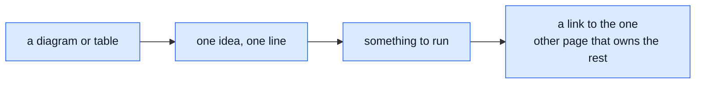
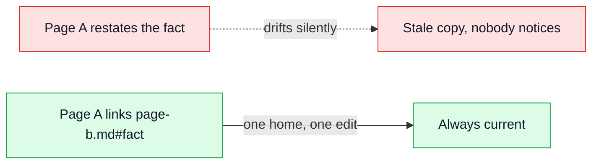

# Writing These Docs

The site calls itself "ADHD-friendly docs" in `docs/.vitepress/config.mts`'s own description. That
claim is a page shape, not a slogan — this is the shape, written down once so the rest of the site
can follow it mechanically instead of by feel.



That loop, repeated per section, is most of this page.

## The rules every page follows

| Rule                             | What it means                                                                                                           |
| -------------------------------- | ----------------------------------------------------------------------------------------------------------------------- |
| One hub per topic                | The hub owns the overview. Its satellites link up to it and never re-explain it.                                        |
| Links go down or sideways        | Down to the detail, sideways as "Read next". A page never restates another page.                                        |
| At most 3 levels                 | Branch, topic, page.                                                                                                    |
| About 300 lines a page           | Past that, a hub plus sub-pages.                                                                                        |
| Front-matter on every page       | `type` and `audience`, below. The home page is the one exemption.                                                       |
| One type per H2                  | A section is a concept, a task, a reference or a troubleshooting. `npm run check` does not judge this; the review does. |
| Visual first                     | A table beats a list, a list beats prose. Mermaid for every flow, process or structure.                                 |
| Images where they explain better | A real screen or a drawn concept. See the placeholder below.                                                            |

## Front-matter

Every page except `docs/index.md` opens with a block that `npm run check` reads:

```yaml
---
type: concept # concept | task | reference | troubleshooting
audience: [developer] # a non-empty list from: staff, owner, developer, architect, operator, anyone
---
```

| `type`            | The reader wants to | Shape                        |
| ----------------- | ------------------- | ---------------------------- |
| `concept`         | understand why      | idea, diagram, trade-offs    |
| `task`            | get something done  | ordered steps, each runnable |
| `reference`       | look something up   | a table, nothing else        |
| `troubleshooting` | fix a symptom       | symptom, cause, fix          |

## Images and placeholders

Where a real screen or a drawn concept explains better than words, leave a placeholder; the image
pass fills it later:

```md
<!-- IMG: what the picture shows · alt text for the reader -->
```

## One template per type

Copy the block for the page's type, then delete what the page does not need.

### Concept

````md
---
type: concept
audience: [developer]
---

# <The idea, as a noun>

<One line: what this is and why a reader would care.>

```mermaid
<the shape of it>
```

## Why it is built this way

| Choice | Why | What it costs |
| ------ | --- | ------------- |

## Read next

- [<the page that goes deeper>](./x.md)
````

### Task

```md
---
type: task
audience: [developer]
---

# <Verb the thing>

<One line: what you will have at the end.>

## Before you start

- <what must already be true>

## Steps

1. <one action, with the command to run>
2. <the check that shows it worked>

## Read next

- [<the page for the next job>](./x.md)
```

### Reference

```md
---
type: reference
audience: [anyone]
---

# <The thing being listed>

<One line: what the table covers and what generates it, if anything.>

| Name | What it is | Where it is defined |
| ---- | ---------- | ------------------- |
```

### Troubleshooting

```md
---
type: troubleshooting
audience: [staff]
---

# <When X happens>

<One line: who this is for.>

| You see | Because | Do this |
| ------- | ------- | ------- |

## Still stuck

- [<the page that owns the area>](./x.md)
```

## The six rules

| Rule                                                 | What it looks like                                                                                             |
| ---------------------------------------------------- | -------------------------------------------------------------------------------------------------------------- |
| A diagram or table before the prose                  | The reader gets the shape before the explanation, not after it                                                 |
| One idea per line, short lines                       | A sentence that needs "and" twice is two sentences                                                             |
| A worked example that can be copy-pasted             | A command, a config block, a curl call — something a reader runs rather than imagines                          |
| A "try it yourself" block, where the subject can run | Not every page has one — a theory page about a trade-off has nothing to run                                    |
| Tables over paragraphs, always                       | If a paragraph is comparing two or more things, it is a table that hasn't been formatted yet                   |
| One home per fact, reached by anchor                 | State a fact once; every other page **links** `<page>.md#anchor` to it rather than restating a shorter version |

## Try it yourself

Take any paragraph in a draft that compares two or more things and turn it into a table:

**Before:**

> Dev bind-mounts the source and has no auth on Mongo; production bakes the image and runs Mongo
> with a scoped app user behind a root account.

**After:**

| Dev                 | Production                                                 |
| ------------------- | ---------------------------------------------------------- |
| Source bind-mounted | Source baked into the image                                |
| Mongo has no auth   | Mongo runs a scoped `readWrite` user behind a root account |

Same facts, and the reader compares columns instead of re-parsing a sentence to find the pairing.

## One home per fact

The rule that keeps a big site from drifting: when two pages would otherwise say the same thing,
one of them says it and the other links to `<page>.md#anchor`. A fact stated twice is a fact that
goes stale in only one of the two places, silently.



Verify a link before shipping it. `npm run docs:build` fails on a dead link between two pages, and
`npm run check` fails on a dead file path (and a `#anchor` on a tracked page)
named in an inline code span.

```bash
npm run check
```

### What the docs-references check sweeps {#what-check-docs-references-sweeps}

`docs:build` already refuses a dead LINK between two pages. Nothing else refuses a dead FACT: a
page naming a top-level routes folder in a repo that is organised by module reads as current
to everyone who has not opened the tree. This is the only check that looks for it.

| Rule                               | Why                                                                                                |
| ---------------------------------- | -------------------------------------------------------------------------------------------------- |
| Inline code spans only             | A fenced block is a code SAMPLE; sweeping it buries real findings in illustration.                 |
| `./`-relative tokens are skipped   | VitePress resolves those against the page, and `docs:build` already fails on a dead one.           |
| Resolution is by suffix            | `orders/model.ts` matches `src/modules/orders/model.ts` without spelling the root path.            |
| A `#anchor` is checked too         | Against that page's own headings, for a page in THIS repo only; the peer's are its own.            |
| Link anchors are checked too       | `[x](../reference/page.md#a)` against VitePress's own slug (`@mdit-vue/shared`), not a copy of it. |
| `@`-prefixed tokens use `tsconfig` | `@modules/orders` is checked; `@asyncapi/cli` matches no alias and is read as an npm package.      |
| Tokens starting with `/` skipped   | HTTP routes, not files. The contract owns those, and `lint:openapi` refuses a missing one.         |
| Directories count as targets       | `src/infrastructure/` resolves without naming a file.                                              |
| The paired repo's name resolves    | Over THERE, which makes citing it by package name instead of directory name a finding.             |
| Code citations are checked too     | A `docs/…md#anchor` in code, tests, configs, root docs, YAML or `.env-example` must resolve.       |
| `npm run <x>` is checked too       | Any page, fenced or inline: `x` must be a script here or in the paired frontend.                   |
| `<!-- doc-paths:ignore -->`        | Skips the whole line, for prose that names an absent path on purpose (a rename table).             |

The code-citation half only asks whether a link is dead (page tracked, anchor a heading, same
slugger); a peer repo's page, a URL and a `../` path are left alone. It checks nothing else.

The sweep has floors: one that silently reads zero pages would report a clean tree forever, which
is worse than no sweep.

## Bringing an old page up to this standard

Over a hundred pages predate these rules, and a hundred-page rewrite is exactly the push this page
warns against: a single sitting produces a hundred pages nobody re-read. So it is a trickle, and
the trigger is deliberately not a schedule:

> **You touched a module for another reason. Fix its doc page in the same sitting.**

That way the page is reworked by whoever has the code fresh in their head, and the work rides along
with a change that was happening anyway. This item is never "done" — only ever "next page off the
list."

## What this page is not

**Advisory, not enforced.** No linter checks a page's shape, on purpose: a rule that penalises a
too-prose paragraph polices the author, not a real defect, and the two pages this site trusts most
(`understand/clustering.md`, `understand/modules.md`) earn that trust by following these rules well, not by
passing a check. Judgement stays with whoever writes the page.

## Exemplars to copy

| Page                                                 | Diagrams | Why it works                                                         |
| ---------------------------------------------------- | -------- | -------------------------------------------------------------------- |
| [Clustering & Shutdown](../understand/clustering.md) | 3        | The model for a SMALL page: diagram → env table → diagram → sequence |
| [Modules](../understand/modules.md)                  | 7        | The model for a LONG page                                            |
| [Tactical DDD](../understand/tactical-ddd.md)        | 11       | Concept-heavy material kept visual throughout                        |
| [Mutation Testing](mutation-testing.md)              | 9        | The most worked, copy-pasteable examples in the repo                 |

## Where to go next

| You want to                            | Read                                   |
| -------------------------------------- | -------------------------------------- |
| See the file glossary these docs index | [File Glossary](../reference/start.md) |
| Write a code comment                   | [Code comments](./code-comments.md)    |
| Check the file paths the docs name     | `npm run check`                        |
