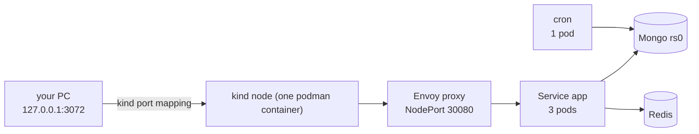

# Kubernetes testing

`npm run k8s:rig -- up | drill | down` — a real one-node Kubernetes on your own machine, to watch the app
roll over three copies for real: probes, the grace period, the Service's endpoints and a live
stream moving between pods. This page is the setup, step by step, with the reason for each step.
The automated cousin, which needs none of this, is [Replicas testing](./replicas-testing.md).



## What it is, and what it is not

| It is                                               | It is not                                                     |
| --------------------------------------------------- | ------------------------------------------------------------- |
| kind (Kubernetes in a container) on rootless podman | A deployment target: the manifests in `k8s/base` are a start  |
| The proof that a rolling restart drops no request   | Part of `npm run complete` or CI: it takes minutes and ~3 GB  |
| `k8s/base` + `k8s/overlays/kind` (Kustomize)        | Multi-node, TLS, autoscaling, a Helm chart or a managed Mongo |

## Set it up once

Each step says why, so you can tell which ones your machine needs.

| #   | Step                                                 | Why                                                                                                                                                                                                                                                                                                                  |
| --- | ---------------------------------------------------- | -------------------------------------------------------------------------------------------------------------------------------------------------------------------------------------------------------------------------------------------------------------------------------------------------------------------- |
| 1   | `sudo pacman -S kind` (or kind's release binary)     | kind is the Kubernetes project's own local-cluster tool. Fully open source. It needs `kubectl` too, which you already have for Kustomize.                                                                                                                                                                            |
| 2   | `export KIND_EXPERIMENTAL_PROVIDER=podman`           | kind guesses Docker. Here `docker` is a podman shim, and kind then fails with **"requires setting systemd property Delegate=yes"**, which is misleading: nothing is wrong with cgroups. With the variable set the same command works. `k8s/rig.sh` exports it itself; you need it only for your own `kind` commands. |
| 3   | Pin the node image (`kindest/node:v1.35.8@sha256:…`) | kind 0.33 defaults to a Kubernetes **1.37** node; `kubectl` supports one minor of skew, and yours is 1.35. The pin lives in `k8s/overlays/kind/kind-cluster.yaml`, digest included.                                                                                                                                  |
| 4   | `k8s/rig.sh up`                                      | Builds the runtime image, creates the cluster, installs the Gateway controller, deploys, and waits until `/readyz` answers through the host port.                                                                                                                                                                    |

That was all this machine needed (kind 0.33.0, podman 6.1, cgroup v2, systemd 261, rootless, netavark).
Steps 1 and 2 are the only ones that changed anything. The three below are **fallbacks from kind's own
guide**, in the order to try them, each keyed to the symptom that calls for it. None was needed here.

| Symptom                                            | Cause and fix                                                                                                                                                                                                                                                                                    |
| -------------------------------------------------- | ------------------------------------------------------------------------------------------------------------------------------------------------------------------------------------------------------------------------------------------------------------------------------------------------ |
| Node starts, then `iptables` or `ip6tables` errors | A rootless container cannot load kernel modules, and a fresh node may pick the legacy iptables. Load them once as root: `printf 'ip6_tables\nip6table_nat\nip_tables\niptable_nat\n' \| sudo tee /etc/modules-load.d/iptables.conf`, then `sudo systemctl restart systemd-modules-load.service`. |
| Processes fail to fork inside the node             | Podman's default pid limit is too low for a node. In podman's user config file (containers.conf, under ~/.config/containers) set `[containers]` `pids_limit = 65536`.                                                                                                                            |
| A real cgroup error, with the variable set         | Delegation. First without root: `systemd-run --scope --user -p "Delegate=yes" kind create cluster …`. Then the root fix: a systemd drop-in named delegate.conf under user@.service.d with `[Service]` `Delegate=yes`, `systemctl daemon-reload`, log out and in.                                 |
| `kind create` waits forever for a log line         | Add `log_driver = "k8s-file"` **inside the same `[containers]` block** of podman's containers.conf. A second `[containers]` header breaks the file.                                                                                                                                              |

::: warning zsh and pasted comments
Paste commands without their `# comment` tail. In zsh a `#` is not a comment at an interactive prompt unless
`interactive_comments` is set, so a pasted `kind create … # note` hands `#` and the words after it to the command
as patterns.
:::

[kind quick start](https://kind.sigs.k8s.io/docs/user/quick-start/) · [kind on rootless providers](https://kind.sigs.k8s.io/docs/user/rootless/) ·
[Kubernetes: kubectl version skew](https://kubernetes.io/releases/version-skew-policy/#kubectl)

## Run it

```sh
npm run k8s:rig -- run                                           # up, drill, then down however it ends
npm run k8s:rig -- up                                                # or step by step, by hand
```

| Command               | What it does                                                                                                                                                                        |
| --------------------- | ----------------------------------------------------------------------------------------------------------------------------------------------------------------------------------- |
| `up`                  | Builds `localhost/boilerplate-app:rig`, `podman save`s it into the node (`kind load image-archive`), makes random secrets, applies the data tier and `setup`, then `app` and `cron` |
| `run`                 | `up`, `drill`, then `down` through an exit trap: the cluster is deleted after a failed step or a Ctrl-C                                                                             |
| `drill`               | A rolling restart under steady traffic, then a stream across pods (below)                                                                                                           |
| `down`                | Deletes the cluster and `tmp/k8s-rig`. Leaves nothing in `podman ps -a`                                                                                                             |
| `K8S_RIG_PORT=3099 …` | A different host port. Default `3072`, inside this repo's block ([ports](./pairing-and-ports.md#host-port-map))                                                                     |

**The rig keeps its own kubeconfig** (`tmp/k8s-rig/kubeconfig`) and every `kubectl` also names
`--context kind-boilerplate-rig`. `kind create` would otherwise add the context to `~/.kube/config` and make it
the current one, and a later `kubectl apply` meant for another cluster would land here, or the reverse.
To poke at the cluster yourself: `kubectl --kubeconfig tmp/k8s-rig/kubeconfig --context kind-boilerplate-rig -n boilerplate get pods`.

## What `up` deploys, and why in this order

| Object                | Notes                                                                                                              |
| --------------------- | ------------------------------------------------------------------------------------------------------------------ |
| Mongo `StatefulSet`   | `--replSet rs0`, one member; a Job initiates it. Transactions need a replica set. No TLS and no auth on the rig    |
| Redis `Deployment`    | `noeviction`, one instance for both Redis URLs                                                                     |
| `setup` Job           | Indexes and the access bootstrap, once, **before** the app: compose's `depends_on: service_completed_successfully` |
| `app` × 3 + `Service` | The probes, grace period and hardening are commented in `k8s/base/app.yaml`                                        |
| `cron` × 1            | supercronic, `Recreate`, the crontab generated into `k8s/base/crontab` by `npm run regenerate`                     |
| Envoy Gateway         | The pinned release, checked against a sha256 in `rig.sh`; its proxy Service is a NodePort mapped to the host       |

The order is two `kubectl apply -k` calls split by the `boilerplate/stage` label, with a wait for `setup` between them.
Applying everything at once starts `app` against a database that has no indexes yet.

Why Gateway API and not Ingress: ingress-nginx is retired
([Kubernetes blog](https://kubernetes.io/blog/2025/11/11/ingress-nginx-retirement/)); Gateway API is the successor
standard. The Gateway objects are a Kustomize **component** (`k8s/components/gateway`), so `k8s/base` still applies on
a cluster that has no Gateway API CRDs.

::: tip The rig never waits on the Gateway's `Programmed` condition
It needs a load balancer address, and rootless kind has none. The rig waits for Envoy's Deployment and for a real
`GET /readyz` through the host port instead. cloud-provider-kind, which would supply an address, stays out.
:::

## The drill

`k8s/drill.ts`, run by `k8s/rig.sh drill`. It reuses the replicas suite's client and stream reader.

| Check                                                                            | How                                                                                                 |
| -------------------------------------------------------------------------------- | --------------------------------------------------------------------------------------------------- |
| No request fails during `kubectl rollout restart deployment/app`                 | Four loaders hit `GET /` through the edge: every answer 2xx, no reset connection                    |
| Old pods exit 0 inside the grace period, no `Graceful shutdown timeout` log line | A pod watch records each container's exit code; a `logs -f` per old pod is searched                 |
| Each old pod leaves the ready endpoints before it stops                          | EndpointSlices are sampled every 250 ms: the gap from "not ready" to exit must be at least a second |
| A stream held on an old pod gets the drain `retry:`                              | `kubectl port-forward pod/A` pins the stream to one pod                                             |
| A frame caused on one new pod reaches a stream held on another                   | Stream via `port-forward pod/C`, `POST /notifications/read-all` via `port-forward pod/D`            |

The two pods are picked by name because the frame names no pod: only a port-forward guarantees "another pod".
Signup works with an SMTP host and no broker (the mail falls back inline), so the rig needs no Mailpit.

## What the first run showed

Measured on the rig (one node, three `app` pods), not guessed:

| Finding                                                                                           | Where it is used                                                                                 |
| ------------------------------------------------------------------------------------------------- | ------------------------------------------------------------------------------------------------ |
| 5302 requests across a rolling restart, **0** non-2xx: Envoy drops a draining pod in time         | `readinessProbe` every 2 s, failing on the first miss, and the 5 s lame-duck delay               |
| An old pod leaves the ready endpoints 12–14 s before its container exits                          | Delay (5 s) plus the drain; well inside the 30 s grace period                                    |
| `app` holds ~563 MB steady and ~676 MB at peak, with the heap capped at 384 MB                    | Limit 1Gi and heap cap 640 (512Mi is OOMKilled at boot): `tsx` keeps the transpiled module graph |
| `cron` needs far more than one process: each job is its own `node` process, several fire together | Limit 4Gi; 1Gi was OOMKilled within minutes                                                      |
| `NODE_URL` and the CORS origin follow the host port                                               | The `edge-env` ConfigMap, written by `rig.sh` from `K8S_RIG_PORT`                                |

## Undo it

| What                                 | How                                                                                     |
| ------------------------------------ | --------------------------------------------------------------------------------------- |
| The cluster                          | `k8s/rig.sh down` (or `kind delete cluster --name boilerplate-rig`)                     |
| The image                            | `podman rmi localhost/boilerplate-app:rig`                                              |
| The node image                       | `podman rmi docker.io/kindest/node` (about 1 GB)                                        |
| The fallback files, if you made them | iptables.conf under modules-load.d, podman's containers.conf, the delegate.conf drop-in |
| kind itself                          | `sudo pacman -R kind`                                                                   |

## Read next

- [Replicas testing](./replicas-testing.md): the same rules, automated, with no cluster
- [Kubernetes](../operate/ways-to-deploy/kubernetes.md): the manifests as a starting point
- [Health checks](../operate/health-checks.md): the probes and the shutdown order
- [Scaling](../understand/scaling.md)
