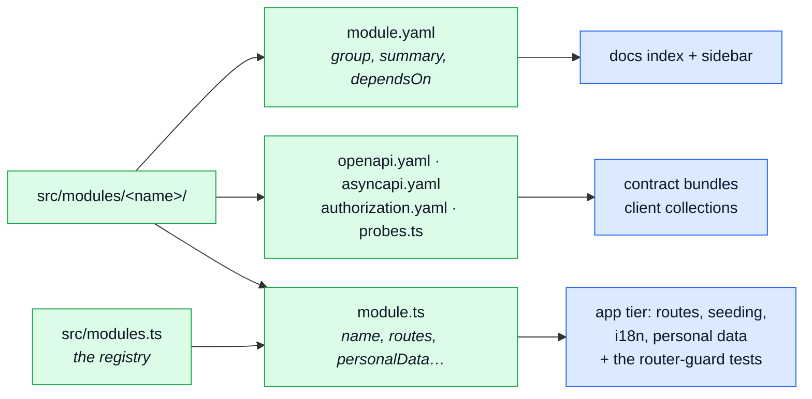
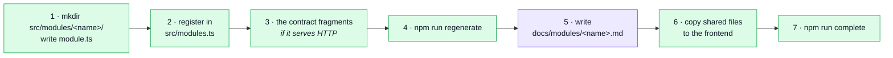

# Adding & removing a module

The procedure, in order, with the commands. [Modules](../understand/modules.md) is the reasoning behind the
shape; this page is what you actually type.

Both halves are the same claim read in two directions:

> A domain is one folder plus its registration in `src/modules.ts` (the import, the `enabledModules`
> entry and the `ModuleName` member), and at most three hand-kept lists
> ([the central edits](module-scaffolder.md#the-central-edits)). Adding it costs a folder and those; removing it
> costs `rm -rf` and deleting it. Anything else that breaks is **real coupling**, and seeing it is the
> point.

That claim is not aspirational — the cost of one real addition is recorded below, honestly,
including the parts beyond the registration.

## The one registry, and everything that reads from the folder

A module is named in exactly one place that decides whether it exists: `enabledModules` in
`src/modules.ts`. Everything else a module has to say about itself sits in its own folder, and the
tables built from it read it from there.



| What a module declares          | Read by                                                                       |
| ------------------------------- | ----------------------------------------------------------------------------- |
| `module.yaml#group`, `summary`  | the docs index and the `/modules/` sidebar (`scripts/docs/module-catalog.ts`) |
| `openapi.yaml` (paths and tags) | the root contract, completed by `scripts/contracts/root-assembly.ts`          |
| `probes.ts`                     | the client collections, loaded by directory scan                              |
| `module.ts#routes`              | the router-guard tests, through `enabledModules`                              |

Three order lists remain, and they are a PREFERENCE, not a registry:

| List                 | File                                        | What it decides                                                       |
| -------------------- | ------------------------------------------- | --------------------------------------------------------------------- |
| `MODULE_ORDER`       | `scripts/contracts/openapi-bundle.ts`       | order only — where its paths sit in the OpenAPI bundle                |
| `MODULE_ASYNC_ORDER` | `scripts/contracts/asyncapi-bundles.ts`     | order only — where its channels sit in the AsyncAPI bundle            |
| `PREFERRED_ORDER`    | `scripts/contracts/authorization-bundle.ts` | order only — where its rules and sets sit in the authorization bundle |

MEMBERSHIP is discovered from disk: a module folder either ships an `openapi.yaml` /
`asyncapi.yaml` / `authorization.yaml` or it doesn't, and `scripts/contracts/section-order.ts` puts
the discovered ones in the listed order, drops a listed module whose folder is gone, and appends
one the list has never heard of in alphabetical order. The root OpenAPI document is treated the
same way: `shared/contracts/openapi.root.yaml` keeps one `$ref` per module path in the order the
bundle has always had, and `assembleRoot` drops the entries of a module that is gone and appends
the paths and tags of one it has not seen. So neither adding nor removing a module needs an edit
to any of them — an edit only moves where the module sits, and the bundles of a full checkout keep
their historical order byte for byte.

An `asyncapi.internal.yaml` (a queue nothing outside this service reaches) and whether a module's
public `asyncapi.yaml` is frontend-visible are both fully automatic — see step 3 below — so neither
needs a registry entry at all.

An `analytics.ts` needs no entry anywhere: `tests/cross-cutting/analytics-events.test.ts` sweeps the
module folders for one.

A library exactly one module imports is that module's too, though it needs no entry anywhere:
[Package Dependencies](../reference/package-dependencies.md) derives ownership straight from the
import graph. Adding one means running the [vetting rules](dependency-vetting.md) first
and writing a `## Libraries` section on the module's own page; removing the module removes the
library from `package.json` in the same change, once nothing else has started importing it. See
[Libraries a module owns](../understand/modules.md#libraries-a-module-owns).

A module's demo records live in `scenarios/<name>.ts`, which exports a `shopModule`.
`npm run regenerate` discovers those files into `scenarios/shop-modules.generated.ts`, so
there is no hand-kept list of these four: a module need not have demo data at all, and deleting the
file removes its entry. A `shopModules` key naming a module `enabledModules` does not mount is a
compile error (`ShopModulesAreMounted` in `scenarios/check.ts`). What the API
actually answers for a seeded row is not published anywhere; it is checked directly, against a
real database, by `tests/integration/scenarios/shop.test.ts`.

Nothing else enumerates domains. Route mounting, the seeder, the i18n boot, the audit vocabulary and
the metrics registry all walk the registry instead — which is why none of them appears in either
checklist.

What still names modules by hand, and why it is not a table a new module edits (the data export's
schema is not one: each module declares its own section as `x-personal-data` in its `openapi.yaml`,
and the bundler assembles `AccountExportResponse` from them):

- **Role grants** in `shared/rules/authorization-roles.yaml`. The cases in
  `shared/cases/authorization.cases.yaml` name a role, never its rules. A module that introduces permission rules decides which
  roles list its sets; the rules and sets themselves live in the module's own `authorization.yaml`.
- **`WRITE_EXCEPTIONS`** in `tests/cross-cutting/write-routes-are-guarded.test.ts`, only for a
  module whose write route deliberately needs no permission rule. A module whose writes all sit
  behind `requirePermission` adds nothing.

---

## Adding a module

::: tip Steps 1 to 5 can be generated
`npm run scaffold:module -- <name>` writes the folder, the contract fragment, the permission rules and set,
the smoke tests, the docs page and the registry edits, then regenerates. It also makes the three
edits outside the folder that a keyed module still needs (the registry `src/modules.ts`, the admin role
list in `shared/rules/authorization-roles.yaml`, the PUT/PATCH parity canary). [Module scaffolder](module-scaffolder.md) has the
flow; the steps below are what it automates, and what you do by hand for a module of another shape.
:::



### 1 · The folder

At minimum a `module.ts` and a `module.yaml`. Everything else is the domain's own business — add a
file when the domain needs it, not because the table has a row for it.

```
src/modules/<name>/
    module.ts                      the manifest — the only file src/modules.ts imports
    module.yaml                    always — group, summary, subdomain, siblings it may reach; see strategic-ddd.md §2
    routes.ts                      if it serves HTTP
    controllers/*.ts               ditto
    service.ts                     if it has behaviour
    services/                      instead of service.ts, once one file stops being readable
    repository.ts · model.ts       if it owns a collection
    domain/                        if it has rules worth proving without a database
    providers/                     if it owns an outbound port — see payments/
    index.ts                       always — the convenience barrel, see strategic-ddd.md §5
    locales/{en,it,es}.json        if it produces user-facing text
    audit.ts · metrics.ts          if it records actions or numbers
    events.ts · emails.ts          if it publishes events or sends mail
    openapi.yaml                   its standalone slice of the REST contract
    asyncapi.yaml                  the same, if it owns a channel
    probes.ts                      the requests a spec cannot describe
    analytics.ts                   the event names it emits
    factories.ts                   how its test/demo records are built
    tests/unit/ · tests/contract/  co-located, deleted with the module

scenarios/<name>.ts                its demo records — outside src/, see build/demo-profile.md
```

Everything at that root is a layer or a self-registering slot; everything that is a **subject**
is a folder named for it. That is the rule, and it is what decides where a new file goes when the
list above has no row for it. `openapi.yaml` and `probes.ts` are the contract slice this module
owns; [Contract Ownership & Fragmentation](contract-fragmentation.md) is what reads them.

::: tip The module to copy is `example`
Start from `src/modules/example` ([the module template](../understand/modules.md#the-module-template)), not from
a shop module. It is `group: example` (`npm run demo:remove` deletes it with the shop, since it is mounted in
production — copy it first), and it depends only on `users`. It carries a public route above a gate, guarded writes with an own-rows rule and a staff one, a
status lifecycle, a rate-limit budget, locales, a mail template, a personal-data section with an
export and an erasure, an audit vocabulary and a contract slice, and it shows each optional
capability in its own files. It has no page of its own on purpose, so there is nothing to keep in
step with the code. A copy of a shop module starts life with a dependency on the shop that the
foundation may not have.
:::

A new `package.json` dependency this module alone needs is this module's, the moment nothing else
imports it — no registry entry, just the vetting rules and a `## Libraries` section on the
module's page. See [Libraries a module owns](../understand/modules.md#libraries-a-module-owns).

**A config line outside the module is still the module's.** A compose service only it needs, an `.env-example` variable nothing else reads — none of
these can live under `src/modules/<name>/`, but deleting the module should still mean deleting
them. Wherever the file format allows a comment, that line carries:

```
# WARNING: owned by the <name> module — delete it when removing the module (docs/modules/<name>.md)
```

A module's scheduled jobs are the exception to the exception: they are declared on its manifest
(`jobs`), and `npm run regenerate` writes `docker/crontab`
from them, so there is no line to remember to delete. `tests/cross-cutting/scheduled-jobs.test.ts`
holds the declarations to their rules, and `npm run check` holds the generated files to them.
See `sweep:webhook-retries` (`src/modules/webhooks/jobs.ts`) for the pattern.

The manifest is the whole contract between the domain and the application:

```ts
// src/modules/tasks/module.ts (abridged)
import path from 'node:path';
import type { AppModule } from '@kernel/registry';
import { router } from './routes';

/**
 * Contact requests: anyone may file one, admins read and triage them. Records an email address
 * rather than referencing a user, since the form is open to people with no account. A leaf in
 * both directions.
 */
export default {
    name: 'tasks',
    mounts: [{ basePath: '/tasks', routes: router }],
    // REQUIRED, not optional — a module cannot compile without answering this. 'none' is the
    // explicit, reviewed answer for a module with nothing personal to export.
    personalData: [{ section: 'tasks', collect: (subject) => findOwnTasksForExport(subject) }],
    locales: path.join(__dirname, 'locales')
} satisfies AppModule;
```

Every field here is read by something at boot — that is the bar for adding one. What the module
reaches for is its `import` statements, and how it reaches is the docblock above the manifest, in
prose, where a reader meets both at once. Write that docblock while you still remember why you drew
the boundary: the question is easiest to answer now and hardest once the module is six months old.
See [Strategic DDD](../understand/strategic-ddd.md) for the four kinds of relationship worth naming in it.

::: tip A domain with no URL is a first-class module
Omit `mounts` entirely and you get a headless module — `access` is one.
`AppModule` is a plain interface, and `app/routes.ts` mounts only what a module lists in `mounts`, so a
module with none is skipped rather than reported.
:::

### 2 · The registration

```ts
// src/modules.ts
import tasks from './modules/tasks/module';

export const enabledModules: AppModule[] = [account, auditLogs, cart /* … */, tasks];

export type ModuleName = 'account' | 'audit-logs' | 'cart' /* … */ | 'tasks';
```

The third edit is the `ModuleName` member: a table keyed on `ModuleName` (`scenarios/shop-modules.ts`)
refuses a name no module carries, so a module left out of the union is a false type error later.
Keep the array and the union alphabetical. Order only decides route-mounting sequence, which is irrelevant for
distinct base paths, so alphabetical keeps diffs boring.

**Stop here if the domain serves no HTTP.** It is mounted, seeded, translated, audited and measured
already — nothing below applies.

### 3 · The fragments

Write `openapi.yaml`; its paths and tags reach the root contract by themselves
(`scripts/contracts/root-assembly.ts`). A line in `MODULE_ORDER` is optional —
it only chooses where the paths sit; without one the module is appended alphabetically. The same
goes for `MODULE_ASYNC_ORDER` if you wrote a top-level `asyncapi.yaml` (not `asyncapi.internal.yaml`
— see below). An `analytics.ts` needs no entry anywhere — the name is swept off disk. A
`scenarios/<name>.ts`, if the domain has demo data, is found by `npm run regenerate`, which
writes `scenarios/shop-modules.generated.ts` — the rows themselves are produced by seeding the
catalogue and driving the real endpoints at boot, not assembled from a committed list.

Whether the channels reach a browser is a naming choice, not a registry entry: `asyncapi.yaml` IS
the module's public event catalogue — an SSE stream, a websocket — and lands in `asyncapi.public.yaml`,
copied to the paired frontend. `asyncapi.internal.yaml` is a queue crossing a broker the frontend
cannot open, and never leaves this bundle. A domain can own either, both, or neither.

A module that fires a public webhook adds `asyncapi.webhooks.yaml` (a fragment of the `webhooks`
section, merged only while `webhooks` exists) and a `publicEvents` entry on its manifest; `example`
is the one to copy.

A listed order entry with no fragment on disk is ignored, and a fragment on disk with no entry is
appended — neither fails the bundle, because membership is what is on disk. The same goes for a
`probes.ts`: the client collections find it by scanning the module folders.

### 4 · Bundle

```bash
npm run regenerate -- --no-sync   # bundles, generated client and schemas, every generated doc block
npm run lint:openapi              # spectral
```

`contracts:bundle` bundles the contract documents and stops there. The client collections are
generated and `.gitignore`d, so they are opt-in:

```bash
npm run contracts:bundle -- bruno
```

`contract.bruno.yml` lands at the repo root, untracked, built from the committed
`openapi.yaml` and `scenarios/subjects.ts`'s example ids. They are generated and never hand-edited —
a request the contract cannot describe belongs in that module's `probes.ts`.

### 5 · The page

Write `docs/modules/<name>.md` by hand. Nothing generates it, and the shape every existing page
follows is three parts:

- the **At a glance** box — what it owns, what it depends on, what breaks if you change it
- **The story** — why the domain exists, the decisions that are not obvious from the code, the traps
- **Related pages** — the siblings and the horizontal pages a reader will want next

The code comes from `example`, which has no page by design (its file headers carry the explanation).
Copy the page of a module shaped like yours instead — [`tasks`'s](../modules/tasks.md) is a good model — and
replace it. Do not
restate what the code already says — the routes are in `src/modules/<name>/routes.ts` and
`openapi.yaml`, the fields are in `model.ts`, and a page repeating either goes stale the first time
someone edits the source and not the prose. A module page owns the DECISION; the mechanism belongs
to a page under [Tools](../understand/tool-map.md) or [Theory](../understand/start.md).

Then fill in the descriptor the page is listed from — no other registration:

- `summary` and `group` in `module.yaml` put the module in the index and the `/modules/` sidebar,
  under Foundation or Demo shop

If the domain carries a file shape no other module has, give it a row in
[`docs/reference/src-modules.md`](../reference/src-modules.md) so the vocabulary stays written
down.

### 6 · The paired repo

`openapi.yaml` and the other shared bundles are byte-identical across the two repos. Copy them over
and run the identity gate on both sides:

```bash
npm run check
```

A red `spec-identity` after adding a domain is **correct** — it is the gate saying the frontend has
not received the regenerated files yet. See [the shared contract](./module-removal.md#the-shared-contract-in-both-directions).

### 7 · Check

```bash
npm run complete
```

### What it actually cost

`wishlist`, measured at its addition, with the section-order entries and docs registrations since
made optional or automatic:

|                                                  |                                                            |
| ------------------------------------------------ | ---------------------------------------------------------- |
| files added                                      | one folder                                                 |
| lines changed elsewhere                          | 1 in `src/modules.ts` + its section-order entries          |
| documentation written by hand                    | two sections of one page — the rest is generated           |
| existing files needing an edit to accommodate it | **0**                                                      |
| generated unasked                                | the bundles; the client collections when asked for by name |

---

## Removing a module

Moved to [Removing a module](./module-removal.md#removing-a-module).

## Re-running the deletability check {#re-running-the-deletability-check}

Moved to [Re-running the deletability check](./module-removal.md#re-running-the-deletability-check).

## Read next

- [Removing a module](./module-removal.md)

- [Modules](../understand/modules.md) — why the shape is what it is
- [Layers](../understand/layers.md) — the layer stack inside one module
- [Contract Ownership & Fragmentation](contract-fragmentation.md) — how fragments become bundles
- [Modules overview](../modules/start.md) — the module pages this procedure adds to and removes from
