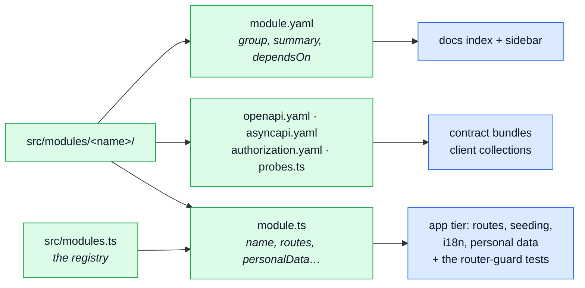

# The module registry

Part of [Adding & removing a module](./module-lifecycle.md): the one folder-driven registry and everything that reads from it.

## The one registry, and everything that reads from the folder

A module is named in exactly one place that decides whether it exists: `enabledModules` in
`src/modules.ts`. Everything else a module has to say about itself sits in its own folder, and the
tables built from it read it from there.

| What a module declares          | Read by                                                                       |
| ------------------------------- | ----------------------------------------------------------------------------- |
| `module.yaml#group`, `summary`  | the docs index and the `/modules/` sidebar (`scripts/docs/module-catalog.ts`) |
| `openapi.yaml` (paths and tags) | the root contract, completed by `scripts/contracts/root-assembly.ts`          |
| `probes.ts`                     | the client collections, loaded by directory scan                              |
| `module.ts#routes`              | the router-guard tests, through `enabledModules`                              |

Three order lists remain, and they are a PREFERENCE, not a registry:

| List                 | File                                        | What it decides                                                       |
| -------------------- | ------------------------------------------- | --------------------------------------------------------------------- |
| `MODULE_ORDER`       | `scripts/contracts/openapi-bundle.ts`       | order only — where its paths sit in the OpenAPI bundle                |
| `MODULE_ASYNC_ORDER` | `scripts/contracts/asyncapi-bundles.ts`     | order only — where its channels sit in the AsyncAPI bundle            |
| `PREFERRED_ORDER`    | `scripts/contracts/authorization-bundle.ts` | order only — where its rules and sets sit in the authorization bundle |

MEMBERSHIP is discovered from disk: a module folder either ships an `openapi.yaml` /
`asyncapi.yaml` / `authorization.yaml` or it doesn't, and `scripts/contracts/section-order.ts` puts
the discovered ones in the listed order, drops a listed module whose folder is gone, and appends
one the list has never heard of in alphabetical order. The root OpenAPI document is treated the
same way: `shared/contracts/openapi.root.yaml` keeps one `$ref` per module path in the order the
bundle has always had, and `assembleRoot` drops the entries of a module that is gone and appends
the paths and tags of one it has not seen. So neither adding nor removing a module needs an edit
to any of them — an edit only moves where the module sits, and the bundles of a full checkout keep
their historical order byte for byte.

An `asyncapi.internal.yaml` (a queue nothing outside this service reaches) and whether a module's
public `asyncapi.yaml` is frontend-visible are both fully automatic — see step 3 below — so neither
needs a registry entry at all.

An `analytics.ts` needs no entry anywhere: `tests/cross-cutting/analytics-events.test.ts` sweeps the
module folders for one.

A library exactly one module imports is that module's too, though it needs no entry anywhere:
[Package Dependencies](../reference/package-dependencies.md) derives ownership straight from the
import graph. Adding one means running the [vetting rules](dependency-vetting.md) first
and writing a `## Libraries` section on the module's own page; removing the module removes the
library from `package.json` in the same change, once nothing else has started importing it. See
[Libraries a module owns](../understand/modules.md#libraries-a-module-owns).

A module's demo records live in `scenarios/<name>.ts`, which exports a `shopModule`.
`npm run regenerate` discovers those files into `scenarios/shop-modules.generated.ts`, so
there is no hand-kept list of these four: a module need not have demo data at all, and deleting the
file removes its entry. A `shopModules` key naming a module `enabledModules` does not mount is a
compile error (`ShopModulesAreMounted` in `scenarios/check.ts`). What the API
actually answers for a seeded row is not published anywhere; it is checked directly, against a
real database, by `tests/integration/scenarios/shop.test.ts`.

Nothing else enumerates domains. Route mounting, the seeder, the i18n boot, the audit vocabulary and
the metrics registry all walk the registry instead — which is why none of them appears in either
checklist.

What still names modules by hand, and why it is not a table a new module edits (the data export's
schema is not one: each module declares its own section as `x-personal-data` in its `openapi.yaml`,
and the bundler assembles `AccountExportResponse` from them):

- **Role grants** in `shared/rules/authorization-roles.yaml`. The cases in
  `shared/cases/authorization.cases.yaml` name a role, never its rules. A module that introduces permission rules decides which
  roles list its sets; the rules and sets themselves live in the module's own `authorization.yaml`.
- **`WRITE_EXCEPTIONS`** in `tests/cross-cutting/write-routes-are-guarded.test.ts`, only for a
  module whose write route deliberately needs no permission rule. A module whose writes all sit
  behind `requirePermission` adds nothing.

---

## Read next

- [Adding & removing a module](./module-lifecycle.md)
