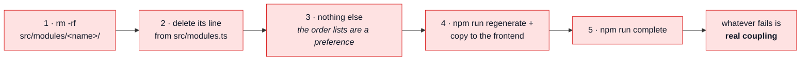
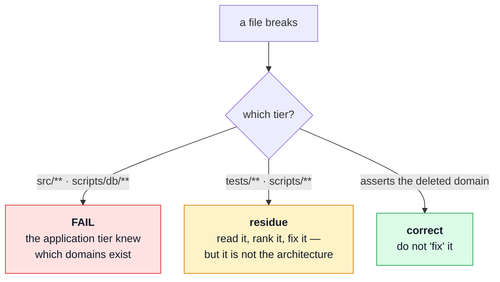
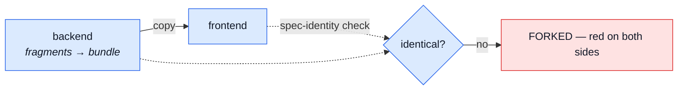

# Remove a module

The other half of [Adding & removing a module](./module-lifecycle.md): delete the folder, re-bundle, read the failures.

## Before you start

- The module is not one another module depends on: `npm run check` names every dependant (step 6).
- A clean tree, so the failures you read are only this removal's.

## Steps {#removing-a-module}



### 1–3 · Delete the folder and the registration

```bash
rm -rf src/modules/<name>
# delete the import, the array entry and the ModuleName member in src/modules.ts
```

Its paths leave the contract, its probes leave the collections and its `module.yaml` entries leave
the docs with the folder — each is read from disk.

Deleting a module another one imports stops `tsc` on the importing file, naming the line. Either
delete the dependant too, or drop the import.

`tsc` also stops on a `scripts/ops/` script that runs the module — delete the script itself to fix it.
From there the chain flags the rest step by step rather than needing to be walked by hand:
`tests/cross-cutting/scheduled-jobs.test.ts` fails the `package.json` entry that named the
now-deleted script, and once that entry is gone too, the same test fails the `docker/crontab` line
that named IT.

A module that owns more outside `src/modules/` lists it on its own page — see
[webhooks](../modules/webhooks.md#not-wanted-remove-the-module).

Drop any `package.json` dependency this module owned alone too — [Package
Dependencies](../reference/package-dependencies.md), regenerated, shows which; a leftover reads as
still owned by a module that no longer exists.

### 4 · The page

```bash
rm docs/modules/<name>.md
# and any sub-pages it had, e.g. docs/modules/<name>-<flow>.md
```

Its index entry, its sidebar entry and its pairing statement all lived in its own `module.yaml`,
which went with the folder, so there is nothing to un-register. Deleting the page itself is still a
step you do by hand; nothing currently refuses a leftover one.

### 5 · Re-bundle and mirror

```bash
npm run contracts:bundle
npm run lint:openapi
```

Spectral will report `oas3-unused-component` **warnings** for shared components in
`shared/contracts/` whose only referrers are gone. Warnings, not errors, and correct as far as the
tool can see — but they are the thing the next deletion trips over, so prune them while you know
which domain they belonged to.

Then copy the shared bundles to the frontend.

### 6 · Read the failures — they are not all equal

This is the part that makes the exercise worth running. Classify every failure by **which tier it
is in**, because only one tier is a verdict on the architecture:



**A break in `src/**`or`scripts/db/**` is the only real failure.** It means something in the application
tier named a domain, and that is the thing the four tiers exist to prevent.

Breaks under `tests/**` and `scripts/**` are residue. They are worth fixing, but they do not
invalidate the claim — and some of them are **supposed** to break:

| Break                                                             | Verdict                                                                                   |
| ----------------------------------------------------------------- | ----------------------------------------------------------------------------------------- |
| an integration test asserting a race between two deleted modules  | correct — no modules, no race                                                             |
| `spec-identity` reporting the shared bundles as forked            | correct — deleting a domain **is** a two-repo change, and this is it saying so            |
| a sweep canary whose floor was calibrated to a fixed module count | residue — compare the sweep against the disk instead, see [What it finds](#what-it-finds) |
| a central spec importing the deleted module                       | residue — the spec used a domain as sample data                                           |

### What `demo:remove` does about the residue

`npm run demo:remove` (via `removeModules` in `scripts/scaffold/demo-remove-modules.ts`) takes the mechanical share of the residue out itself:

- **A test that imports a removed module is deleted**, and so is every test that imports one of
  those — `tests/support` helpers included. A test may also say `// requires-module: a, b` on a line
  of its own when it drives the kernel through a module's subjects without importing it
  (`tests/support/checkout-as.ts` does this for `cart`: it posts to the route without importing it).
- **The shared authorization files lose the module's keys.** `shared/rules/authorization-roles.yaml` drops
  the grants, and `shared/cases/authorization.cases.yaml` drops every case about a subject only that
  module declared.
- **The alert rules on the module's own metrics go**, with their `promtool` cases
  (`docker/observability/prometheus.alert-rules*.yaml`). A metric is the module's when only its
  folder registers it.
- **The shared validation labels only its fields used go** (`validation.attributes` in
  `shared/locales/*.json`): a field its contract names that no surviving request carries.
- **The scenario files go with it**: `scenarios/<name>.ts` (its fixtures),
  `scenarios/values/<name>.ts` (its example values for the generated client collections) and
  `scenarios/support/doubles/<name>/`. Nothing is edited to unlist them — the registries that
  collected them are generated from the files on disk, see
  [the scenario registries](demo-profile.md#the-scenario-registries-are-generated).

Writing a test that survives this is one rule: **a test that needs a module to say something says so
in its imports, and a foundation test never borrows one as sample data.** A test about a foundation
module that also has shop cases keeps those cases in a file of their own (`shop.contract.test.ts`,
`checkout.test.ts`), so the strip removes exactly them. A sweep with an exact expected set filters it
through `isDeployed(<module>)` from `@tests/paths`, and a canary floor is `≥ 1` against the disk
(see below).

---

## The shared contract, in both directions

`openapi.yaml` and its sibling bundles are shared **byte-identically** with the paired frontend.
Neither repo owns them alone, so both procedures end the same way:



So a red `spec-identity` in the middle of either procedure is a **step you have not done yet**, not
a bug. It goes green when the paired repo has the same bytes.

---

## Re-running the deletability check

The removal procedure doubles as an acceptance test, and it is worth running deliberately after any
significant change — not because it is expected to fail, but because the failures it finds are
invisible to `tsc`, to lint, and to a fully green suite.

Run it on a throwaway copy so nothing in the repo is touched:

```bash
SB=$(mktemp -d)                                   # outside the repo
rsync -a --exclude node_modules --exclude .git ./ "$SB"/
cp -al node_modules "$SB"/node_modules            # same filesystem, or copy it
cd "$SB"

rm -rf src/modules/{products,cart,orders}
# drop the imports, array entries and ModuleName members from src/modules.ts
npx tsc --noEmit                                  # THE assertion: 0 errors in scripts/db/**, and none
                                                  # in src/** from a module that did not DECLARE
                                                  # the dependency in its manifest

# probes are discovered by directory scan, so there is no list to edit
npm run contracts:bundle
npx spectral lint openapi.yaml --ruleset shared/contracts/spectral.yaml
npm test                                          # everything else: a report, not a verdict
```

Pick domains that are **depended upon**, not leaves — deleting a leaf proves very little. The three
above are the interesting set because `cart → products`, `cart → orders` and `orders → products` are
all declared edges.

### What it finds

Read the output in three piles, because only one is a problem, and it must stay empty.

**Legitimate: a dependent module stops compiling.** A module that genuinely imports what was
deleted fails loudly at the file and line that holds the coupling. The answer is to delete the
dependents too or pick a different set. **`scripts/db/**` must stay at zero\*\*, and that is the
number this exercise defends.

**Correct: specs that assert a deleted domain.** The co-located `tests/unit` and `tests/contract`
files of the dependent modules go with their modules.

**Residue: central specs using a domain as sample data.** For example a mechanism test that
imports several modules' `emails.ts` or `analytics.ts` to render or sweep them, or a spec that
drives a race between two deleted modules. Also sibling `tests/` reaches that
`eslint-plugin-boundaries` permits and only this exercise makes visible.

A sweep canary states its floor against the disk (`owners` equals the modules that have a `tests/`
directory, floor `≥ 1`), never as a literal calibrated to today's module count: a literal goes slack
as modules are added and stops asserting anything.

### Why this is a procedure and not a test

Nothing in the suite runs the deletion, and that is deliberate — the interesting failures are the
ones a sweep cannot express:

- **A count calibrated to the current build.** `expect(files.length).toBeGreaterThanOrEqual(6)` is
  a copy of `src/modules.ts` expressed as an integer, in a file that mentions no domain and
  therefore reads as domain-free. There is no name to grep for. The fix is per-canary — assert the
  sweep is consistent with the disk (`found.length === onDisk.length`) with a floor of `≥ 1`.
- **A mechanism test using a domain as sample data.** `mailer-templates.test.ts` imports three
  modules' `emails.ts` to render every template. Every one of those imports is through a legitimate
  public surface, so no import rule can distinguish it from a correct one. What makes it fragile is
  the _reason_ for the import, and that is a judgement call.
- **A named export from a generated file.** The client-collection generator reads
  `scenarios/subjects.ts`, which states only ids and credentials, rather than domain-shaped
  identifiers pulled from a generated file. The fix for that kind of coupling is removing the reason
  the import exists, not a lint rule.

    The generator does import `src/modules/<name>/probes.ts` for the modules that declare probes,
    and that is deliberate. A probe is a thing the module genuinely owns and nothing else can
    supply, so the break it produces when the module goes away is informative rather than
    annoying. An import that fails loudly when a module goes away is not coupling to design out; it
    is the checklist entry the compiler is holding for you.

- **A whole-word scan for domain names.** Tried and rejected: `observability` and `locales` are
  module names _and_ infrastructure folder names, and a module's `scenarios/<name>.ts` names
  collections forever by design. The false-positive rate makes it unusable.

What the suite does cover is the neighbouring ground: `eslint-plugin-boundaries` holds a
co-located spec to its sibling's barrel, and `tests/contract/route-spec-parity.test.ts` keeps every mounted route in
the spec and every spec operation mounted. Neither is a substitute for actually deleting a folder.

## Read next

- [Adding & removing a module](./module-lifecycle.md)
- [Module scaffolder](./module-scaffolder.md)
