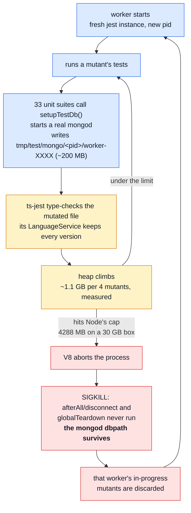
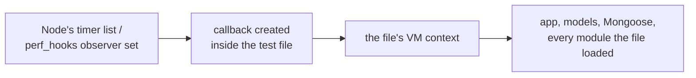

# Mutation testing: memory and workers

Part of [Mutation Testing](./mutation-testing.md): the worker pool, per-file setup costs, and the out-of-memory loop.

## The worker-pool multiplication {#the-worker-pool-multiplication}

`jest.config.mutation.js` pins `maxWorkers: 1`, and that single line is worth roughly an order of
magnitude on this machine.

`jest.config.js` sizes its pool for a STANDALONE run: one jest process, a fixed default of 2
workers when `JEST_WORKERS` is unset (the fallback for a direct `npx jest`, documented in that
file — `npm run test:*` sizes itself through `scripts/testing/machine-budget.ts` instead).
`jest.config.mutation.js` spreads the base config, so before this it inherited that number — and
under Stryker the number is multiplied rather than reused. Stryker runs `concurrency` test runners
at once, each of which is a full jest with a full pool of its own. On a 32-core box that was four
runners times thirty workers, back when the fallback was itself computed from core count.

What it looks like when it is wrong: **load average 31.8 on 32 cores, and roughly 55 seconds per
mutant against a suite that runs 703 tests in 78 seconds single-threaded.** The run is not blocked
on anything; it is context-switching. Nothing errors, and the progress bar's remaining-time
estimate stays plausible, which is what makes it survivable for a long time.

There is nothing for a pool to do here in any case. `coverageAnalysis: "perTest"` narrows each
mutant to the tests that actually reach it — usually a handful, in one or two files — and a jest
pool cannot parallelise below a file. **The parallelism belongs to Stryker, which spends it on
mutants.** `STRYKER_CONCURRENCY` in `.env` is the one knob worth turning; `JEST_WORKERS` governs
`npm test` and should not be reaching this run at all.

It also fixes the memory arithmetic in `jest.config.js`'s own comment: peak RSS is measured per
worker, and four runners each holding a thirty-worker pool is not a budget anyone sized.

Related, and found the same way: `ignorePatterns` now lists `tmp/**`. That covers the in-memory
mongod data directories under `tmp/test/`, which are live files being written by a running jest
while Stryker copies the project into its sandbox — so copying them is both pointless (every jest
instance starts its own server) and racy. A WiredTiger file removed mid-copy fails the entire run
with an `ENOENT` naming a filename nothing in the project mentions. `scripts/mutation/stryker-run.ts`
clears its own scratch root, `tmp/test-mutation`, before it starts (a plain `npm test`'s `tmp/test` is left alone), which hid this until two runs overlapped.

`ignorePatterns` also lists `.claude/**` — Claude Code's local state, mostly untracked: the whole
worktree checkouts it creates there exist only on a developer's machine, which is why CI never hits
what they cause. Stryker's sandbox copy is a plain `copyfile`, so a symlinked directory
in there aborts the whole run with `EISDIR` before a single mutant is instrumented. The one tracked
part, `.claude/skills/`, is pointer files no test reads (see [AI Auditing](./ai-auditing.md)).

The rule the two share: a directory the suite does not read belongs here — the sandbox needs what the TESTS read, not what the repository happens to contain.

`ignorePatterns` must **not** list `public/**`, even though `tmp/`, `dist/` and
`docs/` are all excluded there — the sandbox is the only filesystem the tests see, and
`tests/unit/scenarios/scenario-images.test.ts` asserts every seed row's `imageUrl` resolves to a
committed file under `public/images/seed/`. Leave it out of `ignorePatterns` and Stryker refuses to
start at all.

## What to be wary of — per-file setup costs {#per-file-setup-costs}

Mutation testing multiplies whatever the suite does on setup by the mutant count. A cost that is
invisible at `npm test` becomes the whole run here.

The worked example, measured 2026-08-14. `setupTestDb()` runs in `beforeAll`, so it fired once per
test FILE — and it used to start a `MongoMemoryServer` each time:

|                    | per pass   | per run           |
| ------------------ | ---------- | ----------------- |
| `npm test`         | 33 servers | 33                |
| `npm run mutation` | 33 servers | 33 × 6042 mutants |

Each server is a real `mongod` plus ~200 MB of dbpath and ~1 MB of driver buffers. Under `npm test`
the process exits and takes them; under Stryker the worker persists across mutants, so the buffers
accumulated to 1.08 GB — 45% of the heap — and the run stopped converging. Starting **one** server
per jest instance and giving each file its own DATABASE fixed it without touching a single test.

**The rule:** anything in `beforeAll` is paid once per file per mutant. Before adding a server, a
container, a browser or a fixture build there, ask what it costs multiplied by the mutant count —
and prefer one shared instance with per-file isolation over one instance per file.

**How to spot it:** run the suite outside Stryker first (`npx jest <scope> --runInBand`). If it is
fast and light there but heavy under mutation, the difference is setup being repeated, not your
tests being slow.

## When a run never finishes — the OOM/strand loop

A mutation run can fail in a way that looks like slowness and is not. Recognising it early is worth a
great deal, because the run will not converge no matter how long it is left alone.

### What you see

```
Mutation testing 3% (elapsed: ~1h 29m, remaining: ~36h 45m) 4478/6042 tested
WARN  ChildProcessProxy       Child process [pid 665821] ran out of memory.
INFO  RetryRejectedDecorator  Test runner process [665821] ran out of memory. You probably have a
                              memory leak in your tests.
```

Three tells, and any one of them is enough:

- **The ETA grows while you watch it.** A healthy run's estimate falls.
- **`ran out of memory` repeats** — every 15–25 seconds in the measured case.
- **The percentage and the mutant count disagree.** 3% against 4478/6042 means most of that "tested"
  count belongs to workers that died before reporting it, and will be redone.

### The mechanism



Measured 2026-08-14: **212 stranded data directories, 71 GB**, inside one sandbox, in under two hours
— 88 GB across `tmp/stryker/` once earlier crashed runs were counted. The loop feeds itself: every
restart pays the full start-up cost again, so throughput falls as the mess grows.

### Why the cleanup did not catch it

The lifecycle in `tests/support/global-setup.ts` is deliberate and well-argued — each jest instance
owns `tmp/test/mongo/<pid>` and deletes exactly that on the way out. It rests on one assumption:

> one jest instance per run, which reaches `globalTeardown`

Stryker breaks both halves. It starts a **new jest instance per restarted worker**, and it kills them,
so `globalTeardown` is the one step that never runs. Three consequences, each of which hid the mess:

| Design choice                     | What Stryker does to it                                                                                                                               |
| --------------------------------- | ----------------------------------------------------------------------------------------------------------------------------------------------------- |
| `globalTeardown` deletes the root | Only on a clean exit — so every OOM strands a directory by definition                                                                                 |
| The root comes from `__dirname`   | Under Stryker that resolves **inside the sandbox**, `tmp/stryker/sandbox-XXXX/tmp/test/`, where the documented `rm -rf tmp/test` recovery never looks |
| Ownership is keyed by pid         | Correct for one instance; across hundreds of restarts each new pid simply claims a new directory beside the last                                      |

### The strategy, in order

The trap to avoid has a name: **black-box tuning** — turning knobs from outside the process
(concurrency, heap cap, transform) and watching whether the symptom improves. It feels like progress
and it answers the wrong question. "Did it get better" cannot distinguish a fix from a postponement,
which is how the same investigation produces three different conclusions in an afternoon.

1. **Decide the SHAPE before hunting a cause.** Two very different problems present identically:

    |                         | Symptom                                   | Test                                                     | Fix                       |
    | ----------------------- | ----------------------------------------- | -------------------------------------------------------- | ------------------------- |
    | **Unbounded growth**    | dies at any ceiling                       | lower the ceiling — it still dies, just sooner           | find what is retained     |
    | **Bounded working set** | dies only when the ceiling is close to it | lower the ceiling — it stabilises just under the new one | cap it, or shrink the set |

    V8 does not collect eagerly. Given a ceiling far above what a program needs, it will happily
    drift toward it, so "RSS is climbing" is **not** evidence of a leak on its own.

2. **Reproduce small.** One file, one worker. A problem you can trigger in ninety seconds is one you
   can test a hypothesis against.
3. **Bisect one variable.** Change exactly one thing between two otherwise-identical runs — the
   control below used two files of near-identical size, one whose tests open a database and one
   whose tests do not.
4. **Open the box.** Everything above is still black-box. A heap snapshot says what is actually in
   memory, and until you have one you are guessing.
5. **Re-measure the same way after changing anything**, or you have swapped one guess for another.

### Reading the heap itself

Node writes a snapshot at the moment it is about to die:

```bash
NODE_OPTIONS="--max-old-space-size=1400 --heapsnapshot-near-heap-limit=1" \
  npx stryker run --mutate 'src/infrastructure/http/response.ts' --concurrency 1
```

Lower `--max-old-space-size` to make that moment arrive sooner — the composition of the heap is the
same, it just gets there faster. The file lands in the working directory, which under Stryker is the
sandbox, so:

```bash
find . -name '*.heapsnapshot'
```

Load the file in Chrome DevTools (Memory tab → Load) and start from the **Summary** view, grouped by
object kind. **One dominant kind is a finding; an even spread is a working set** — and that single
line is the difference between "we have a leak" and "this suite is simply heavy".

Knowing the kind tells you nothing about the owner: the dominant kind in the investigation below was
megabyte-sized binary buffers, which look exactly like network I/O and were not. Switch to the
**Comparison** or **Containment** view and walk retainers backwards from a large instance to the
variable actually holding it — DevTools computes true dominators, which answers "who is holding
these" the summary view cannot.

This repo used to carry two purpose-built scripts (`report-heap-summary.ts`, `report-heap-retainers.ts`) <!-- doc-paths:ignore -->
for this — removed once the buffer leak below was diagnosed and fixed, since DevTools does the same
job without a bespoke tool to maintain. Worth writing again if a future investigation needs it.

### Finding the culprit

Reproduce small before reproducing large. One file, one worker, is enough:

```bash
npx stryker run --mutate 'src/modules/orders/repository.ts' --concurrency 1
```

Watch a worker grow while it runs:

```bash
watch -n5 'ps -o pid,etime,rss,args -p $(pgrep -f child-process-proxy-worker) | cut -c1-100'
```

**Read `ELAPSED`, not only `RSS`** — it is the fastest diagnosis on this page. If the parent `stryker`
process has been up for hours while its workers are minutes old, they are being restarted and the run
is in this loop rather than making progress.

Count the damage as it accumulates:

```bash
ls tmp/stryker/sandbox-*/tmp/test/mongo/ | wc -l  # one entry per instance that died
du -sh tmp/stryker/                               # what it has cost so far
grep -c "ran out of memory" <run log>             # restarts, when the log was kept
```

Then narrow it with jest's own instruments, which answer different questions:

| Command                                       | Answers                                                                    |
| --------------------------------------------- | -------------------------------------------------------------------------- |
| `npx jest <suite> --runInBand --logHeapUsage` | does the heap grow from one test FILE to the next                          |
| `npx jest <suite> --detectOpenHandles`        | what still holds the process open — sockets, timers, an unstopped `mongod` |
| `npx jest <suite> --detectLeaks`              | whether a suite's module registry survives collection after teardown       |

The shape of the answer matters. Growth **across files within one jest run** points at module-level
state. Growth **only across mutants** points at something the process keeps that a module-registry
reset does not clear.

### What it turned out to be — and how the control proved it

Measured 2026-08-14. The decisive experiment was a **control with one variable changed**: mutate
`src/infrastructure/http/response.ts` (206 lines, whose covering tests open no database) instead of
`src/modules/orders/repository.ts` (204 lines, whose tests do). Near-identical size, opposite
database dependency.

The no-database control leaked just as fast — **3963 → 4447 → 5045 MB across four mutants**, past
Node's cap. So Mongo is a bystander, and Stryker's own hint (`You probably have a memory leak in
your tests`) points at the wrong layer.

**ts-jest was the first suspect and it is not the answer.** It does two jobs — translate TypeScript,
and type-check it — and the second holds a `LanguageService` cache that looked like an obvious
candidate. Replacing it with swc (see below) roughly halved the suite's wall-clock and lowered the
run's footprint, but the growth continued. A plausible mechanism that improves the symptom is not a
diagnosis, and treating it as one cost an hour.

**The measurement that should have come first: run the suite OUTSIDE the tool.**

```bash
NODE_OPTIONS="--max-old-space-size=900 --heapsnapshot-near-heap-limit=1" \
  npx jest --config jest.config.mutation.js tests/unit tests/cross-cutting 'src/modules/.*/tests/unit' --runInBand
```

All 109 suites and 1500 tests — including the 37 that reach a real `mongod` — complete in ~13
seconds and never approach a 900 MB ceiling. **The suite is not heavy.** Whatever consumes gigabytes
is the harness around it, which narrows the search from "our code" to "how Stryker runs our code"
and rules out every theory about the tests themselves in one command.

**What the heap actually holds**, dumped at the moment of death and grouped by kind:

```
heap total 2404.1 MB across 15,028,338 objects

     bytes        count  kind
 1081.8 MB          958  native system / JSArrayBufferData     <- 45% of the heap
  358.5 MB      194,035  array (object properties)
  272.0 MB    5,078,346  closure
   55.4 MB    1,079,266  object system / Context
```

Everything after the first line is an even spread — millions of small objects, which is what a
running program looks like. The first line is 958 raw binary buffers. That single group-by is what
turns "something leaks" into "these bytes, of this kind".

It does **not** turn it into "these bytes, held by this code" — and the gap between those two
sentences is where this investigation lost most of its time. Buffers of roughly a megabyte look like
network and database I/O, so that is what they were assumed to be, and three fixes were built on the
assumption before anything tested it. See
[the case study](#case-study-the-buffers-were-not-io-at-all) for what they actually were.

**One trap to avoid when repeating this measurement:** take the reading during the MUTATION phase,
not the dry run. The dry run executes the whole suite once — including every database-backed
suite — so a worker reaches gigabytes there regardless of which file is being mutated, and a
sample taken then says nothing about the file under test. Watch for `0/N tested` in the progress
line; while it reads zero, the number on screen is the dry run's.

**And take it the same way every time.** `--heapsnapshot-near-heap-limit` fires when V8's old space
approaches its cap, which is a moment you do not control and — for this leak — may never arrive at
all, because the bytes sit outside old space. Two readings taken at different triggers are not
comparable, and comparing them produced a confident wrong answer here. Prefer
`--heapsnapshot-signal=SIGUSR2`, which lets you choose the moment:

```bash
NODE_OPTIONS="--max-old-space-size=4096 --heapsnapshot-signal=SIGUSR2" npx stryker run --concurrency 1 &
# wait for the progress line to reach a chosen mutant, then:
kill -USR2 "$(pgrep -f child-process-proxy-worker | head -1)"
```

Pick a cap high enough that the worker does not restart mid-measurement: a restart resets the
accumulation, and a snapshot of a freshly restarted worker looks like a heap that never grew.

### Case study: the buffers were not I/O at all {#case-study-the-buffers-were-not-io-at-all}

A short account of a four-hypothesis investigation, kept because the wrong turns are the reusable
part. Measured 2026-08-14 on a 16-core / 30 GB machine.

**The symptom.** `npm run mutation:full` grew until Node killed the worker, restarted it having
finished nothing, and reported a remaining time that climbed rather than fell — 36 hours after 90
minutes at 3%. A heap dump said half the process was ~1000 raw binary buffers of about a megabyte
each.

**The three hypotheses that were wrong.** Each was plausible, each improved the symptom, and none was
the cause — which is precisely why "it got better" is not a diagnosis:

| Hypothesis                  | What was built                        | What happened                                              |
| --------------------------- | ------------------------------------- | ---------------------------------------------------------- |
| ts-jest's type-check cache  | swapped the transform to swc          | suite got ~2× faster; growth continued                     |
| a `mongod` started per file | one shared server for the whole run   | 88 GB of stranded data directories fixed; growth continued |
| per-file mongoose connects  | planned: share one socket via `useDb` | never built — the measurement below killed it              |

All three shared one unexamined premise: that megabyte-sized buffers must be I/O. They looked like
network buffers, so the search stayed inside the database stack for hours.

**The measurement that broke it.** The premise is testable in one line of reasoning: if the buffers
come from database connections, running fewer database suites must leave fewer buffers. So the same
run was taken three times — with all 37 database-backed suites, with 10, and with none — every
reading at the identical point (end of the dry run, one full suite pass), under a cap high enough
that no worker restarted mid-measurement:

| database-backed suites | buffers | buffer bytes | heap total |
| ---------------------- | ------- | ------------ | ---------- |
| 37                     | 431     | 511.6 MB     | 1251.6 MB  |
| 10                     | 430     | 511.5 MB     | 1225.4 MB  |
| 0                      | 423     | 511.1 MB     | 1220.0 MB  |

Removing **every** database suite changed the buffer count by 8 and the bytes by 0.5 MB. Repeated
five mutants into the mutation phase the curve is not merely flat but non-monotonic — 1329 buffers
with no database against 1185 with all of them. There is no relationship to connections in either
phase, and the `useDb` work would have been a week spent on 0.1% of the problem.

**What they actually were.** A heap snapshot forces a full GC before it is written, so everything in
one is genuinely reachable rather than merely uncollected. Walking the reference graph _backwards_
from the buffers — grouping by kind alone cannot do this, since it aggregates nodes and never
reads edges — named the owner immediately:

```
1326.0 MB   78   ArrayBuffer .backing_store  <-  Buffer .buffer  <-  system / Context .buffer
```

78 buffers, 95% of all buffer bytes, **17.0 MB each**, held by a variable named `buffer` in a module
scope. That is `node_modules/bson/lib/bson.cjs`, compiled from upstream
[`src/bson.ts`](https://github.com/mongodb/js-bson/blob/main/src/bson.ts): <!-- doc-paths:ignore -->

```js
const MAXSIZE = 1024 * 1024 * 17;
let buffer = ByteUtils.allocate(MAXSIZE); // allocated on every evaluation of the module
```

`bson` reserves a 17 MiB scratch buffer the moment it is loaded — enough for MongoDB's 16 MiB
document ceiling. Jest gives every test **file** a fresh module registry, because that is what test
isolation means, so every file that reaches mongoose evaluates `bson` again and pays 17 MiB again. A
normal `npm test` never notices: files run in worker processes that exit and return the memory.
Stryker does not exit — it runs the suite once per mutant inside one long-lived worker — so the
copies accumulate, roughly ten per mutant.

**Why every earlier fix missed it.** The buffer belongs to the library that _encodes_ documents, not
to any connection: it is allocated at import time, before a connection exists and whether or not one
ever does. Sharing a server could not touch it, sharing a connection could not either, and removing
the database suites did not — because unit tests still import models, models import mongoose, and
mongoose imports bson.

**Why the heap cap never contained it.** `--max-old-space-size` bounds V8's old space.
`ArrayBuffer` backing stores are external to it, so V8 sees a comfortable heap, feels no pressure to
collect, and the process grows regardless: a worker capped at 1400 MB was measured at 6.6 GB RSS.
The cap only ever decided _when_ the worker died, never _whether_ it grew.

**What this investigation missed — found 2026-09-21.** The retainer walk above stopped at
`system / Context .buffer`: `bson`'s own module scope. One step further, to the GC root, would have
shown why that scope was still alive: a timer from `express-rate-limit` and an observer from
`prom-client`, each pinning its test file's whole context. The buffers piled up because the files
were never freed — not because Stryker's worker never exits. Fixed in
`tests/support/test-environment.ts`; see [One process per dry run](#one-process-per-dry-run) and
[the `bson` warning sign](#the-bson-warning-sign). No upstream report against `bson` is needed:
freeing the file frees its buffer.

The former is not a workaround invented under pressure — it is Stryker's own sanctioned answer to a
dependency holding module-scope state a reused worker can't shed.
[stryker-mutator/stryker-js#2922](https://github.com/stryker-mutator/stryker-js/issues/2922)
documents the same class of problem for native ESM (a reused worker can't reset a module's state
between mutants, since Node has no `require.cache` equivalent for ESM) and prescribes
`maxTestRunnerReuse: 1` as the fix. [The option's own docs](https://stryker-mutator.io/docs/stryker-js/configuration/#maxtestrunnerreuse-number)
frame it the same way: _"Not recommended unless you are experiencing memory leaks that you are
unable to resolve"_ — this is that case, not a special one.

**The lever that looks right and is not.** Jest's `workerIdleMemoryLimit` recycles a worker once it
passes a memory bound, which is the plain-jest analogue of `maxTestRunnerReuse` and the first thing
anyone reaches for here. It cannot work for this leak, for the same reason `--max-old-space-size`
could not: the child reports `process.memoryUsage().heapUsed` and nothing else —
`node_modules/jest-worker/build/processChild.js`, one line — so the bound is measured against the
one number that excludes `ArrayBuffer` backing stores. A worker holding 78 copies of a 17 MiB
buffer looks small to it. Checked 2026-08-15, jest 30; check it again rather than assuming, but do
not spend a day rediscovering it.

**The rule this earns.** Group-by tells you _what_ is in a heap; only the edges tell you _who holds
it_. Identifying a kind of object and then guessing its owner from what that kind is usually for is
not a diagnosis — it is the same guess with a number attached to it. And follow the edges all the
way to a GC root: stopping at the first owner found (here, `bson`'s module scope) names the victim,
not the culprit.

### Related: the same arithmetic kills a plain `npm test` {#jest-worker-count}

Stryker is where the accumulation becomes unbounded, but the per-worker cost exists in an ordinary
run too, and it is enough on its own. A worker peaks at 772–905 MB here; jest's default worker count
is `logical CPUs - 1`, which on a 16-core/32-thread machine is 31 of them. Measured 2026-08-15 over
the 98 unit suites:

| workers | wall | peak RSS |
| ------- | ---- | -------- |
| 31      | 20s  | 17.6 GB  |
| 12      | 14s  | 9.0 GB   |
| 8       | 13s  | 6.3 GB   |

At 17.6 GB on a 30.5 GB machine that also runs the docker stack, the OOM killer takes two workers
and jest reports `A jest worker process was terminated by another process: signal=SIGKILL` while
every test passes — a message that names the symptom and nothing else.

Note that eight workers were **faster** than thirty-one: past the point where the machine can hold
them, extra workers buy contention rather than throughput, so there is no speed being traded away.
The number is a property of the machine, so it lives in `.env` as `JEST_WORKERS`, exactly like
`STRYKER_CONCURRENCY`. `npm run test:*` computes it from free memory
(`scripts/testing/machine-budget.ts`); a bare `npx jest` falls back to a fixed 2.

### The fix

`jest.config.mutation.js` swaps the transform to `@swc/jest` for the mutation run only. swc
translates and checks nothing, so it retains nothing between mutants. Types are still checked — once,
by `npm run ts-check` inside `npm run complete`, which is the right number of times: a mutant
changes an expression, not a signature, so re-checking per mutant cannot return a different answer.

It is also simply faster. The same 110 suites and 1527 tests:

| Transform                                         | Time       |
| ------------------------------------------------- | ---------- |
| ts-jest (`jest.config.js`, the normal run)        | ~21 s      |
| swc (`jest.config.mutation.js`, the mutation run) | **~9.7 s** |

**One compatibility note, and it is a real semantic difference rather than a quirk.** TypeScript
emits each `require` where its `import` stood; swc follows ESM and hoists imports to the top. A
`jest.mock` factory that reads a `const` declared between the two therefore works under ts-jest and
throws `Cannot access '<name>' before initialization` under swc. The fix is to reach the variable
from inside a function — a getter, or a wrapping arrow — so the read happens on access rather than
at factory time. `tests/unit/infrastructure/adapters/mailer-dispatch.test.ts` carries a worked
example in its comments.

**A second note, and this one is a property to preserve rather than a problem to fix.** swc
transpiles file-by-file with no cross-file knowledge — which is what makes it cheap, and is also its
one constraint: a type-only import must be written `import type`, or swc emits a real `require` for
a value that does not exist at runtime. The app is already written that way, enforced by
`verbatimModuleSyntax` in `tsconfig.json`, so nothing needs doing here beyond not turning that off.

**A third note: `jest.spyOn` on a namespace import.** `jest.spyOn(port, 'fn')` after
`import * as port` has to redefine an export. swc makes exports non-configurable getters, so under
this config it throws `TypeError: Cannot redefine property: fn`, while the normal run passes.
Replace the module with `jest.mock` instead, keeping the real function as the default
implementation — `tests/support/ports.ts` explains the pattern, and
`src/modules/invoicing/tests/unit/render.test.ts` shows it.

### Preventing it

- **Sweep before the run, not only after it.** A killed process cannot clean up after itself, so the
  next start has to.
- **Keep the data root out of the sandbox.** An absolute path passed in through the environment
  survives the copy; a `__dirname`-derived one does not.
- **Sweep dead siblings at `globalSetup`.** A directory named for a pid that no longer exists belongs
  to a dead instance and is safe to remove, which bounds accumulation _within_ a run rather than only
  between runs.
- **Cap the worker heap deliberately** instead of inheriting Node's default — which is a flat
  ceiling, not a function of the machine's RAM. See [the heap cap](#worker-heap-cap).

**A cap is containment, not a fix** — and for this leak it is weaker containment than it looks.
`--max-old-space-size` bounds V8's old space only; `ArrayBuffer` backing stores live outside it, so a
worker capped at 1400 MB was measured at 6.6 GB RSS. Against external memory the cap does not decide
how much a worker accumulates, only how early V8 panics about the part it can see.

### The heap cap — unset is not "as much as the machine has" {#worker-heap-cap}

V8's default old-space limit scales with system memory only up to a ceiling, and on 64-bit Node that
ceiling is around 4 GB. Measured here on Node v24.18.0, 30 GB of RAM:

```bash
node -e "console.log(require('v8').getHeapStatistics().heap_size_limit)"
# → 4496293888   (≈ 4.2 GB)
```

Past roughly 16 GB of RAM, a bigger machine therefore buys a Stryker worker nothing: every one of
them gets the same ~4.2 GB. Measured 2026-09-20, a full run hit that ceiling directly —
`FATAL ERROR: Ineffective mark-compacts near heap limit`, inside the first minute, identically at
concurrency 6, 4, 2 and 1, with 10+ GB of the machine free throughout. `STRYKER_WORKER_HEAP_MB=8192`
survived where unset did not.

Two failure modes wear the same "ran out of memory" label:

| Symptom                                                   | Cause                                                                    | The lever                                                       |
| --------------------------------------------------------- | ------------------------------------------------------------------------ | --------------------------------------------------------------- |
| Crash in the first minute, identical at every concurrency | a worker wants more than V8's ~4.2 GB default                            | `STRYKER_WORKER_HEAP_MB`                                        |
| Climb per test file or per mutant, RSS far above any cap  | old test files kept alive, each holding `bson`'s 17 MiB outside the heap | [the test environment](#one-process-per-dry-run) — a cap cannot |

Budget `STRYKER_WORKER_HEAP_MB × STRYKER_CONCURRENCY` against free RAM, and re-measure the default
on your own Node version rather than trusting the number above: it reads like a V8 default, not a
documented constant.

## One process per dry run — why a file must free its memory {#one-process-per-dry-run}

Stryker's jest runner forces `runInBand: true`. The dry run therefore executes every related test
file inside ONE process, and `workerIdleMemoryLimit` never gets a worker to recycle. Whatever a
file leaves reachable, the next hundred files add to.

What made files leave everything reachable: a callback still registered with Node when the file
ended. Its closure belongs to the file's VM context, so the whole context stays alive with it.



| Who registered it                     | What                       | Never released because       |
| ------------------------------------- | -------------------------- | ---------------------------- |
| `express-rate-limit`'s MemoryStore    | an interval per limiter    | nothing calls `shutdown()`   |
| prom-client's `collectDefaultMetrics` | a GC `PerformanceObserver` | nothing calls `disconnect()` |

Measured 2026-09-21, shard-30's 117 related files in band at a 4 GB heap: 35–80 MB retained per
file, `Ineffective mark-compacts near heap limit` around file 64 — with or without Stryker, at any
concurrency. A plain `npm test` never shows it: its workers are recycled.

**The fix** is `tests/support/test-environment.ts`, the `testEnvironment` of every jest config. It
tracks the timers and observers a file starts and clears the survivors at teardown. The same run
then held 220–620 MB from the first file to the last.

**Finding the next one**, if the heap climbs again: `npx jest -c jest.config.mutation.js
--runInBand --logHeapUsage <files>`, then a heap snapshot after two files. Count a per-file
object (`Mongoose` works) and walk its retainer path to a GC root — the root names the culprit.

### Stryker's coverage records, and collecting after each file {#collect-after-each-file}

Clearing timers was not enough: on 2026-10-04 the sweep's `preflight` still died after 13 minutes
at a 12 GB heap, and a parallel variant at Node's default heap lost 208 of 210 shards the same way.
Two more things kept finished files in memory, and both happen only under Stryker.

| Cause                          | What happens                                                                                                                                                                                                                                                                                   | Fix in `tests/support/test-environment.ts`                                                                                              |
| ------------------------------ | ---------------------------------------------------------------------------------------------------------------------------------------------------------------------------------------------------------------------------------------------------------------------------------------------- | --------------------------------------------------------------------------------------------------------------------------------------- |
| **Stryker's coverage records** | Stryker shares one namespace object across every file. With `coverageAnalysis: perTest`, its instrumented code creates a `{}` per covering test _inside_ the file's VM context — and an object keeps its whole context alive. Every file that exercised the mutated code stayed: ~420 MB each. | At teardown, copy those records into the environment's own realm (`releaseStrykerCoverage`). Same data, nothing pointing into the file. |
| **Lazy collection**            | V8 frees a finished file's context lazily. In one process the next files outrun it, and V8 throws "heap out of memory" with the memory still reclaimable — [known jest behaviour](https://github.com/jestjs/jest/issues/11956).                                                                | At teardown, call `gc()` when `--expose-gc` made it available.                                                                          |

Measured 2026-10-07, heap after each file of Stryker's initial run (`--dryRunOnly`):

| Mutated file (related test files) | Heap cap | Neither fix              | Collection only                          | Both                             |
| --------------------------------- | -------- | ------------------------ | ---------------------------------------- | -------------------------------- |
| `tasks/model.ts` (124)            | 4 GB     | out of memory by file 23 | finished, 0.6–3.2 GB                     | —                                |
| `users/model.ts` (205)            | 8 GB     | out of memory            | out of memory by file 27, +420 MB a file | finished, levels off near 4.4 GB |

The first row hid the first cause: few of `tasks`'s test files run its model during a test, so few
records were made. `users/model.ts` is exercised by nearly every test file, so nearly every file
stayed. A plain `jest --runInBand` shows neither: there is no Stryker namespace, and with
`--logHeapUsage` plus `--expose-gc` jest collects after each file itself.

Who sets `--expose-gc`:

- `scripts/mutation/stryker-run.ts` — the local runs and the PR diff job.
- `NODE_OPTIONS` in `mutation.yml`'s `preflight` and `mutation-wave.yml`'s shards.

A normal test run sets neither the flag nor the namespace, so it pays nothing.

### The `bson` warning sign {#the-bson-warning-sign}

`bson` is not a leak on its own. It is the **amplifier** that makes any other leak expensive, and
the first thing a memory dump shows — which is why it was blamed for a month.

|                            |                                                                                                                                                                                            |
| -------------------------- | ------------------------------------------------------------------------------------------------------------------------------------------------------------------------------------------ |
| **What it does**           | reserves a 17 MiB scratch buffer at module scope, every time the module is evaluated ([`src/bson.ts`](https://github.com/mongodb/js-bson/blob/main/src/bson.ts)) <!-- doc-paths:ignore --> |
| **When that is harmless**  | on its own, always: jest evaluates it once per test FILE, and the buffer is freed with the file                                                                                            |
| **When it becomes a leak** | a test file stays reachable after it ends — then its 17 MiB stays too, and the next file adds another                                                                                      |
| **Why it hides**           | the buffer is an `ArrayBuffer`, outside V8's heap: `--max-old-space-size` never sees it, and `heapUsed` never counts it                                                                    |
| **How it shows**           | `process.memoryUsage().arrayBuffers` climbing ~17 MiB per test file; a heap dump dominated by ~17 MB buffers                                                                               |

Measured 2026-09-21, 40 test files in one process, `arrayBuffers` after each:

| after file | files retained (before the fix) | files freed (after) |
| ---------- | ------------------------------- | ------------------- |
| 1          | 38 MB                           | 38 MB               |
| 10         | 195 MB                          | 36 MB               |
| 20         | 390 MB                          | 53 MB               |
| 40         | 726 MB, still climbing          | 71 MB, flat         |

**If you see it:** do not look at `bson`. Look for what keeps old test files alive — walk a heap
snapshot's retainer path from one of the buffers **all the way to a GC root**, not just to the
module that owns it. The root names the real culprit: in 2026-09 a timer and a performance
observer; next time perhaps an event listener on a shared object, or a global registry.

## The dry run's own timeout

`stryker.json` sets `dryRunTimeoutMinutes: 20`. It used not to set it at all, which left Stryker's
default of 5 minutes in force — and the dry run executes the WHOLE suite once, unconditionally,
before a single mutant runs, to build the coverage map `coverageAnalysis: perTest` needs. Under the
old three-night rotation, three or four shards lost that coin flip on ordinary nights, timing out at
340–360 seconds with nothing to show for it. 20 minutes is a flat setup-cost budget against a job
measured in hours; it hides nothing, unlike narrowing what the dry run has to execute would.

## Concurrency and maxTestRunnerReuse — the current numbers {#concurrency-and-reuse}

Both are measurements with an expiry date, not constants — re-measure them when the numbers below stop matching the machine or the project.

**`concurrency: 4`.** The ceiling is memory, not cores: each worker is a separate process carrying a full test runner and its own in-memory `mongod`, and the machine is in use while a run happens. It was 8, and 8 stopped fitting: measured 2026-08-14, under the old unit-only ruler, a run at 8 held four workers at ~4 GB RSS each, logged 12 `ran out of memory` worker restarts in the first five minutes, and then made no progress at all — 1927 of 6040 mutants after five minutes, and the same 1927 three samples later. A run that thrashes does not merely take longer, it stops finishing.

What moved was the project, not the machine: the module count went from nine to thirteen and the mutant count from 3241 to 6040 between those two measurements, so the same 8 workers each carried a much larger program. `maxTestRunnerReuse` (below) has since removed the _unbounded_ growth that made 8 fail, so that specific failure no longer applies — but what bounded a worker under that ruler was the working set of one pass, ~2.9 GB, which does not shrink with more recycling. Divide usable RAM by ~3 GB: 8 in principle, 6 in practice on 32 cores / 30.5 GB, because 8 left only 1.6 GB free on a machine doing other things.

**That ~2.9 GB figure predates the ruler merge** — it was measured under the old unit-only config, whose worker never opened a database. `stryker.json` now runs `tests/integration/` in every worker, which starts a real in-memory `mongod` per file, so the true working set per worker today is almost certainly higher. `STRYKER_WORKER_PEAK_MB` in `scripts/mutation/stryker-run.ts` (the constant `resolveConcurrency()` divides free RAM by) still reads `2900` — **it has not been re-measured against the merged ruler.** Until it is, `resolveConcurrency()` on an unconfigured machine may pick a concurrency a little more aggressive than the box can actually sustain; the OOM-loop guard below still catches the consequence (a run that will not converge) rather than letting it burn silently, but it costs restarts to find that out. Re-measure the same way as before — `npx stryker run --mutate <one file> --concurrency 1`, watching RSS — and update both this paragraph and the constant together.

4 is kept as the shared default because this value is committed and the safe number is a property of the machine, not the project — a contributor's laptop is not a 30 GB desktop. Raise it per machine via `STRYKER_CONCURRENCY` in `.env` (see [the worker-pool multiplication](#the-worker-pool-multiplication)). CI overrides it independently — the GitHub sweep passes `--concurrency 1` with a 12 GB heap, because a standard runner is 4 vCPU / 16 GB, not 32/30 ([The GitHub sweep](./mutation-testing-running.md#the-github-sweep)).

**`maxTestRunnerReuse: 1`** restarts the test runner after every mutant. It was set because memory
climbed from mutant to mutant — measured at reuse 5: **23 OOM restarts on one file**; at 1: **0**,
and half the time.

That climb was [old test files kept alive](#one-process-per-dry-run), each holding
[`bson`'s 17 MiB](#the-bson-warning-sign) — fixed 2026-09-21. **Reuse 1 is therefore probably no
longer needed**, while every restart costs a fresh process, jest and `mongod` per mutant. Not yet
re-measured: raise it (3, then 2 if that fails) only after checking RSS stays flat across mutants:

```bash
npx stryker run --mutate <one file> --concurrency 1
```

watching RSS against the mutant counter.

## Read next

- [Mutation Testing](./mutation-testing.md) — the hub
- [Coverage & Confidence](./coverage-and-confidence.md)
