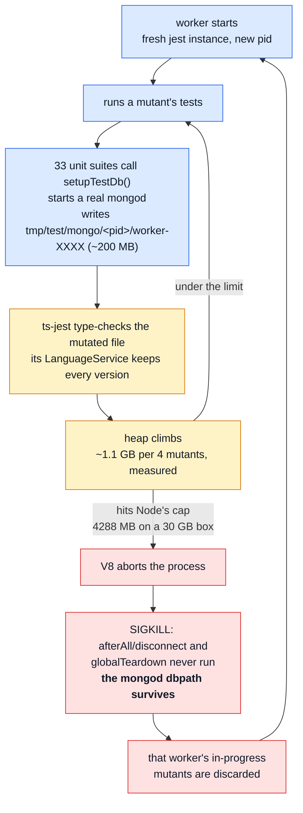

# Mutation testing: when a run never finishes

Part of [Mutation testing: memory and workers](./mutation-testing-memory.md): the out-of-memory strand loop: what it looks like, why, and how it was found and fixed.

## When a run never finishes — the OOM/strand loop

A mutation run can fail in a way that looks like slowness and is not. Recognising it early is worth a
great deal, because the run will not converge no matter how long it is left alone.

### What you see

```
Mutation testing 3% (elapsed: ~1h 29m, remaining: ~36h 45m) 4478/6042 tested
WARN  ChildProcessProxy       Child process [pid 665821] ran out of memory.
INFO  RetryRejectedDecorator  Test runner process [665821] ran out of memory. You probably have a
                              memory leak in your tests.
```

Three tells, and any one of them is enough:

- **The ETA grows while you watch it.** A healthy run's estimate falls.
- **`ran out of memory` repeats** — every 15–25 seconds in the measured case.
- **The percentage and the mutant count disagree.** 3% against 4478/6042 means most of that "tested"
  count belongs to workers that died before reporting it, and will be redone.

### The mechanism



Measured 2026-08-14: **212 stranded data directories, 71 GB**, inside one sandbox, in under two hours
— 88 GB across `tmp/stryker/` once earlier crashed runs were counted. The loop feeds itself: every
restart pays the full start-up cost again, so throughput falls as the mess grows.

### Why the cleanup did not catch it

The lifecycle in `tests/support/global-setup.ts` is deliberate and well-argued — each jest instance
owns `tmp/test/mongo/<pid>` and deletes exactly that on the way out. It rests on one assumption:

> one jest instance per run, which reaches `globalTeardown`

Stryker breaks both halves. It starts a **new jest instance per restarted worker**, and it kills them,
so `globalTeardown` is the one step that never runs. Three consequences, each of which hid the mess:

| Design choice                     | What Stryker does to it                                                                                                                               |
| --------------------------------- | ----------------------------------------------------------------------------------------------------------------------------------------------------- |
| `globalTeardown` deletes the root | Only on a clean exit — so every OOM strands a directory by definition                                                                                 |
| The root comes from `__dirname`   | Under Stryker that resolves **inside the sandbox**, `tmp/stryker/sandbox-XXXX/tmp/test/`, where the documented `rm -rf tmp/test` recovery never looks |
| Ownership is keyed by pid         | Correct for one instance; across hundreds of restarts each new pid simply claims a new directory beside the last                                      |

### The strategy, in order

The trap to avoid has a name: **black-box tuning** — turning knobs from outside the process
(concurrency, heap cap, transform) and watching whether the symptom improves. It feels like progress
and it answers the wrong question. "Did it get better" cannot distinguish a fix from a postponement,
which is how the same investigation produces three different conclusions in an afternoon.

1. **Decide the SHAPE before hunting a cause.** Two very different problems present identically:

    |                         | Symptom                                   | Test                                                     | Fix                       |
    | ----------------------- | ----------------------------------------- | -------------------------------------------------------- | ------------------------- |
    | **Unbounded growth**    | dies at any ceiling                       | lower the ceiling — it still dies, just sooner           | find what is retained     |
    | **Bounded working set** | dies only when the ceiling is close to it | lower the ceiling — it stabilises just under the new one | cap it, or shrink the set |

    V8 does not collect eagerly. Given a ceiling far above what a program needs, it will happily
    drift toward it, so "RSS is climbing" is **not** evidence of a leak on its own.

2. **Reproduce small.** One file, one worker. A problem you can trigger in ninety seconds is one you
   can test a hypothesis against.
3. **Bisect one variable.** Change exactly one thing between two otherwise-identical runs — the
   control below used two files of near-identical size, one whose tests open a database and one
   whose tests do not.
4. **Open the box.** Everything above is still black-box. A heap snapshot says what is actually in
   memory, and until you have one you are guessing.
5. **Re-measure the same way after changing anything**, or you have swapped one guess for another.

### Reading the heap itself

Node writes a snapshot at the moment it is about to die:

```bash
NODE_OPTIONS="--max-old-space-size=1400 --heapsnapshot-near-heap-limit=1" \
  npx stryker run --mutate 'src/infrastructure/http/response.ts' --concurrency 1
```

Lower `--max-old-space-size` to make that moment arrive sooner — the composition of the heap is the
same, it just gets there faster. The file lands in the working directory, which under Stryker is the
sandbox, so:

```bash
find . -name '*.heapsnapshot'
```

Load the file in Chrome DevTools (Memory tab → Load) and start from the **Summary** view, grouped by
object kind. **One dominant kind is a finding; an even spread is a working set** — and that single
line is the difference between "we have a leak" and "this suite is simply heavy".

Knowing the kind tells you nothing about the owner: the dominant kind in the investigation below was
megabyte-sized binary buffers, which look exactly like network I/O and were not. Switch to the
**Comparison** or **Containment** view and walk retainers backwards from a large instance to the
variable actually holding it — DevTools computes true dominators, which answers "who is holding
these" the summary view cannot.

This repo used to carry two purpose-built scripts (`report-heap-summary.ts`, `report-heap-retainers.ts`) <!-- doc-paths:ignore -->
for this — removed once the buffer leak below was diagnosed and fixed, since DevTools does the same
job without a bespoke tool to maintain. Worth writing again if a future investigation needs it.

### Finding the culprit

Reproduce small before reproducing large. One file, one worker, is enough:

```bash
npx stryker run --mutate 'src/modules/orders/repository.ts' --concurrency 1
```

Watch a worker grow while it runs:

```bash
watch -n5 'ps -o pid,etime,rss,args -p $(pgrep -f child-process-proxy-worker) | cut -c1-100'
```

**Read `ELAPSED`, not only `RSS`** — it is the fastest diagnosis on this page. If the parent `stryker`
process has been up for hours while its workers are minutes old, they are being restarted and the run
is in this loop rather than making progress.

Count the damage as it accumulates:

```bash
ls tmp/stryker/sandbox-*/tmp/test/mongo/ | wc -l  # one entry per instance that died
du -sh tmp/stryker/                               # what it has cost so far
grep -c "ran out of memory" <run log>             # restarts, when the log was kept
```

Then narrow it with jest's own instruments, which answer different questions:

| Command                                       | Answers                                                                    |
| --------------------------------------------- | -------------------------------------------------------------------------- |
| `npx jest <suite> --runInBand --logHeapUsage` | does the heap grow from one test FILE to the next                          |
| `npx jest <suite> --detectOpenHandles`        | what still holds the process open — sockets, timers, an unstopped `mongod` |
| `npx jest <suite> --detectLeaks`              | whether a suite's module registry survives collection after teardown       |

The shape of the answer matters. Growth **across files within one jest run** points at module-level
state. Growth **only across mutants** points at something the process keeps that a module-registry
reset does not clear.

### What it turned out to be — and how the control proved it

Measured 2026-08-14. The decisive experiment was a **control with one variable changed**: mutate
`src/infrastructure/http/response.ts` (206 lines, whose covering tests open no database) instead of
`src/modules/orders/repository.ts` (204 lines, whose tests do). Near-identical size, opposite
database dependency.

The no-database control leaked just as fast — **3963 → 4447 → 5045 MB across four mutants**, past
Node's cap. So Mongo is a bystander, and Stryker's own hint (`You probably have a memory leak in
your tests`) points at the wrong layer.

**ts-jest was the first suspect and it is not the answer.** It does two jobs — translate TypeScript,
and type-check it — and the second holds a `LanguageService` cache that looked like an obvious
candidate. Replacing it with swc (see below) roughly halved the suite's wall-clock and lowered the
run's footprint, but the growth continued. A plausible mechanism that improves the symptom is not a
diagnosis, and treating it as one cost an hour.

**The measurement that should have come first: run the suite OUTSIDE the tool.**

```bash
NODE_OPTIONS="--max-old-space-size=900 --heapsnapshot-near-heap-limit=1" \
  npx jest --config jest.config.mutation.js tests/unit tests/cross-cutting 'src/modules/.*/tests/unit' --runInBand
```

All 109 suites and 1500 tests — including the 37 that reach a real `mongod` — complete in ~13
seconds and never approach a 900 MB ceiling. **The suite is not heavy.** Whatever consumes gigabytes
is the harness around it, which narrows the search from "our code" to "how Stryker runs our code"
and rules out every theory about the tests themselves in one command.

**What the heap actually holds**, dumped at the moment of death and grouped by kind:

```
heap total 2404.1 MB across 15,028,338 objects

     bytes        count  kind
 1081.8 MB          958  native system / JSArrayBufferData     <- 45% of the heap
  358.5 MB      194,035  array (object properties)
  272.0 MB    5,078,346  closure
   55.4 MB    1,079,266  object system / Context
```

Everything after the first line is an even spread — millions of small objects, which is what a
running program looks like. The first line is 958 raw binary buffers. That single group-by is what
turns "something leaks" into "these bytes, of this kind".

It does **not** turn it into "these bytes, held by this code" — and the gap between those two
sentences is where this investigation lost most of its time. Buffers of roughly a megabyte look like
network and database I/O, so that is what they were assumed to be, and three fixes were built on the
assumption before anything tested it. See
[the case study](./mutation-testing-oom-case-study.md#case-study-the-buffers-were-not-io-at-all) for what they actually were.

**One trap to avoid when repeating this measurement:** take the reading during the MUTATION phase,
not the dry run. The dry run executes the whole suite once — including every database-backed
suite — so a worker reaches gigabytes there regardless of which file is being mutated, and a
sample taken then says nothing about the file under test. Watch for `0/N tested` in the progress
line; while it reads zero, the number on screen is the dry run's.

**And take it the same way every time.** `--heapsnapshot-near-heap-limit` fires when V8's old space
approaches its cap, which is a moment you do not control and — for this leak — may never arrive at
all, because the bytes sit outside old space. Two readings taken at different triggers are not
comparable, and comparing them produced a confident wrong answer here. Prefer
`--heapsnapshot-signal=SIGUSR2`, which lets you choose the moment:

```bash
NODE_OPTIONS="--max-old-space-size=4096 --heapsnapshot-signal=SIGUSR2" npx stryker run --concurrency 1 &
# wait for the progress line to reach a chosen mutant, then:
kill -USR2 "$(pgrep -f child-process-proxy-worker | head -1)"
```

Pick a cap high enough that the worker does not restart mid-measurement: a restart resets the
accumulation, and a snapshot of a freshly restarted worker looks like a heap that never grew.

## Where the case study went

The long sections moved to sub-pages; each heading below keeps its old link target.

### Case study: the buffers were not I/O at all {#case-study-the-buffers-were-not-io-at-all}

Moved: [Case study: the buffers were not I/O at all](./mutation-testing-oom-case-study.md#case-study-the-buffers-were-not-io-at-all).

### Related: the same arithmetic kills a plain `npm test` {#jest-worker-count}

Moved: [Related: the same arithmetic kills a plain `npm test`](./mutation-testing-oom-case-study.md#jest-worker-count).

### The heap cap — unset is not "as much as the machine has" {#worker-heap-cap}

Moved: [The heap cap — unset is not "as much as the machine has"](./mutation-testing-oom-case-study.md#worker-heap-cap).

## Still stuck

- [Mutation testing: the buffers case study and the fix](./mutation-testing-oom-case-study.md)
- [Mutation testing: memory and workers](./mutation-testing-memory.md)
