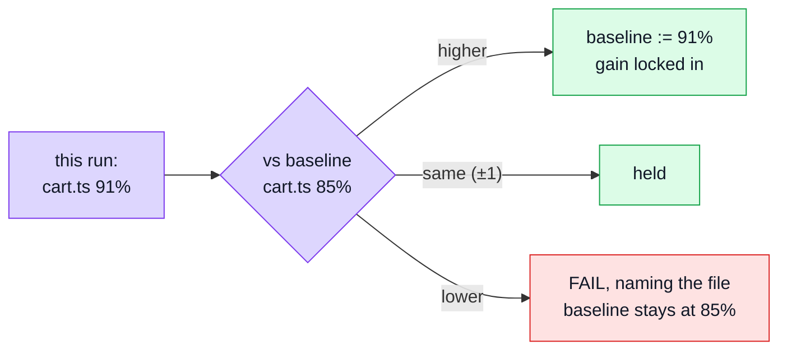

# Mutation testing: the ratchet

Part of [Mutation Testing](./mutation-testing.md): the per-file ratchet, choosing what to strengthen, and thresholds.

## The per-file ratchet

Stryker's own thresholds are **global** — `high`, `low`, `break`, and nothing else. That is a pooling failure: a strong file carries a weak one, and the number that passes is an average nobody can act on. It gets worse as `mutate` widens, not better.

So `mutation-baseline.json` records a score **per file**, and `scripts/mutation/check-baseline.ts` compares each run against it. The committed file is pending a reseed under the merged ruler ([one ruler](./mutation-testing.md#one-ruler)) — once `mutation:full` has covered the whole scope and folded it in, every run after that compares against it:

- a file that drops below its recorded score **fails**;
- a file that improves has its baseline **rewritten upward**, locking the gain in;
- a new file is recorded at whatever it first measures, **including `0`** — an honest zero in a diff beats a zero dissolved into a mean.



A regression **cannot be laundered**: running with `--update` on a regressed file keeps the higher value _and_ still exits non-zero.

A one-point tolerance absorbs the timeout/survivor race (whether a hanging mutant is recorded as a timeout or a survivor depends on machine load), not genuine weakening.

## Choosing what to strengthen next

A report ranked by score answers "where is the number lowest", which is almost never the same
question as "where would a test be worth most". Two filters come first.

### Agnostic before applicable

This repository is a boilerplate. The demo is a small shop, and a real shop built from it will have
far more product code than this — but that code is written once, by whoever forks it. What every
fork inherits _unchanged_ is the core: the cache adapter, the queue adapter, the upload pipeline,
the auth service, the error interpreter. A bug there ships to every project that ever started here.

So the order is by **blast radius**, not by percentage. the account login service (`src/modules/account/services/login.ts` since the split) at 53% mattered more
than a lower-scoring model of an order line, because every application has logins and only this one
has orders.

### `total` versus `covered` — two different jobs

The report prints both, and the gap between them is the whole diagnosis:

| Reading                  | Meaning                                     | The work                                   |
| ------------------------ | ------------------------------------------- | ------------------------------------------ |
| both low, close together | tests run this code and do not assert on it | **assert harder** on what already executes |
| total ≪ covered          | most mutants have **no coverage**           | **write tests that reach it at all**       |
| both high                | done                                        | move on                                    |

Those are different pieces of work and the single percentage does not distinguish them. Of the four
files strengthened most recently, all four were the second kind — `cache.ts`'s entire
read/write/invalidate path reported _no coverage_, because exercising it needs a Redis and the unit
suite has none. The fix was a fake client, not sharper assertions.

### Prefer a file with a rule to grade against

Between two files with a similar blast radius, take the one whose behaviour is **stated somewhere
other than the code** — a contract schema, a `docs/understand` rule, a documented policy. A survivor
tells you a change was invisible; it does not tell you which behaviour was supposed to be there.
Without an independent statement the natural move is to assert whatever the code currently does,
and that produces exactly the tautology the [spec-drift audit](./ai-auditing.md) exists to find.

`validation-messages.ts` scores worse than most and is a good first stop for precisely this reason
— its contract is written down in `docs/understand/request-flow.md`. A file with an equally bad score
and no stated rule is a worse target, not a better one.

Do not keep a ranked file list here. Survivor counts are a snapshot of one run and go stale
silently; `stryker-incremental.json` and a fresh report are the source of truth, and the filters
above are what turn either into an order.

### Then falsify, every time

A test written against a survivor is a test written to make a number move, which is exactly the
failure mode mutation testing exists to catch. So each one is checked the only way that means
anything: **break the source on purpose and confirm the suite goes red.**

```bash
# e.g. make a poison message requeue instead of being discarded
#   ch.nack(incoming, false, false)  →  ch.nack(incoming, false, true)
npx jest tests/unit/infrastructure/adapters/queue.test.ts     # must FAIL
```

Occasionally the mutation cannot be expressed at all — removing the null-delivery guard in
`consumeFromQueue` is a **compile** error, because the type is `ConsumeMessage | null`. That is a
finding worth keeping rather than working around: the guard is enforced by the type system, and no
test is needed to defend it.

## Thresholds — measured, not invented

`high` and `low` only colour the report — `stryker.json` carries `80` / `60`, unchanged by the
ruler merge. `break` is deliberately `null`: 40% of `observability`'s mutants were `NoCoverage` on
its own first real measurement under the wider ruler, which makes any single global number invented
rather than measured for a scope this partially covered. The per-file ratchet in
`mutation-baseline.json` is the gate instead, for the reason [The per-file ratchet](#the-per-file-ratchet)
gives generally: one collapsing file cannot hide behind hundreds of healthy ones under a global
percentage.

This was not always the setting. Before the ruler merge, the unit-only config's `break` was **60** —
copied directly from the frontend's own `thresholds.break`, and it stayed there as a deliberate,
sustained exception to the rule below because the two files were meant to stay one pair. That
config is gone now, and its `break` went with it; the merged `stryker.json` never had a reason to
set one, since the ratchet was already doing the real gating.

Ordinarily the rule is: raise `break` when a score **sustains** a higher band; never lower it to make a run pass. The single sanctioned exception besides the one above is a change to `mutate` — which changes the population, so old and new numbers are not measurements of the same thing — re-recorded in the same commit with both numbers and the reason.

### Baseline status: pending a reseed

`mutation-baseline.json`'s committed contents were measured under the old unit-only ruler and are
not comparable to what the merged `stryker.json` reports — see [one ruler](./mutation-testing.md#one-ruler). The first
full sweep under the merged ruler (`npm run mutation:full`, folded in once every shard has a report)
is what replaces them; until it runs, read the file on disk as understating every integration-
covered file's real score, never as a grade.

## Read next

- [Mutation Testing](./mutation-testing.md) — the hub
- [Coverage & Confidence](./coverage-and-confidence.md)
