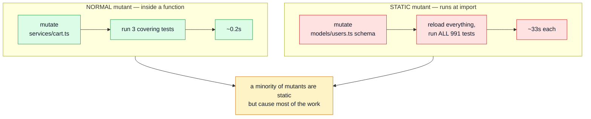
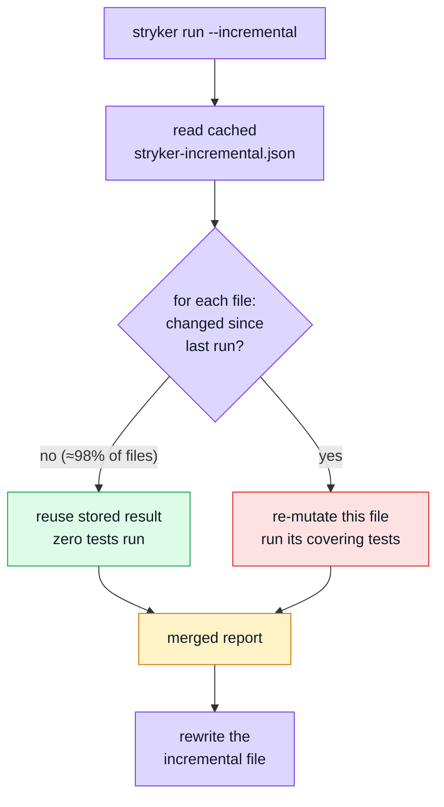
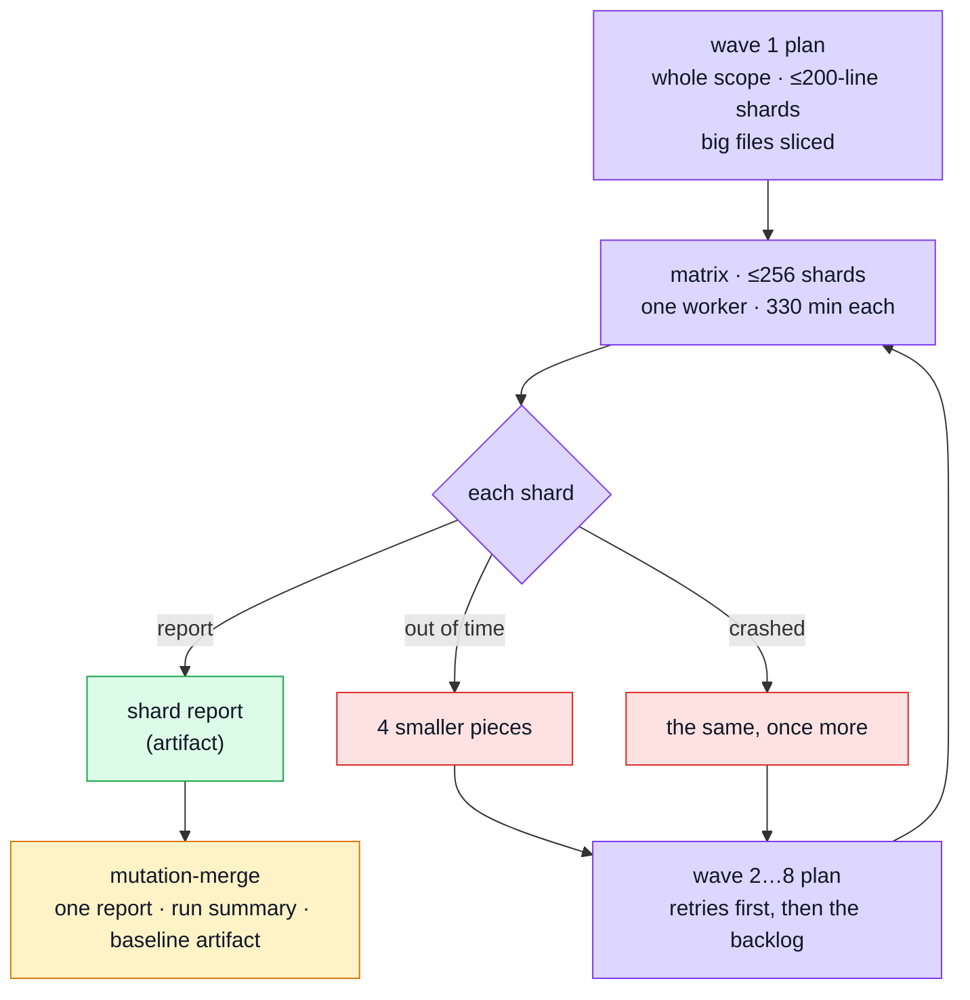

# Mutation testing: running it

Part of [Mutation Testing](./mutation-testing.md): why a run is slow, incremental mode, the three commands, the GitHub sweep and the diff run.

## Why the full sweep never gates a PR — the diff run does instead

A full sweep re-executes the whole suite once per mutant, hours of work. `.github/workflows/mutation.yml`
is a separate workflow from `ci.yml` — **monthly** (`cron: '0 3 1 * *'`) plus manual dispatch — kept
structurally separate rather than folded into `ci.yml` behind a conditional: a separate file can't
become a PR gate by accident. The one job in that file that DOES run on `pull_request` is the diff
run, scoped to the files a branch changed rather than the whole scope — see
[The diff run](#the-diff-run-and-why-it-can-fail-when-the-full-sweep-cannot).

## Why a run is slow — static mutants {#why-a-run-is-slow-static-mutants}

This is the thing worth understanding, because it explains an otherwise baffling number.

`coverageAnalysis: perTest` means Stryker normally runs only the handful of tests that touch the mutated line. But some mutants are **static** — they live in code that executes when the module is _imported_ rather than when a test calls it:

```ts
export const userSchema = new Schema({ ... });        // runs at import
export const userRepository = createRepository(); // runs at import
```

Stryker cannot swap those in and out per test. It has to reload the whole environment — and so, from its planner:

```js
else {  // static, and ignoreStatic is off
    return this.createMutantRunPlan(mutant, {
        netTime: this.timeSpentAllTests,
        testFilter: this.globalTestFilter,   // ← every test in the suite
    });
}
```

Visually, the difference:



**One static mutant runs the entire suite.** The share is worth measuring rather than guessing: the run's summary prints `tests per mutant on average`, and the JSON reporter labels each mutant `static`, so counting them per file names the handful that dominate the wall clock.

The mutate scope has one real number now, from `observability` — its cheapest module, at 5 files and
421 mutants: **49m35s at `--concurrency 2`, ~7.1 seconds per mutant.** The other files in
`stryker.json`'s `mutate` (`scopeWithLines()` in `scripts/mutation/mutate-scope.ts` counts the scope: 918 files, 93,921 mutable lines on 2026-10-22) have never completed a run;
extrapolating that one file's rate to the whole scope is what the sharding in
[Why the full sweep is sharded](#why-the-full-sweep-is-sharded)
is sized from, and it is a single data point rather than a settled average — re-measure per-shard
timings once a few monthly sweeps have run, the same way `concurrency` and `maxTestRunnerReuse`
below carry their own expiry dates.

It also inflates timeouts, because the timeout is derived from how long the tests are expected to take:

```
timeout = timeoutFactor × netTime + timeoutMS + overhead
```

For a static mutant `netTime` is the whole suite, which is what makes those timeouts minutes rather than seconds. Every module's model and repository builds its objects at module scope, so the static surface here is large by design.

### `ignoreStatic` — rejected permanently {#static-mutants-open-question}

| Option                                 | Effect                                                            | Status                                                                                                      |
| -------------------------------------- | ----------------------------------------------------------------- | ----------------------------------------------------------------------------------------------------------- |
| Raise `concurrency`                    | Near-linear speed-up, **changes no measurement**                  | **Done** — `stryker.json` sets 4, the CI shard jobs pass 1, and `STRYKER_CONCURRENCY` raises it per machine |
| `incremental: true`                    | PR runs re-mutate only changed files                              | Not done — the diff run narrows via `--mutate` and `--force`s past any cache                                |
| Split the sweep into one job per layer | Wall-clock becomes the slowest group, not the sum                 | Not done; probably unnecessary if the cost is fixed at the source                                           |
| `ignoreStatic: true`                   | Removes the whole-suite reruns — but stops measuring some mutants | **Rejected permanently, 2026-09-20 — see below.**                                                           |
| Move logic out of module scope         | The only fix that costs nothing in measurement                    | Invasive; module-scope schemas are idiomatic Mongoose                                                       |

`ignoreStatic` is a real, documented Stryker option, and Stryker's own description of it says "it might make sense to ignore static mutants". But **its default is `false`**, and that default is a judgement by the people who wrote the tool: measuring those mutants is the safer behaviour.

**Read from the planner, not the docs** (`@stryker-mutator/core/src/mutants/mutant-test-planner.ts`):
`ignoreStatic` does not "stop measuring static mutants" — it only drops the ones with **no per-test
coverage at all**. A static-and-covered ("hybrid") mutant is still measured, just activated at
runtime instead of module load.

| Mutant kind                               | today               | with `ignoreStatic`                     |
| ----------------------------------------- | ------------------- | --------------------------------------- |
| runtime only                              | covering tests only | unchanged                               |
| **hybrid** — static AND per-test coverage | **whole suite**     | covering tests only, runtime activation |
| **pure static** — no per-test coverage    | whole suite         | **`Ignored`, never measured**           |

**Measured, not assumed.** From a completed 181-mutant sample across three leaf service files:
**66 static, 64 hybrid, 2 pure-static.** `ignoreStatic` would have dropped 2 of 181 — a small win in
speed, bought at the cost of never measuring what those 2 mutants do, and a smaller sample of module
and repository files (where the static surface actually concentrates) was not in it.

Two things argue against switching it on, independent of the ratio:

1. **It is a trade-off, not a fix.** It buys speed by not measuring some code, permanently.
2. **Soundness.** With `ignoreStatic` on, a static-but-covered mutant is activated at _runtime_
   rather than at module load (`mutantActivation: 'runtime'` in the planner). A mutant whose only
   effect happens during import may then never actually trigger, and be reported as survived when it
   was never really tested. That is a quieter failure than a slow run.

**The decision: off, permanently. Not a lever, not a second pipeline.** The measurement it would
buy — static vs. hybrid vs. pure-static, per mutant — is computable from any Stryker JSON report
already on disk (`static` + `coveredBy`), so there is no future version of this question that needs
a config change to answer; re-derive the ratio from a report instead of re-opening the option.

## Incremental mode — what it is {#incremental-mode-what-it-is}

**Enabled.** This is what makes mutation testing usable on a pull request rather than only in a monthly sweep.

**The problem.** Every run starts from scratch. Change one line in one service, and Stryker still re-mutates every mutant across the whole codebase — including all the ones in files you did not touch, whose results will be identical to last time.

**The mechanism.** With `incremental: true`, Stryker writes every mutant's result to
`tmp/reports/stryker-incremental.json` — gitignored, so it lives only on the machine that wrote it
(see below). On the next run it compares the new source against what the file remembers:

- file unchanged → reuse the stored result, run nothing
- file changed → re-mutate it properly
- a _test_ changed → re-run the mutants that test covers, because the answer may now be different



**What it changes in practice.** A pull request touching one service goes from every mutant in the repo to a few dozen — seconds instead of the full sweep. That is what turns mutation testing from "a report you read once a week" into "a check on your PR".

**The catch, and why the full sweep still runs in full.** The incremental file is a cache, and caches go stale — a refactor that moves code between files, a dependency upgrade, or a merge conflict resolved badly can leave it describing a codebase that no longer exists. So the intended shape is two runs with different jobs:

| Run               | Trigger                   | Setting                                      | Purpose                                            |
| ----------------- | ------------------------- | -------------------------------------------- | -------------------------------------------------- |
| PR (diff)         | `pull_request`            | `--force`                                    | Always a clean measurement of the changed files    |
| Local full sweep  | `npm run mutation:full`   | `incremental` per shard, `--force` on demand | Fast by default; refreshed from scratch on request |
| GitHub full sweep | cron (monthly) / dispatch | nothing restored — from scratch every time   | Slow, and never stale                              |

`--force` tells Stryker to ignore the stored results entirely, which is what stops staleness accumulating.

## Running it locally {#running-it-locally}

There is no command that mutates the whole scope in one unsharded pass — `npm run mutation:full`
is always sharded (see [why](#why-the-full-sweep-is-sharded)), because an unsharded run over hours
of mutants has nothing to show for itself if it is killed partway: **a killed Stryker run writes no
report at all**, not even for the mutants it already finished.

**Why an unsharded pass would not converge here.** ~24% of the scope's mutants are static, each one
reruns the entire suite ([above](#why-a-run-is-slow-static-mutants)). Measured 2026-09-20: at
concurrency 6, 4, 2 and 1 alike, and with the heap cap fixed, an unsharded local run's remaining-time
estimate climbed for forty minutes instead of falling. Do not re-derive that — it has been tried:

| Lever                                    | Outcome                                                                                                                                                  |
| ---------------------------------------- | -------------------------------------------------------------------------------------------------------------------------------------------------------- |
| `STRYKER_CONCURRENCY` 6 → 4 → 2 → 1      | identical crash at every value — **concurrency is not the lever**                                                                                        |
| `STRYKER_WORKER_HEAP_MB=8192`            | fixes the first-minute crash ([the heap cap](./mutation-testing-memory.md#worker-heap-cap)) — and an unsharded run still does not converge               |
| `ignoreStatic: true`                     | **not enabled, and not the fix either** — it only drops mutants with no per-test coverage at all; see [the open question](#static-mutants-open-question) |
| Narrowing to a branch's 20 changed files | still 31% static, because infrastructure files pull in most of the suite as "related"                                                                    |

**What to run:**

```bash
npm run mutation                     # the files this branch changed — minutes
npm run mutation:full -- --list      # the whole scope as shards, and what is recorded
npm run mutation:full -- --limit=2   # an evening's worth
```

`mutation:full` is the scope bin-packed by `scripts/mutation/sharding.ts` — the same plan the monthly
CI matrix uses — run one shard after another, each shard's report kept under
`tmp/reports/mutation-shards/`. Stop after two and two are banked; the next evening starts at the third.

**Sharding is not faster.** A shard narrows _which mutants_ are tested and narrows nothing about the
suite, so a static mutant inside one still reruns everything. What sharding buys is partial credit:
the unit the machine can lose is now one shard, not the whole sweep. `--shard-lines` trades the two
costs against each other — every shard pays the whole-suite dry run again, so bigger shards waste
less on setup and go longer between banked results.

**The baseline is written only when the scope closes.** Until every shard has a report the sweep
records nothing, and when it does close it folds in with `--merge`, which never lowers a score and
never drops a file it did not measure. A half-covered scope left on disk is not a number.

## The three commands {#the-three-commands}

One ruler, one baseline, three commands. Before 2026-09-20 there were two configs, two baselines and
nine npm scripts between them; the rework collapsed that into this:

```
npm run mutation          # the files this branch changed, graded against the baseline
npm run mutation:full     # the whole repo, sharded, resumable across evenings
npm run mutation:check    # grade the last report; non-zero if a file dropped
```

Recording the baseline is not a fourth command: `mutation:full` folds its shards in when — and only
when — every shard has a report (below). `mutation:check -- --update` is the manual escape hatch for
recording an intentional change (§[The per-file ratchet](./mutation-testing-ratchet.md#the-per-file-ratchet)).

| Command          | Tests it runs                      | Mutates                           | When                            |
| ---------------- | ---------------------------------- | --------------------------------- | ------------------------------- |
| `mutation`       | unit + cross-cutting + integration | only the files the branch changed | every pull request              |
| `mutation:full`  | unit + cross-cutting + integration | everything in `mutate`, sharded   | monthly (the 1st), or on demand |
| `mutation:check` | (reads the last report)            | —                                 | after either run above          |

### Why the full sweep is sharded {#why-the-full-sweep-is-sharded}

The mutate scope is measured, not estimated: `scopeWithLines()` in `scripts/mutation/mutate-scope.ts`
reports **918 files, 93,921 mutable lines** on 2026-10-22 (`stryker.json`'s `mutate`), and `observability` — its cheapest module — took 49m35s for 421
mutants, ~7.1 seconds each at `--concurrency 2`. Applied to the whole scope that is on the
order of **a hundred and more runner-hours** (it grows with the line total): no per-shard timeout GitHub allows, and no number of module-shaped shards, makes
that fit in one run, because splitting work does not shrink the total, it only changes how many
shards run in parallel.

So sharding is the default, not a fallback:

- **Sharded by line count**, not module name. Both sweeps walk the SAME roots `stryker.json`
  declares (`scripts/mutation/mutate-scope.ts`), which closes the gap the old hand-written matrix
  had: a module added to `src/modules/` is in a shard the next time either runs, with nothing to
  edit. Locally `scripts/mutation/sharding.ts` packs ~600 lines a shard; on GitHub,
  `scripts/mutation/ci/waves.ts` plans much smaller ones — [The GitHub sweep](#the-github-sweep).
- **Monthly, not nightly or weekly.** One full sharded sweep a month (the 1st) covers the whole
  scope. At six jobs at a time it takes about a week, and the free plan's job slots are shared by
  every repository on the account, so weekly would keep it running almost without pause. Between
  sweeps, the diff run keeps every changed file honest. The old three-night rotation existed only
  because the full scope did not fit in one night.
  On-demand-only was tried and rejected too: it means never, and a baseline nobody refreshes gates
  nothing — a file that arrives after the last sweep has no recorded score, so the checker treats
  an unknown file as nothing to compare against, and new code ends up the code least covered by
  the ratchet. Nightly was tried too, and this repo already lived that failure: 24 failures and
  12 cancellations over 35 nights, unnoticed, until `mutation-notify` was added.

`mutation-merge` then folds every finished shard into `mutation-baseline.json` with `--merge` —
see [`mergeIntoBaseline`](./mutation-testing-ratchet.md#the-per-file-ratchet): files the sweep could not measure are left
exactly as they were, not treated as having left the mutate scope.

### The GitHub sweep {#the-github-sweep}

The monthly `mutation.yml` run. Same `stryker.json`, same ruler as `npm run mutation:full` — cut to
fit GitHub's free runners instead of a desktop. It is built to **finish**, not to be fast: a sweep
from scratch takes about a week.

#### Why GitHub needs different settings {#why-github-needs-different-settings}

The ruler is the same; the machine is not. Every setting below is a property of the machine, which
is why none of them lives in `stryker.json`:

|                    | Your desktop (`npm run mutation:full`)           | A GitHub runner (`mutation.yml`)                       |
| ------------------ | ------------------------------------------------ | ------------------------------------------------------ |
| Hardware           | 32 cores, ~30 GB                                 | 4 vCPU, 16 GB                                          |
| Time limit         | none                                             | 6 hours a job, then killed                             |
| Interrupted?       | resume tomorrow — each finished shard is on disk | a killed job leaves nothing; Stryker writes at the end |
| Workers × heap     | 2 × 8 GB (`.env`)                                | 1 × 12 GB, plus swap                                   |
| Shard size         | ~600 lines (`sharding.ts`)                       | ≤200 lines, big files sliced (`ci/waves.ts`)           |
| Remembers last run | yes — incremental file per shard                 | no — a fresh machine every job                         |
| How many at once   | one shard after another                          | up to 6 jobs, of the account's 20                      |

#### Worked example: the sweep that went red (2026-09-27) {#worked-example-the-sweep-that-went-red}

The old workflow ran the desktop's shape on GitHub's hardware: 600-line shards, two workers at
Node's default ~4 GB heap. Of 80 shards, 39 finished, 30 crashed, 11 were killed. Each failure
traces back to one row of the table above:

| What happened                                                                 | The desktop assumption that broke                                                                                                                                    | What the sweep does now                                                                |
| ----------------------------------------------------------------------------- | -------------------------------------------------------------------------------------------------------------------------------------------------------------------- | -------------------------------------------------------------------------------------- |
| 30 shards: "ran out of memory" in 10–20 minutes, before any mutant ran        | Memory. The initial test run of a widely imported file (`users/model.ts`) loads most of the suite into one process; 4 GB is not enough, the desktop's 8 GB is.       | 12 GB heap, one worker so it fits, swap; `preflight` proves it before the sweep starts |
| 11 shards killed at 350 minutes — `queue.ts` alone at 264 of 272 mutants      | Time. 600 lines is an evening on the desktop, where a shard can take as long as it needs; on a runner it overran the 6-hour cap, and the work was lost with the job. | 200-line shards, big files sliced, a shard out of time split in four and run again     |
| The 39 that finished took 129–338 minutes — several within minutes of the cap | Same: the size was never measured on a runner.                                                                                                                       | Sized from that run: 0.43 min per line at two workers, so ~0.9 at one                  |
| The baseline was not saved                                                    | Not a machine issue: the commit step ran only when no file regressed, and 8 had.                                                                                     | The report is uploaded whatever the verdict, and the baseline is folded from it        |

The lesson generalises to any heavy job moved to CI: **measure it on the runner, and design for the
job being killed**. A desktop run fails slowly and visibly; a runner kills the job and keeps nothing.

#### Which run to use when {#which-run-to-use-when}

- **Before or after changing a file** — `npm run mutation`. Minutes. Open
  `tmp/reports/mutation/index.html`: every surviving mutant is a change your tests would not notice.
- **On a pull request** — the `mutation-diff` job does the same automatically and fails only if a
  file you touched scored below its baseline.
- **To refresh every score** — the monthly GitHub sweep then `npm run mutation:pull`, or
  `npm run mutation:full` on the desktop over a few evenings. Either one ends in the same
  `mutation-baseline.json`; the pull also brings the sweep's whole `mutation.json` home.
- **To check the GitHub setup still fits** — _Run workflow_ with **check-only**: the 20-minute
  preflight alone.

| GitHub's limit              | What the sweep does about it                                                                                                                                                      |
| --------------------------- | --------------------------------------------------------------------------------------------------------------------------------------------------------------------------------- |
| 6 hours a job               | Shards of at most 200 non-blank lines; a bigger file is sliced. Stryker is stopped at 330 minutes, so the job itself records that it ran out of time.                             |
| 16 GB a runner              | One Stryker worker, a 12 GB heap, 16 GB of extra swap. On 2026-09-27, two workers at 4 GB lost 30 of 80 shards to "ran out of memory" before a single mutant ran.                 |
| 256 jobs a matrix           | **Waves.** Each wave is one matrix; what does not fit waits for the next.                                                                                                         |
| 20 jobs at once (free plan) | `max-parallel: 6`, leaving fourteen for `ci.yml`, the frontend and everything else — a sweep lasts a week and must not starve them.                                               |
| The plan is a guess         | A shard out of time comes back in the next wave in four pieces; one that crashed comes back once, as it was. After eight waves, whatever is left is reported as **not measured**. |



**Preflight.** Before wave 1, `preflight` runs Stryker's initial test run (`--dryRunOnly`, no
mutant tested) for `src/modules/users/model.ts` — imported by nearly every test file, so the
widest initial run any shard makes, and the one that ran out of memory in 30 shards on 2026-09-27.
It uses the wave shards' exact runner setup (`.github/actions/mutation-runner`). If it fails, no
wave starts. Tick **check-only** in _Run workflow_ to run just this, in about 20 minutes, before
committing to a multi-day sweep.

**Slicing a file without changing the measurement.** Stryker's own line ranges
(`--mutate 'file.ts:10-40'`) mutate only nodes wholly inside the range, so a node crossing a slice
edge — a function body, a schema object — would be mutated by no slice at all. The sweep instead
runs the whole file in every slice and loads a small ignorer plugin
(`scripts/mutation/ci/slice-ignorer.ts`, via a config written fresh from `stryker.json` each job)
that skips only subtrees which do not touch the slice. A node crossing an edge touches both
neighbours, so both test it and the merge keeps one result. Checked 2026-09-30 on
`src/infrastructure/runtime/cluster-policy.ts`, cut through the middle of a function: the merged
slices matched the whole-file run mutant for mutant, 26 of 26, and the function body that crossed
the cut ran in both halves.

**Reading the result.**

- **Run page:** the summary — score, mutants by status, the weakest files, anything not measured.
- **`mutation-report` artifact:** the merged `mutation.json`, its `index.html` (Stryker's own
  viewer, the shards merged into it) and the run page's `summary.md`. Kept 90 days.
  `npm run mutation:pull` puts the first two in `tmp/reports/mutation/` and folds
  `mutation-baseline.json` from the report — the same fold the merge job runs. Review the
  baseline's diff and commit it.
- **Red run:** exactly one of two things — a file could not be measured in any wave, or a file
  scored below its baseline. A red _shard_ inside a wave is not a failure: it is a retry being
  scheduled. The report is uploaded either way.
- **On demand:** Actions tab → Mutation → Run workflow. A new run queues behind one in progress
  instead of cancelling it.

**No write access, on purpose.** Every job here runs `npm ci`, and an install script of any
package in the tree runs with whatever token the job holds. A token that can push to `main`, next to
hundreds of packages' install scripts, is the supply-chain shape GitHub's own hardening guide warns
against ([GitHub Security Lab](https://securitylab.github.com/resources/github-actions-preventing-pwn-requests/)).
So every job is `contents: read`, every checkout sets `persist-credentials: false`, and the result
leaves as the `mutation-report` artifact. Bringing it home is one command and a commit:

```bash
npm run mutation:pull     # newest unexpired report from a sweep of main, baseline folded from it
git diff mutation-baseline.json
```

When there is nothing to pull, the error names which of three cases it hit:

| Message starts                                            | Meaning                                      | What to do                                                                    |
| --------------------------------------------------------- | -------------------------------------------- | ----------------------------------------------------------------------------- |
| `no mutation-report artifact exists`                      | no sweep of `main` has reached its merge job | `gh workflow list --all`; `gh run list --workflow mutation.yml --branch main` |
| `mutation-report artifacts exist only for other branches` | only non-`main` runs uploaded                | dispatch the sweep on `main`                                                  |
| `every mutation-report artifact from main has expired`    | the newest is past its 90 days               | re-run the sweep                                                              |

**Cost.** The shard count follows the scope's line total (`SHARD_LINES` in
`scripts/mutation/ci/waves.ts`), so wave 1 fills and the rest spills into wave 2. Measured on the
2026-09-27 sweep: a median 0.43 runner-minutes per line at two workers (a floor — the shards that
timed out are heavier). One worker is _assumed_ to double that, plus roughly 15 minutes of setup per
shard: **days, not hours**, at 6 in parallel, retries included, and more as the scope grows. Every sweep starts from scratch; nothing is carried between runs.
Re-measure the per-line figure from the first finished sweep and update both this paragraph and
`SHARD_LINES` in `scripts/mutation/ci/waves.ts`.

Nothing here touches the local sweep: `npm run mutation:full` keeps its own shard size
(`sharding.ts`) and its machine-sized settings (`stryker-run.ts`).

### The diff run, and why it can fail when the full sweep cannot

The full sweep's own Stryker step does not gate: `stryker.json`'s `thresholds.break` is `null`, on
the same reasoning as the ratchet everywhere else on this page — a single global percentage over the
whole scope hides exactly the file that matters. `mutation-merge` folds every shard into
`mutation-baseline.json` regardless of the result, so the record always reflects what was actually
measured. The diff run is the one that can block a PR, and it does so on a narrower question: **did
a file you touched score below what the baseline already records for it?**

It mutates WHOLE changed files rather than changed lines. Stryker supports line ranges
(`--mutate 'file.ts:10-40'`, which is how Google's published practice scopes a diff), and whole
files are chosen deliberately: whole-file scores are what the baseline records, so they compare
directly, whereas a line-range score is comparable to nothing. The consequence is intended — touch a
file and you own not making its debt worse.

Two things follow from ratcheting rather than thresholding, and both matter:

- **Pre-existing weakness cannot fail you.** The baseline already records it. You simply cannot
  lower it further.
- **Equivalent mutants cannot fail you.** A mutant no test could ever kill — `.catch(() => null)`
  becoming `() => undefined`, say — was already surviving when the baseline was taken, so it is
  priced in and moves nothing. This is why the diff run needs none of the mutant-suppression
  heuristics that a threshold-based diff gate would.

Stryker's own `thresholds.break` is deliberately not the verdict here. It is a percentage over
whatever the diff happens to contain: one survivor is 50% of two mutants and 10% of ten, and the
size of a diff is not a fact about the code.

The run never records. `--update` is not forwarded, because a partial report written as the baseline
would erase every file it did not measure — `check-baseline.ts` refuses that explicitly.
The monthly sweep owns the baseline.

```bash
npm run mutation                  # against origin/main
npm run mutation -- --base=HEAD~3
```

**Where its result goes.** It is graded on the changed files alone. Then its results are laid over
the `mutation.json` already on disk (`overlayReport` in `scripts/mutation/ci/merge.ts`): the changed
files take the new result, every other file keeps the one that was there. `index.html` is redrawn
from the result. On a fresh checkout, and in the `mutation-diff` job, there is nothing to lay it
over, and the report holds the changed files alone.

::: warning When GitHub runs your mutations
After `npm run mutation`, the report on disk is no longer GitHub's sweep. It is a mix:

- **the files you changed** — this run, on your machine, against your uncommitted or unpushed code
- **every other file** — the sweep, as pulled, against the code `main` had on the sweep's day

`mutation-baseline.json` is not touched: the diff run never records. So:

- **Pull first, then run.** `npm run mutation:pull` before `npm run mutation`, or the mix is laid
  over an older sweep, or over nothing.
- **Never commit a baseline made from the mix.** The baseline only ever comes from a whole sweep:
  `mutation:pull`, or a closed `mutation:full`.
- **To get GitHub's sweep back**, pull again. It replaces the mix.
  :::

**Cost.** Whole-file scope makes this minutes, not seconds: a four-file diff measured 402 mutants,
and `products/repository.ts` alone is 196. Budget tens of minutes on a PR that touches a large
service.

## Read next

- [Mutation Testing](./mutation-testing.md) — the hub
- [Coverage & Confidence](./coverage-and-confidence.md)
