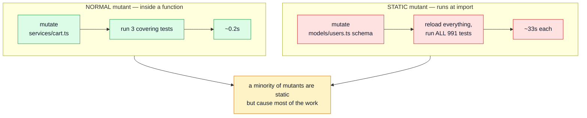
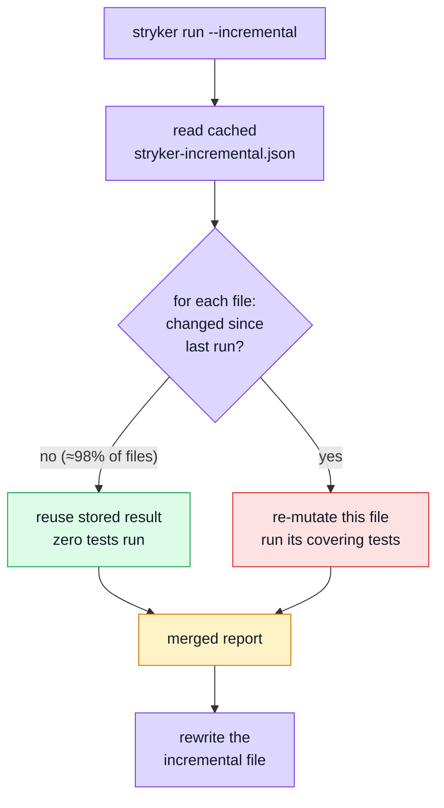

# Mutation testing: running it

Part of [Mutation Testing](./mutation-testing.md): why a run is slow, incremental mode, the three commands, the GitHub sweep and the diff run.

## Why the full sweep never gates a PR — the diff run does instead

A full sweep re-executes the whole suite once per mutant, hours of work. `.github/workflows/mutation.yml`
is a separate workflow from `ci.yml` — **monthly** (`cron: '0 3 1 * *'`) plus manual dispatch — kept
structurally separate rather than folded into `ci.yml` behind a conditional: a separate file can't
become a PR gate by accident. The one job in that file that DOES run on `pull_request` is the diff
run, scoped to the files a branch changed rather than the whole scope — see
[The diff run](./mutation-testing-sweeps.md#the-diff-run-and-why-it-can-fail-when-the-full-sweep-cannot).

## Why a run is slow — static mutants {#why-a-run-is-slow-static-mutants}

This is the thing worth understanding, because it explains an otherwise baffling number.

`coverageAnalysis: perTest` means Stryker normally runs only the handful of tests that touch the mutated line. But some mutants are **static** — they live in code that executes when the module is _imported_ rather than when a test calls it:

```ts
export const userSchema = new Schema({ ... });        // runs at import
export const userRepository = createRepository(); // runs at import
```

Stryker cannot swap those in and out per test. It has to reload the whole environment — and so, from its planner:

```js
else {  // static, and ignoreStatic is off
    return this.createMutantRunPlan(mutant, {
        netTime: this.timeSpentAllTests,
        testFilter: this.globalTestFilter,   // ← every test in the suite
    });
}
```

Visually, the difference:



**One static mutant runs the entire suite.** The share is worth measuring rather than guessing: the run's summary prints `tests per mutant on average`, and the JSON reporter labels each mutant `static`, so counting them per file names the handful that dominate the wall clock.

The mutate scope has one real number now, from `observability` — its cheapest module, at 5 files and
421 mutants: **49m35s at `--concurrency 2`, ~7.1 seconds per mutant.** The other files in
`stryker.json`'s `mutate` (`scopeWithLines()` in `scripts/mutation/mutate-scope.ts` counts the scope: 918 files, 93,921 mutable lines on 2026-10-22) have never completed a run;
extrapolating that one file's rate to the whole scope is what the sharding in
[Why the full sweep is sharded](./mutation-testing-sweeps.md#why-the-full-sweep-is-sharded)
is sized from, and it is a single data point rather than a settled average — re-measure per-shard
timings once a few monthly sweeps have run, the same way `concurrency` and `maxTestRunnerReuse`
below carry their own expiry dates.

It also inflates timeouts, because the timeout is derived from how long the tests are expected to take:

```
timeout = timeoutFactor × netTime + timeoutMS + overhead
```

For a static mutant `netTime` is the whole suite, which is what makes those timeouts minutes rather than seconds. Every module's model and repository builds its objects at module scope, so the static surface here is large by design.

### `ignoreStatic` — rejected permanently {#static-mutants-open-question}

| Option                                 | Effect                                                            | Status                                                                                                      |
| -------------------------------------- | ----------------------------------------------------------------- | ----------------------------------------------------------------------------------------------------------- |
| Raise `concurrency`                    | Near-linear speed-up, **changes no measurement**                  | **Done** — `stryker.json` sets 4, the CI shard jobs pass 1, and `STRYKER_CONCURRENCY` raises it per machine |
| `incremental: true`                    | PR runs re-mutate only changed files                              | Not done — the diff run narrows via `--mutate` and `--force`s past any cache                                |
| Split the sweep into one job per layer | Wall-clock becomes the slowest group, not the sum                 | Not done; probably unnecessary if the cost is fixed at the source                                           |
| `ignoreStatic: true`                   | Removes the whole-suite reruns — but stops measuring some mutants | **Rejected permanently, 2026-09-20 — see below.**                                                           |
| Move logic out of module scope         | The only fix that costs nothing in measurement                    | Invasive; module-scope schemas are idiomatic Mongoose                                                       |

`ignoreStatic` is a real, documented Stryker option, and Stryker's own description of it says "it might make sense to ignore static mutants". But **its default is `false`**, and that default is a judgement by the people who wrote the tool: measuring those mutants is the safer behaviour.

**Read from the planner, not the docs** (`@stryker-mutator/core/src/mutants/mutant-test-planner.ts`):
`ignoreStatic` does not "stop measuring static mutants" — it only drops the ones with **no per-test
coverage at all**. A static-and-covered ("hybrid") mutant is still measured, just activated at
runtime instead of module load.

| Mutant kind                               | today               | with `ignoreStatic`                     |
| ----------------------------------------- | ------------------- | --------------------------------------- |
| runtime only                              | covering tests only | unchanged                               |
| **hybrid** — static AND per-test coverage | **whole suite**     | covering tests only, runtime activation |
| **pure static** — no per-test coverage    | whole suite         | **`Ignored`, never measured**           |

**Measured, not assumed.** From a completed 181-mutant sample across three leaf service files:
**66 static, 64 hybrid, 2 pure-static.** `ignoreStatic` would have dropped 2 of 181 — a small win in
speed, bought at the cost of never measuring what those 2 mutants do, and a smaller sample of module
and repository files (where the static surface actually concentrates) was not in it.

Two things argue against switching it on, independent of the ratio:

1. **It is a trade-off, not a fix.** It buys speed by not measuring some code, permanently.
2. **Soundness.** With `ignoreStatic` on, a static-but-covered mutant is activated at _runtime_
   rather than at module load (`mutantActivation: 'runtime'` in the planner). A mutant whose only
   effect happens during import may then never actually trigger, and be reported as survived when it
   was never really tested. That is a quieter failure than a slow run.

**The decision: off, permanently. Not a lever, not a second pipeline.** The measurement it would
buy — static vs. hybrid vs. pure-static, per mutant — is computable from any Stryker JSON report
already on disk (`static` + `coveredBy`), so there is no future version of this question that needs
a config change to answer; re-derive the ratio from a report instead of re-opening the option.

## Incremental mode — what it is {#incremental-mode-what-it-is}

**Enabled.** This is what makes mutation testing usable on a pull request rather than only in a monthly sweep.

**The problem.** Every run starts from scratch. Change one line in one service, and Stryker still re-mutates every mutant across the whole codebase — including all the ones in files you did not touch, whose results will be identical to last time.

**The mechanism.** With `incremental: true`, Stryker writes every mutant's result to
`tmp/reports/stryker-incremental.json` — gitignored, so it lives only on the machine that wrote it
(see below). On the next run it compares the new source against what the file remembers:

- file unchanged → reuse the stored result, run nothing
- file changed → re-mutate it properly
- a _test_ changed → re-run the mutants that test covers, because the answer may now be different



**What it changes in practice.** A pull request touching one service goes from every mutant in the repo to a few dozen — seconds instead of the full sweep. That is what turns mutation testing from "a report you read once a week" into "a check on your PR".

**The catch, and why the full sweep still runs in full.** The incremental file is a cache, and caches go stale — a refactor that moves code between files, a dependency upgrade, or a merge conflict resolved badly can leave it describing a codebase that no longer exists. So the intended shape is two runs with different jobs:

| Run               | Trigger                   | Setting                                      | Purpose                                            |
| ----------------- | ------------------------- | -------------------------------------------- | -------------------------------------------------- |
| PR (diff)         | `pull_request`            | `--force`                                    | Always a clean measurement of the changed files    |
| Local full sweep  | `npm run mutation:full`   | `incremental` per shard, `--force` on demand | Fast by default; refreshed from scratch on request |
| GitHub full sweep | cron (monthly) / dispatch | nothing restored — from scratch every time   | Slow, and never stale                              |

`--force` tells Stryker to ignore the stored results entirely, which is what stops staleness accumulating.

## Running it locally {#running-it-locally}

There is no command that mutates the whole scope in one unsharded pass — `npm run mutation:full`
is always sharded (see [why](./mutation-testing-sweeps.md#why-the-full-sweep-is-sharded)), because an unsharded run over hours
of mutants has nothing to show for itself if it is killed partway: **a killed Stryker run writes no
report at all**, not even for the mutants it already finished.

**Why an unsharded pass would not converge here.** ~24% of the scope's mutants are static, each one
reruns the entire suite ([above](#why-a-run-is-slow-static-mutants)). Measured 2026-09-20: at
concurrency 6, 4, 2 and 1 alike, and with the heap cap fixed, an unsharded local run's remaining-time
estimate climbed for forty minutes instead of falling. Do not re-derive that — it has been tried:

| Lever                                    | Outcome                                                                                                                                                  |
| ---------------------------------------- | -------------------------------------------------------------------------------------------------------------------------------------------------------- |
| `STRYKER_CONCURRENCY` 6 → 4 → 2 → 1      | identical crash at every value — **concurrency is not the lever**                                                                                        |
| `STRYKER_WORKER_HEAP_MB=8192`            | fixes the first-minute crash ([the heap cap](./mutation-testing-memory.md#worker-heap-cap)) — and an unsharded run still does not converge               |
| `ignoreStatic: true`                     | **not enabled, and not the fix either** — it only drops mutants with no per-test coverage at all; see [the open question](#static-mutants-open-question) |
| Narrowing to a branch's 20 changed files | still 31% static, because infrastructure files pull in most of the suite as "related"                                                                    |

**What to run:**

```bash
npm run mutation                     # the files this branch changed — minutes
npm run mutation:full -- --list      # the whole scope as shards, and what is recorded
npm run mutation:full -- --limit=2   # an evening's worth
```

`mutation:full` is the scope bin-packed by `scripts/mutation/sharding.ts` — the same plan the monthly
CI matrix uses — run one shard after another, each shard's report kept under
`tmp/reports/mutation-shards/`. Stop after two and two are banked; the next evening starts at the third.

**Sharding is not faster.** A shard narrows _which mutants_ are tested and narrows nothing about the
suite, so a static mutant inside one still reruns everything. What sharding buys is partial credit:
the unit the machine can lose is now one shard, not the whole sweep. `--shard-lines` trades the two
costs against each other — every shard pays the whole-suite dry run again, so bigger shards waste
less on setup and go longer between banked results.

**The baseline is written only when the scope closes.** Until every shard has a report the sweep
records nothing, and when it does close it folds in with `--merge`, which never lowers a score and
never drops a file it did not measure. A half-covered scope left on disk is not a number.

## Where the commands and sweeps went

The long sections moved to sub-pages; each heading below keeps its old link target.

### The three commands {#the-three-commands}

Moved: [The three commands](./mutation-testing-sweeps.md#the-three-commands).

### Why the full sweep is sharded {#why-the-full-sweep-is-sharded}

Moved: [Why the full sweep is sharded](./mutation-testing-sweeps.md#why-the-full-sweep-is-sharded).

### The GitHub sweep {#the-github-sweep}

Moved: [The GitHub sweep](./mutation-testing-sweeps.md#the-github-sweep).

### The diff run, and why it can fail when the full sweep cannot {#the-diff-run-and-why-it-can-fail-when-the-full-sweep-cannot}

Moved: [The diff run, and why it can fail when the full sweep cannot](./mutation-testing-sweeps.md#the-diff-run-and-why-it-can-fail-when-the-full-sweep-cannot).

## Read next

- [Mutation testing: the commands and the sweeps](./mutation-testing-sweeps.md)

- [Mutation Testing](./mutation-testing.md) — the hub
- [Coverage & Confidence](./coverage-and-confidence.md)
