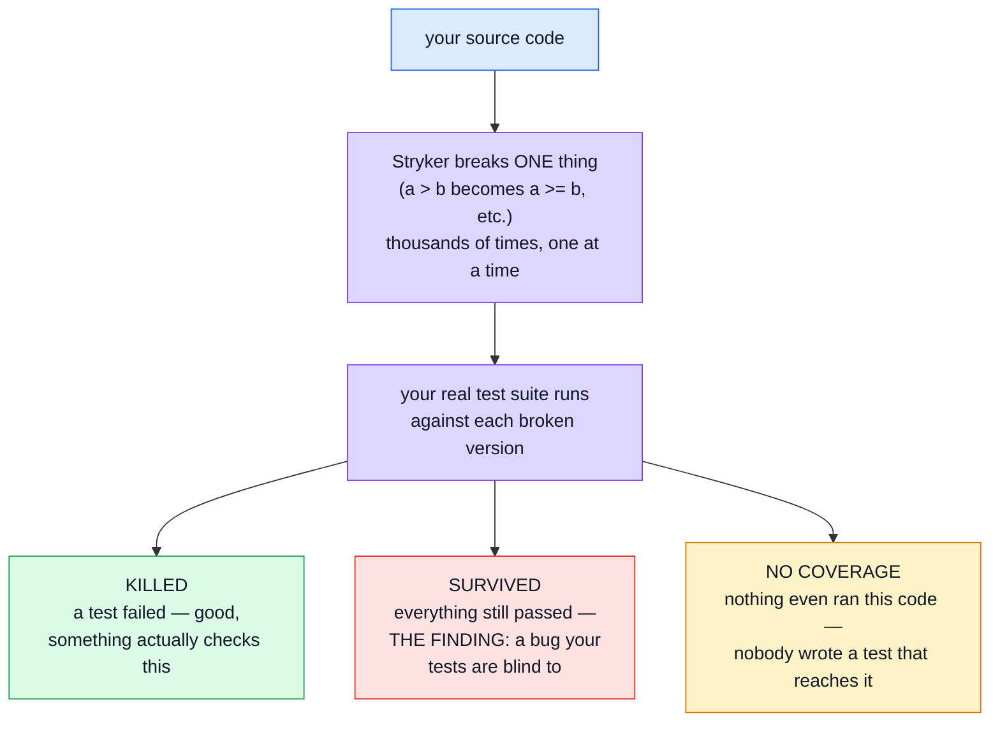
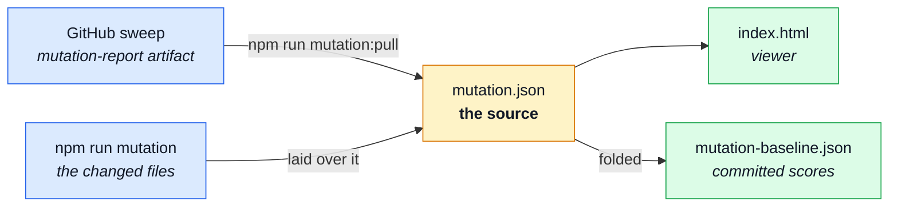
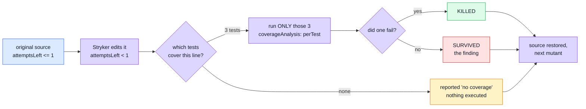
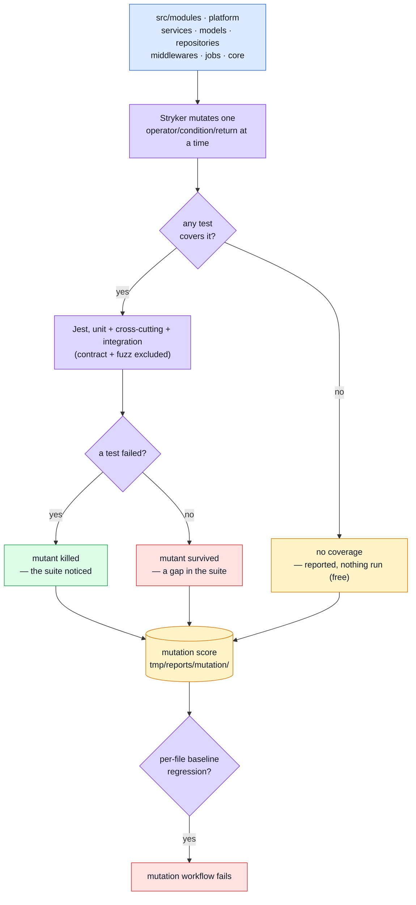

# Mutation Testing

Every other layer on this site answers "does the code do the right thing?" This one answers a different question: **do the _tests_ actually notice when it doesn't?** Line coverage can be satisfied by executing a line without asserting anything about its result; mutation testing can't — it edits the source thousands of times (`>` to `>=`, `&&` to `||`, a function body emptied out) and reports every edit the suite failed to catch. A **surviving mutant** is a bug the tests are structurally blind to.

::: warning The baseline on disk is pending a reseed
`stryker.json` is the only config now (2026-09-20, [one ruler](#one-ruler)) — every run loads
`tests/integration/` in addition to the unit and cross-cutting suites. `mutation-baseline.json`'s
current contents were measured under the OLD, unit-only config, which is strictly dominated by this
one: every file scores the same or better under the ruler that runs more tests. Until the first full
sweep under the merged ruler runs and folds its scores in, treat the numbers on disk as stale —
they understate what the tests actually cover, never overstate it.

See [Coverage & Confidence](./coverage-and-confidence.md) for what to trust, and what a 0% score
does and does not mean.
:::

## Start here — the short version

**Line coverage asks "did this code run?" Mutation testing asks "if I break this code, does anything notice?"** Those are different questions, and a file can score 100% on the first and 0% on the second — the tests execute every line and check nothing about what it does.



**The two things this finds, and they need different fixes:**

| You see         | It means                                                                                                    | The fix                                                                      |
| --------------- | ----------------------------------------------------------------------------------------------------------- | ---------------------------------------------------------------------------- |
| **Survived**    | A test runs this code but checks nothing that would catch it breaking — a useless assertion, or none at all | Sharpen the test: assert on the actual behaviour, not just "it didn't throw" |
| **No coverage** | No test runs this code at all                                                                               | Write a test that reaches it — there is nothing to sharpen yet               |

Both look like "the lines are covered" from the outside — a line coverage number says nothing about either one. The tool lands one word on each so you don't have to guess which problem you have. (Full outcome list, including `killed`/`timeout`/`error`: [Glossary](#glossary) below; one mutant walked through step by step: [What a mutant actually is](#what-a-mutant-actually-is).)

### The three numbers people mix up

Coverage thresholds used to exist and no longer do; mutation testing is the one test-quality number. Three separate percentages are left across this project, and they are easy to mix up:

| Where                                      | Measures                                                         | Number                                                                                                          | What happens if it's missed                                          |
| ------------------------------------------ | ---------------------------------------------------------------- | --------------------------------------------------------------------------------------------------------------- | -------------------------------------------------------------------- |
| `stryker.json` → `thresholds.high` / `low` | Nothing enforced — just colours the HTML report green/yellow/red | 80 / 60                                                                                                         | Nothing. Decoration only.                                            |
| `stryker.json` → `thresholds.break`        | Has the **whole run's** score collapsed                          | `null` — deliberately unset, see [Thresholds](./mutation-testing-ratchet.md#thresholds-—-measured-not-invented) | Nothing. The per-file ratchet is the real gate.                      |
| `mutation-baseline.json` (**the ratchet**) | Did **this one file** score worse than it did last time          | no fixed number — compares each file only to its own history                                                    | `npm run mutation:check` fails, naming the exact file that got worse |

The one that actually gates day-to-day work is the **last row** — the ratchet. `break` is a single global number, which means one strong file can hide one collapsing file behind the average; the ratchet can't be fooled that way because it checks every file against itself. See [The per-file ratchet](./mutation-testing-ratchet.md#the-per-file-ratchet) for how that comparison works, with a diagram.

### Which file is what {#which-file-is-what}

Three files matter. One is the source; the other two are made from it.

| File                                   | What it is                                                                                      | Tracked | Made by                           |
| -------------------------------------- | ----------------------------------------------------------------------------------------------- | ------- | --------------------------------- |
| `stryker.json`                         | The settings: what to mutate, which tests run, where the results go                             | yes     | a person                          |
| `tmp/reports/mutation/mutation.json`   | **The source.** Every mutant, its status, and per test which mutants it ran and which it caught | no      | a run, or `npm run mutation:pull` |
| `mutation-baseline.json`               | One score per file, nothing else: the bar a file must not drop below                            | yes     | folded from `mutation.json`       |
| `tmp/reports/mutation/index.html`      | A viewer: `mutation.json` drawn as a page. Disposable                                           | no      | drawn from `mutation.json`        |
| `tmp/reports/stryker-incremental.json` | A cache, so the next local run skips unchanged mutants. Speed only — never read as a result     | no      | Stryker                           |



The local full sweep, `npm run mutation:full`, keeps one `mutation.json` per shard under
`tmp/reports/mutation-shards/` instead — see [Why the full sweep is sharded](./mutation-testing-running.md#why-the-full-sweep-is-sharded).

## Glossary

Read this first. The rest of the page uses these words precisely, and several of them mean something narrower than they sound.

| Term                   | What it means here                                                                                                                                                                                                                                                                                    |
| ---------------------- | ----------------------------------------------------------------------------------------------------------------------------------------------------------------------------------------------------------------------------------------------------------------------------------------------------- |
| **Mutant**             | One deliberate edit to one place in the source. `a > b` becomes `a >= b`. Stryker makes thousands, one at a time. See [What a mutant actually is](#what-a-mutant-actually-is).                                                                                                                        |
| **Killed**             | At least one test failed when the mutant was active. Good — the suite noticed.                                                                                                                                                                                                                        |
| **Survived**           | Every test still passed with broken code. **This is the finding.** It means no assertion anywhere depends on that behaviour.                                                                                                                                                                          |
| **No coverage**        | No test executes that code at all, so Stryker doesn't even run anything — it reports the mutant immediately. Different from "survived": survived means tested-but-not-asserted, no-coverage means not-tested. **Costs nothing**, which is why untested files are cheap to keep in scope.              |
| **Timeout**            | The mutant made the suite hang (a mutated loop condition, typically). Counted as **killed** — the suite did notice, just expensively.                                                                                                                                                                 |
| **Mutation score**     | Killed ÷ (all viable mutants). Reported twice: over _everything_, and over _covered code only_. The gap between the two is the size of the untested surface.                                                                                                                                          |
| **`break` threshold**  | The score below which the run fails. A backstop for "has this collapsed", not a target.                                                                                                                                                                                                               |
| **Baseline / ratchet** | `mutation-baseline.json` records what **each file** scored. Improvements are written back, regressions fail. See [The per-file ratchet](./mutation-testing-ratchet.md#the-per-file-ratchet).                                                                                                          |
| **Monthly full sweep** | A GitHub Actions workflow on a `cron` schedule rather than on push. Nothing waits for it. In this repo, `.github/workflows/mutation.yml` runs it on the 1st of each month; the diff run below is the fast, per-PR complement.                                                                         |
| **Concurrency**        | How many mutants Stryker tests **in parallel**. Each one is a separate OS process running a full test runner _and its own in-memory mongod_, so the limit is memory, not CPU cores.                                                                                                                   |
| **`coverageAnalysis`** | Set to `perTest`: Stryker first records which tests touch which code, then runs **only the covering tests** for each mutant instead of the whole suite. This is the main reason a run is minutes and not days — except for static mutants, below.                                                     |
| **Static mutant**      | A mutant in code that runs when the file is **imported**, not when a test calls it — a `new Schema({...})`, a repository built at module scope, a config object. See [Why a run is slow](./mutation-testing-running.md#why-a-run-is-slow-static-mutants); it is the single biggest cost in this repo. |
| **Incremental**        | Stryker remembers per-mutant results in a gitignored file, so the next run only re-mutates what changed. **Enabled** locally, `--force` rebuilding from scratch; the GitHub sweep starts from scratch every time. See [Incremental mode](./mutation-testing-running.md#incremental-mode-what-it-is).  |

## What a mutant actually is

A mutant is **one small, deliberate edit to your source code**. Stryker makes it, runs the tests, and puts the code back. That is the whole idea.

Take a real line from this codebase:

```ts
// src/modules/cart/repository.ts
if (attemptsLeft <= 1 || !isDuplicateKey(error)) throw error;
```

Stryker generates a separate mutant for each thing it can change here:

| #   | Mutant                                        | What it is asking                                  |
| --- | --------------------------------------------- | -------------------------------------------------- |
| 1   | `attemptsLeft < 1`                            | Does any test pin the exact retry boundary?        |
| 2   | `attemptsLeft >= 1`                           | Same boundary, the other direction                 |
| 3   | `attemptsLeft <= 1 && !isDuplicateKey(error)` | Does anything depend on this being **or**?         |
| 4   | `isDuplicateKey(error)` (negation removed)    | Does a test cover the non-duplicate error path?    |
| 5   | `if (false) throw error;`                     | Does anything notice if we never give up retrying? |

Each one is run **on its own**, never together. Then:

- a test fails → **killed**. Some assertion depended on that behaviour. Good.
- every test passes → **survived**. You just broke the retry budget and nothing complained.

A survivor is not "a test is missing" in the abstract. It is a specific, reproducible statement: _this exact change to your code is invisible to your test suite._

### One mutant's lifecycle



The source on disk is never left mutated — Stryker works in a throwaway copy under `tmp/stryker/`.

## Tools

| Tool                                   | Role                                                                          |
| -------------------------------------- | ----------------------------------------------------------------------------- |
| [Stryker](https://stryker-mutator.io/) | Generates mutants, re-runs the suite once per mutant, scores what survived    |
| `@stryker-mutator/jest-runner`         | Drives Jest as the test runner, against a narrowed subset of `jest.config.js` |

## Architecture



## One ruler — why every run now includes `tests/integration/` {#one-ruler}

Decided 2026-09-20. There used to be two Stryker configs: `stryker.config.json` excluded <!-- doc-paths:ignore -->
`tests/integration/` and `tests/contract/` for speed, `stryker.deep.json` included the former. <!-- doc-paths:ignore --> **The
unit-only config is gone.** `stryker.json` is the only config, and it always runs the integration
suites — because more tests running can only kill more mutants, never fewer, so the wider ruler is
strictly more informative about the same code, and its only real cost is speed.

That cost was the entire reason the split existed, and it was worse than "slower": the unit-only
ruler read **126 of its 214 files at 0%** — no unit test touches a service or repository at all, so
every mutant in them scored `NoCoverage` by construction. Measured on the delivery module's one service file at the time: **0%**
under the unit ruler, **64.8%** under the one that also runs `tests/integration/`. Same tests, same
code, only the ruler changed.

**The price, stated plainly.** Every mutation run now starts a real Mongo and runs integration
tests, so the per-mutant cost goes up. That is why the full scope is always sharded and runs monthly
rather than as an unsharded nightly — see [The three commands](./mutation-testing-running.md#the-three-commands).

**What the merge depends on: a test file must free its memory when it ends.** A mutation run loads
far more files per process than `npm test` does, so anything a file leaves reachable accumulates —
and `bson`'s 17 MiB buffer makes each leftover file expensive. The cause and the fix are in
[One process per dry run](./mutation-testing-memory.md#one-process-per-dry-run); how `bson` shows up is under
[the `bson` warning sign](./mutation-testing-memory.md#the-bson-warning-sign).

### What is still excluded, and why

`stryker.json` restricts the Jest config Stryker drives to exclude `tests/contract/`, `tests/fuzz/`, both of those trees' per-module homes, and `tests/integration/journeys/`:

```json
"jest": {
    "config": {
        "testPathIgnorePatterns": [
            "/node_modules/",
            "<rootDir>/tests/contract/",
            "<rootDir>/tests/fuzz/",
            "<rootDir>/src/modules/[^/]+/tests/contract/",
            "<rootDir>/tests/integration/journeys/",
            "<rootDir>/tests/cross-cutting/contract-bundles.test.ts",
            "<rootDir>/tests/cluster/",
            "<rootDir>/tests/broker/",
            "<rootDir>/tmp/",
            "<rootDir>/.claude/worktrees/"
        ]
    }
}
```

**Contract and fuzz stay excluded.** A contract test boots the entire app through supertest, so
`enableFindRelatedTests` relates it to nearly every file — every mutant would pay an application
boot, and a one-line change in one module would drag in the whole contract suite. Fuzz suites are
non-deterministic by construction: a mutant killed by a random input on one run and not the next
produces a score that moves on its own, which is the one thing a ratchet cannot tolerate.

**Journeys stay excluded** for the contract suite's reason: each one boots the whole app, so
`enableFindRelatedTests` relates it to nearly every file, and a one-line change would drag the
lot in. See [Journeys](../reference/tests.md#tests-integration-journeys-—-one-user-across-modules).

`tests/cluster/` forks real workers against a Redis and is not part of `npm test` either; neither is
`tests/broker/`, which needs a real RabbitMQ. `tmp/` and
`.claude/worktrees/` are not suites at all: they hold Stryker's own sandboxes and other checkouts'
copies of the tests, which jest would otherwise discover and run as if they were this tree's.

The `contract-bundles.test.ts` entry is excluded because it asserts the contract generators: each case builds a
contract document in memory from its sources and checks the result. It exercises `scripts/` and the contract
sources.

**The unit layer's cost depends on a naming rule, and that is the fragile part.** A file under
`src/modules/*/tests/unit/` that calls `setupTestDb()` starts a real `mongod` and connects mongoose
to it, while nothing about its name warns that it does. So a database-touching spec lives in its
module's `tests/integration/`, and `unit-layer-stays-database-free` in
`.dependency-cruiser.cjs` is what keeps a new one from drifting back in — it asks whether a spec can
REACH a database, so a helper that pulls one in is caught too. Confirm the unit layer is clean with:

```bash
npm run check
```

That grep, and the incident it used to report, is the load-bearing fact behind the failure mode
below — kept as a worked example because the mechanism it describes (a `beforeAll` cost paid once
per mutant) is general, not specific to this one fixed case.

Measured on `src/modules/products/repository.ts` — 196 mutants, a file with no unit tests at all
and a thorough integration suite — on 2026-08-27, back when the two rulers still existed separately:

| scope                               | score      | NoCoverage | wall clock |
| ----------------------------------- | ---------- | ---------- | ---------- |
| unit only (the old default)         | **0.00%**  | 161 of 196 | —          |
| \+ integration (now the only ruler) | **82.14%** | 3 of 196   | 22m 13s    |

That is the same file, the same tests, and the same day. The 0% was never a statement about the
repository's tests; it was a statement about the ruler. Read it beside
[Reading a 0%](#reading-a-0-—-and-the-one-case-where-it-was-excluded-instead), which makes the same
point from the other direction.

**This is also why the controllers are not mutated.** They have no unit tests; they are covered by the contract suite, which Stryker still doesn't run. Put them in `mutate` and all 60 files report ~0% — and that number would not mean "the controllers are untested", it would mean "they were measured with a ruler configured not to touch them". Worse, the ratchet would then record those zeros and defend them forever. Measuring controllers honestly requires running contract under Stryker too, which is a much larger cost decision than this one.

## Scope — what is mutated

```json
"mutate": [
    "src/infrastructure/**/*.ts",
    "src/kernel/**/*.ts",
    "src/domain-primitives/**/*.ts",
    "src/modules/*/**/*.ts",
    "!src/modules/*/index.ts",
    "!src/modules/*/tests/**"
]
```

A counterintuitive but important consequence of the table above: **untested files are free to include.** A mutant with no covering test is reported `NoCoverage` without running anything, so a file at 0% costs nothing and honestly records the gap. The cost lives entirely in _well-covered_ code — especially static-and-covered code.

That is why the list above is so short. The bar for excluding something is **"a mutant here could not mean anything to anyone"**, not "our tests would not kill it" — an unkilled mutant is a finding, while a file missing from the report is a blind spot, since an absent file reads exactly like a file with no survivors. Only two things clear that bar: a module's `index.ts`, a barrel whose mutants ask whether a re-export changed; and `tests/**`, which is not the code under test.

### Suppressing logger calls, line by line {#suppressing-logger-calls}

A file staying in `mutate` does not mean every line in it does. From a completed 181-mutant report,
**29 of 35 survivors were `logger.*` calls** — a mutated log message, level, or metadata field that
no test asserts on and none should: nothing here is behaviour, and asserting on log output couples
tests to wording nobody reads programmatically. Every `logger.info/warn/error/debug/trace/fatal(...)`
call site in `src/**` carries `// Stryker disable next-line all` (or the `disable all` /
`restore all` pair, for a call that spans more than one line) — see
[Ignore mutations](https://stryker-mutator.io/docs/stryker-js/ignore-mutations/) for the comment
syntax. This is a suppression at the call site, not an exclusion of the file: everything else in
that file is still measured normally.

### Reading a 0% — and the one case where it was excluded instead

Everything else stays in scope, including code this runner cannot reach, because a 0% is usually a
true statement worth keeping in front of people.

`src/app/**` is the exception, and it is worth understanding why it is not a precedent. The Express
wiring measured **0.00% across all eight files: 126 mutants, every one `NoCoverage`, not a single
survivor** — because it is exercised by `tests/contract`, which this _runner_ excludes by
`testPathIgnorePatterns` (see [What is still excluded](#what-is-still-excluded-and-why)), and by no
unit test at all. The measurement predates [one ruler](#one-ruler); `tests/integration` runs under
Stryker now, and the tier stays out of `mutate` until someone re-measures it with that ruler.

That made it a different animal from an honest zero. An honest zero is code a suite _could_ reach
and none does — a finding, and actionable. These 126 mutants had **no test that could ever kill
them**, so they dragged the global number down permanently while telling nobody anything, and they
put a global `break` of 70 out of reach by construction rather than by neglect.

So the tier was excluded, taking the global score from ~65.7% to ~68.3%. What is lost is a standing
reminder, and it is recorded here instead (`stryker.json`'s `mutate` simply does not list `src/app`): **the Express wiring has no
unit tests.** If that changes, put it back in scope — then its number would mean something.

The bar this cleared, and that a future exclusion has to clear too: _no configured suite can reach
this code at all._ "Our tests would not kill it" is not that bar. The paired frontend answers the
same question the same way for `.vue` files, on mirror-image reasoning — Stryker cannot mutate
template expressions, so a score there would imply coverage nobody has.

The three outcomes are different findings, and the columns keep them apart:

| Outcome         | What happened                                 | What to do                                 |
| --------------- | --------------------------------------------- | ------------------------------------------ |
| **Killed**      | a test ran it and an assertion depended on it | nothing                                    |
| **Survived**    | a test ran it and nothing noticed             | sharpen the assertion                      |
| **No coverage** | nothing ran it                                | write a test, or accept the runner's reach |

Two shapes of unreached code show up differently, and it is worth knowing which you are looking at. Code that runs at **import time** — a route table literal, a schema built at module scope — executes as soon as any test imports the module, so its mutants are _covered_ and come back as **survivors**: `users/routes.ts` reports 36 of them. A **function body** only executes when called, so an uncalled one comes back as **no coverage**. Zero survivors alongside a high no-coverage count is the signature of a file nothing invokes.

Controllers illustrate why a blanket exclusion is the wrong instrument. They were once excluded wholesale on the assumption that only contract and integration tests reach them — but several are unit-tested directly as plain functions with fake `req`/`res` objects (`post-login`, `get-refresh-token`, `delete-account`, `post-account-restore`, `get-observability-metrics-overview`). The exclusion was therefore hiding real, working coverage as well as honest gaps.

## Where the rest went

The long sections moved to three sub-pages; each heading below keeps its old link target.

### The worker-pool multiplication {#the-worker-pool-multiplication}

Moved: [The worker-pool multiplication](./mutation-testing-memory.md#the-worker-pool-multiplication).

### What to be wary of — per-file setup costs {#per-file-setup-costs}

Moved: [What to be wary of — per-file setup costs](./mutation-testing-memory.md#per-file-setup-costs).

### The heap cap — unset is not "as much as the machine has" {#worker-heap-cap}

Moved: [The heap cap — unset is not "as much as the machine has"](./mutation-testing-memory.md#worker-heap-cap).

### One process per dry run — why a file must free its memory {#one-process-per-dry-run}

Moved: [One process per dry run — why a file must free its memory](./mutation-testing-memory.md#one-process-per-dry-run).

### Stryker's coverage records, and collecting after each file {#collect-after-each-file}

Moved: [Stryker's coverage records, and collecting after each file](./mutation-testing-memory.md#collect-after-each-file).

### The `bson` warning sign {#the-bson-warning-sign}

Moved: [The `bson` warning sign](./mutation-testing-memory.md#the-bson-warning-sign).

### Running it locally {#running-it-locally}

Moved: [Running it locally](./mutation-testing-running.md#running-it-locally).

### `ignoreStatic` — rejected permanently {#static-mutants-open-question}

Moved: [`ignoreStatic` — rejected permanently](./mutation-testing-running.md#static-mutants-open-question).

### The diff run, and why it can fail when the full sweep cannot {#the-diff-run-and-why-it-can-fail-when-the-full-sweep-cannot}

Moved: [The diff run, and why it can fail when the full sweep cannot](./mutation-testing-running.md#the-diff-run-and-why-it-can-fail-when-the-full-sweep-cannot).

### The per-file ratchet {#the-per-file-ratchet}

Moved: [The per-file ratchet](./mutation-testing-ratchet.md#the-per-file-ratchet).

### The three commands {#the-three-commands}

Moved: [The three commands](./mutation-testing-running.md#the-three-commands).

### The GitHub sweep {#the-github-sweep}

Moved: [The GitHub sweep](./mutation-testing-running.md#the-github-sweep).

## File map

| Path                                   | Contents                                                                                                                                 |
| -------------------------------------- | ---------------------------------------------------------------------------------------------------------------------------------------- |
| `stryker.json`                         | Scope (`mutate`), the narrowed Jest config (integration included), thresholds, concurrency, reporters                                    |
| `jest.config.mutation.js`              | The swc transform and `maxWorkers: 1` — see [the worker pool](./mutation-testing-memory.md#the-worker-pool-multiplication)               |
| `mutation-baseline.json`               | Per-file scores. Committed. The ratchet's memory — see [pending reseed](./mutation-testing-ratchet.md#baseline-status-pending-a-reseed). |
| `scripts/mutation/stryker-run.ts`      | One Stryker invocation, sized for this machine — concurrency, the heap cap, the scratch sweep, the OOM abort                             |
| `scripts/mutation/run-diff.ts`         | `npm run mutation` — the files a branch changed, graded against the ratchet                                                              |
| `scripts/mutation/run-shards.ts`       | `npm run mutation:full` — the whole scope, one shard at a time, resumable, merges once closed                                            |
| `scripts/mutation/local-policy.ts`     | Which shards a local sweep runs next, given what previous evenings already recorded                                                      |
| `scripts/mutation/mutate-scope.ts`     | The real mutate scope, read off the tree — every `.ts` file `stryker.json` declares mutable                                              |
| `scripts/mutation/sharding.ts`         | Bin-packing by line count for a local sweep                                                                                              |
| `scripts/mutation/ci/`                 | The GitHub sweep only — wave planner, slice ignorer, report merge, and the CLI the workflows call                                        |
| `scripts/mutation/baseline.ts`         | Ratchet logic — scoring, comparison, the "never lower" rule, and the merge variant of both                                               |
| `scripts/mutation/check-baseline.ts`   | CLI for the commands below                                                                                                               |
| `scripts/mutation/pull-report.ts`      | `npm run mutation:pull` — the newest sweep's report into `tmp/reports/mutation/`, the baseline folded from it                            |
| `scripts/mutation/github-artifacts.ts` | Which uploaded report that is: the newest unexpired one from a sweep of `main`                                                           |
| `.github/workflows/mutation.yml`       | Monthly schedule + dispatch, eight waves and the merge job, the PR diff job, the failure issue                                           |
| `.github/workflows/mutation-wave.yml`  | One wave: plan it, then run its shards as a matrix                                                                                       |
| `tmp/reports/mutation/index.html`      | Human-readable report, drawn from `mutation.json`                                                                                        |
| `tmp/reports/mutation/mutation.json`   | The source: every mutant, per-test results. The ratchet and the audits read it — [which file is what](#which-file-is-what)               |

## Commands

| Command                                               | Effect                                                                                                                                                           |
| ----------------------------------------------------- | ---------------------------------------------------------------------------------------------------------------------------------------------------------------- |
| `npm run mutation`                                    | The files a branch changed, graded against the ratchet, then laid over the report on disk. `--base=<ref>` to compare against something other than `origin/main`. |
| `npm run mutation:full`                               | The whole scope locally, one shard at a time, resumable across evenings. `--list`, `--limit=n`, `--only=`, `--force`, `--shard-lines=n`.                         |
| `npm run mutation:check`                              | Compare the last report against the per-file baseline. Fails naming what regressed.                                                                              |
| `npm run mutation:check -- --update`                  | Record the last full-scope run (improvements only). Use when `mutate` changed, and say why.                                                                      |
| `npm run mutation:check -- --merge --merge-dir=<dir>` | Fold a sharded sweep's reports into the baseline — see `mutate-scope.ts`'s `readReportsUnder`. What `mutation-merge` runs in CI.                                 |
| `npm run mutation:pull`                               | Download the newest GitHub sweep's report into `tmp/reports/mutation/` and fold `mutation-baseline.json` from it. Needs `gh auth login`. Review, then commit.    |

## Read next

- [Memory and workers](./mutation-testing-memory.md)
- [Running it](./mutation-testing-running.md)
- [The ratchet](./mutation-testing-ratchet.md)

- [Testing](./testing-and-docs.md) — suite overview
- [Unit Testing](./unit-testing.md) — the layer being mutated
