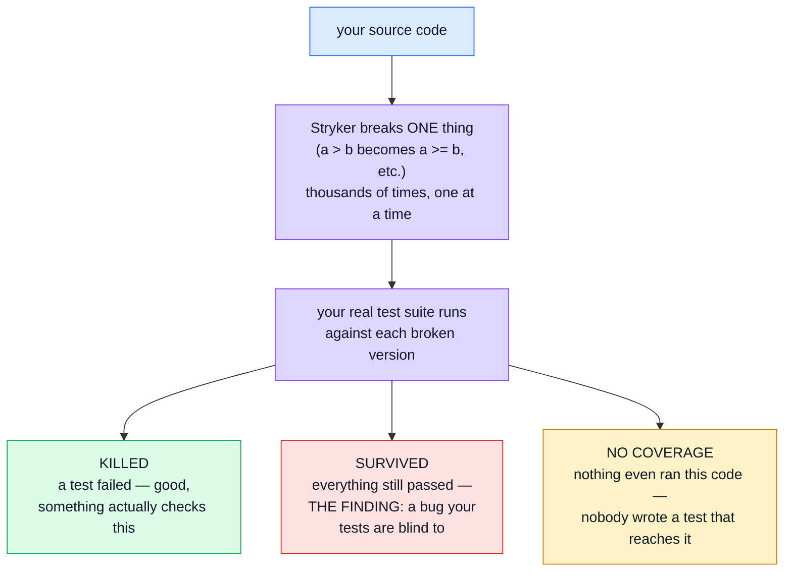
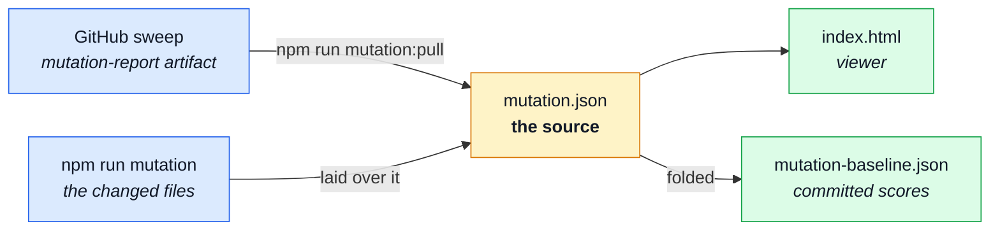
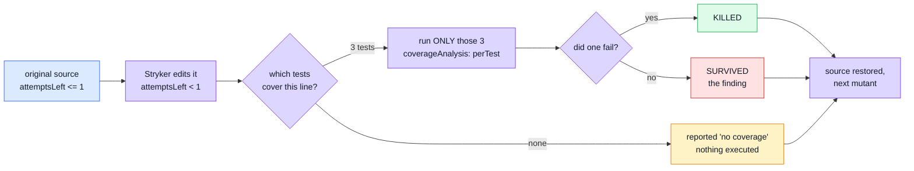
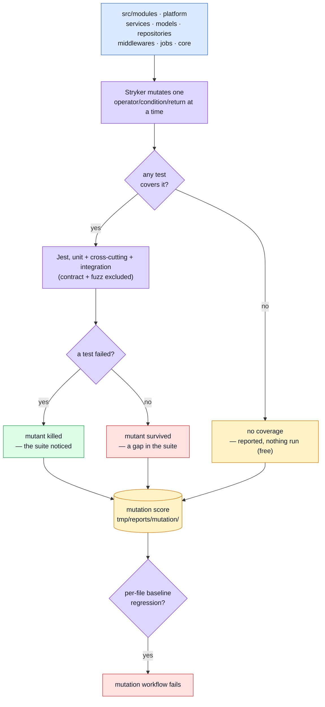

# Mutation Testing

Every other layer on this site answers "does the code do the right thing?" This one answers a different question: **do the _tests_ actually notice when it doesn't?** Line coverage can be satisfied by executing a line without asserting anything about its result; mutation testing can't — it edits the source thousands of times (`>` to `>=`, `&&` to `||`, a function body emptied out) and reports every edit the suite failed to catch. A **surviving mutant** is a bug the tests are structurally blind to.

::: warning The baseline on disk is pending a reseed
`stryker.json` is the only config now (2026-09-20, [one ruler](./mutation-testing-ruler.md#one-ruler)) — every run loads
`tests/integration/` in addition to the unit and cross-cutting suites. `mutation-baseline.json`'s
current contents were measured under the OLD, unit-only config, which is strictly dominated by this
one: every file scores the same or better under the ruler that runs more tests. Until the first full
sweep under the merged ruler runs and folds its scores in, treat the numbers on disk as stale —
they understate what the tests actually cover, never overstate it.

See [Coverage & Confidence](./coverage-and-confidence.md) for what to trust, and what a 0% score
does and does not mean.
:::

## Start here — the short version

**Line coverage asks "did this code run?" Mutation testing asks "if I break this code, does anything notice?"** Those are different questions, and a file can score 100% on the first and 0% on the second — the tests execute every line and check nothing about what it does.



**The two things this finds, and they need different fixes:**

| You see         | It means                                                                                                    | The fix                                                                      |
| --------------- | ----------------------------------------------------------------------------------------------------------- | ---------------------------------------------------------------------------- |
| **Survived**    | A test runs this code but checks nothing that would catch it breaking — a useless assertion, or none at all | Sharpen the test: assert on the actual behaviour, not just "it didn't throw" |
| **No coverage** | No test runs this code at all                                                                               | Write a test that reaches it — there is nothing to sharpen yet               |

Both look like "the lines are covered" from the outside — a line coverage number says nothing about either one. The tool lands one word on each so you don't have to guess which problem you have. (Full outcome list, including `killed`/`timeout`/`error`: [Glossary](#glossary) below; one mutant walked through step by step: [What a mutant actually is](#what-a-mutant-actually-is).)

### The three numbers people mix up

Coverage thresholds used to exist and no longer do; mutation testing is the one test-quality number. Three separate percentages are left across this project, and they are easy to mix up:

| Where                                      | Measures                                                         | Number                                                                                                          | What happens if it's missed                                          |
| ------------------------------------------ | ---------------------------------------------------------------- | --------------------------------------------------------------------------------------------------------------- | -------------------------------------------------------------------- |
| `stryker.json` → `thresholds.high` / `low` | Nothing enforced — just colours the HTML report green/yellow/red | 80 / 60                                                                                                         | Nothing. Decoration only.                                            |
| `stryker.json` → `thresholds.break`        | Has the **whole run's** score collapsed                          | `null` — deliberately unset, see [Thresholds](./mutation-testing-ratchet.md#thresholds-—-measured-not-invented) | Nothing. The per-file ratchet is the real gate.                      |
| `mutation-baseline.json` (**the ratchet**) | Did **this one file** score worse than it did last time          | no fixed number — compares each file only to its own history                                                    | `npm run mutation:check` fails, naming the exact file that got worse |

The one that actually gates day-to-day work is the **last row** — the ratchet. `break` is a single global number, which means one strong file can hide one collapsing file behind the average; the ratchet can't be fooled that way because it checks every file against itself. See [The per-file ratchet](./mutation-testing-ratchet.md#the-per-file-ratchet) for how that comparison works, with a diagram.

### Which file is what {#which-file-is-what}

Three files matter. One is the source; the other two are made from it.

| File                                   | What it is                                                                                      | Tracked | Made by                           |
| -------------------------------------- | ----------------------------------------------------------------------------------------------- | ------- | --------------------------------- |
| `stryker.json`                         | The settings: what to mutate, which tests run, where the results go                             | yes     | a person                          |
| `tmp/reports/mutation/mutation.json`   | **The source.** Every mutant, its status, and per test which mutants it ran and which it caught | no      | a run, or `npm run mutation:pull` |
| `mutation-baseline.json`               | One score per file, nothing else: the bar a file must not drop below                            | yes     | folded from `mutation.json`       |
| `tmp/reports/mutation/index.html`      | A viewer: `mutation.json` drawn as a page. Disposable                                           | no      | drawn from `mutation.json`        |
| `tmp/reports/stryker-incremental.json` | A cache, so the next local run skips unchanged mutants. Speed only — never read as a result     | no      | Stryker                           |



The local full sweep, `npm run mutation:full`, keeps one `mutation.json` per shard under
`tmp/reports/mutation-shards/` instead — see [Why the full sweep is sharded](./mutation-testing-running.md#why-the-full-sweep-is-sharded).

## Glossary

Read this first. The rest of the page uses these words precisely, and several of them mean something narrower than they sound.

| Term                   | What it means here                                                                                                                                                                                                                                                                                    |
| ---------------------- | ----------------------------------------------------------------------------------------------------------------------------------------------------------------------------------------------------------------------------------------------------------------------------------------------------- |
| **Mutant**             | One deliberate edit to one place in the source. `a > b` becomes `a >= b`. Stryker makes thousands, one at a time. See [What a mutant actually is](#what-a-mutant-actually-is).                                                                                                                        |
| **Killed**             | At least one test failed when the mutant was active. Good — the suite noticed.                                                                                                                                                                                                                        |
| **Survived**           | Every test still passed with broken code. **This is the finding.** It means no assertion anywhere depends on that behaviour.                                                                                                                                                                          |
| **No coverage**        | No test executes that code at all, so Stryker doesn't even run anything — it reports the mutant immediately. Different from "survived": survived means tested-but-not-asserted, no-coverage means not-tested. **Costs nothing**, which is why untested files are cheap to keep in scope.              |
| **Timeout**            | The mutant made the suite hang (a mutated loop condition, typically). Counted as **killed** — the suite did notice, just expensively.                                                                                                                                                                 |
| **Mutation score**     | Killed ÷ (all viable mutants). Reported twice: over _everything_, and over _covered code only_. The gap between the two is the size of the untested surface.                                                                                                                                          |
| **`break` threshold**  | The score below which the run fails. A backstop for "has this collapsed", not a target.                                                                                                                                                                                                               |
| **Baseline / ratchet** | `mutation-baseline.json` records what **each file** scored. Improvements are written back, regressions fail. See [The per-file ratchet](./mutation-testing-ratchet.md#the-per-file-ratchet).                                                                                                          |
| **Monthly full sweep** | A GitHub Actions workflow on a `cron` schedule rather than on push. Nothing waits for it. In this repo, `.github/workflows/mutation.yml` runs it on the 1st of each month; the diff run below is the fast, per-PR complement.                                                                         |
| **Concurrency**        | How many mutants Stryker tests **in parallel**. Each one is a separate OS process running a full test runner _and its own in-memory mongod_, so the limit is memory, not CPU cores.                                                                                                                   |
| **`coverageAnalysis`** | Set to `perTest`: Stryker first records which tests touch which code, then runs **only the covering tests** for each mutant instead of the whole suite. This is the main reason a run is minutes and not days — except for static mutants, below.                                                     |
| **Static mutant**      | A mutant in code that runs when the file is **imported**, not when a test calls it — a `new Schema({...})`, a repository built at module scope, a config object. See [Why a run is slow](./mutation-testing-running.md#why-a-run-is-slow-static-mutants); it is the single biggest cost in this repo. |
| **Incremental**        | Stryker remembers per-mutant results in a gitignored file, so the next run only re-mutates what changed. **Enabled** locally, `--force` rebuilding from scratch; the GitHub sweep starts from scratch every time. See [Incremental mode](./mutation-testing-running.md#incremental-mode-what-it-is).  |

## What a mutant actually is

A mutant is **one small, deliberate edit to your source code**. Stryker makes it, runs the tests, and puts the code back. That is the whole idea.

Take a real line from this codebase:

```ts
// src/modules/cart/repository.ts
if (attemptsLeft <= 1 || !isDuplicateKey(error)) throw error;
```

Stryker generates a separate mutant for each thing it can change here:

| #   | Mutant                                        | What it is asking                                  |
| --- | --------------------------------------------- | -------------------------------------------------- |
| 1   | `attemptsLeft < 1`                            | Does any test pin the exact retry boundary?        |
| 2   | `attemptsLeft >= 1`                           | Same boundary, the other direction                 |
| 3   | `attemptsLeft <= 1 && !isDuplicateKey(error)` | Does anything depend on this being **or**?         |
| 4   | `isDuplicateKey(error)` (negation removed)    | Does a test cover the non-duplicate error path?    |
| 5   | `if (false) throw error;`                     | Does anything notice if we never give up retrying? |

Each one is run **on its own**, never together. Then:

- a test fails → **killed**. Some assertion depended on that behaviour. Good.
- every test passes → **survived**. You just broke the retry budget and nothing complained.

A survivor is not "a test is missing" in the abstract. It is a specific, reproducible statement: _this exact change to your code is invisible to your test suite._

### One mutant's lifecycle



The source on disk is never left mutated — Stryker works in a throwaway copy under `tmp/stryker/`.

## Tools

| Tool                                   | Role                                                                          |
| -------------------------------------- | ----------------------------------------------------------------------------- |
| [Stryker](https://stryker-mutator.io/) | Generates mutants, re-runs the suite once per mutant, scores what survived    |
| `@stryker-mutator/jest-runner`         | Drives Jest as the test runner, against a narrowed subset of `jest.config.js` |

## Architecture



## Where the scope and ruler went

The long sections moved to sub-pages; each heading below keeps its old link target.

### One ruler — why every run now includes `tests/integration/` {#one-ruler}

Moved: [One ruler — why every run now includes `tests/integration/`](./mutation-testing-ruler.md#one-ruler).

### What is still excluded, and why {#what-is-still-excluded-and-why}

Moved: [What is still excluded, and why](./mutation-testing-ruler.md#what-is-still-excluded-and-why).

### Scope — what is mutated {#scope--what-is-mutated}

Moved: [Scope — what is mutated](./mutation-testing-ruler.md#scope-—-what-is-mutated).

### Scope — what is mutated {#scope-—-what-is-mutated}

Moved: [Scope — what is mutated](./mutation-testing-ruler.md#scope-—-what-is-mutated).

### Suppressing logger calls, line by line {#suppressing-logger-calls}

Moved: [Suppressing logger calls, line by line](./mutation-testing-ruler.md#suppressing-logger-calls).

## Where the rest went

The long sections moved to three sub-pages; each heading below keeps its old link target.

### The worker-pool multiplication {#the-worker-pool-multiplication}

Moved: [The worker-pool multiplication](./mutation-testing-memory.md#the-worker-pool-multiplication).

### What to be wary of — per-file setup costs {#per-file-setup-costs}

Moved: [What to be wary of — per-file setup costs](./mutation-testing-memory.md#per-file-setup-costs).

### The heap cap — unset is not "as much as the machine has" {#worker-heap-cap}

Moved: [The heap cap — unset is not "as much as the machine has"](./mutation-testing-oom-case-study.md#worker-heap-cap).

### One process per dry run — why a file must free its memory {#one-process-per-dry-run}

Moved: [One process per dry run — why a file must free its memory](./mutation-testing-memory.md#one-process-per-dry-run).

### Stryker's coverage records, and collecting after each file {#collect-after-each-file}

Moved: [Stryker's coverage records, and collecting after each file](./mutation-testing-memory.md#collect-after-each-file).

### The `bson` warning sign {#the-bson-warning-sign}

Moved: [The `bson` warning sign](./mutation-testing-memory.md#the-bson-warning-sign).

### Running it locally {#running-it-locally}

Moved: [Running it locally](./mutation-testing-running.md#running-it-locally).

### `ignoreStatic` — rejected permanently {#static-mutants-open-question}

Moved: [`ignoreStatic` — rejected permanently](./mutation-testing-running.md#static-mutants-open-question).

### The diff run, and why it can fail when the full sweep cannot {#the-diff-run-and-why-it-can-fail-when-the-full-sweep-cannot}

Moved: [The diff run, and why it can fail when the full sweep cannot](./mutation-testing-running.md#the-diff-run-and-why-it-can-fail-when-the-full-sweep-cannot).

### The per-file ratchet {#the-per-file-ratchet}

Moved: [The per-file ratchet](./mutation-testing-ratchet.md#the-per-file-ratchet).

### The three commands {#the-three-commands}

Moved: [The three commands](./mutation-testing-sweeps.md#the-three-commands).

### The GitHub sweep {#the-github-sweep}

Moved: [The GitHub sweep](./mutation-testing-sweeps.md#the-github-sweep).

## Read next

- [Mutation testing: the ruler and the scope](./mutation-testing-ruler.md)
- [Mutation testing: file map and commands](./mutation-testing-reference.md)

- [Memory and workers](./mutation-testing-memory.md)
- [Running it](./mutation-testing-running.md)
- [The ratchet](./mutation-testing-ratchet.md)

- [Testing](./testing-and-docs.md) — suite overview
- [Unit Testing](./unit-testing.md) — the layer being mutated
