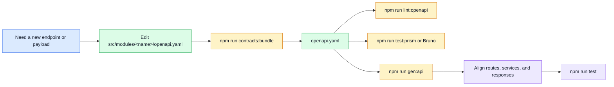

# OpenAPI Workflow

## OpenAPI is the source of truth

For this boilerplate, the safest order is:



If the contract changes, start with the contract.
That keeps backend, generated types, and consumers in sync.

**Edit the fragment, never `openapi.yaml` itself.** The root file is assembled from per-module
fragments by `npm run contracts:bundle`, which overwrites whatever you hand-edited (the file is gitignored and rebuilt on every install).
[Regenerating After a
Change](./regenerating.md) is the short version of what to run when.

## Who owns this file

This repository owns the contract; the frontend holds a byte-identical copy and never edits it.
How the file is meant to be split per module and how it travels between the two repos is
[Contract Ownership & Fragmentation](./contract-fragmentation.md).

## OpenAPI vs AsyncAPI in this repository

- Use OpenAPI for REST endpoint contracts.
- Use AsyncAPI (`asyncapi.yaml`) for SSE/event-driven/queue contracts.

## Tools around the contract

| Tool                                                        | Job                                                          |
| ----------------------------------------------------------- | ------------------------------------------------------------ |
| [`openapi.yaml`](https://spec.openapis.org/oas/latest.html) | single contract file (OpenAPI 3.x specification)             |
| [Spectral](https://stoplight.io/open-source/spectral)       | lint the spec against `shared/contracts/spectral.yaml` rules |
| [orval](https://orval.dev)                                  | generate `api/` types and Zod validators from the spec       |
| [Prism](https://stoplight.io/open-source/prism)             | mock the API from the spec                                   |
| [Bruno](https://www.usebruno.com/)                          | explore the API during development (generated on demand)     |

## Generated output (`api/`)

Running `npm run gen:api` deletes and regenerates the entire `api/` directory (`rm -rf ./api && orval`).
**Never edit files inside `api/` manually** — changes will be overwritten.

```
api/
├── schemas.zod.ts           ← one Zod schema per operation's request and response
├── error-codes.ts           ← generated by scripts/contracts/generate-error-codes.ts
├── request-content-types.ts ← generated by scripts/contracts/generate-request-content-types.ts
├── operation-routes.ts      ← generated by scripts/contracts/generate-request-content-types.ts
├── permission-vocabulary.ts    ← generated from shared/authorization-keys.generated.yaml
└── models/
    ├── index.ts      ← barrel re-export of all types and enum consts
    └── *.ts          ← one file per schema or enum
```

There is no generated HTTP client: nothing in this repo calls its own API, so `orval.config.ts`
generates the `zod` client only. Its comments list the other flavors and why each is not used here.

**Importing generated types** — always go through the `@types` alias, which re-exports everything from `@api/models`:

```typescript
import type { CreateProductRequest, Product } from '@types';
```

**Importing enum const objects** — orval generates enums as `as const` objects (not TypeScript enum declarations). Import the const object to use it with `z.enum()` or for runtime value checks:

```typescript
import { TaskStatus } from '@types';

z.enum(TaskStatus);

// Need the list at runtime: Object.values(X). Never respell a contract enum.
Object.values(TaskStatus);
```

A shared enum is a named schema (`TaskStatus`) that every property `$ref`s, and the const keeps that name. An enum declared inline on a property is named schema name + property name, PascalCase. For example, `HealthPing.status` → `HealthPingStatus`.

Enum values are lowercase snake_case. Four exceptions:

- JSON:API sort tokens (`-createdAt`).
- i18n message keys (`notifications.staff.webhook-disabled`).
- Event names (`order.created`, and `*` for every event): [Internal event names](./asyncapi-workflow.md#internal-event-names).
- A value another standard defines (`no-store` from RFC 9111, `about:blank` from RFC 9457).

## Commands used in this repo

```bash
npm run contracts:bundle  # rebuild openapi.yaml (and the other six bundles) from the fragments
npm run gen:api            # regenerate api/ from openapi.yaml via orval
npm run lint:openapi      # lint openapi.yaml with Spectral
npm run test:prism        # smoke-test Prism mock server against the spec
```

The full "I changed X, run Y" table is [Regenerating After a Change](./regenerating.md).

## Names are US English (rule N6)

Names in US English (AIP-190 / Zalando #103); prose is free. The rule covers what a machine reads: operationIds, schema names, property names, enum values, error-code keys, and on the async side channels, messages and operations. `cancelled`, `cancellable`, `catalogue`, `fulfil…` and the other British stems fail `npm run lint:openapi` (`names-in-us-english-*` in `shared/contracts/spectral.yaml`) and `npm run lint:asyncapi:names` (`shared/contracts/spectral.asyncapi.names.yaml`, run on the bundled `asyncapi.yaml`). `cancellation*` is the US spelling too and stays; `cancel` verbs stay.

## Operation names

An operationId is `<verb><Subject>`. The verbs, in the order a resource uses them:

| Verb      | Means                                                |
| --------- | ---------------------------------------------------- |
| `list`    | read a collection (`listLocales`)                    |
| `get`     | read one record (`getOrderById`)                     |
| `search`  | read a collection with a body of filters             |
| `create`  | POST a new record (`createAddress`, `createApiKey`)  |
| `replace` | PUT                                                  |
| `update`  | PATCH                                                |
| `delete`  | remove a record; `hardDelete` for the permanent form |
| `restore` | undo a soft delete                                   |

A domain verb is used only where CRUD would mislead: `revoke`, `cancel`, `unlink`, `clear`,
`lift`, `place`, `assign`, `mark`, `override`, `resend`, `set`, `correct`, `dismiss`, `logout`,
`request`, and `add` for the cart line (the POST grows an existing line).

`ById` is the resource's own id; `By<Other>Id` is addressed by another resource's id (today only
the cart line, addressed by its product: `updateCartItemByProductId`).

### Naming an action

The verb in the URI, the verb in the operationId and the verb in the `actions` flag are one verb
(Google's [AIP-136](https://google.aip.dev/136): the URI verb matches the name's verb;
[AIP-190](https://google.aip.dev/190): VerbNoun, no prepositions). There are five shapes, and every
POST operation fits one of them.

| Shape                                            | Path                                                                             | operationId                  | `actions` flag                                             | Example                                                                                                               |
| ------------------------------------------------ | -------------------------------------------------------------------------------- | ---------------------------- | ---------------------------------------------------------- | --------------------------------------------------------------------------------------------------------------------- |
| **An action on a thing**                         | `POST /<things>/{id}/<verb>[-<object>]`                                          | `<verb><Subject>[<Object>]`  | the path segment in camelCase, starting with the same verb | `/mark-lost`, `markShipmentLost`, `markLost`                                                                          |
| **A child's action, flagged on its parent**      | `POST /<parents>/{id}/<children>/{childId}/<verb>`                               | `<verb><Child>[<Qualifier>]` | the operationId, with the same qualifier                   | `…/refunds/{refundId}/settle`, `settleRefundByHand`, `PaymentActions.settleRefundByHand`                              |
| **A write that makes or replaces a named thing** | that thing's noun: `/payments`, `/shipments`, `/backup-codes`, `/password/reset` | the domain verb on the noun  | the domain verb, where a flag exists                       | `POST /account/2fa/backup-codes`, `regenerateBackupCodes`; `POST /account/password/reset`, `requestPasswordReset`     |
| **A create on a child collection** (AIP-133)     | `POST /<parents>/{id}/<children>`                                                | `create<Child>`              | the child noun                                             | `POST /payments/{id}/refunds`, `createRefund`, flag `refund`; `POST /tasks/{id}/notes`, `createTaskNote`, flag `note` |
| **A login step**                                 | `/login/<step>`                                                                  | `login<Step>`                | none                                                       | `/account/login/restore`, `loginRestore`                                                                              |

- A create's flag is the child noun because it reads as "may add a refund". It is exempt from the
  verb match on purpose, and is a shape here rather than an exception.
- A toggle pair uses its domain pair: activate/deactivate, enable/disable, hold/release,
  place/lift, assign/unassign (an owner), assign/revoke (a grant), archive/unarchive.
  See [A toggle is a pair of actions](../understand/write-methods.md#a-toggle-is-a-pair-of-actions).
- **No preposition** in a new name, and no new `ById`. Kept as written house choices: the existing
  `ById`/`ByProductId`, `ByHand` (a stored domain term), `ToCart`, `ProofOf`.
- No lint: the shapes are a convention a reviewer applies.

## Request body names

Every top-level request body ends in `Request` (`RequestMultipart` for multipart). `*Input` is
only for a nested writable sub-object (`OrderLineInput`, `LocaleEntryInput`), and a body a
provider defines keeps its own name (`PaymentWebhookEvent`). A DELETE has no body: its target is
the path, and the flags ride in the query or the `/hard` form.

## Nullable fields (OpenAPI 3.1)

The contract is OpenAPI **3.1.0**, where `nullable: true` does not exist: JSON Schema 2020-12 has no such keyword, so every tool ignores it without complaint and the field silently stops accepting `null`. The `no-nullable-keyword` Spectral rule fails the lint on it.

| Field is…                         | Write it as                              |
| --------------------------------- | ---------------------------------------- |
| a scalar that may be `null`       | `type: [string, 'null']`                 |
| a `$ref` that may be `null`       | `oneOf: [{ $ref: … }, { type: 'null' }]` |
| only ever `null` (`ImageRemoval`) | `type: 'null'`                           |

`'null'` is legal in **request bodies only**: a response says "no value" by leaving the key out, and `tests/cross-cutting/contract-responses-never-null.test.ts` fails on a `'null'` in any response schema. The rule, both directions: [Empty, `null`, omitted](../understand/write-methods.md#empty-null-omitted).

A 3.1 `$ref` may carry its own `description` beside it, so a shared parameter such as `OrderIdPathParam` is referenced with a per-operation description. The generated clients keep the component's description, not the sibling one.

## Who may call an operation

Every operation declares `security`, and the `operation-security-declared` Spectral rule fails the lint when one does not: silence is ambiguous (public on purpose, or forgotten?).

| `security`                                 | Meaning                                                                                                                                                                  |
| ------------------------------------------ | ------------------------------------------------------------------------------------------------------------------------------------------------------------------------ |
| `[]`                                       | public, no credential read                                                                                                                                               |
| `[{}, {bearerAuth: []}]`                   | a session is optional; one changes the answer (an admin sees inactive rows)                                                                                              |
| `[{}, {bearerAuth: []}, {apiKeyAuth: []}]` | as above, and an API key may also be the credential: the three product reads, where a key holding the wider keys sees drafts and stock                                   |
| `[{bearerAuth: []}]`                       | a session token is required, and an API key is refused                                                                                                                   |
| `[{bearerAuth: []}, {apiKeyAuth: []}]`     | a session token or an `sk_...` API key: the route mounts `isAuthOrCredential` and its permission has no step-up                                                          |
| `[{cookieAuth: []}]`                       | the `__Host-session` cookie (the refresh token in `jwt` mode, the session id in `cookie` mode) is required: the two SSE streams, since `EventSource` cannot set a header |
| `[{metricsBearer: []}]`                    | the static scrape credential, for `GET /observability/metrics`                                                                                                           |

`apiKeyAuth` is written by hand on each operation a key can use, and `tests/cross-cutting/api-key-security.test.ts` derives the list from the mounted guards: an operation names it exactly when its route mounts `isAuthOrCredential` and its permission has no `stepUp` (a key can never re-authenticate). A route that gains or loses the guard fails the test until the spec follows. The three optional product reads mount no guard, so the test lists them by hand.

## Orval configuration

`orval.config.ts` at the project root controls code generation:

- `input` — source spec (`./openapi.yaml`)
- `output.target` — generated Zod schemas (`./api/schemas.zod.ts`)
- `output.schemas` — generated types (`./api/models/`)
- `output.client` — generator flavor (`zod`)
- `output.mode` — `single` (one output file, all operations)

Changing the mode to `tags-split` generates one file per OpenAPI tag instead.

Note that this splits the **generated output**, not the spec. Splitting the spec itself is a
separate idea — see [Contract Ownership & Fragmentation](./contract-fragmentation.md).

## How this connects to the rest of the docs

- [Regenerating After a Change](./regenerating.md) is the command cheat sheet: which fragment triggers which rebuild, and what each failure message means.
- [Contract Ownership & Fragmentation](./contract-fragmentation.md) explains who owns the spec, how it is meant to be split per module, and how the frontend receives it.
- [Theory / Layers](../understand/layers.md) explains where implementation code lands after the spec changes.
- [Tools](../understand/tool-map.md) explains the non-OpenAPI dependencies around the API runtime.
- [API overview](./api-contracts.md#rest-patterns-used-here) summarizes the style choices used by the contract.

## What to document here

Document:

- source of truth rules,
- contract workflow,
- REST conventions,
- mock/codegen usage.

Do **not** create a page for every tiny request or response object.
Those belong in the spec itself.

## Read next

- [OpenAPI 3.1 specification](https://spec.openapis.org/oas/v3.1.0)
- [Swagger guide](https://swagger.io/docs/specification/about/)
- [OpenAPI Initiative on GitHub](https://github.com/OAI/OpenAPI-Specification)
- [Spectral rulesets](https://docs.stoplight.io/docs/spectral/01baf06bdd05a-rulesets) — basis for `shared/contracts/spectral.yaml`
- [Prism mock options](https://docs.stoplight.io/docs/prism/83dbbd75532cf-http-mocking)
- [orval documentation](https://orval.dev/guides/overview)
- [orval configuration reference](https://orval.dev/reference/configuration/overview)
