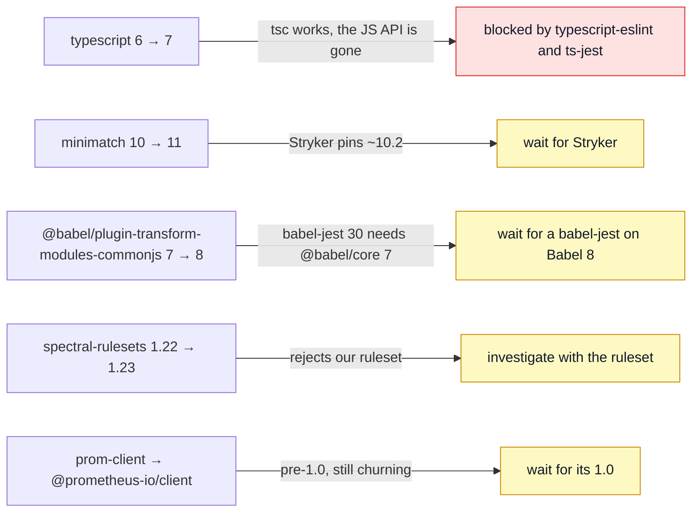

# Pending Major Upgrades

What is deliberately not on its latest release, and why. Measured 2026-11-16 by installing the
candidate over the lockfile, type-checking and running the affected suites. Everything else is
current; a package missing here is not pending.



| Package                                    | Now       | Latest                           | Verdict                                             | Effort |
| ------------------------------------------ | --------- | -------------------------------- | --------------------------------------------------- | ------ |
| `typescript`                               | `6.0.3`   | `7.0.2`                          | **Wait** for 7.1 and the tools below                | M–L    |
| `minimatch`                                | `10.2.6`  | `11.0.5`                         | **Wait** for Stryker, which pins `~10.2`            | S      |
| `@babel/plugin-transform-modules-commonjs` | `7.29.7`  | `8.0.1`                          | **Wait**: `babel-jest` 30 needs `@babel/core` 7     | S      |
| `@stoplight/spectral-rulesets`             | `1.22.7`  | `1.23.1`                         | **Hold** the exact pin: 1.23 fails our ruleset load | S      |
| `@types/node`                              | `24.19.x` | `26.x`                           | Moves with the Node 26 runtime change               | S      |
| `prom-client`                              | `15.1.3`  | `@prometheus-io/client` `0.16.1` | **Wait** for its 1.0                                | S      |

The OpenTelemetry `@opentelemetry/api` is `^1.10` with SDK 3 (`@opentelemetry/sdk-node` 0.301,
`resources` and `sdk-trace` 3.1): the SDK-2 line peered `api <1.10`, the SDK-3 line needs it.

## TypeScript 7

7 is the native (Go) compiler. Trial: `tsc --noEmit -p tsconfig.json` with `typescript@7.0.2`
reports **zero errors** on this repo and finishes in 2.5 s, against 8.6 s for 6.0.3.

What is gone is the JavaScript API. The package root now exports only a version file; the
programmatic API lives under `typescript/unstable/*`, and 7.1 is where a stable one is promised.
Everything that calls `require('typescript')` breaks:

| Tool                                          | Uses the JS API for         | Position on 7                             |
| --------------------------------------------- | --------------------------- | ----------------------------------------- |
| `typescript-eslint` (parser, type-aware lint) | the whole type-checked lint | peer range `>=4.8.4 <6.1.0` — refuses 7   |
| `ts-jest`                                     | transpiling every test file | peer range `>=4.3 <7` — refuses 7         |
| `dependency-cruiser`                          | optional TS parsing         | not tried; check its own peer range first |
| `tsx`                                         | nothing (esbuild)           | unaffected                                |
| `tsc` itself (`npm run ts-check`)             | —                           | works; this is the part that is ready     |

| Question       | Answer                                                                                                                                                                                             |
| -------------- | -------------------------------------------------------------------------------------------------------------------------------------------------------------------------------------------------- |
| Blocked by     | `typescript-eslint` and `ts-jest` releasing a 7-compatible range, which depends on the 7.1 API.                                                                                                    |
| Half-step      | Alias 7 for the CLI only (`"typescript-7": "npm:typescript@7"`) and run `ts-check` through it, keeping `typescript@6` for the tools. Two compilers in one tree is the cost.                        |
| Recommendation | Wait for 7.1. Re-check `npm view typescript-eslint peerDependencies` and `npm view ts-jest peerDependencies` when it lands; the day both accept 7, the upgrade is a bump plus a lint and test run. |
| Effort         | M–L once unblocked: a `tsconfig` deprecation pass, then every rule in the type-aware lint re-run for changed diagnostics.                                                                          |

## prom-client → @prometheus-io/client

| Question       | Answer                                                                                                                            |
| -------------- | --------------------------------------------------------------------------------------------------------------------------------- |
| What it is     | The Prometheus project's own client, the successor to `prom-client` as the library the metrics are written against.               |
| Why not yet    | It is pre-1.0 and its API still moves between minors, so a move now is paid for again on the next release.                        |
| Recommendation | Move only at its 1.0. Re-check `npm view @prometheus-io/client version`; the metrics live in `src/infrastructure/observability/`. |
| Effort         | S: the surface is a registry, counters, gauges and histograms.                                                                    |

## Try it yourself

```sh
npm view typescript-eslint peerDependencies   # does the range admit 7 yet?
npm view ts-jest peerDependencies
npm view @prometheus-io/client version        # has it reached 1.0?
```

## Read next

- [Dependency Vetting](./dependency-vetting.md)
- [Package Dependencies](../reference/package-dependencies.md)
