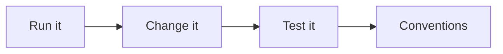

# Build

Run it locally, start a project, change a contract, test it, and the conventions every change follows.

| You want to                         | Start at                                            |
| ----------------------------------- | --------------------------------------------------- |
| See the API running in five minutes | [Getting Started](./run-locally.md)                 |
| Add or remove a module              | [Adding & removing a module](./module-lifecycle.md) |
| Change an endpoint or an event      | [API](./api-contracts.md)                           |
| Know which test to write            | [Testing — Quick Start](./testing-quickstart.md)    |
| Write a page or a comment           | [Writing These Docs](./documentation-style.md)      |

## Run it

- [Getting Started](./run-locally.md)
- [Start a New Project](./new-project.md)
- [Docker & Podman](./docker-and-podman.md)
- [Pairing & Ports](./pairing-and-ports.md)
- [The demo profile](./demo-profile.md)
- [The flow runner](./flow-runner.md)

## Change it

- [Adding & removing a module](./module-lifecycle.md)
- [Module scaffolder](./module-scaffolder.md)
- [API](./api-contracts.md)
- [OpenAPI Workflow](./openapi-workflow.md)
- [AsyncAPI Workflow](./asyncapi-workflow.md)
- [Contract Ownership & Fragmentation](./contract-fragmentation.md)
- [Regenerating After a Change](./regenerating.md)
- [Versioning and Retiring an Endpoint](./versioning.md)

## Test it

- [Testing — Quick Start](./testing-quickstart.md)
- [Testing & Docs](./testing-and-docs.md)
- [Unit Testing](./unit-testing.md)
- [Integration Testing](./integration-testing.md)
- [Contract Testing (Response Shape)](./contract-testing.md)
- [Contract-Derived Request Data](./contract-request-data.md)
- [Spec-Driven Fuzzing](./fuzz-testing.md)
- [Property-Based Testing](./property-testing.md)
- [Concurrency Testing](./concurrency-testing.md)
- [Broker testing](./broker-testing.md)
- [Replicas testing](./replicas-testing.md)
- [Load testing](./load-testing.md)
- [Mutation Testing](./mutation-testing.md)
- [Coverage & Confidence](./coverage-and-confidence.md)
- [Test doubles](./test-doubles.md)
- [Weak Machines](./weak-machines.md)

## Conventions

- [Writing These Docs](./documentation-style.md)
- [Code comments](./code-comments.md)
- [Dependency Vetting](./dependency-vetting.md)
- [Dependency graph](./dependency-graph.md)
- [Pending Major Upgrades](./pending-major-upgrades.md)
- [AI Auditing](./ai-auditing.md)
