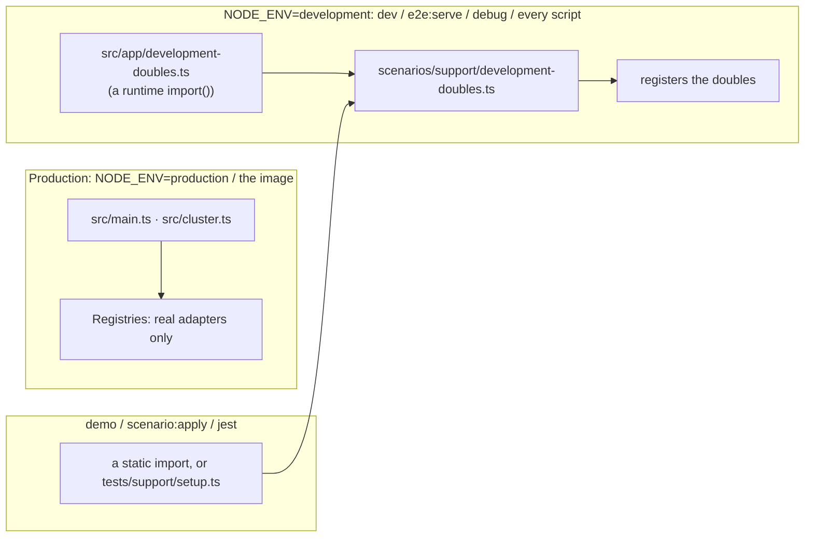

# Test doubles

**No fake, no stub, no demo code in production.** Not refused: absent.

A double lies about a real effect — the `fake` payment provider says "paid", the mail `log` says
"sent". Those live outside `src/`, in `scenarios/support/doubles/`, which the production image does
not copy. A process booted with `NODE_ENV=development` loads them at boot.

## What is a double, and what is not

| Setting                 | Production                | Dev, demo, jest                           |
| ----------------------- | ------------------------- | ----------------------------------------- |
| `NODE_PAYMENT_PROVIDER` | no provider — card is off | `fake`, unless the environment names one  |
| `NODE_MAIL_TRANSPORT`   | `smtp` only               | `log` (renders, drops), `outbox` (memory) |
| OAuth `fake`            | not registered            | registered by the development doubles     |
| analytics `none`        | stays: it is "off"        | same                                      |
| antibot `none`          | stays: it is "off"        | same                                      |

**"Off" is not a double.** It asks nothing and claims nothing, so it stays.

**A feature with no real adapter simply does not work** in production. Today there is no real
payment adapter, so production offers no card payment: `GET /payments/methods` lists no `card`,
checkout refuses it with `409 CART_PAYMENT_METHOD_NOT_AVAILABLE`. A deployment with a bank transfer configured still checks out, by transfer.

## The door: `NODE_ENV=development`

`NODE_ENV` in `.env` is the one switch. `loadDevelopmentDoubles()` (`src/app/development-doubles.ts`)
is the one runtime door from `src/` to `scenarios/`: under `development` it imports
`scenarios/support/development-doubles.ts`, and under any other value it does nothing.

| Who loads the doubles                                         | How                                                                                                            |
| ------------------------------------------------------------- | -------------------------------------------------------------------------------------------------------------- |
| `dev`, `dev:docker*`, `e2e:serve`, `debug`                    | `src/main.ts` awaits the loader after `startTracing()` and before `serve`                                      |
| `start:cluster`, `dev:docker:cluster`, the cluster test suite | `src/cluster.ts` awaits it before its primary/worker split, so the primary and every worker load it themselves |
| every `db:*`, `ops/*`, `job` script, the dev `cron` container | `runScript` awaits it before `assertProcessConfig()`; the cron container needs nothing but `NODE_ENV`          |
| `demo`                                                        | `scenarios/run-server.ts` imports the file first: it forces `NODE_ENV` itself, after imports                   |
| `scenario:apply`                                              | `scenarios/apply.ts` imports the file: it forces `NODE_MAIL_TRANSPORT=log` whatever `NODE_ENV` is              |
| jest                                                          | `tests/support/setup.ts` calls `registerDoubles()`; `NODE_ENV=test` makes the loader a no-op                   |

The production image copies no `scenarios/`. `NODE_ENV=development` there refuses to boot, and the
refusal names the cause: the loader looks for the file under the working directory, the same rule
`dotenv` follows for `.env`. A unit test asserts the loader's path names a real file, because no
static check can follow it.

The file does three things, in order: reads `.env`, gives `NODE_PAYMENT_PROVIDER`,
`NODE_MAIL_TRANSPORT` and `NODE_PSEUDONYM_KEY` a development default **when unset**, and registers
the doubles. Loading it twice (`scenario:apply` in development does) is harmless: a registration
replaces its own entry, and a default only fills what is unset.

## Why the registration is light

The development doubles and `setup.ts` both run **before** the application is built. A double that
imported the payments module there would load a module before a test's `jest.mock` is hoisted, and
before the config gate has judged the environment. So `scenarios/support/doubles/register.ts` loads
only the registries, and each double loads what it needs on its first call.

The registries live on `globalThis` under a `Symbol.for` key (`createSharedProviderRegistry` in
`src/infrastructure/runtime/provider-registry.ts`): dozens of test files use `resetModules` or
`isolateModules`, and a module-local map would come back empty after one.

## What else is not in `src/`

| Left `src/`                                                      | Now                                                                                                                              |
| ---------------------------------------------------------------- | -------------------------------------------------------------------------------------------------------------------------------- |
| the `/__test/*` routes and the restore machinery                 | `scenarios/support/demo.ts`; `run-server.ts` hands it to `createApp` as an `extension`                                           |
| the demo clock                                                   | `scenarios/support/demo-clock.ts`                                                                                                |
| the webhook sink's SSRF exemption (`NODE_WEBHOOK_DEMO_SINK_URL`) | registered by the development doubles through `src/infrastructure/adapters/ssrf-exemptions.ts`, as a whole origin, port included |

Production code therefore has no demo flag and no exemption in the SSRF guard, and the only code
that names a double is the loader, which reads `NODE_ENV` and imports a file the image does not
have: the registries are empty until a development process fills them.

## What the `fake` payment provider does and does not model

| Behaviour              | The fake                                                                                                                                                                                                              |
| ---------------------- | --------------------------------------------------------------------------------------------------------------------------------------------------------------------------------------------------------------------- |
| 3-D Secure             | `pm_card_authentication_required` answers `requires_action`, then **settles on its own** to `succeeded`. This models "the challenge was completed"; a pending or abandoned challenge is reached with `setFakeOutcome` |
| A refund               | Leaves the intent `succeeded`, as a real provider does; the refund is its own record                                                                                                                                  |
| A refund ledger        | **None.** The service refuses an over-refund with 422 `PAYMENT_REFUND_EXCEEDS_REMAINING` before the provider is called, so a ledger here would guard a path no journey can reach                                      |
| Wrong amount, refusals | `setFakeReceipt`, `setFakeOutcome`, `setFakeRefundFailure`, keyed by `fake_pi_<paymentId>`                                                                                                                            |

## Add a double

1. Put the file in `scenarios/support/doubles/`. A double that belongs to a `group: shop` module
   goes in a folder named for it (`payments/`), with a `register.ts` exporting one function.
2. Register it from `scenarios/support/doubles/register.ts`.
3. Test it under `tests/unit/scenarios/`.

`npm run demo:remove` deletes a removed module's doubles folder and its two lines in `register.ts`.

## Read next

- [Payments provider port](../modules/payments-provider-port.md)
- [Email & rendering](../understand/email-and-rendering.md#which-transport-and-who-decides)
- [Demo profile](./demo-profile.md)
