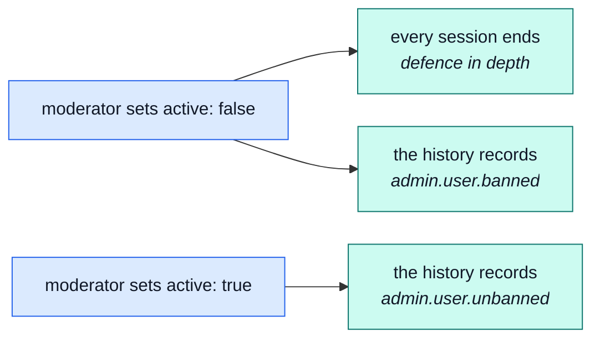
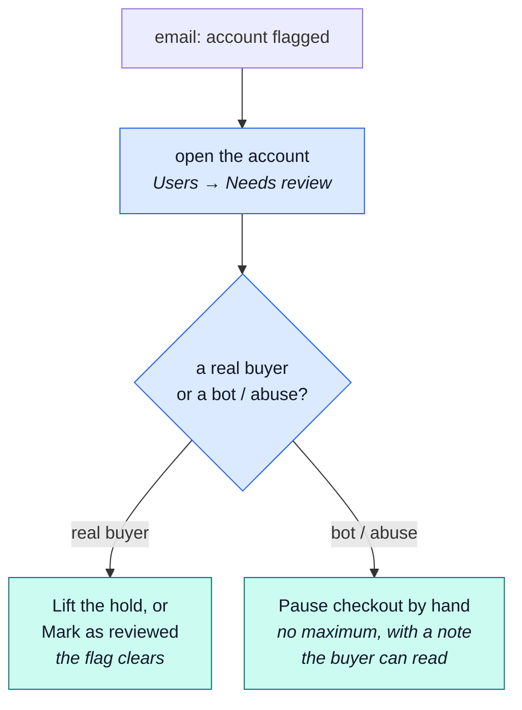
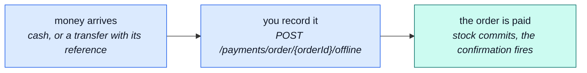

# The moderator

Accounts that need action taken against them, orders that need sorting out, and money that needs
to go back.

Log in as `moderator@example.com` — a real, narrower account, not the owner's. The password is
on [Test it yourself](./test-me.md).

## Key families, three jobs

| Key                                                         | Buys                                                      |
| ----------------------------------------------------------- | --------------------------------------------------------- |
| `read:User` / `.create` / `.update` / `.delete`, `ban:User` | Add, edit, erase an account — and ban one.                |
| `display:Order` / `.update`                                 | Read and update any order in the shop, not only your own. |
| `display:Payment` / `.create` / `.update`                   | Read any payment, and refund it.                          |
| `read:Return` / `.update`                                   | Read any return request, and approve or decline it.       |
| `read:AuditLog`                                             | Read the history of what everyone with a key did.         |

## Banning is its own key

There is no separate "ban" button in the data model. Banning an account **is** setting `active` to
`false` on it — the same field, the same endpoint, that an edit uses — but changing that one field
needs `ban:User`, a key [support](./support.md) does not hold. A role that fixes a customer's
phone number should not, by that alone, be able to lock them out:

What makes it show up as a **ban** rather than an ordinary edit is the action history, not a new
code path: flipping `active` from true to false is recorded as `admin.user.banned`, and flipping it
back is `admin.user.unbanned` — everything else that changes on the same request is still recorded
as a plain update. → [`users`](../modules/users.md)

## "Needs review": checking an account the shop flagged

The shop watches for a buyer who keeps cancelling. When someone's **unpaid** orders fall through
three times in a week (cancelled, or left to expire without paying), their next checkout is
**paused** for at most seven days, and their account is **flagged "Needs review"**. When it is
**paid** orders they cancel, nothing is paused: cancelling before dispatch is a legal right, so the
shop only flags the account for a person to look at. Either way you get an email, and the account
shows a "Needs review" chip in the Users list (filter: Review → Needs review).

The flag **stays until you act on it**, even after a pause has ended by itself. Setting or lifting a
hold counts as acting. Both are `ban:User`, so this is your job and not [support's](./support.md).

A **paid** cancellation is never a reason to pause on its own. Place a hold only for abuse, and write
the note as if the buyer reads it, because they do. → [`orders`](../modules/orders.md#the-purchase-hold)

## Recording a transfer, and why a paid order refuses it

`create:Payment` is also what lets this role record money that arrived outside the checkout
flow — cash at the counter, a bank transfer once its reference is matched — through
`POST /payments/order/{orderId}/offline`. It settles the order exactly as a card payment would: the
order moves to `paid`, stock commits, the confirmation fires.

An order already `paid` refuses a second recording, the same rule that refuses a second card
intent — `orders` alone decides whether an order still awaits payment, and every door that could
open a new one asks it before doing anything else. → [`payments`](../modules/payments.md)

## Reading the shop's own history

`read:AuditLog` opens `GET /audit` — this role's own window onto who did what, scoped to this shop.
It is the same underlying trail [the observability dashboard](../modules/observability.md) reads
for the platform operator, reached through a different door with a different key: this one asks
nothing about the platform, only about this shop, which is exactly the key a shop's own staff can
be handed. → [`audit-logs`](../modules/audit-logs.md)

## What a moderator protects

An account that holds a staff role may be changed only by a holder of `assign:Role`
([the rule](../theory/authorization.md#protecting-people)). A moderator does not hold it: it
can ban, edit and erase a customer, and it cannot touch another staff member or an administrator,
whatever the other keys say; the refusal is `403 ROLE_MANAGEMENT_REQUIRED`. It cannot hand out a
role either. A
moderator holds no `delete:Order` or `create:Order`: sorting an order out is updating it,
and removing or raising one on someone's behalf is [the manager's](./manager.md) job.

::: tip What this role cannot touch
No `products.*` — a moderator cannot change what a thing costs or looks like; that is
[the editor's](./editor.md) job. No `locales.*` — also [the editor's](./editor.md). No
`inventory.*` — a moderator reads an order, never moves stock.
:::

## The words we used

| Word               | In plain terms                                                                    |
| ------------------ | --------------------------------------------------------------------------------- |
| **Ban**            | `active: false` on an account, recorded under its own name in the history.        |
| **Refund**         | Money returned on a payment already taken. → [`payments`](../modules/payments.md) |
| **Action history** | Who did what, when, to which row. → [`audit-logs`](../modules/audit-logs.md)      |
