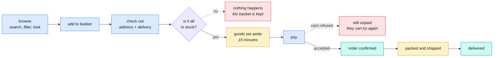
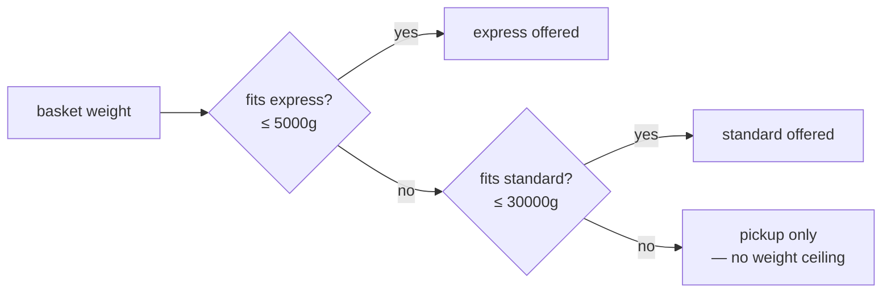
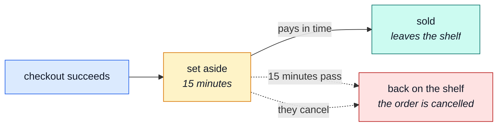

# The customer

What someone buying pet supplies actually experiences, start to finish.

Log in as `customer@example.com`. The password is on [Test it yourself](./test-me.md).

## The journey

## Before buying

**Browsing needs no account.** Anyone can look at the shop, search it, filter by category
(`dogs`, `cats`, `rabbits`, `birds`, `reptiles`, `small-animals`, `food`, `bundles`), and see what
is in stock. Out-of-stock items are still shown — that is why the Heavy-Duty Cat Scratching Post
exists in the demo — because hiding them makes a shop look emptier than it is.

**The basket lives on the server, not in the browser.** Add something on a phone and it is there on
a laptop. Close the browser for a week and it is still there.
→ [`cart`](../modules/cart.md)

**A wishlist is the "maybe later" pile.** Saved items sit there until they are moved into the
basket, at which point they leave the wishlist. → [`wishlist`](../modules/wishlist.md)

## Checking out

This is the only complicated moment in the shop, so it is worth understanding.

At checkout, four things have to be true at the same instant: the prices are current, the address is
real, the delivery has a cost, and **everything is actually in stock**. The shop checks all of them
together and then does one of two things.

::: warning It is all or nothing
If any line is short, the whole checkout is refused and **nothing is charged and nothing is
reserved**. The refusal lists every problem line at once — what was wanted, what is available — so
the basket can be fixed in one pass instead of discovering the next problem after each retry.
:::

If it all agrees, the goods are **set aside**: still on the shelf, but promised to that order and no
longer sellable to anyone else.

### Why can't I pick express?

Every shipping method has a weight it will actually carry — a courier's own limit, not a shop rule.
A basket heavier than a method's ceiling simply doesn't offer that method at checkout.

A product with no weight recorded counts as weightless — it never keeps a method off the list on
its own.

## The 15-minute hold

Setting goods aside is a promise with a deadline.

This is why an abandoned checkout does not silently eat the shop's stock. If the customer wanders
off, the goods come back on their own and the half-finished order is cancelled.

→ [`inventory`](../modules/inventory.md) · [the detail](../modules/inventory-reservations.md)

## Paying

The card form is real; the card is not. Any made-up card is accepted **except**
the test method `pm_card_declined`, which is always refused — so a refusal can be demonstrated on purpose rather
than waited for.

A refused card is not a failure of the order. The order stays unpaid, the goods stay set aside for
the rest of the 15 minutes, and the customer can try again.

Once payment goes through, the money and the goods are settled in the same instant: the order
becomes **paid** and the goods stop being "set aside" and become "sold".
→ [`payments`](../modules/payments.md)

**When the card form shows at all.** An order only awaits payment while it is still `pending` — the
one status the shop considers "still open to pay". Once an order is `paid`, the form does not come
back: the shop is not asking "would you like to pay again", it already has the money.

## Afterwards

- **They see their own orders, and only their own.** → [`orders`](../modules/orders.md)
- **They can download an invoice** as a PDF. It shows the VAT charged on each item, on the
  shipping fee (charged at the same rate as the goods it delivered, split across rates if the
  basket mixed two), and a summary table totalling every rate on the order at a glance.
- **They can cancel** until the order ships. If they paid by card, the money goes back
  automatically; if they paid by an offline method (a bank transfer an operator recorded by hand),
  an operator has to confirm the money actually came back before the order shows refunded. Past
  that point the money does not come back on its own: it goes back when the goods do (or when an
  operator chooses to refund), in whole or in part — see [`payments`](../modules/payments.md).
- **They can withdraw from the purchase** once it has arrived, without giving a reason. The delivery
  email, the order's history and the withdrawal box all name the same last day, written as "until
  the end of 5 December", with no time of day. The shop quietly accepts a withdrawal for one more
  day, so a buyer who counts a day differently is never turned away. → [`orders`](../modules/orders.md#the-withdrawal-window)
- **They can re-order** — one click puts everything from a past order back in the basket.
- **They can track the parcel** once it ships. → [`delivery`](../modules/delivery.md)

## When an order is late

A preorder or backorder can be late: its date moves later, is taken away, or passes with the goods
still not here. The shopper gets an **email** (and a note in their inbox) with the new date, or
"no new date yet", and the way to cancel: they can **cancel from their order page for a full refund**
any time before it ships. They are never asked a question and never have to answer. **If they are
happy to wait they do nothing**, and the shop never cancels their order for them. If it is very late,
a person from the shop may write to them. → [`delivery`](../modules/delivery.md#preorders-and-a-moved-date)

## When checkout is paused

A shopper whose **unpaid** orders keep falling through (cancelled, or left to expire without paying,
three times in a week) finds their next checkout refused: a notice on the cart and the profile says
why, until when, and how to ask a person. The pause lasts **at most seven days** and ends by itself
sooner if a person lifts it. They get an email with the same, a contact link, and their right to
object. Paying an order they already placed, cancelling, returning and their own data rights are never
blocked. Cancelling a **paid** order never pauses anything: that is a legal right, and the shop only
asks a person to take a look. → [`orders`](../modules/orders.md#the-purchase-hold)

## Their account

Sign up, verify by email, log in, forget the password and reset it, change it, and see every device (in the cookie set-up with its name, such as "Firefox on Linux")
currently logged in — with a "log me out everywhere" button that ends all of them at once. Money,
deleting the account and ending other devices ask for the password again when the customer last
proved it a while ago, however the shop keeps people signed in
([the two set-ups](../theory/sessions.md)).

An address book holds the places they have shipped to, with one marked as the usual.

Deleting the account is deliberately two steps, and it takes everything with it: the basket, the
wishlist and the address book all go. → [`account`](../modules/account.md)

## The words we used

| Word          | In plain terms                                                                                                        |
| ------------- | --------------------------------------------------------------------------------------------------------------------- |
| **Set aside** | Stock promised to an unpaid order. Not sold yet, but nobody else can buy it. → [`inventory`](../modules/inventory.md) |
| **Checkout**  | The single moment the basket becomes an order. → [`cart`](../modules/cart.md)                                         |
| **Order**     | A frozen record of what was bought, at the prices of that day. → [`orders`](../modules/orders.md)                     |
| **Invoice**   | The PDF receipt for an order.                                                                                         |
| **Session**   | One logged-in device. Logging out everywhere ends all of them. → [`account`](../modules/account.md)                   |
