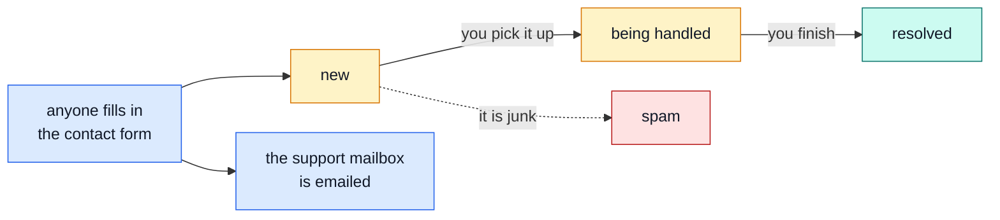
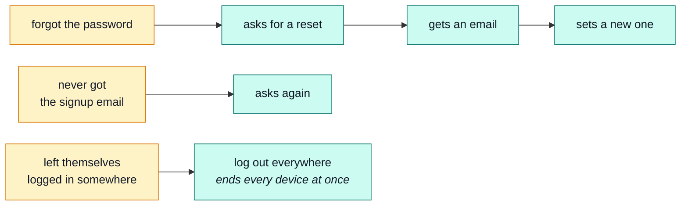
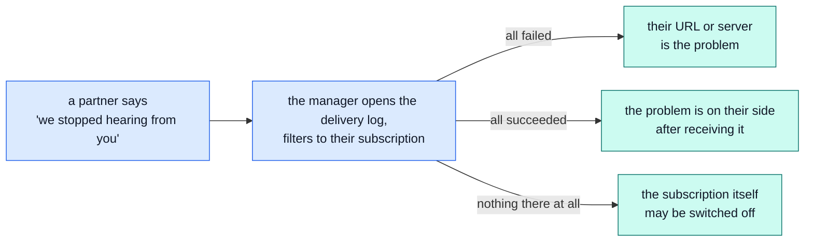

# The support desk

Messages from people, accounts that need help, and knowing whether the shop is actually broken.

Log in as `support@example.com`. The password is on [Test it yourself](./test-me.md).

::: tip When something goes wrong
When a buyer asks where their parcel is: [shipped but not arrived](./when-something-goes-wrong.md#shipped-not-arrived), [an order stuck in processing](./when-something-goes-wrong.md#stuck-in-processing).
:::

## The contact form

Anyone can send a message — no account needed. Along with signing up and logging in, it is one of the few things a complete stranger can write to.

Four states, and that is the entire workflow. Private notes can be attached to a message; the person
who sent it never sees them.

::: tip It records an email address, not a customer
The form asks for an email rather than requiring a login, because the people most likely to need
help are the ones who cannot get in. A consequence worth knowing: **deleting someone's account does
not delete their messages** — they were never attached to the account in the first place.
:::

→ [`feedback`](../modules/feedback.md)

## "I can't get in"

Most of what a support desk does, and none of it needs staff intervention:

::: tip What the desk may and may not do to an account
Support fixes a customer's details (a phone number, a name) and nothing that is the customer's own
to prove: there is no password, email or second-factor reset on anyone's behalf, because those are
the owner's alone. It cannot ban or reactivate an account either: that is `ban:User`, the
[moderator's](./moderator.md) key. And it works only on customers: another staff member's account
holds a role only a role manager may touch, so an edit is refused with
`403 ROLE_MANAGEMENT_REQUIRED`.
:::

A person can see every device currently signed in to their account and end any of them, or all of
them, themselves. → [`account`](../modules/account.md)

::: warning An unverified account still works
Signing up sends a verification email. An unverified customer can browse, fill a basket, keep a
wishlist and read their own orders, but cannot check out until the address is proven. If someone
says "I never got the email and I cannot order" — that is correct, not a bug: resend the email.
:::

## A buyer phones in a return {#phones-in-a-return}

The buyer cannot log in, or would rather ask. Open the order, then **Open return**: pick the lines,
the reason, and — if they asked a few days ago — the day they asked. The return is born
**approved** (you are the answer), and the buyer gets one email with the address to send the goods
to. No fresh login: nothing is paid until the goods arrive.
→ [`returns`](../modules/returns.md#staff-open-a-return-for-the-buyer)

## A buyer withdraws by phone, email or letter {#withdraws-by-phone}

The law accepts any clear statement, and counts it from the day it was **sent**, not the day you read
it. On the order press **Record withdrawal**, give the day the buyer sent it and how (phone, email,
letter, other). The shop then does everything their own button does, and emails them the day they
stated it and the day you recorded it: their proof.

The shop asks you to confirm your password first: it is a legal record, and before dispatch it
cancels the order and sends the money back (that needs the refund and order keys, which the
[moderator](./moderator.md) holds). A withdrawal sent after the window really closed is refused:
that one is not yours to waive.
→ [`returns`](../modules/returns.md#staff-open-a-return-for-the-buyer)

## A goodwill return after the deadline {#goodwill-after-deadline}

Day 40, the buyer is a regular, you say yes: open the return with reason **Other**. The deadline
does not stop you, and the return shows, for the next person, that it was an exception. Made-to-order
goods can be taken back this way too. Write nothing you do not want: the note is optional.

A defect that appeared within the two years but was reported later is **not** goodwill, it is the
legal guarantee: open it as **Defective goods** with the day the buyer reported it. Some countries
give more than two years; the same door covers it.

## Declining a return {#declining-a-return}

Pick the reason from the list: the period ended, not returnable, no defect found, or other. The
buyer reads one sentence in their own language. Write to the buyer only when you pick **Other**; the
shop then needs your message, because "other" alone tells them nothing.
→ [`returns`](../modules/returns.md#declining-a-request)

## Declined by mistake? {#declined-by-mistake}

A decline is final, on purpose: a decision stays a record. To fix a wrong one, open a **new return
for the same lines** from the order ([a buyer phones in a return](#phones-in-a-return)). The old
decline holds no units, so nothing is blocked. Set the day they asked to the day of the first
request, and put the declined return's number in the note (the buyer reads the note). The buyer
will have two emails: the decline, then the approval.
→ [`returns`](../modules/returns.md#staff-open-a-return-for-the-buyer)

## "Where is my order?"

Everything a customer might ask has an answer they can already see themselves: their order list, its
current step, the tracking code once it ships, and a PDF invoice to download.

A customer who writes in quotes the order number from their mail (`2026-000041`, often typed `#2026-41`).
Paste it into the Orders list's order number box: the list finds that one order.

If they want to cancel, they can — and a paid order refunds itself when they do. Nobody has to
process it.
→ [The customer](./shopper.md) · [`orders`](../modules/orders.md)

## "My order is late"

The customer already got an email and an inbox note when the date moved or would be missed. It says the new
date (or that there is none yet), and that they can **cancel from their order page for a full
refund** any time before it ships. Nothing is asked of them and the shop never cancels for them:
silence means they keep waiting. Staff look at the **Late** list weekly
([the weekly routine](./manager.md#late-orders)). A customer who writes in about it is told the same,
and if they want out, a staff member cancels and refunds with the ordinary cancel.
→ [`delivery`](../modules/delivery.md#what-staff-do-about-a-late-order)

## "My checkout is paused"

If a customer writes that they cannot place an order, the cause may be a **purchase pause**: the
shop pauses checkout for at most **seven days** after several unpaid orders were cancelled or left
to expire. The customer sees a notice on their cart and profile that says why and until when, and
gets an email with a link to write to you. Paying an order they already have, cancelling, returning
and their own data rights all still work.

Support **cannot lift it**: that is `ban:User`, the [moderator's](./moderator.md) key. Pass the case
on with the customer's address and what they told you; the moderator checks the account (it shows as
"Needs review") and lifts the pause or keeps it. Tell the customer a person will look at it, and that
it ends by itself within seven days at the latest. They may also object to it (GDPR Art. 21): say so in
the same ticket.
→ [`orders`](../modules/orders.md#the-purchase-hold)

## Languages

The shop's buttons, labels and messages speak more than one language, and **that wording can be
changed without a developer** — the [editor](./editor.md) does exactly this, and needs no other
access to do it.

Someone in that role can edit the text customers see on-screen, and register or retire a language.
The demo ships with Spanish, Italian, French and Japanese in deliberately different states of
completeness, so a half-translated shop can be seen behaving.

::: tip You can change what a phrase says, not invent new ones — and not what a product says
Editing replaces existing wording. A brand-new label still needs a developer — the application
decides _what text exists_, the editor decides _what it says_. A product's own title and
description are translated too, but through a different door — see
[`products`](../modules/products.md#writing-translated-content).
:::

A shopper who says "the shop is in English, I picked Spanish" is looking at a language that is switched
off, or one whose screens are not translated yet. Ask the [editor](./editor.md) to check the language's
switch; nothing on the shopper's side needs fixing.

→ [`locales`](../modules/locales.md)

## "Is the shop down?"

There is a health page that answers plainly. The live activity view that updates by itself is the
platform operator's, not this desk's (the support role holds no observability permission).

And there is the **90-day record of every staff action**: who changed that price, who cancelled that
order, when. Most "what happened here?" questions end there, but not from this desk: the record is
[the moderator's](./moderator.md) and [the manager's](./manager.md) to read, and the desk asks one
of them. Neither is the platform-wide view a developer or operator would use instead.

→ [`observability`](../modules/observability.md) · [`audit-logs`](../modules/audit-logs.md)

## "Our other system stopped getting notified"

When a shop is wired up to notify another system — accounting software, a mailing list — every
attempt to deliver that notification is logged: what event, when, whether it succeeded, and why it
didn't when it didn't.

::: warning Not readable from this desk
The support role holds no webhook permission: the delivery log (and replaying a delivery) belongs to
[the manager](./manager.md) and the administrator. This desk's part is to pass the partner's
complaint on, and to know what the manager will look at.
:::

Filtering the log by subscription and by status is usually the whole investigation — the error
column says what actually went wrong (timed out, refused, a wrong status code back).

::: tip Replay does not wait for the retry schedule (manager and administrator only)
A failed delivery retries itself automatically for a while, then gives up. Once whatever was
wrong is fixed, **replay** sends that exact attempt again immediately, right now, without waiting
for a next scheduled try or asking the other system to trigger the event over again.
:::

→ [The shop manager](./manager.md) · [`webhooks`](../modules/webhooks.md)

## What is pretend here

Worth knowing before promising anything to a customer:

| Thing              | In the demo                                                     |
| ------------------ | --------------------------------------------------------------- |
| Card payments      | Fake. No money moves. One test method always refuses.           |
| The courier        | Fake. Staff record the handover and the arrival by hand.        |
| Emails             | Not actually sent — they are collected where you can read them. |
| The whole database | Thrown away when the demo stops.                                |

→ [Demo profile](../tools/demo-profile.md)

## The words we used

| Word             | In plain terms                                                                                                        |
| ---------------- | --------------------------------------------------------------------------------------------------------------------- |
| **Triage**       | Deciding what a new message is and who deals with it. → [`feedback`](../modules/feedback.md)                          |
| **Verified**     | Confirmed their email. Until then an account can shop but not check out.                                              |
| **Session**      | One signed-in device. → [`account`](../modules/account.md)                                                            |
| **Audit log**    | The 90-day record of staff actions, read by the moderator and the manager. → [`audit-logs`](../modules/audit-logs.md) |
| **Health check** | A page that says whether the shop is running. → [`observability`](../modules/observability.md)                        |
| **Delivery**     | One attempt to notify another system of one event. → [`webhooks`](../modules/webhooks.md)                             |
| **Replay**       | Resending a delivery right now, instead of waiting for its next automatic retry. Manager only.                        |
