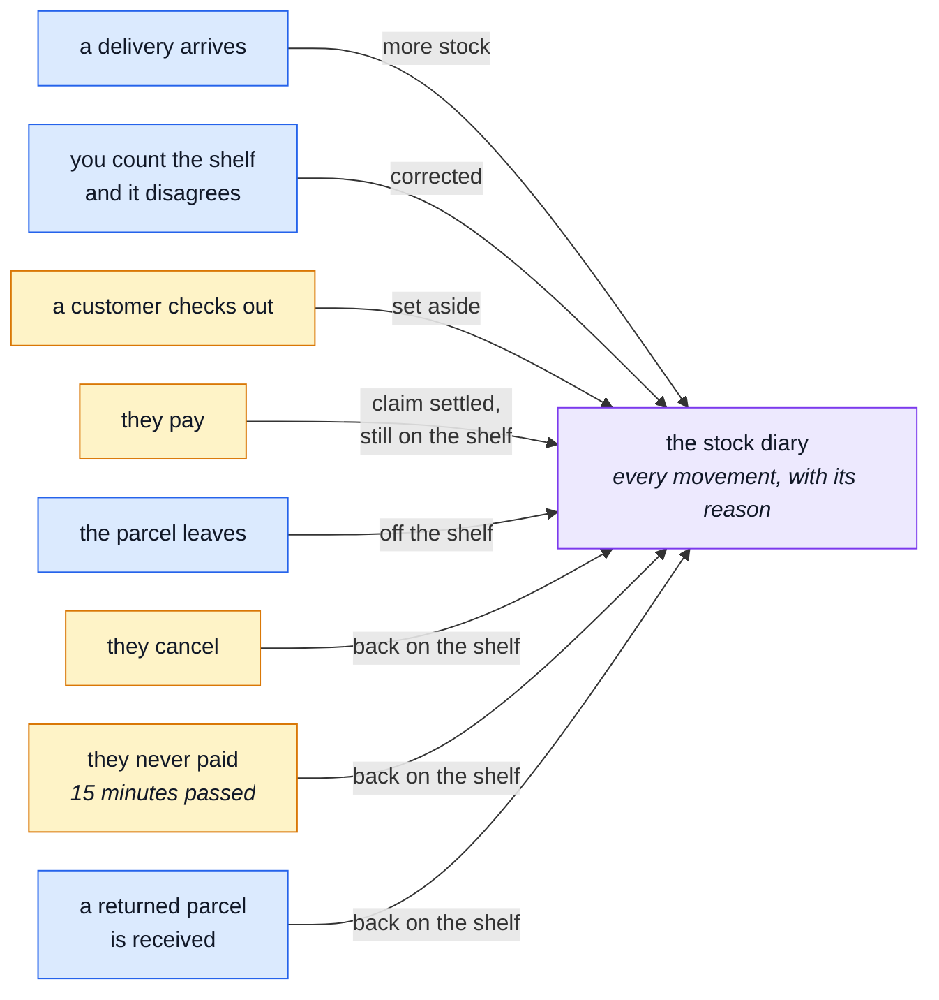
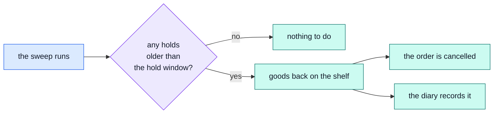
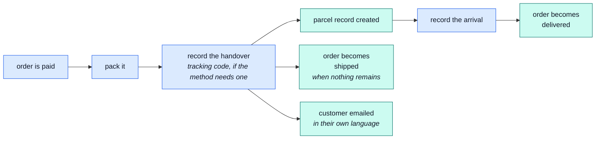

# The warehouse

Stock, and getting parcels out of the door.

Log in as `warehouse@example.com`. The password is on [Test it yourself](./test-me.md).

::: tip When something goes wrong
Odd cases that land on you: [fewer on the shelf than promised](./when-something-goes-wrong.md#fewer-on-shelf), [an order stuck in processing](./when-something-goes-wrong.md#stuck-in-processing), [shipped but not arrived](./when-something-goes-wrong.md#shipped-not-arrived).
:::

## The one rule

**Nobody types a stock number in directly.** Not the manager, not the shop, not anyone.

Stock only ever moves because something happened, and that something is always recorded. A number only
changes in one of these ways:

Blue is you doing something. Amber happens on its own. Either way the diary gets a line, so
"why is this number 23?" always has an answer.

::: tip Why this matters
A shop where anyone can overwrite the stock figure is a shop where the figure is eventually wrong
and nobody can say when it went wrong. Recording the _reason_ instead of the _result_ means the
number can always be rebuilt from its history.
:::

→ [`inventory`](../modules/inventory.md)

## Three numbers, not one

Every product carries three figures, and confusing them is the classic warehouse mistake:

| Figure        | Means                                                      |
| ------------- | ---------------------------------------------------------- |
| **On hand**   | Physically on the shelf right now                          |
| **Set aside** | Of those, how many are promised to orders not yet shipped  |
| **Available** | On hand minus set aside — what a customer can actually buy |

A product with 10 on hand and 4 set aside sells to 6 more people, not 10.

## The two things you do by hand

**A delivery arrived** — record what came in. Stock goes up, the diary gets a line.

**The count is wrong** — record the correction. Somebody dropped a box, or two got miscounted at
some point. Stock moves to the true figure, the diary gets a line saying it was a correction rather
than a sale.

Both are entries in a book, not edits to a number. That distinction is the whole design.

Goods usually arrive before a product is published, so the stock form lists drafts too. That is
all the warehouse reads beyond the storefront: changing a price or deleting a product stays with
the manager.

## An alarm: a paid order with no stock set aside

Now and then the shop emails the owner (the alert mailbox, "a paid order has no stock held"). It means an
order is paid, or on its way, but nothing was set aside for it in the stock. That does not come from a
late payment: it means the data was edited by hand or restored from a backup.

When the manager passes it on: open the order, then look at the shelf. If the goods are there, tell the
technician to restore the reservation. If they are not, the order is cancelled and the customer refunded. If the
parcel already left, record a **correction** so the count is true again. Then ask who changed the data.

→ [the detail](../modules/inventory-reservations.md#orphaned-hold)

## Clearing expired holds

When a customer checks out but never pays, their goods sit "set aside" for 15 minutes (by default) and then need
releasing.

::: warning This does not happen by itself
In the normal deployment a `cron` service runs the sweep every 5 minutes. **The demo (`npm run demo`)
has no such timer**, so somebody or something has to trigger the sweep — the job that finds expired
holds and puts the goods back.

Until it runs, those goods are invisible to customers even though nobody is buying them. Run it at
least as often as the hold lasts.
:::

→ [the detail](../modules/inventory-reservations.md)

## The running-low list

There is a stock board showing everything with a "show me only the low ones" filter. Anything at
**5 or fewer** counts as low, unless that figure is changed.

In the demo, the Heavy-Duty Cat Scratching Post sits at zero — a permanent example of what the
bottom of that list looks like.

## Goods that are late

Stock that has not arrived by its date leaves the order **waiting**; the buyer has already been
emailed, and may cancel any time before it ships. When stock does arrive, record it as usual: the
waiting orders take it in the order they were paid. Which orders are late, and the weekly check, are
the manager's: see [Late orders](./manager.md#late-orders).

## Getting parcels out of the door

The same rule as the stock diary above applies here: **you record what happened, and the status
follows from it — you never set the status directly.** There is no "mark it shipped" switch on its
own; recording the handover (`POST /delivery/fulfillment-orders/{id}/shipments`) IS what marks it
shipped — once nothing remains to ship. Until then the order stays `processing`, and its fulfilment
reads `partially_fulfilled` after a first partial shipment.

Only one shipping method in the demo (express) needs a tracking code — the others move a parcel
along with nothing but the record of the handover itself. Either way, the three things after
recording the handover all happen on their own: you do not separately create the parcel, or write
the status field, or send the email.

::: tip Starting work on a paid order
Packing starts with its own action — `POST /orders/{id}/process` — which moves the order
from paid to `processing`. Nobody sets `processing` directly: the same rule, one step earlier.
:::

**There is no courier simulation.** Recording the arrival is a real action on a real
parcel, the same way recording the handover is — not a button standing in for a delivery company's
own report. → [`delivery`](../modules/delivery.md)

::: tip When the ordinary sequence does not fit
A parcel scanned against the wrong order, or a correction needed outside the normal pack → ship →
deliver order, goes through an admin's forced correction instead — see
[Correcting a mistake](./manager.md#correcting-a-mistake). It still creates the same record; it
just carries a reason and skips the ordinary gate.
:::

## A returned parcel arrives {#a-returned-parcel-arrives}

When a buyer's parcel comes back, press **Goods received** on the return. By default every unit goes
back on the shelf and the buyer is refunded.

**A returned item is damaged.** Set the **restock** count of its line to **0** (or to how many of
the units are sellable) before you press the button. The units you do not restock never reach the
shelf, so a broken lamp is never handed to a buyer who is waiting for one. The refund does not
change: restocking is about the goods, not the money.

Dispose of the broken item or repair it. If it becomes sellable, record it with **Receive stock**
(a delivery) and write in the note that it is a repaired return.

::: warning The shop pays for a lost parcel
A buyer who posted the goods and shows proof of posting is owed the refund even if the parcel never
arrives. Receive the return with a restock count of 0 on every line (see
[The return parcel was lost](./when-something-goes-wrong.md#return-parcel-lost)).
:::

→ [`returns`](../modules/returns.md#what-the-customer-gets-back)

## The words we used

| Word           | In plain terms                                                                                   |
| -------------- | ------------------------------------------------------------------------------------------------ |
| **On hand**    | Physically present on the shelf.                                                                 |
| **Set aside**  | On the shelf, but promised to an order not yet shipped. → [`inventory`](../modules/inventory.md) |
| **Available**  | On hand minus set aside. What can still be sold.                                                 |
| **The sweep**  | The job that releases holds nobody paid for. Must be triggered.                                  |
| **Adjustment** | A recorded correction after counting the shelf.                                                  |
| **Receipt**    | A recorded delivery from a supplier.                                                             |
