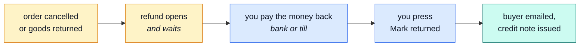
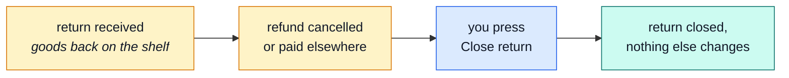
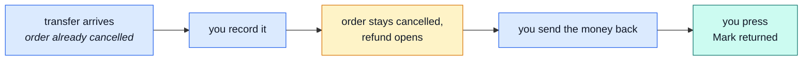

# When something goes wrong

**The shop handles the ordinary cases by itself. These are the odd ones, and they are yours.**

The shop does not guess in a case like these. It shows you what it knows, gives you a button or a
note field, and leaves the decision to a person. Each entry below has the same three parts:
**what you see**, **what to do**, **whose job it is**.

| Something odd happened                                                 | Go to                                                          |
| ---------------------------------------------------------------------- | -------------------------------------------------------------- |
| A refund is owed and the money must be paid back by hand               | [A refund owed by hand](#refund-owed-by-hand)                  |
| The card refused to take a refund back                                 | [A card refund the card refused](#card-refund-refused)         |
| A refund was also made in the provider's own dashboard                 | [Refunded in the dashboard as well](#refund-covered-elsewhere) |
| Two refunds were opened by mistake                                     | [Two refunds by mistake](#two-refunds)                         |
| A return was received but its refund will never come the usual way     | [A return that cannot finish](#return-cannot-finish)           |
| Money arrived by bank transfer for an order that was already cancelled | [A transfer for a cancelled order](#late-transfer)             |
| The shelf holds fewer units than the orders promised                   | [Fewer on the shelf than promised](#fewer-on-shelf)            |
| An order stays in "being prepared" and nothing moves                   | [An order stuck in processing](#stuck-in-processing)           |
| A parcel left a long time ago and nobody recorded its arrival          | [Shipped but not arrived](#shipped-not-arrived)                |
| A parcel was lost, or damaged on the way, and the buyer never got it   | [A parcel lost or damaged](#lost-parcel)                       |
| A parcel was lost and the shelf has none left to send again            | [Lost, and none left](#lost-none-left)                         |
| A parcel marked lost has arrived after all                             | [The lost parcel arrived](#lost-parcel-arrived)                |
| A parcel came back to the shop (returned to sender)                    | [It came back to us](#parcel-came-back)                        |

::: tip More entries come with their features
Each entry here describes something the shop does today. When a new tool lands (disputes, a buyer
who never answers), its entry lands on this page in the same change as the tool.
:::

## A refund owed by hand {#refund-owed-by-hand}

**What you see.** A cancelled or returned order was paid in cash or by bank transfer. The order's
payment shows a refund that is still **open**, and the order is listed on the payment
"needs attention" list. The shop cannot send money out of your bank, so it waits for you.

**What to do.**

1. Pay the money back from the bank (or the till), for the amount shown.
2. Only then press **Mark returned** on that refund.

Pressing it is what closes the refund: the buyer gets the "your money is back" email and the credit
note is issued. Nothing is sent before you press it.

::: warning Never press Mark returned before the money has left
The button only records that you paid. If the bank transfer then fails, the shop and the buyer both
believe they were paid back and nobody is left to notice.
:::

**Whose job.** Whoever holds the refund permission: the [moderator](./moderator.md) or the admin.
A card payment is different: the shop refunds the card itself, and has no hand step.
→ [`payments`](../modules/payments.md)

## A card refund the card refused {#card-refund-refused}

**What you see.** You refunded a card payment (or cancelled an order, or received a return), and
the refund sits **open**. On the payment, the refund reads **Failed** with a reason. If the reason
is one of the clear ones (the bank declined it, the card expired or was reported lost or stolen, or
the shop's own provider balance was too low), the payment's **Mark returned** button is offered and
the order is on the "needs attention" list at once. The shop does not keep sending a refund the bank
has refused for good.

**What to do.**

1. Agree with the buyer how to pay them back, for example a bank transfer to an account in their
   name. The shop does not store bank details: keep them in your mailbox and your bank, under your
   usual retention.
2. Pay the money back from your bank, for the amount shown.
3. Only then press **Mark returned** on that refund.

Pressing it closes the refund: the credit note is issued, a waiting return closes, and the buyer is
told their money is back.

If the refund pays a return or a withdrawal, the "needs attention" list also shows **how many days are
left** to pay it back. The law (EU Consumer Rights Directive, Art. 13) gives you 14 days from the
day it was opened; after that the row says how late it is. Any other refund shows only its age.

If the reason reads **provider unavailable** or **no usable reason**, there is no Mark returned
button on purpose. The refund may have gone through, and the shop keeps asking the provider under
the same key until it has an answer. If it stays open for an hour, it shows up on the "needs
attention" list: check the provider's own dashboard (or its support) to see whether the money left.
If the provider is gone for good, that is a technician's job in the database, not a button.

If the payment's provider was removed from the shop, the reason reads **The payment provider is no
longer installed**: nothing was asked, so pay the buyer back yourself and press **Mark returned**.

::: warning Never press Mark returned before the money has left
The button only records that you paid. If the bank transfer then fails, the shop and the buyer both
believe they were paid back and nobody is left to notice.
:::

**Whose job.** Whoever holds the refund permission: the [moderator](./moderator.md) or the admin.
→ [`payments`](../modules/payments.md#when-a-card-refund-cannot-go-back)

## Refunded in the dashboard as well {#refund-covered-elsewhere}

**What you see.** Somebody refunded the buyer straight from the card provider's dashboard, and the
shop also holds its own refund for the same money. On the payment, that refund reads **open**
(waiting for you, or **Failed** with a clear reason such as "declined"), and the payment's
**Cancel refund** button is offered.

**What to do.**

1. Open the provider's dashboard and confirm the money really went back to the buyer.
2. Press **Cancel refund** on the shop's refund and write who refunded it, and where, in the note.

Cancelling is a void inside the shop only. Nothing is sent to the provider, no credit note is issued
and the buyer is not emailed: the money never moved from here. The amount becomes refundable again.
If the refund still reads **provider unavailable** or **no usable reason**, there is no Cancel
button on purpose: the shop may still be sending it, so wait for its answer first.

::: warning Never cancel a refund the shop already paid
A refund that reads **succeeded** cannot be cancelled: the money left, and voiding it would make
the books lie. If it was paid twice, the buyer holds the extra money: ask them for it.
:::

**Whose job.** Whoever holds the refund permission: the [moderator](./moderator.md) or the admin.
→ [`payments`](../modules/payments.md#cancelling-a-refund)

## Two refunds by mistake {#two-refunds}

**What you see.** Two partial refunds were opened for the same goods (the Refund button stays
available on purpose, so a double click can do it). The payment shows both.

**What to do.**

1. Open the payment's **Refunds** tab and read both refunds first.
2. A duplicate that is still **open** (waiting, or refused for a clear reason): press **Cancel
   refund** on it, with a note.
3. A duplicate that already shows **succeeded** is the buyer's money now. Write to them and ask for
   it back.

::: warning Never refund a negative amount to fix a duplicate
There is no such thing as a refund backwards. Cancel the open one, or ask the buyer.
:::

**Whose job.** The [moderator](./moderator.md) or the admin.
→ [`payments`](../modules/payments.md#cancelling-a-refund)

## A return that cannot finish {#return-cannot-finish}

**What you see.** A return was **received** and its goods are back on the shelf, but it never turns
**closed**: its refund was cancelled, or the money went back outside the shop, so the shop will
never see the refund land.

**What to do.** Press **Close return** on the return and, if you like, write why. The return
becomes closed and the order's history says so.

Closing is bookkeeping only: no money moves, no stock moves, no credit note is issued and the
buyer is not emailed that their money is back. If money is still owed, settle it first through the
refund (see [A refund owed by hand](#refund-owed-by-hand)).

::: warning A return nobody has received yet is not closed
A request is approved or declined. Close is for a return whose goods have arrived.
:::

**Whose job.** Whoever receives returns: the [warehouse](./warehouse.md) or the manager.
→ [`returns`](../modules/returns.md#closing-a-return-by-hand)

## A transfer for a cancelled order {#late-transfer}

**What you see.** The buyer's bank transfer arrives after their order was cancelled (they waited
too long, or somebody cancelled it). The money is real, the order is not payable any more.

**What to do.**

1. Record the transfer the usual way (see [Recording a transfer](./moderator.md#recording-a-transfer-and-why-a-paid-order-refuses-it)).
   The shop accepts it even though the order is cancelled.
2. The order **stays cancelled** and a refund for the full amount opens, owed by hand.
3. Send the money back, then press **Mark returned** (as in the entry above).

If the buyer still wants the goods, they order again. A cancelled order is never brought back.

**Whose job.** The [moderator](./moderator.md) or the admin: both record payments and refunds.
→ [`payments`](../modules/payments.md#offline-payments)

## Fewer on the shelf than promised {#fewer-on-shelf}

**What you see.** You count the shelf, it holds fewer units than orders are waiting on, and the
correction is refused with a conflict: the stock figure cannot drop below what is already **set
aside** for orders that exist.

**What to do.**

1. Decide which orders you cannot fill.
2. Ask the [manager](./manager.md#an-order-s-life) to cancel them. The cancelled units come off
   "set aside" and a paid order is refunded.
3. Then record the count again as a correction.

::: warning The refusal is on purpose
The shop is saying "you have promised these units to real people". Cancel the orders first, then
correct the count. Never the other way round.
:::

**Whose job.** The warehouse counts and records. The manager cancels.
→ [The three numbers](./warehouse.md#three-numbers-not-one)

## An order stuck in processing {#stuck-in-processing}

**What you see.** An order is "being prepared" and stays there: nobody recorded a handover.

**What to do.** There are three honest ways out:

| The truth                                    | Do this                                                                                               |
| -------------------------------------------- | ----------------------------------------------------------------------------------------------------- |
| The parcel left, nobody recorded it          | The warehouse [records the handover](./warehouse.md#getting-parcels-out-of-the-door)                  |
| The goods cannot be sent                     | The manager cancels the order (a paid order is refunded unless they say otherwise)                    |
| A parcel was scanned against the wrong order | An admin [corrects the status](./manager.md#correcting-a-mistake), with a reason that is written down |

**Whose job.** The warehouse for the first, the manager for the second, an admin for the third.

## Shipped but not arrived {#shipped-not-arrived}

**What you see.** The order says **shipped**, the parcel left a while ago, and nobody has recorded
its arrival. Nothing in the shop reminds you: it is a habit, not an alarm.

**What to do.** Look through the shipped orders about once a week. When a courier confirms the
delivery, the warehouse records the arrival (`POST /delivery/shipments/{id}/deliver`).

**Why it matters.** The order only moves to **delivered** after the last arrival is recorded. The
buyer's right to withdraw, and their legal guarantee, both count from that moment. Until it is
recorded, the clock has not started and the buyer's return window is still closed.

**Whose job.** The warehouse records; the [support desk](./support.md#where-is-my-order) is who
hears about it first, from a buyer asking where the parcel is.
→ [`delivery`](../modules/delivery.md#delivering)

## A parcel lost or damaged {#lost-parcel}

**What you see.** The carrier says the parcel is lost, or the buyer says it never came, or it was
damaged **on the way** and never handed over. The order says **shipped** and the parcel will not
arrive.

**What to do.**

1. Check the tracking code on the shipment first: the carrier's page is the proof.
2. On the shipment, press **Report lost / damaged**. Choose _lost_ or _damaged_. _Damaged_ means damaged
   in transit and never handed over; damage the buyer found after they had the goods is a
   [return](./support.md), not this.
3. Write the **message**: this is what the buyer reads, in the mail and on their order. Say what you will
   do and when ("we are sending a new one on Monday"). The **note** is for your colleagues and the
   buyer never sees it.
4. The units are open again on the **same order**. Either **ship them again** with the normal Ship button
   (the order goes back to _being prepared_ and forward again), or **cancel the rest** and refund the
   buyer if they would rather have the money.
5. Claim the loss with the carrier in the carrier's own portal. The shipment, its tracking code and your
   note are the paper trail.

**Never.** Create a new order for the replacement, or mark the lost parcel as delivered. The shop already
has the order, the invoice and the payment; a second order would count the sale twice.

::: tip For the accountant
The shipment with its tracking code and note documents the loss. In Italy goods that went missing are
presumed sold unless the loss is documented (DPR 441/1997), so keep that record.
:::

**Whose job.** The warehouse reports and ships again; the manager decides on a refund.
→ [`delivery`](../modules/delivery.md#lost-in-transit)

## Lost, and none left {#lost-none-left}

**What you see.** After you report a parcel lost, the order shows a second part **waiting for stock**,
with a date. The shelf had fewer units than the parcel carried.

**What to do.** Nothing is lost by waiting: the units the shelf had are ready to ship now, and the rest
are owed to this buyer **before** any new customer, in the order of the original payment. The date is the
product's restock date or, when it has none, thirty days. The buyer is told both in the mail.

1. Ship what the shelf covers (the normal Ship button).
2. When stock arrives, the rest is released by itself, as for any waiting order.
3. If the buyer would rather have a refund, cancel the waiting part.
4. **Check the preorder board** after a loss on a popular product: the owed units count there with the
   other promises, and they are not limited by the product's backorder limit.

**Whose job.** The warehouse ships; the manager handles a refund.
→ [`inventory`](../modules/inventory-reservations.md#owed-after-a-loss)

## The lost parcel arrived {#lost-parcel-arrived}

**What you see.** A parcel you reported lost shows up at the buyer's after all (the carrier updates, or
the buyer writes).

**What to do.** Open the shipment and press **Record arrival**, like any arrival. It works when every unit
on it is still open: the replacement was not sent and the rest was not cancelled. The shop then counts
the original parcel as the delivery and gives back the stock it had set aside again.

If the button is gone, the replacement already went (or the rest was cancelled) and the shop refuses to
count the goods twice. **Ask the buyer to send one back, or let them keep it: that is your call.** If
units come back to you, [record them as received](./warehouse.md#the-two-things-you-do-by-hand) with a
note.

**Whose job.** The warehouse records the arrival; the manager decides about the second parcel.
→ [`delivery`](../modules/delivery.md#the-lost-parcel-turns-up)

## It came back to us {#parcel-came-back}

**What you see.** The carrier returned the parcel to the shop (returned to sender, wrong address, refused).

**What to do.** Record the units as **received** with a note ("returned to sender, parcel 12"), so the
shelf is true again. Then ship them again with the normal Ship button, or cancel and refund. If the
parcel was reported lost earlier, ship again from the same order: you do not need to report anything
else.

**Whose job.** The warehouse.
