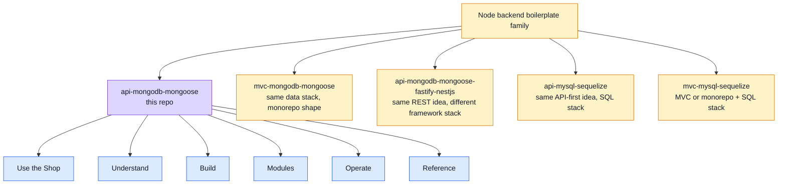
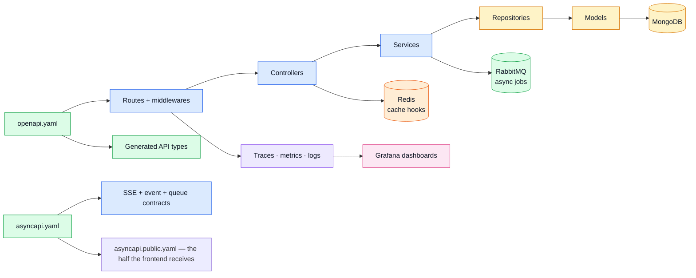

## I want to…

| I want to…                                  | Go to                               |
| ------------------------------------------- | ----------------------------------- |
| Use the demo shop, or explain it to someone | [Use the Shop](/use-the-shop/start) |
| Understand how and why it is built          | [Understand](/understand/start)     |
| Run it, change it, test it                  | [Build](/build/start)               |
| Read how one domain works                   | [Modules](/modules/start)           |
| Deploy it, back it up, watch it             | [Operate](/operate/start)           |
| Look up an endpoint, a script, a file       | [Reference](/reference/start)       |

## What this docs site is for

This docs site stays short, visual, and practical.
Use it to understand **what this boilerplate is**, **how the app layers fit together**, and **which tools already exist in the repo**.

> Think of the repo as **an example backend blueprint**, not a finished product with product-specific business rules.

## Family map

## Read this repo as

- **API**: REST API.
- **Framework**: [Express](./understand/runtime.md).
- **Database**: [MongoDB + Mongoose](./understand/mongodb-mongoose.md).
- **Observability**: [Observability Reference](./operate/observability-reference.md), [Prometheus](./operate/prometheus.md), [OpenTelemetry](./operate/opentelemetry.md), and [Grafana](./operate/grafana.md).
- **Real-time / outbound**: [SSE metrics stream](./reference/observability.md) and [email + PDF rendering](./understand/email-and-rendering.md).
- **Process model**: [Clustering & graceful shutdown](./understand/clustering.md).
- **Contracts**: [`openapi.yaml`](./build/openapi-workflow.md#openapi-is-the-source-of-truth) + [`asyncapi.yaml`](./build/asyncapi-workflow.md#asyncapi-is-the-async-contract-source-of-truth).
- **Shape**: layered code explained in [Theory](./understand/start.md) and the dedicated [Layers](./understand/layers.md) page.

## Six sections, six jobs

### [Demo Shop](./use-the-shop/start.md)

What the demo application actually does, in plain language, with no code on any page.
Start here if you are not going to read the codebase — or if you need to explain it to someone who
never will.

### [Theory](./understand/start.md)

Big picture: architecture, layers, and request flow.

### [Modules](./modules/start.md)

One page per domain, top to bottom: what it owns, who depends on it, its collection fields, its
routes, and everything it emits.
Start at [the whole map](./modules/start.md) — every domain grouped by subdomain, every node clickable.

### [Tools](./understand/tool-map.md)

Dependency-focused pages: runtime, security, database, cache, logs, metrics, traces, package groups, scripts, containers, analytics, testing, and docs.
New to the stack? Start at [Tools Explained](./understand/tools-explained.md) for a plain-English "what is X and why is it here" summary of every tool.

### [API](./build/api-contracts.md)

Contract-first workflow: OpenAPI + AsyncAPI, codegen, mocks, and implementation alignment.

### [Files](./reference/start.md)

The lookup surface: every file in the repository, what it is, and which page above explains it.
Start here when you have landed on a filename rather than on a question.

## Quick visual of the current repo

## Good starting points

- Never run this repo before? Start at [Getting Started](./build/run-locally.md) — three commands to a browsable API.
- Deploying instead of developing? [Getting Started — Production](./operate/first-deploy.md).
- Not a developer, or explaining this to someone who is not? [Demo Shop](./use-the-shop/start.md) — the whole application in five short pages.
- Want to know what one domain does, end to end? [Modules](./modules/start.md) — one page each, same shape every time.
- Found a file and have no idea what it is? [File Glossary](./reference/start.md) — one hop to an answer.
- Edited a module's contract fragment and unsure what to rerun? [Regenerating After a Change](./build/regenerating.md).
- Want the app shape? Start at [Theory Overview](./understand/start.md) and [Layers](./understand/layers.md).
- Want a specific dependency? Start at [Tools](./understand/tool-map.md) and jump to the tool page you need.
- Want the `package.json` map? Read [Package Dependencies](./reference/package-dependencies.md) and [Package Scripts](./reference/package-scripts.md).
- Want observability? Start with [Observability Reference](./operate/observability-reference.md), then jump to [Prometheus](./operate/prometheus.md), [OpenTelemetry](./operate/opentelemetry.md), and [Grafana](./operate/grafana.md).
- Want to change payloads or routes? Start in [API Overview](./build/api-contracts.md) and keep [`openapi.yaml`](./build/openapi-workflow.md#openapi-is-the-source-of-truth) first.
