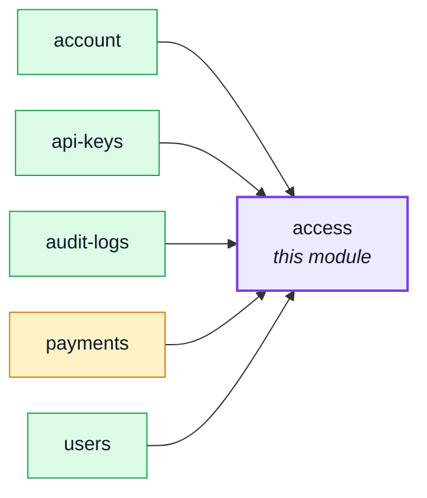
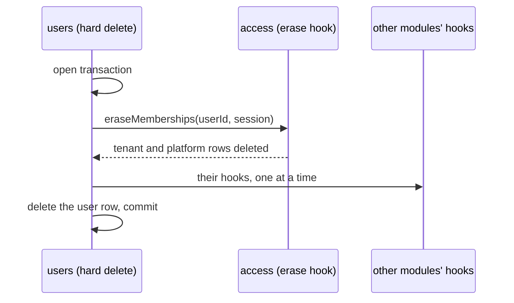

# access

::: tip At a glance
**Owns** — the tenant and membership collections: who the shops are, and who holds which role,
where.
**Depends on** — nothing. It sits low enough in the graph that [`account`](./account.md),
[`api-keys`](./api-keys.md) and [`users`](./users.md) all import it, never the reverse.
**Breaks if you change** — the role-management refusal in `assignRole`, and `canChangeAccount`: the two things
standing between any grant form, or any writer, and a privilege-escalation endpoint.
:::

## Its neighbourhood

<!-- module-graph:access:start -->

_Solid arrows are imports. Dotted arrows are domain events — the return path an import
graph cannot see._

<!-- module-graph:access:end -->

## The story

**Routeless on purpose.** Nothing in the boilerplate creates a shop or grants a role over the
wire — a deployment ships with one tenant, fixed at build time (`DEPLOYMENT_TENANT_ID`, which
stays in `kernel/access/tenant.ts`, imported directly rather than looked up), and every role a
person can hold comes from `shared/authorization-roles.yaml`, never from a request. So there is no
URL for this module to answer, and none of the route-guarding code — `kernel/permissions.ts`,
`kernel/ability.ts`, `kernel/access/query.ts` — moved here with the data; those stay in the kernel
because the guard itself is kernel code, and this module is the domain they ask about, not the
asking.

What makes it a module rather than kernel code anyway: it is an identity-and-access domain with
real collections and real write invariants, consumed by several sibling modules — several unrelated
modules sharing one domain is reason enough for its own module, the same reasoning
[`addresses`](./addresses.md) is split out of `account` for. A routeless module is not a special
case here: `basePath`/`routes` are both optional on the manifest (see
[Module lifecycle](../theory/module-lifecycle.md)), and `access` is this repo's one module that
omits both.

::: tip Roles are data, permissions are code
A role's PERMISSIONS live in `shared/authorization-roles.yaml` alone — the same file the PHP twin
reads byte-for-byte — never in this module's own collection. What this module stores is the other
half: WHO holds a role, in which shop, at which scope. `assignRole` validates a name against the
presets before writing a membership, so a role that exists nowhere can never be silently assigned;
`isUnrestrictedRole` (`@kernel/permissions`) asks those same presets whether a held name counts as
an administrator, rather than matching against a hardcoded list here. One fact, one home, on each
side of that line.
:::

`assignRole` and `revokeRole` take an optional `session`, so an account write and its
membership can share one transaction (see [`users`](./users.md#creating-and-updating-with-a-role)).
Given a session, `assignRole` and `revokeRole` audit only their failures; the success is recorded
with `auditRoleAssigned` / `auditRoleRevoked` once the caller has committed, and a grant refused before the account even
exists is audited by `grantRefusalAudited`, which answers the HTTP path with the rule that failed: a granter without `assign:Role` gets `403 ROLE_MANAGEMENT_REQUIRED` (judged first, so it learns nothing about role names), an unknown or never-granted name a translated `422` on `role`.

Every invariant here is a refusal, not a comment: a granter cannot hand over a role they do not
themselves hold, and `customer`, `unverified` and `guest` are not roles at all — an audience is
computed from the session and `verifiedAt` (see
[the audience roles](../theory/authorization.md#everyone-is-a-customer-first)), so there is nothing
to grant and a signup has no role to assign.

::: info The last administrator CAN be removed
Revoking, demoting or deleting a shop's last administrator is allowed, and leaves the shop with
none. A refusal would only guard against an operator who knows what they are doing, and the repair
is one database write: give somebody an administrator membership again, with the command under
[The first admin](../getting-started-production.md#the-first-admin).
:::

## When the account is erased

Roles are personal data, so this module declares a `personalData.erase` hook (`eraseMemberships`)
beside its export section. A hard delete of the account runs it inside the same transaction as
every other module's hook and the row itself:

Either the account and all its roles go, or none of them does: a failing later hook rolls the
role deletion back with it, so no account is ever left alive without the roles it held. No
membership row survives the user it points at.

## Whose accounts a role may touch

A key says what kind of thing; it never said whose. An account that holds a staff role may be
changed only by a holder of `assign:Role`, or it is a `403 ROLE_MANAGEMENT_REQUIRED`.
`canChangeAccount` answers it for a user id, `roleProtectedRefusal` wraps it into the envelope the
services return, and `holdsStaffRole` / `staffHoldersAmong` read from the memberships whether an
account holds a role in either scope. A role has no level and nothing ranks. The rule, its
exemptions and where each service asks it are on
[Authorization](../theory/authorization.md#protecting-people); this module owns only the question,
never the places it is asked.

## Who can do what

Every rule this module declares and who holds it, role by role. The rule is what a route guard asks for; the set is what a role lists.

<!-- permissions:start -->

| Rule          | Set              | `guest` | `unverified` | `customer` | `manager` | `warehouse` | `support` | `editor` | `moderator` | `admin` | `operator` | Credential | What it lets them do                                                                                                              |
| ------------- | ---------------- | ------- | ------------ | ---------- | --------- | ----------- | --------- | -------- | ----------- | ------- | ---------- | ---------- | --------------------------------------------------------------------------------------------------------------------------------- |
| `assign:Role` | `RoleManagement` | —       | —            | —          | —         | —           | —         | —        | —           | ✅      | —          | ✅         | Hand a staff role to an account or take it away, and change an account that holds one — edit, ban, erase. Held by administrators. |

✅ held · `own` only the caller’s own rows · ⚡c / ⚡s needs a freshly proved session (critical / sensitive) ·
Credential: ✅ when an API key can be minted with the rule. Generated from the rules and sets in
`src/modules/*/authorization.yaml` and the roles in `shared/authorization-roles.yaml`, asked of the
evaluator — [Authorization](../theory/authorization.md) explains the model.

<!-- permissions:end -->

## Related pages

- [`account`](./account.md) — resolves a bearer token into an `AuthContext` via `rolesOf`
- [`api-keys`](./api-keys.md) — re-derives a minted key's current role at check time
- [`users`](./users.md) — writes a membership on create, update and email verification, and runs `eraseMemberships` in a hard delete
- [Authorization](../theory/authorization.md) — the whole model, kernel half and module half together
- [Tenancy](../theory/tenancy.md) — why one deployment pins one tenant id
