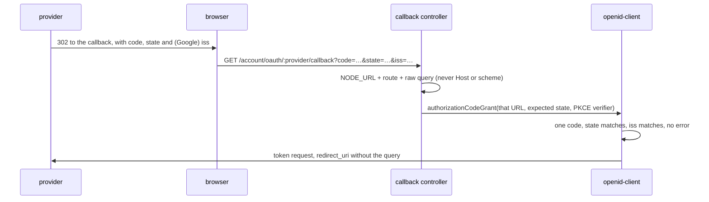
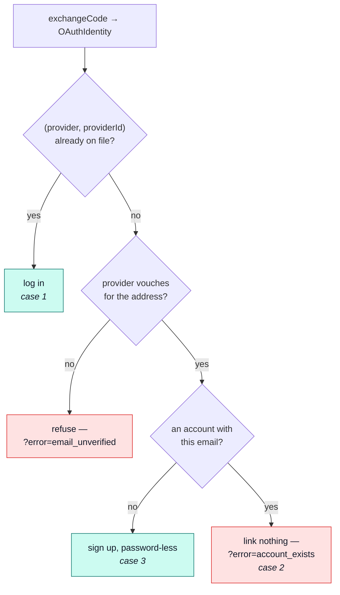

# OAuth registration, outcomes and endpoints

Registering the provider apps, how a login ends and the endpoint surface that carries it.

## Registering the provider apps {#registering-the-apps}

This boilerplate owns no Google or GitHub app, so a real sign-in needs yours. Per provider:

1. Register an OAuth app (Google: console.cloud.google.com/apis/credentials; GitHub:
   github.com/settings/developers).
2. Set its callback URL to `NODE_URL` + `account/oauth/<provider>/callback`: exactly the
   [server-derived URI](./account-oauth.md#two-urls-both-server-derived), or the exchange fails.
3. Put the client id and secret in the provider's two `NODE_OAUTH_*` variables (`.env-example` § C5).
   A provider is offered only once both are set.
4. Sign in once with each provider by hand. The tests drive the `fake` provider, so nothing else
   proves the real console settings. That check belongs to the first real deployment: an app is
   tied to one address, so one registered for `localhost` is thrown away later.

Google:

- Application type Web application, user type External, scopes `openid email profile` only.
- Testing status is enough to try it. With only those scopes nobody needs to be a listed test user
  and nothing expires after 7 days.
- "Publish app" (In production) needs a homepage and a privacy-policy link on the consent screen.
- Brand verification (name and logo on the consent screen) needs both on a Search-Console-verified
  domain. Without it the consent screen shows the domain instead.

GitHub:

- One OAuth app per environment. The callback must match exactly, so keep wildcard matching off.

Locally, register the callback on the same host as `NODE_URL` (`localhost` in the defaults). Do not
switch to `127.0.0.1` on its own: the `__Host-` state cookie is set on the host the frontend's
`VITE_API_URL` names, so the start and the callback must share a host.

The client id and secret go in the client's `.env`, not in `secrets/`
([optional integrations](../operate/first-deploy.md)). Rotate the secret in the console if it
leaks.

The callback hands the library that same URL with the request's **raw query string** attached
(`oauthCallbackUrl`, sliced off `request.originalUrl`), not a rebuilt one. The library then judges
the whole authorization response: a repeated `code` or `state`, an `error=`, a wrong `state` and a
foreign `iss` are each refused, and the `redirect_uri` it sends to the token endpoint is that URL
without the query. A rebuilt query would have hidden all of those, since `request.query` folds a
repeated parameter into an array.

## Outcomes, and the one that is a security decision {#outcomes-and-the-one-that-is-a-security-decision}

::: warning `providerId` is the identity key, never `email`
An email match is consulted **only** when no identity is on file, and it never logs anyone in or
links anything on its own: **a sign-in does not link a provider by email match.** NIST SP 800-63C-4
§3.8.1 says the relying party SHALL require an authenticated session with the subscriber account for
every linking function, so a match answers `?error=account_exists` ("sign in, then connect it from
your profile") and writes nothing. A provider's email can change while its subject id cannot, and
anyone able to register an OAuth app under a victim's address must not be able to walk into that
account. `emailVerified` is the provider's own claim, and an unverified address is refused outright:
it neither matches an account nor creates one, since a signup stamps the address as verified and
would pre-hijack it. It also closes an old gap: with 2FA armed, the link used to be saved before the
second-factor challenge, so someone who failed the challenge still left a permanent link behind.
:::

### Connecting a provider, signed in

The one door that links is `POST /account/oauth/links/:provider`, for a signed-in caller with a fresh
session (sensitive tier). The browser comes back from the provider with cookies only, so the start
issues a short-lived `oauth-link` token (5 minutes, spent on use) beside the state and verifier
cookies: it is the callback's proof WHICH account is connecting. It is not proof WHO is at the
browser, so the callback also resolves the session cookie and refuses the link unless that session
belongs to the account the token was minted for (a planted token would otherwise link the victim's
provider identity to the attacker's account, and mail the attacker). A browser with no session, or
another account's, is `?error=link_expired`; no new reason code, so no contract change. The same callback then links the
identity to that account (whatever email the provider holds), mints no session, audits
`AUTH_OAUTH_LINKED`, mails the owner and redirects with `?linked=<provider>`. A provider account that
already belongs to another account is `?error=already_linked`; a missing, spent or expired token is
`?error=link_expired`. Every refusal comes before the token is spent, so a refused attempt leaves it
live until it expires; the spend and the `$push` of the identity commit in one transaction
([Spending a link](./account-sessions.md#spending-a-link)). Because removal is permanent and nothing re-links by email match, a provider
the owner disconnected can never come back without them.

Two identities minting the **same** never-before-seen account at once is the race the
`users_oauth_identity` unique index exists for: the loser's `create` rejects with `E11000`, the
callback turns that into a generic `?error=provider_error`, and the caller's retry finds case 1.

## The endpoint surface, and how failure travels {#the-endpoint-surface-and-how-failure-travels}

| Route                                   | Answers                                       |
| --------------------------------------- | --------------------------------------------- |
| `GET /account/oauth/:provider`          | 302 to the consent screen, `state` cookie set |
| `GET /account/oauth/:provider/callback` | 302 back to the frontend, session cookies set |

Both are public, because this **is** how an unauthenticated caller signs in. Both sit behind
`credentialLimiters`. Which providers exist is `oauthProviders` on [`GET /config`](../reference/config.md):
a deployment with no keys lists none.

Only two failures answer with a body. Everything past the state check redirects to the frontend
with `?error=<code>`, because by then the browser is mid-navigation and a JSON body has nowhere to
be read:

| Failure                            | Answer                          |
| ---------------------------------- | ------------------------------- |
| provider never configured          | `404`                           |
| `state` missing or mismatched      | `400`                           |
| consent declined                   | `302 ?error=access_denied`      |
| no `code`, or the exchange failed  | `302 ?error=provider_error`     |
| email the provider won't vouch for | `302 ?error=email_unverified`   |
| email matches an existing account  | `302 ?error=account_exists`     |
| …and that account never proved it  | `302 ?error=account_unverified` |
| connect: identity held elsewhere   | `302 ?error=already_linked`     |
| connect: token missing or spent    | `302 ?error=link_expired`       |

Every row counts against the credential budgets, the `302` ones too: the controller flags the
failure (`credentialAttemptFailed`) so a redirect is not refunded as a success.

The success path calls the same `issueSession` [`postLogin`](./account-sessions.md) does, with
`amr: [provider.name]` — so a Google login records **how** it was proved, and the freshness guards
read it like any other method. It returns no access token: the frontend's
`POST /account/refresh` bootstrap mints one the moment it lands.

## Read next

- [account-oauth](./account-oauth.md) — the module's own page
