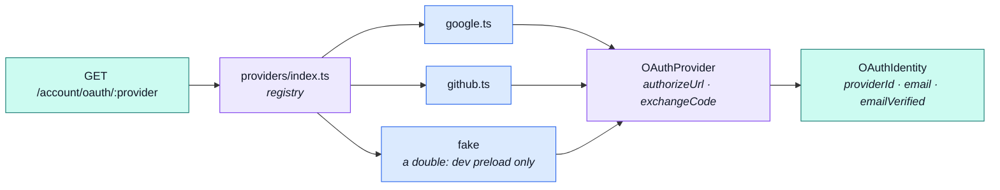
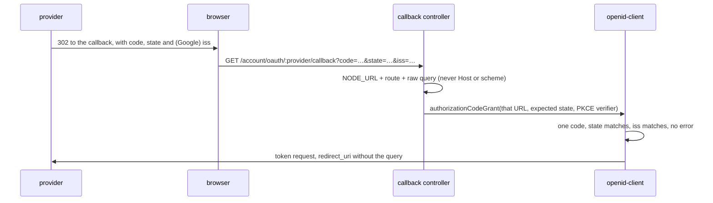
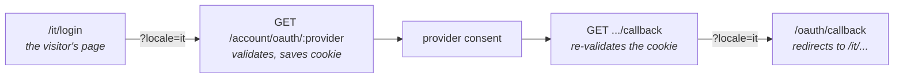
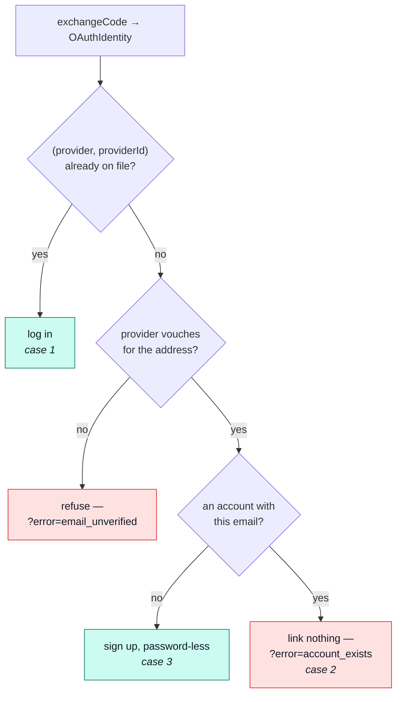

# OAuth

Signing in with somebody else's identity provider — the port, the CSRF handshake across the
redirect, and the outcomes a callback can have.
[Web attack defences](../theory/defences/authentication.md#federated-login)
carries the same three defences as attack rows — the `state` cookie, the server-derived URIs, and the
linking rule — naming what each one stops. This page is the mechanism behind them.

::: tip At a glance
**The shape** — `config.ts` reads the env, `state.ts` owns the CSRF cookie, `providers/` holds the
port and one file per implementation.
**Published** — nothing. Minting this application's sessions is [`account`](./account.md)'s own
business, exactly as [Sessions](./account-sessions.md) is.
**Breaks if you change** — `oauthRedirectUri`. Every provider's console has the old value
registered, and a mismatch fails the exchange, not the redirect.
:::

## The port, and why several may be live at once

Same seam as [`payments`](./payments-provider-port.md)' provider port, with one deliberate
difference: a deployment can offer Google **and** GitHub together, so there is no single
`NODE_*_PROVIDER` switch to pick a winner.

Each registry entry is a **closure re-checked on every call**, never a value computed at import: a
provider is configured when its `NODE_OAUTH_<NAME>_CLIENT_ID` / `_CLIENT_SECRET` pair is set in
the environment the process was started with (or a test override), and the registry holds no copy
of its own to go stale. An unconfigured provider resolves `undefined`
and the route answers 404 — the same "loud, never silently wrong" stance an unset
`NODE_PAYMENT_PROVIDER` gets.

`fake` is the dev preload's stand-in (a [test double](../tools/test-doubles.md), not in `src/`): no network call and no consent screen, so a Cypress spec
clicking "Continue with Google" never leaves this app. It still round-trips the real `state` cookie,
so the CSRF check gets genuine coverage rather than being skipped in the suite that exercises it
most.

## Two URLs, both server-derived

| Value                                  | Built from          | Never from            |
| -------------------------------------- | ------------------- | --------------------- |
| the redirect URI given to the provider | `NODE_URL`          | the request           |
| where the callback sends the browser   | `NODE_FRONTEND_URL` | the provider's answer |

That is the whole of the open-redirect and callback-confusion defence, and it works only because
`config.ts` is the single place both the start and the callback controller read them from.

## Registering the provider apps {#registering-the-apps}

This boilerplate owns no Google or GitHub app, so a real sign-in needs yours. Per provider:

1. Register an OAuth app (Google: console.cloud.google.com/apis/credentials; GitHub:
   github.com/settings/developers).
2. Set its callback URL to `NODE_URL` + `account/oauth/<provider>/callback`: exactly the
   [server-derived URI](#two-urls-both-server-derived), or the exchange fails.
3. Put the client id and secret in the provider's two `NODE_OAUTH_*` variables (`.env-example` § C5).
   A provider is offered only once both are set.
4. Sign in once with each provider by hand. The tests drive the `fake` provider, so nothing else
   proves the real console settings.

The callback hands the library that same URL with the request's **raw query string** attached
(`oauthCallbackUrl`, sliced off `request.originalUrl`), not a rebuilt one. The library then judges
the whole authorization response: a repeated `code` or `state`, an `error=`, a wrong `state` and a
foreign `iss` are each refused, and the `redirect_uri` it sends to the token endpoint is that URL
without the query. A rebuilt query would have hidden all of those, since `request.query` folds a
repeated parameter into an array.

## The CSRF handshake

A double-submit cookie, not server-side state: the value is minted and handed to the provider as
`state` in the **same response** that sets it as `__Host-oauth_state`, and the callback trusts a request
only when the two agree. No new server secret, unlike a signed token would need.

- 128 bits, from `randomBytes(16)` — the same entropy every one-time token carries.
- 5 minutes: long enough to pick a Google account, short enough to bound reuse.
- `httpOnly` / `sameSite: 'lax'`, `secure` always, no `Domain`, path `/` — the `__Host-` prefix's rules,
  the same flags as `__Host-session`. The prefix is what makes the double-submit check hold: a sibling
  subdomain that can write cookies cannot plant a state, a verifier and a callback URL that match
  (login CSRF: the victim lands signed in as the attacker). Every cookie here carries it, and an
  unprefixed `oauth_state` is simply ignored.
- Cleared by **both** a successful and a failed callback.

A second cookie, `__Host-oauth_verifier`, rides beside it: the **PKCE** verifier (RFC 7636, `S256` only).
`state` defeats a forged callback; the verifier defeats a stolen authorization code, since the
code is redeemable only by whoever holds it. Same lifetime, flags and clearing points. The port's
`authorizeUrl` takes the challenge and `exchangeCode` the verifier, together with the `state` the
cookie held: the library compares it with the one the provider echoed back, so a callback with
another attempt's `state` is refused before any request leaves.

## The protocol is `openid-client`'s

The authorization URL, the code exchange, the `state` and PKCE checks and the ID-token claim checks
(issuer, audience, expiry, issue time) are the library's, in `providers/client.ts`. What stays ours
is small, and every provider call goes through it:

| Ours                               | Why                                                                                      |
| ---------------------------------- | ---------------------------------------------------------------------------------------- |
| Each provider's endpoints, written | no discovery request at login: nothing to fail, nothing to spoof                         |
| One `fetch` for every call         | a 5 s deadline, a 1 MiB body cap, a redirect is an error (`providerFetch`)               |
| GitHub's `/user`, `/user/emails`   | not OAuth: GitHub's own REST API, and a private address only shows on the second         |
| The identity mapping               | `sub` or `id` as the key, never the email; an unverified address stays marked unverified |

Google's ID token comes straight from its token endpoint over TLS, so its **signature is not
checked**: OpenID Connect Core 3.1.3.7 step 6 accepts the channel in its place, and it is the same
trust the `code` and the access token already rest on. Google's issuer is pinned to
`https://accounts.google.com`; the bare `accounts.google.com` spelling its documentation also
mentions is refused. Google's discovery document says it sends `iss` on the redirect
(RFC 9207), and the static metadata says so too (`authorization_response_iss_parameter_supported`),
so a callback with no `iss`, or another one, is refused as well. GitHub sends none and is not asked
for one. GitHub answers a failed exchange with HTTP 200 and an `error` body, which the
library reads as the failure it is.

## What else rides the round trip: `continue` and `locale`

The start route accepts two optional query params. Each is saved as a cookie beside `__Host-oauth_state`
(same 5 minutes, same flags, same clearing points) and echoed on the redirect back to the frontend.

| Param      | Cookie                  | Validated by       | Echoed on                            |
| ---------- | ----------------------- | ------------------ | ------------------------------------ |
| `continue` | `__Host-oauth_continue` | `isSameOriginPath` | the success and the 2FA redirect     |
| `locale`   | `__Host-oauth_locale`   | `isLocaleTag`      | every redirect, a failure's included |

Both are **validated twice**: at the start against the query, and again at the callback against
the cookie, because a cookie is client-writable. An invalid value is dropped silently, since a
browser navigation has nowhere to show a JSON error. `locale` exists because `NODE_FRONTEND_URL`
names an origin, not a page: with no `continue` target and no saved language preference, the
frontend has nothing else to tell an `/it/login` visitor from an `/en/login` one. A saved
preference on the account still wins, exactly as it does for a password login.

## Outcomes, and the one that is a security decision

::: warning `providerId` is the identity key, never `email`
An email match is consulted **only** when no identity is on file, and it never logs anyone in or
links anything on its own: **a sign-in does not link a provider by email match.** NIST SP 800-63C-4
§3.8.1 says the relying party SHALL require an authenticated session with the subscriber account for
every linking function, so a match answers `?error=account_exists` ("sign in, then connect it from
your profile") and writes nothing. A provider's email can change while its subject id cannot, and
anyone able to register an OAuth app under a victim's address must not be able to walk into that
account. `emailVerified` is the provider's own claim, and an unverified address is refused outright:
it neither matches an account nor creates one, since a signup stamps the address as verified and
would pre-hijack it. It also closes an old gap: with 2FA armed, the link used to be saved before the
second-factor challenge, so someone who failed the challenge still left a permanent link behind.
:::

### Connecting a provider, signed in

The one door that links is `POST /account/oauth/links/:provider`, for a signed-in caller with a fresh
session (sensitive tier). The browser comes back from the provider with cookies only, so the start
issues a short-lived `oauth-link` token (5 minutes, spent on use) beside the state and verifier
cookies: it is the callback's proof WHICH account is connecting. It is not proof WHO is at the
browser, so the callback also resolves the session cookie and refuses the link unless that session
belongs to the account the token was minted for (a planted token would otherwise link the victim's
provider identity to the attacker's account, and mail the attacker). A browser with no session, or
another account's, is `?error=link_expired`; no new reason code, so no contract change. The same callback then links the
identity to that account (whatever email the provider holds), mints no session, audits
`AUTH_OAUTH_LINKED`, mails the owner and redirects with `?linked=<provider>`. A provider account that
already belongs to another account is `?error=already_linked`; a missing, spent or expired token is
`?error=link_expired`. Because removal is permanent and nothing re-links by email match, a provider
the owner disconnected can never come back without them.

Two identities minting the **same** never-before-seen account at once is the race the
`users_oauth_identity` unique index exists for: the loser's `create` rejects with `E11000`, the
callback turns that into a generic `?error=provider_error`, and the caller's retry finds case 1.

## The endpoint surface, and how failure travels

| Route                                   | Answers                                                     |
| --------------------------------------- | ----------------------------------------------------------- |
| `GET /account/oauth/providers`          | the configured names — a deployment with no keys lists none |
| `GET /account/oauth/:provider`          | 302 to the consent screen, `state` cookie set               |
| `GET /account/oauth/:provider/callback` | 302 back to the frontend, session cookies set               |

All three are public, because this **is** how an unauthenticated caller signs in, and all three sit
behind `credentialLimiters`.

Only two failures answer with a body. Everything past the state check redirects to the frontend
with `?error=<code>`, because by then the browser is mid-navigation and a JSON body has nowhere to
be read:

| Failure                            | Answer                          |
| ---------------------------------- | ------------------------------- |
| provider never configured          | `404`                           |
| `state` missing or mismatched      | `400`                           |
| consent declined                   | `302 ?error=access_denied`      |
| no `code`, or the exchange failed  | `302 ?error=provider_error`     |
| email the provider won't vouch for | `302 ?error=email_unverified`   |
| email matches an existing account  | `302 ?error=account_exists`     |
| …and that account never proved it  | `302 ?error=account_unverified` |
| connect: identity held elsewhere   | `302 ?error=already_linked`     |
| connect: token missing or spent    | `302 ?error=link_expired`       |

The success path calls the same `issueSession` [`postLogin`](./account-sessions.md) does, with
`amr: [provider.name]` — so a Google login records **how** it was proved, and the freshness guards
read it like any other method. It returns no access token: the frontend's
`POST /account/refresh` bootstrap mints one the moment it lands.

## Connected accounts: seeing and removing a link {#connected-accounts}

A linked provider is a way into the account, so its owner can see and remove it. Two routes, both
for a signed-in caller, neither public:

| Route                                   | Answers                                                                |
| --------------------------------------- | ---------------------------------------------------------------------- |
| `GET /account/oauth/links`              | each linked provider and when it was connected, never its id           |
| `POST /account/oauth/links/:provider`   | starts connecting one; fresh session (sensitive tier); the consent URL |
| `DELETE /account/oauth/links/:provider` | removes the link; fresh session (sensitive tier); `404` if absent      |

Both the connect and the removal mail the account's address (`account.sign-in-method-changed`, no link
that acts): NIST SP 800-63C-4 §3.8 says the account holder SHALL be told when a federated identifier
is added or removed, and a change made from a stolen session is otherwise silent. An account made
through a provider gets no such mail, since nothing was added to an account somebody already had.

There is **no guard on removing the last sign-in method**, by decision: forgot-password recovers a
passwordless account, so a lock-out here is the owner's to repair, not a state to forbid. The
password-reset confirmation mail names the providers still connected (or says none are): a reset
changes the password, not what Google or GitHub can still do, and the owner can only act on a link
they were told about.

## Two consequences worth naming

- **An OAuth-only account has no password.** `users.password` is deliberately not `required`, and
  sign-in for such an account works only through a provider — until a password reset gives it one.
  Its step-up is a code mailed to its verified address, so enabling a provider needs mail that
  delivers: boot refuses the pair otherwise outside development and test
  ([how](./account-sessions.md#step-up-for-an-account-with-no-password)).
- **The callback applies the account's second factor.** An account with `twoFactorEnabledAt` set gets
  the same login challenge `POST /account/login` would issue, not a session: the callback redirects
  the browser to the frontend's 2FA step and the session is minted only after
  [`POST /account/login/2fa`](./account-two-factor.md). A provider is one way to prove the first
  factor, never a replacement for the second (the attack row:
  [Federated login](../theory/defences/authentication.md#federated-login)).

## Libraries

`openid-client` is `account`'s alone — see [Package Dependencies](../tools/package-dependencies.md).

| Library                     | Maintained    | What it costs you                                                                                            |
| --------------------------- | ------------- | ------------------------------------------------------------------------------------------------------------ |
| `openid-client` (chosen)    | active, typed | ESM-only, which Jest has to transform; brings `oauth4webapi`, its one dependency                             |
| `passport` + strategies     | active        | a session-and-middleware model this app does not use, and two strategies to keep patched                     |
| hand-written token exchange | —             | what this file replaced: PKCE, state and claim checks are exactly what `CLAUDE.md` rules out writing by hand |

## Related pages

- [`account`](./account.md) — the module this belongs to
- [Sessions](./account-sessions.md) — the session a callback mints, and `amr`
- [Two-factor authentication](./account-two-factor.md) — the second factor this path also owes
- [`users`](./users.md) — `oauthAccounts` and the unique index behind it
- [Web attack defences](../theory/defences/authentication.md#federated-login) — the same subsystem as attack rows
- [`payments` provider port](./payments-provider-port.md) — the port this one is shaped after
