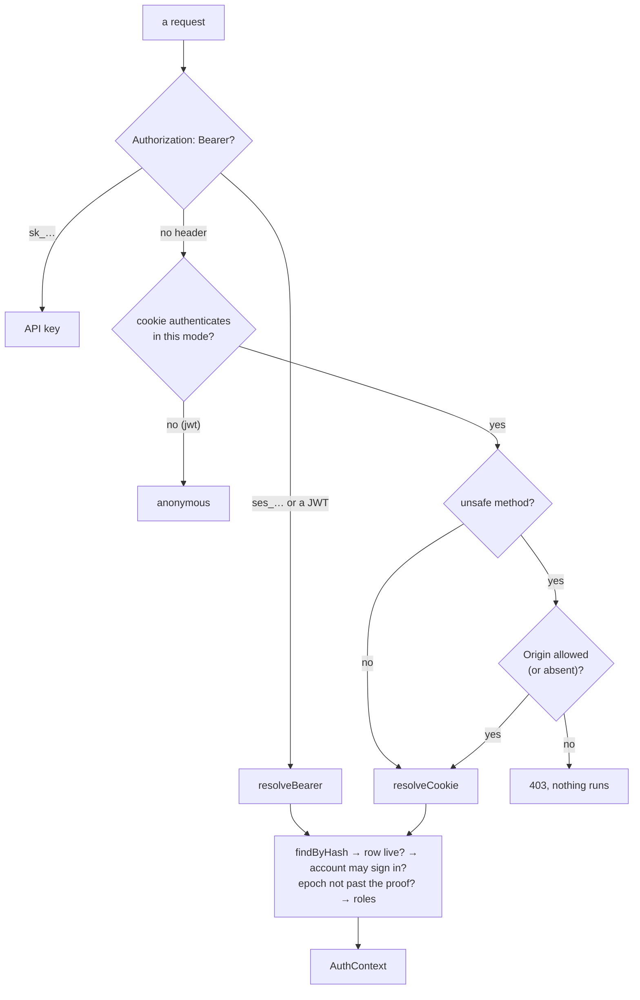
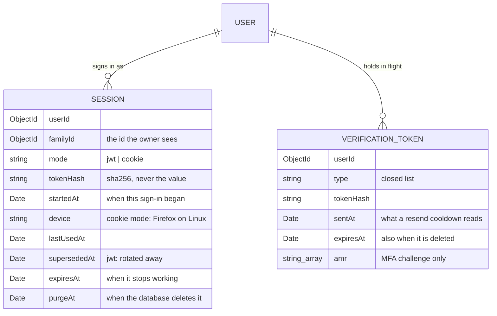

# Cookie mode and where sessions live

The `cookie` session mode: one random id, its flags, where sessions are stored and how logout everywhere ends them.

## `cookie` mode: one random id {#cookie-mode}

A login makes `ses_` plus 32 random bytes (base64url). Only its sha256 is stored, in a `sessions` row
with `mode: 'cookie'`: the account, a `familyId` (the id the owner sees), `authTime` and `amr` (the
step-up proof), the "remember me" tier, `startedAt` and the expiry. `lastUsedAt` is written at most once
a minute, so a busy tab does not write on every request.

- **Step-up.** `authTime` is stored at login and written again only by `POST /account/reauth`.
  Plain use never touches it, so a session kept alive for a month still asks for the password before
  money or deletion.
- **A re-proof replaces the id**, keeping the row's `familyId`, `startedAt` and expiry: the
  successor is stored first, the old row deleted second, so a failure between leaves two sessions,
  not none. A password change and a factor change delete every session first, so the controller
  reads the caller's session BEFORE the change (`sessionSnapshotOf`) and the re-mint continues it.
- **Logging out** deletes the digest's whole family (`removeFamilyByHash`); "log out that device"
  deletes by `familyId`, and clears the caller's own cookies when the family is its own;
  logout-everywhere moves the epoch and deletes every row. The epoch refuses what a failed delete
  would leave behind: a row whose `authTime` predates it never resolves.
- **A `ses_…` Bearer** is resolved exactly like the cookie, and is how every non-browser client logs
  in (`transport: "bearer"`). Because a header is not ambient, it is not origin-checked.
- **The origin check** is in `getAuth`, the one place a caller is resolved; see
  [Two ways to stay signed in](../understand/sessions.md#the-cookie-asks-for-a-check-on-every-write).
  `POST /account/refresh` answers 404 here.

## The cookie, flag by flag {#the-cookie-flag-by-flag}

The name is `__Host-session` in both modes: the prefix makes a browser refuse the cookie unless it is
`Secure`, `Path=/` and Domain-less. In `jwt` mode refresh is a `POST`, and refresh, logout and the SSE
streams answer 403 to a request naming an `Origin` that is not an allowed frontend origin (the same
list CORS uses), so a request from someone else's page cannot act on the cookie. In `cookie` mode the
same check covers every state-changing request the cookie authenticates.

| Flag       | Value           | Why                                                                                  |
| ---------- | --------------- | ------------------------------------------------------------------------------------ |
| `httpOnly` | `true`          | The credential (refresh token or session id) is long-lived; script must not read it. |
| `secure`   | `true`, always  | The `__Host-` name requires it; browsers accept `Secure` cookies from `localhost`.   |
| `sameSite` | `lax`           | Survives a top-level navigation back into the app; refuses cross-site form posts.    |
| `path`     | `/`             | The endpoints that read it are on different paths; `__Host-` needs it.               |
| `domain`   | none            | Host-locked: a sibling subdomain cannot set or overwrite the cookie.                 |
| `maxAge`   | the chosen tier | The cookie expires when the token does, rather than outliving it.                    |

There is a second, deliberately **non-secure** cookie carrying nothing but a logged-in hint, so the
client shell can render the right chrome before its first request answers. It holds no credential
and is safe to read from script — that is its entire job.

A third cookie is the **familiar-device** one (`session/device-cookie.ts`). It holds up to five
HMACs of account emails under `NODE_DEVICE_COOKIE_SECRET`, names no one and proves no password.
Holding one only skips the per-account failure budget, so an attacker spending that budget cannot
lock the owner out of their own browser. The per-address and per-block budgets still apply.

## Where sessions live {#where-sessions-live}

Two collections, both `account`'s own. Neither is on the user document: an array that grows with
every refresh is the anti-pattern MongoDB names for unbounded arrays, and a credential-bearing one
would have to be loaded (and kept out of every serialization) with the account it hangs off.

| Collection           | One row is                         | Deleted by                                                      |
| -------------------- | ---------------------------------- | --------------------------------------------------------------- |
| `sessions`           | one refresh token, or one sign-in  | its own `purgeAt` (TTL index), a logout, a revoke, an erasure   |
| `verificationtokens` | one mailed link or login challenge | its own `expiresAt` (TTL index), being spent, a password change |

- **A date on the row, not a lifetime on the index.** Both TTL indexes are `expireAfterSeconds: 0`
  on a per-row date, so changing `NODE_SESSION_TIME_*` never rebuilds an index, and a
  rotated-away row can be given an earlier date than its original expiry. The database's monitor
  runs about once a minute, so every read also checks `expiresAt`: a row past it is dead whether or
  not it has been deleted yet.
- **One live link per kind, atomically.** A reset, verification, email-change, undo and OAuth-link token each
  allow one live row per account, enforced by a partial unique index on `(userId, type)` for those
  kinds only. Issuing is one upsert, so two simultaneous requests cannot leave two working links. A
  deletion confirmation and an MFA challenge may be several at once, and are not in that index.
- **The kinds are a closed list** (`VERIFICATION_TOKEN_TYPES` in `token-types.ts`), the schema's
  enum: a misspelt kind is refused at the write, instead of being stored and never purged.
- **What stays on the user:** the password, the second factors, the linked providers and the session
  epoch. They are bounded, and the epoch has to commit with the credential write that moves it.
- **Deactivating or soft-deleting an account** moves the epoch in the same save, which refuses every
  session at once; the rows then age out by their own date. Nothing here reaches into `sessions`
  from `users`.

### What the session list shows

Each entry carries the time the sign-in began (`createdAt`, which a re-proof does not move) and
when it was last used. A `jwt` row per rotation would repeat one sign-in, so the list keeps only the
newest row of each family.

`cookie` mode adds a coarse `device` label such as "Firefox on Linux". `device-label.ts` parses
the `User-Agent` once, at login, with `bowser`, and keeps the browser and the system only (never a
version, an address or the raw header). The label lives on the row, so it is exported with the
session and erased with it. A client naming neither (curl, a script) gets no label, and `jwt` mode
keeps none.

## Logout everywhere {#logout-everywhere}

Every session an account holds is a row, which is what makes "log me out of every device" one
`deleteMany` rather than a token blocklist. The epoch (below) is the part that matters; the delete
is what keeps `GET /account/sessions` honest.

### The session epoch

Removing refresh tokens does not touch an access token already handed out (stateless, ten minutes)
except through its `sid` claim: every `jwt` access token names its session family, and the bearer
resolver checks that the family still has an unexpired row, so revoking one session (by id, or a
plain logout) stops its access tokens at once. Any unexpired row counts, rotated away or not: a
rotation supersedes the old row before it stores the successor. Ending a session deletes its whole
family, never only the presented row, so a predecessor inside the grace window dies with it. And
every "I may be compromised" event also moves `tokensValidAfter` on the user, and a token whose
`auth_time` (floored to the second) predates it is refused — by the resolver for an access token, by
`verifyRefreshToken` and the rotation for a refresh one. `auth_time`, not `iat`, because one
`/refresh` resets `iat` and would walk a stolen session out of the cut.

| Event                                 | Epoch moves                                                                      | The caller                                                                              |
| ------------------------------------- | -------------------------------------------------------------------------------- | --------------------------------------------------------------------------------------- |
| logout everywhere                     | yes                                                                              | signed out too                                                                          |
| password change or reset              | yes, and pending one-time tokens and MFA challenges are purged                   | signed out too                                                                          |
| 2FA factor armed, removed or disabled | yes                                                                              | survives: refresh cookie re-minted, the client's next `/refresh` swaps the access token |
| email change confirmed                | yes                                                                              | the confirming request is usually the mailbox, not a session                            |
| email change undone ("not me")        | yes, FIRST, before the address is touched, and pending links purged              | n/a: the undo link is the credential                                                    |
| refresh reuse detected                | yes                                                                              | n/a                                                                                     |
| admin ban or soft delete              | yes, in the same save as `active` / `deletedAt`; a ban also purges pending links | n/a: an unban or a restore does not bring the old tokens back                           |
| plain logout                          | no, but its session family goes, so its access token stops at once               | n/a                                                                                     |

### One table, keyed by cause {#revocation}

`REVOCATION` (`domain/revocation.ts`) lists every cause once: where its epoch is written, whether
pending links are purged, whether it announces `account.sessions_revoked`, whether the caller is
re-minted, and which session modes it applies to. `revokeFor(cause, userId)` in
`services/revocation.ts` acts on a row; the reasons an event can carry (`SessionsRevokedReason`),
and so the cases `api-keys` mails about, are derived from the rows that announce. Adding a cause
means adding a row, and the compiler asks for its test trigger.

`deletion-scheduled` is the row for `DELETE /account` ([scheduled deletion](./account.md#scheduled-deletion)):
the epoch rides `users`' own save, the pending links (reset, verification, email change, login challenges)
are purged, nothing is announced to `api-keys` (the keys are suspended by the resolver, not revoked, and
come back on restore), and the caller is not re-minted. The `account-restore` link is minted after
this purge, and is deliberately not among the links it kills.

**Where the epoch is written.** In the credential's own write, so a second write failing cannot
leave an old session live: the password's transaction, the swap's `save`, the factor's `save`. Two
cases stand apart. Logout everywhere writes the epoch and its `account.sessions_revoked`
[outbox](../understand/outbox.md) row in one transaction. The email undo does the same **before**
restoring the address: if the old address was taken meanwhile the restore answers 409, and the
thief must already be out when the owner retries (the undo link survives that 409, see
[Spending a link](./account-sessions-step-up.md#spending-a-link)). Deleting the session rows afterwards is housekeeping; its
failure is logged.

`POST /account/reauth` deletes the session it was given when it re-mints, leaving one live
session rather than two. A token stamped in the very second of a bump is kept, which is what lets
the caller's re-minted session survive its own bump.

## Read next

- [account-sessions](./account-sessions.md) — the module's own page
