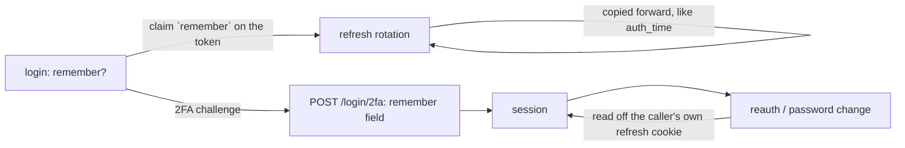
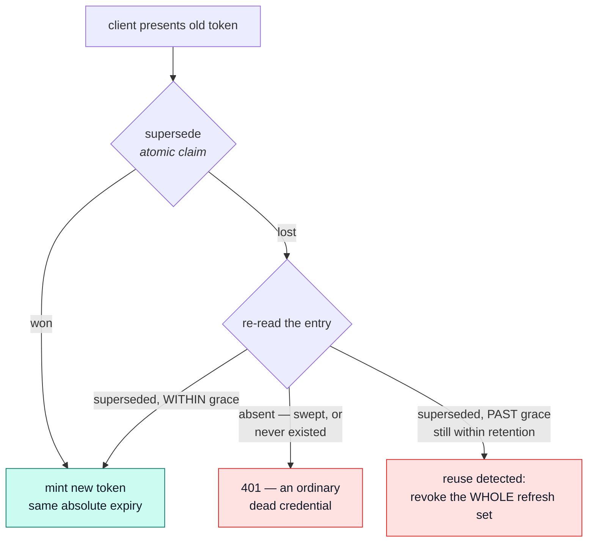

# JWT mode: tokens, keys and claims

How the `jwt` session mode works: two tokens, the signing-key ring, what a token claims, and how a refresh token rotates.

## `jwt` mode: two tokens, two lifetimes, two homes {#jwt-mode-two-tokens-two-lifetimes-two-homes}

|                | Access token               | Refresh token               |
| -------------- | -------------------------- | --------------------------- |
| Travels in     | the `Authorization` header | the `__Host-session` cookie |
| Lifetime from  | `NODE_TOKEN_ACCESS_TIME`   | one of three tiers, below   |
| Readable by JS | yes — the client holds it  | no — `httpOnly`             |

The refresh tier is the "remember me" choice, and it is a tier rather than a boolean so the copy on
the login form and the lifetime in the environment stay one decision:

| Tier     | Environment variable       | Default |
| -------- | -------------------------- | ------- |
| `short`  | `NODE_SESSION_TIME_SHORT`  | 1 day   |
| `medium` | `NODE_SESSION_TIME_MEDIUM` | 7 days  |
| `long`   | `NODE_SESSION_TIME_LONG`   | 30 days |

Staff and admin sessions also idle out: see [the staff idle timeout](../understand/sessions.md#the-staff-idle-timeout).

The longest default is 30 days, which meets ASVS 4.0.3 V3.3.2 L1 as written. A shop session is
long-lived on purpose and risk-based (ASVS 5.0 V7.1.1): the sensitive actions behind it ask for the
password again (`NODE_REAUTH_TIME_*`), the model Amazon and Shopify customer accounts use.

`config.ts` is the single place a deployment's answer to _how long is a session_ is parsed —
`jwt.ts` signs against it, `cookie-strategy.ts` stores its row against it and `cookies.ts` sets
`maxAge` from it. Its name is deliberate: it holds no token and issues none. The three tiers are the
same in both modes: a refresh token's life in `jwt` mode, the session row's in `cookie` mode.

### The box left unticked {#remember-me-unticked}

No `remember` is a real choice, not a missing one. It is the conventional meaning of an unticked
"remember me" (ASP.NET Core Identity, Django, Rails Devise, Spring Security all do the same):

| Login                                 | Cookie                                      | Refresh token's server TTL |
| ------------------------------------- | ------------------------------------------- | -------------------------- |
| `remember: short` / `medium` / `long` | persistent, `Max-Age` = the tier            | the tier                   |
| no `remember` (also OAuth, signup)    | **browser-session**: no `Max-Age`/`Expires` | the `short` tier           |

The **server** TTL is the real limit, not the cookie: browsers restore session cookies ("continue
where you left off"), so a session cookie alone would not end anything. NIST 800-63B-4 says the same
— use a non-persistent cookie, and never let cookie expiry be the limit.

The access token is a separate clock. `getAccessExpiryTime()` reads `NODE_TOKEN_ACCESS_TIME` and
nothing else, so the refresh fallback above can never leak into it.

The choice has to survive every step that re-mints the session, or it silently reverts:

- **Claim.** The refresh token carries `remember` only when a tier was ticked; absent means a
  browser-session login. Rotation copies it (`carriedClaims` in `jwt.ts`) and hands the controller
  `refreshMaxAgeMs: undefined` for a session login, so the rotated cookie stays a session cookie.
- **2FA.** The password step answers a challenge and sets no cookie, so the box's value is asked
  again: `POST /account/login/2fa` takes the same optional `remember` (`LoginTwoFactorRequest`).
  ASP.NET Core Identity carries it the same way. An OAuth-originated challenge has no earlier
  password step, so the 2FA request is the only place it can be said.
- **Reauth and password change.** Both replace the session, so `reissueSession` keeps the tier: in
  `jwt` mode read off the request's own `__Host-session` cookie (signature only — a password change has
  already deleted the row), in `cookie` mode off a snapshot of the caller's row taken before the
  change. No cookie, a stranger's cookie or an expired one all read as "no tier": a session cookie,
  never a persistent one granted by accident.
  A reauth from a `jwt` client that sends only its access token (no refresh cookie) still continues
  its own family: the token's `sid` names it, and the newest live row of that family supplies its start and
  end. Without that, the change would start a second family and leave the first one's refresh cookie
  working. A change that ends every session (a factor change) does not follow the token: it dies
  with the rest.

## The signing key is a ring, not a single secret {#the-signing-key-is-a-ring-not-a-single-secret}

`NODE_TOKEN_ACCESS`/`NODE_TOKEN_REFRESH` are each an ordered, comma-separated list of secrets,
newest first. `jwt.ts` signs with `ring[0]` and stamps a `kid` (`key-ring.ts#keyId`, a digest of
the secret itself); verifying looks the token's `kid` up in the ring rather than assuming
`ring[0]`, so a token signed moments before a rotation still verifies. Full rotation procedure:
[Security](../understand/security.md#signing-key-rotation).

## What a token says, and who it is for {#token-claims}

An access token carries RFC 9068's full set of registered claims, so its `at+jwt` header is true;
a refresh token carries the same minus `client_id`. `jwt.ts#signToken` stamps them and
`verifyAgainstRing` demands them.

| Claim       | Access token            | Refresh token    | From                                   |
| ----------- | ----------------------- | ---------------- | -------------------------------------- |
| `sub`       | the account             | the account      | the user id                            |
| `iss`       | checked                 | checked          | `NODE_TOKEN_ISSUER`, else `NODE_URL`   |
| `aud`       | checked, its own        | checked, its own | `NODE_TOKEN_{ACCESS,REFRESH}_AUDIENCE` |
| `iat` `exp` | required                | required         | the clock and the lifetime             |
| `jti`       | required, random        | required, random | `randomUUID()`                         |
| `client_id` | required, `first-party` | absent           | `FIRST_PARTY_CLIENT_ID`                |
| `sid`       | the session family      | absent           | the row it was minted against          |

- **Why `iss`/`aud`.** A secret shared with another service would otherwise let that service mint
  tokens accepted as sessions here (RFC 8725 §3.10). A wrong or missing one is a `401`.
- **Why two audiences.** Unset, the access audience is `NODE_URL` (the API) and the refresh one
  `NODE_URL/account/refresh` (where it is redeemed). A token of one kind is refused as the other
  even if both rings shared a secret — the second fence after `typ`.

## Refresh rotation {#refresh-rotation}

`POST /account/refresh` doesn't just re-sign an access token — it REPLACES the refresh token too,
every time. Without that, a stolen cookie would stay valid, silently, for as long as it had left to
live (up to 30 days, `remember: long`); rotation turns "a value that never changes" into "a value
that changes on every use", so a copy presented after the original has moved is detectable.

The new token's absolute expiry is COPIED from the old one's own claim, never reset to a fresh full
window — rotation changes the token's VALUE for theft detection, it does not extend how long the
session may live past what it was granted at login. The "remember me" choice is copied forward too
([above](#remember-me-unticked)): a rotation that dropped it would turn a session cookie persistent
on the first refresh.

**A session keeps one id across rotation.** Every rotation stores a new row with a new `_id`, so the
id `GET /account/sessions` publishes is the row's `familyId` instead: minted at login and copied to
every successor, together with `startedAt`. "Log out that device" deletes the whole family, the live
token and any rotated-away predecessor still kept for reuse detection. An id taken from `_id` would
name the dead predecessor after the first refresh, and the revoke would answer success while the
device stayed signed in (RFC 9700 §4.14.2: refresh-token families). Two refreshes of one token
inside the grace window each store a successor, so a family can briefly hold two live rows; the
list shows the newest, once.

Reuse is detected at the token endpoint only, as RFC 9700 §4.14.2 has it. A stale refresh token
presented at `POST /account/logout`, or carried into a sign-in, deletes its own family and records
no reuse, by design: that already ends the sign-in a thief could use, and logout answers `204` either
way.

The grace window (`NODE_TOKEN_ROTATION_GRACE_MS`, default 10s) exists for one reason: two requests
racing on the SAME cookie — two tabs waking together, an interceptor retrying — both present the
identical old token, and only one can win the atomic claim. Without the grace window the loser's
retry would look exactly like theft. Within it, the loser is reissued its own sibling token instead
of rejected — proven under real concurrent load in
`src/modules/account/tests/integration/auth-races.test.ts` (R5), not just asserted here.

### Two windows, and why they must not be one

A superseded row stays — never deleted immediately — so a later presentation of it can still be
told apart from noise. `GET /account/sessions` filters these out; they aren't a device the account
holder should see or be able to revoke on their own. Rotation shortens the row's `purgeAt` to the
reuse-detection window (never past its own expiry), and the database deletes it then. No job and no
per-request prune is involved.

How long a superseded row is kept is its own setting, and the separation is load-bearing:

| Window                         | Default | Answers                                                      |
| ------------------------------ | ------- | ------------------------------------------------------------ |
| `NODE_TOKEN_ROTATION_GRACE_MS` | 10s     | Is this replay a benign race, to be reissued?                |
| `NODE_TOKEN_REUSE_WINDOW_MS`   | 24h     | Do we still REMEMBER this token, so a replay reads as theft? |

A purge date equal to the grace window would be the exact complement of the detection predicate
(`supersededMsAgo > grace`): every token the check would have called theft would already be gone,
the lookup would fall through to "genuinely absent", answer an ordinary 401, and revoke nothing.
Nothing fails; the defence is simply unreachable. So a superseded row is kept for the RETENTION
window.

`account`'s manifest refuses to boot unless retention exceeds grace (the check on `sessionConfig` in `session/config.ts`) — the failure is silent by
nature, so it is made loud at the only moment it can be.

The retention default is a trade, stated plainly: an active client rotates about once per
`NODE_TOKEN_ACCESS_TIME` (600s), so 24h keeps roughly 144 rows per session alive at a time.
Retaining for a refresh token's full lifetime would reach ~4,300 rows on the 30-day tier. Past
the retention window a replay is an ordinary 401
with no revocation — a real limit, chosen rather than stumbled into, and asserted as such in
`src/modules/account/tests/integration/jwt.test.ts`.

## Read next

- [account-sessions](./account-sessions.md) — the module's own page
