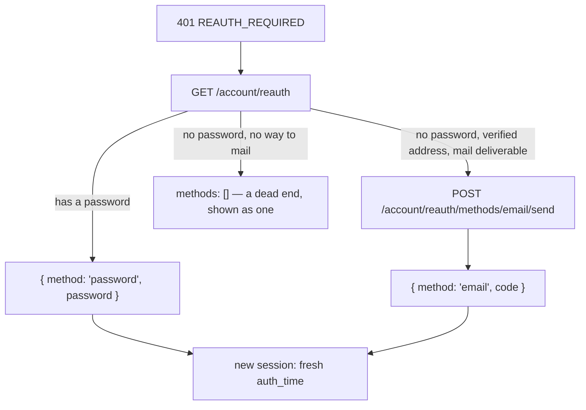
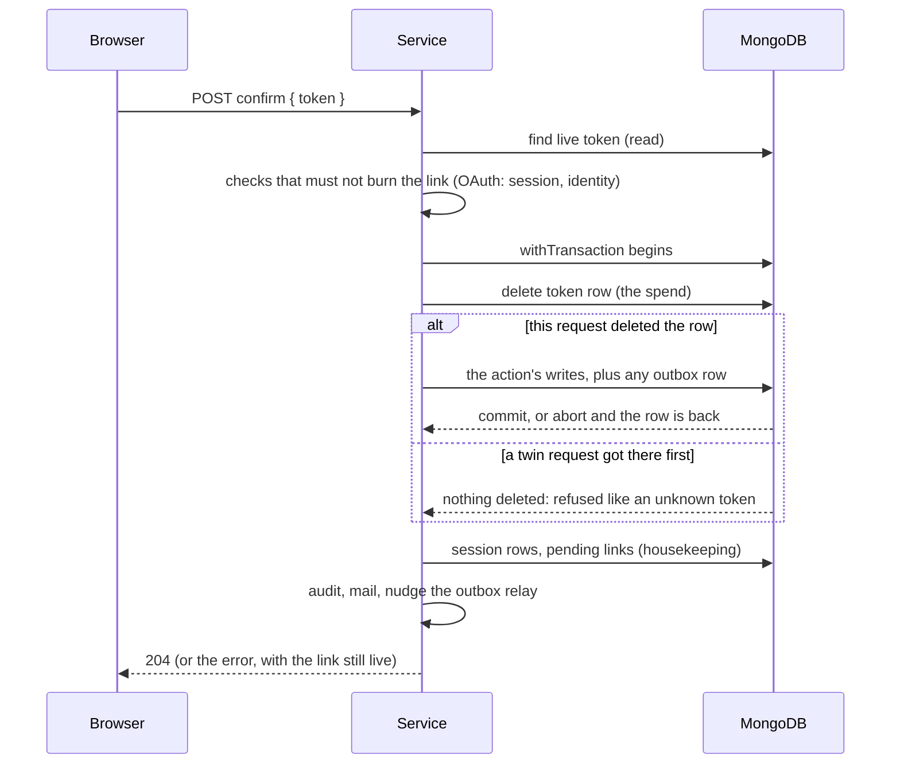

# Freshness and step-up

How recently a caller proved who they are, and how an account with no password or a second factor proves it again.

## Freshness: how recently they proved it {#freshness-auth-time-and-amr}

A valid token and a recently-proved token are different things, and two OIDC claims are what makes
the difference expressible. Wire names are OIDC's on purpose: a future external identity provider's
tokens would satisfy the same guards unchanged.

| Claim       | Holds                                                             |
| ----------- | ----------------------------------------------------------------- |
| `auth_time` | epoch seconds at which the user last actually proved themselves   |
| `amr`       | **how** they proved it — RFC 8176 values, an array, not a boolean |

`auth_time` is a NumericDate (RFC 7519, seconds), the same unit in both modes: the claim in `jwt`
mode, the row's `authTime` in `cookie` mode. A login reads the clock **before** its check begins (the
password hash, the code, the OAuth exchange) and hands that `provedAt` to `issue`; OIDC defines
`auth_time` as when the user authenticated, not when the token was signed.

Both are **stamped once**, at login, then COPIED FORWARD on every access-token mint and every
rotation. Never re-stamped from the clock — a clock-derived `auth_time` would make every refresh
look like a fresh proof, which is precisely the thing the claim exists to deny.

`amr` is an array because proofs compose: a password login is `['pwd']`, a completed
[2FA](./account-two-factor.md) login is `['pwd', 'otp']`, an [OAuth](./account-oauth.md) callback is
`['google']`, and a future WebAuthn passkey is `['hwk']` without a schema change.

No mint defaults its `amr`: `issue` and `reissue` take it as a required option, and the JWT layer splits
into `startSession` (a first session, guarded) and `continueSession` (a re-mint, not). A re-mint claims
what the call proved: a verified code adds `otp` to what the caller held, a password change claims
`['pwd']` alone.

::: warning A missing `auth_time` fails closed in both modes
In jwt mode both claims are required: `carriesTokenClaims` refuses a token without `auth_time` or
`amr` as `malformed`, so it never reaches a guard. In cookie mode `authTime` is an optional field on
the session row, and a row without one reads as `0` (infinitely old), so the caller is asked to
re-authenticate at the first sensitive action instead of reading as freshly authenticated.
:::

`POST /account/reauth` is how a caller refreshes `auth_time` without logging out — re-prove who you
are, get a new stamp. What consumes all of this is the `stepUp` tier declared on a permission
key, in [Authorization](../understand/authorization.md); the "remember me" tiers above set the cookie's
lifetime and **do not** exempt a sensitive action from the freshness check.

## Step-up for an account with no password {#step-up-for-an-account-with-no-password}

An account made through Google or GitHub has no password, so "re-prove the password" cannot be its
step-up. `GET /account/reauth` tells the client which methods apply; the body of `POST /account/reauth`
is tagged by `method`:

- **Why a mailed code is enough.** Forgot-password already works on an OAuth-only account, so the
  mailbox is the account's root key; a code to it adds no new trust. GitHub's sudo mode offers the
  same for social-login accounts. A provider round trip cannot replace it: Google honours neither
  `prompt=login` nor `max_age`, and GitHub returns no `auth_time`.
- **Only for accounts with no password.** A password account keeps the password, and the send route
  refuses it, so the route cannot mail unrequested codes to an account with a better proof.
- **Storage.** The code's HMAC sits on the user as `reauthCode`, separate from `twoFactorMethods`
  because it is not a factor: never armed, never challenges a login. Lifetime, cooldown and the
  five-guess ceiling are `two-factor/delivered-codes.ts`'s, shared; spending and counting are
  conditional writes ([concurrent writes](./account-two-factor.md#concurrent-writes)).
- **Budget.** The send spends the same per-account hourly budget as
  `POST /account/2fa/methods/{method}/send`, since both fill the same mailbox.
- **`amr`.** The re-minted session claims ONLY what that call proved: `pwd` or the new `email`, plus
  `otp` when the body carried a verified second-factor code (`otp` means a second factor here, and a
  mailed code is not one). Proofs from the login are not carried over, so a password-only re-auth
  does not pass a route that demands `otp`.

## Step-up for an account with a second factor {#step-up-for-an-account-with-a-second-factor}

An account with a factor armed (`AuthContext.twoFactorArmed`, read fresh on every request) must have
proved a code in the fresh session before the identity routes: changing the email, changing the
password, and starting an account deletion. Checkout, payments, logout-everywhere, session
management and the data export stay password-only (ASVS 5.0 §7.5.1).

- **The challenge.** The same `401 REAUTH_REQUIRED`, with `details.methods: ['otp']` beside
  `details.maxAge` (RFC 9470's "which proof is missing"). No new error code.
- **The answer.** `POST /account/reauth` takes the password (or the mailed code) AND an optional
  `otp`. The code is checked only after the first proof passed, behind the per-account
  [wrong-code cap](./account-two-factor.md#changing-factors-needs-a-factor), and earns `otp`.
- **Unchanged without 2FA.** An account with no factor is asked nothing new; the password change
  still proves the current password and nothing more.
- **The undo.** An email change can be undone from the old address's link for 7 days, through
  a password change — see [Proving an address](./account.md#proving-an-address).
- **Mail.** An OAuth-only account passes step-up only through a mailed code, so a deployment that
  enables a provider needs mail that delivers. The demo registers its fake provider in code, not
  through the provider variables.

## Spending a link {#spending-a-link}

A one-time email link (verify, email-change confirm and undo, restore, OAuth connect, password
reset, the login challenge) is a token row in `verificationtokens`. Spending it deletes the row,
and the action it unlocks writes to the account. Those two writes commit in **one transaction**
(`spendThen`, `services/tokens.ts`): both land or neither does.

| Order                      | What a crash between the two does                                     |
| -------------------------- | --------------------------------------------------------------------- |
| delete the token, then act | burns the link for nothing: the user must ask for another             |
| act, then delete the token | two simultaneous clicks both act; for a password reset that is unsafe |
| both in one transaction    | nothing lands; the link is still live; the same click works on retry  |

Only database writes go inside. The driver may run the work again on a transient error, so a
mail, an audit row, the session-row cleanup and the outbox wake-up (`nudgeOutbox`) all run after
the commit. Mongoose does not nest transactions, so a write that also announces an event uses
`announceWithin(session, …)` rather than `announceInTransaction`.

Consequences worth knowing:

- **A refused action no longer burns its link.** An email-change confirm or undo that answers 409
  (the address was taken meanwhile) leaves the link live; the owner frees the address and follows
  the same link again. The undo ends every session first, as its own write, so the thief stays out
  even though the restore failed.
- **The undo reads the account inside its transaction.** Restore-or-cancel is decided from that
  fresh copy, not from the one read when the link was looked up: a confirmation that lands between
  the two is restored, not skipped.
- **A refused OAuth attempt keeps its token** (no session, wrong account, identity taken): the
  checks run before the spend, and the token expires on its own after five minutes.
- **The login challenge's spend has no action of its own.** The code was consumed by its own
  atomic write before the spend; a crash after that burns the code, and the user signs in again
  with the next one.
- **The password reset** hands `passwordWrite` (password, epoch and the `account.sessions_revoked`
  row) to the same transaction; `afterPasswordWrite` (session rows, links) follows the commit.

## Read next

- [account-sessions](./account-sessions.md) — the module's own page
