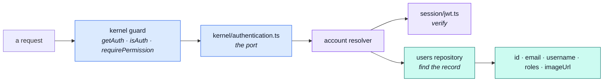
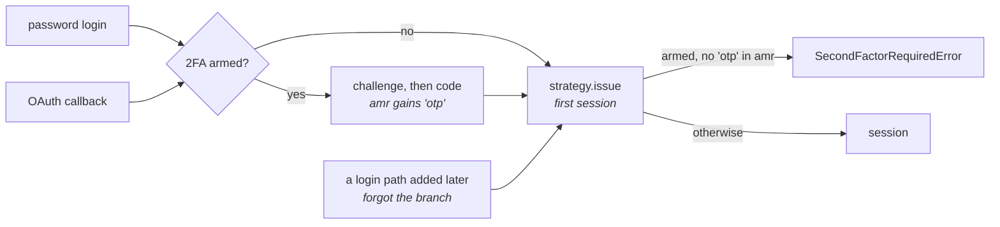

# Sessions

How this application decides who is making a request — and why none of it is published.

::: tip At a glance
**Two modes behind one port** — `strategy.ts` is the port (`issue` · `snapshot` · `reissue` · `remint` · `resolveBearer` · `resolveCookie` · `watchCookie` · `credentialOf` · `list`), `jwt-strategy.ts` and `cookie-strategy.ts` are its adapters, and `NODE_SESSION_MODE` picks one. The choice and what each defends against: [Two ways to stay signed in](../understand/sessions.md).
**The files** — `config.ts` reads the mode and the lifetimes, `session.ts` is what controllers call, `resolver.ts` answers the kernel's port, `auth-context.ts` turns a proof into an `AuthContext`, `listing.ts` decides which rows are the caller's sessions and when each ends, and `../presenter.ts` (pure) maps a row to the wire's `Session`, `mint-guard.ts` refuses a first session without its second factor or on a stale proof, `activity.ts` stamps `lastActiveAt`, the session-epoch rule lives in `../domain/epoch.ts`, `cookies.ts` sets and clears. `jwt` mode adds `jwt.ts` (sign, verify, rotate) and `key-ring.ts` (a secret's `kid`); `cookie` mode adds `session-id.ts` (the `ses_…` id). `device-cookie.ts` is the familiar-device cookie, `login-observability.ts` records that a login happened.
**Published** — nothing. `session/` has no barrel and may not be imported from outside the module.
**Breaks if you change** — the cookie flags or the lifetimes. Every guard in the app resolves through here.
:::

## Choosing the session mode {#choosing-the-session-mode}

One variable, `NODE_SESSION_MODE`, read through `session/config.ts`. Documented in
`.env-example` § A4, as its first block.

|                           | `jwt` (default)                                              | `cookie`                              |
| ------------------------- | ------------------------------------------------------------ | ------------------------------------- |
| What a browser holds      | a 10-minute access token in memory, and the refresh cookie   | one HttpOnly cookie, `__Host-session` |
| Keys the deployment needs | `NODE_TOKEN_ACCESS` and `NODE_TOKEN_REFRESH`, each a ring    | none                                  |
| Lifetimes                 | `NODE_TOKEN_ACCESS_TIME`, `NODE_SESSION_TIME_*`              | `NODE_SESSION_TIME_*`                 |
| Rotation windows          | `NODE_TOKEN_ROTATION_GRACE_MS`, `NODE_TOKEN_REUSE_WINDOW_MS` | not used                              |
| Issuer and audiences      | optional, [derived from `NODE_URL`](#token-claims)           | not used                              |
| `POST /account/refresh`   | exists                                                       | answers 404                           |

- **Shared by both modes:** `NODE_SESSION_TIME_{SHORT,MEDIUM,LONG}` (the "remember me" tiers) and the
  step-up windows `NODE_REAUTH_TIME_CRITICAL` / `NODE_REAUTH_TIME_SENSITIVE`.
- **`jwt` only:** the rest of the `NODE_TOKEN_*` keys. In `cookie` mode they are ignored, and boot no
  longer refuses their placeholders (`skipWhen` on the presence rule), so a cookie deployment does
  not invent two secrets it never uses.
- **Switching signs everyone out.** A row belongs to the mode that issued it: a `jwt` refresh token
  is no `ses_…` id and the reverse, and `GET /account/sessions` lists only the active mode's rows.
  The old rows age out by their own date.
- **The frontend follows on its own.** It reads `session` on `GET /config` at boot and picks its
  transport: the access-token interceptor in `jwt` mode, `credentials: 'include'` and no interceptor
  in `cookie` mode. The same answer carries each tier's lifetime (`lifetimeSeconds`) and the staff
  cap (`staffLifetimeSeconds`), so the cookie list prints the deployment's numbers, not its own.
- **The staff idle timeout and lifetime cap apply in both modes**, judged from the session row's clocks. See [sessions](../understand/sessions.md#the-staff-idle-timeout).

A client with no cookie jar logs in with `transport: "bearer"` in the body (`cookie` mode only;
`jwt` mode ignores it): no session cookie is set, and the response carries the id as `sessionToken`.

## The resolver, installed by `onRegistered`

[`account`](./account.md) fills the kernel's authentication port from its own `onRegistered` hook,
called once when `app.ts` registers every enabled module — not in a boot step, and not merely by
being imported. Installing a function touches no connection, and every guard in the application
depends on it existing before the first request arrives.

The resolver hands back **only the fields the port declares**. The kernel must never learn the
document shape — that is what keeps `kernel` below `modules` in the tier order.

::: warning Two failures that are not the same failure
A **bad token** rejects. A **valid token whose user is gone** resolves `undefined`. The guard turns
that distinction into the same `401` for both (the miss reason is what is counted and audited), so
the answer never tells an attacker whether an account exists.
:::

## `jwt` mode: two tokens, two lifetimes, two homes {#jwt-mode-two-tokens-two-lifetimes-two-homes}

Full detail: [JWT mode: tokens, keys and claims](./account-sessions-jwt.md#jwt-mode-two-tokens-two-lifetimes-two-homes).

### The box left unticked {#remember-me-unticked}

See [JWT mode: tokens, keys and claims](./account-sessions-jwt.md#remember-me-unticked).

## The signing key is a ring, not a single secret {#the-signing-key-is-a-ring-not-a-single-secret}

`NODE_TOKEN_ACCESS`/`NODE_TOKEN_REFRESH` are each an ordered, comma-separated list of secrets,
newest first. `jwt.ts` signs with `ring[0]` and stamps a `kid` (`key-ring.ts#keyId`, a digest of
the secret itself); verifying looks the token's `kid` up in the ring rather than assuming
`ring[0]`, so a token signed moments before a rotation still verifies. Full rotation procedure:
[Security](../understand/security.md#signing-key-rotation).

Full detail: [JWT mode: tokens, keys and claims](./account-sessions-jwt.md#the-signing-key-is-a-ring-not-a-single-secret).

## What a token says, and who it is for {#token-claims}

An access token carries RFC 9068's full set of registered claims, so its `at+jwt` header is true;
a refresh token carries the same minus `client_id`. `jwt.ts#signToken` stamps them and
`verifyAgainstRing` demands them.

Full detail: [JWT mode: tokens, keys and claims](./account-sessions-jwt.md#token-claims).

## Freshness: how recently they proved it {#freshness-auth-time-and-amr}

A valid token and a recently-proved token are different things, and two OIDC claims are what makes
the difference expressible. Wire names are OIDC's on purpose: a future external identity provider's
tokens would satisfy the same guards unchanged.

Full detail: [Freshness and step-up](./account-sessions-step-up.md#freshness-auth-time-and-amr).

## Step-up for an account with no password {#step-up-for-an-account-with-no-password}

An account made through Google or GitHub has no password, so "re-prove the password" cannot be its
step-up. `GET /account/reauth` tells the client which methods apply; the body of `POST /account/reauth`
is tagged by `method`:

Full detail: [Freshness and step-up](./account-sessions-step-up.md#step-up-for-an-account-with-no-password).

## Step-up for an account with a second factor {#step-up-for-an-account-with-a-second-factor}

An account with a factor armed (`AuthContext.twoFactorArmed`, read fresh on every request) must have
proved a code in the fresh session before the identity routes: changing the email, changing the
password, and starting an account deletion. Checkout, payments, logout-everywhere, session
management and the data export stay password-only (ASVS 5.0 §7.5.1).

Full detail: [Freshness and step-up](./account-sessions-step-up.md#step-up-for-an-account-with-a-second-factor).

## `cookie` mode: one random id {#cookie-mode}

A login makes `ses_` plus 32 random bytes (base64url). Only its sha256 is stored, in a `sessions` row
with `mode: 'cookie'`: the account, a `familyId` (the id the owner sees), `authTime` and `amr` (the
step-up proof), the "remember me" tier, `startedAt` and the expiry. `lastUsedAt` is written at most once
a minute, so a busy tab does not write on every request.

Full detail: [Cookie mode and where sessions live](./account-sessions-cookie.md#cookie-mode).

## The cookie, flag by flag {#the-cookie-flag-by-flag}

The name is `__Host-session` in both modes: the prefix makes a browser refuse the cookie unless it is
`Secure`, `Path=/` and Domain-less. In `jwt` mode refresh is a `POST`, and refresh, logout and the SSE
streams answer 403 to a request naming an `Origin` that is not an allowed frontend origin (the same
list CORS uses), so a request from someone else's page cannot act on the cookie. In `cookie` mode the
same check covers every state-changing request the cookie authenticates.

Full detail: [Cookie mode and where sessions live](./account-sessions-cookie.md#the-cookie-flag-by-flag).

## Why none of this is published

::: tip The barrel is one line wide
`session/` is not exported: authorization does not need it.
`kernel/authentication.ts` is the port every request goes through, this module fills it from
`module.ts` using its own relative imports, and **no sibling has ever reached for a token**.

Issuing this application's tokens _is_ what `account` is, and none of it is anyone else's business.
That is also why `session/` is a folder rather than a published layer: nothing outside these four
walls may import it, so it needs no barrel of its own.
:::

`account`'s own barrel publishes nothing this page's flows produce either — `session/` stays
entirely internal. The address book, and what checkout reads from it, belongs to
[`addresses`](./addresses.md).

## The two shared tails

Three flows mint a session and two record one, so both halves are extracted rather than copied.
Neither is a layer — they are the repeated ends of controllers.

| File                     | Is                                                                                                             | Reused by                                                                   |
| ------------------------ | -------------------------------------------------------------------------------------------------------------- | --------------------------------------------------------------------------- |
| `session.ts`             | `issueSession`, `reissueSession`, `remintSession`: a session's credential, put on the response, whichever mode | login, signup, 2FA, the OAuth callback, reauth, password and factor changes |
| `login-observability.ts` | the metrics / audit / analytics emit meaning "a login happened"                                                | `post-login.ts`, `post-login-2fa.ts`                                        |

::: tip Why the observability tail is not in the service
`services/login.ts` checks credentials; it cannot know whether a session exists. The
SUCCESS emit must fire only **after** cookies and an access token are real, which is a
controller-layer fact — so `login()` and `verifyLoginChallenge()` are deliberately kept ignorant of
it.
:::

### The mint guard {#the-mint-guard}

"No session without the second factor" is enforced where a session is minted, not only where a
login branches. Both modes call `assertSecondFactor` (`mint-guard.ts`) from their `issue`, never from a re-mint. The rule itself is the pure `firstSessionRefused` in `domain/session-proof.ts`, which also owns the `AMR` values and `withProofs`. The guard refuses a **first** session for an account whose
`twoFactorEnabledAt` is set unless `amr` carries `otp`, with `SecondFactorRequiredError`:

The controllers still branch to the challenge first, so the guard is the backstop for the path that
forgot to: it fails loudly (a `500`, never a session) instead of handing out a session the factor
never guarded.

The same `issue` also calls `assertProofCurrent`: a first session is refused with `StaleProofError`
(also a `500`) when the account's epoch moved after `provedAt`, compared in milliseconds. That is a
login whose old password checked out while a password change, or a logout everywhere, committed
elsewhere: minted after the change, it would otherwise carry an `auth_time` the epoch does not
predate, and survive it.

A **re-mint** (`reissueSession`, `remintSession`) continues a session the caller already holds and
is not checked. It stamps `auth_time` at the mint: a password change re-mints after its own epoch
move, which a proof time read before that move would predate. That door, and `amr` becoming
required, are a separate decision.

## Where sessions live {#where-sessions-live}

Two collections, both `account`'s own. Neither is on the user document: an array that grows with
every refresh is the anti-pattern MongoDB names for unbounded arrays, and a credential-bearing one
would have to be loaded (and kept out of every serialization) with the account it hangs off.

Full detail: [Cookie mode and where sessions live](./account-sessions-cookie.md#where-sessions-live).

### One table, keyed by cause {#revocation}

See [Cookie mode and where sessions live](./account-sessions-cookie.md#revocation).

### The session epoch {#the-session-epoch}

See [Cookie mode and where sessions live](./account-sessions-cookie.md#the-session-epoch).

## Logout everywhere {#logout-everywhere}

Every session an account holds is a row, which is what makes "log me out of every device" one
`deleteMany` rather than a token blocklist. The epoch (below) is the part that matters; the delete
is what keeps `GET /account/sessions` honest.

Full detail: [Cookie mode and where sessions live](./account-sessions-cookie.md#logout-everywhere).

## Spending a link {#spending-a-link}

A one-time email link (verify, email-change confirm and undo, restore, OAuth connect, password
reset, the login challenge) is a token row in `verificationtokens`. Spending it deletes the row,
and the action it unlocks writes to the account. Those two writes commit in **one transaction**
(`spendThen`, `services/tokens.ts`): both land or neither does.

Full detail: [Freshness and step-up](./account-sessions-step-up.md#spending-a-link).

## Refresh rotation {#refresh-rotation}

`POST /account/refresh` doesn't just re-sign an access token — it REPLACES the refresh token too,
every time. Without that, a stolen cookie would stay valid, silently, for as long as it had left to
live (up to 30 days, `remember: long`); rotation turns "a value that never changes" into "a value
that changes on every use", so a copy presented after the original has moved is detectable.

Full detail: [JWT mode: tokens, keys and claims](./account-sessions-jwt.md#refresh-rotation).

## Libraries

`jose` and `bowser` are `account`'s alone — see [Package Dependencies](../reference/package-dependencies.md)
for where they sit among everything else this repo depends on.

| Library                  | Maintained    | What it costs you                                                                                |
| ------------------------ | ------------- | ------------------------------------------------------------------------------------------------ |
| `jose` (chosen)          | active, typed | ESM-only, which Jest has to be told to transform; no `oct` key set, so the `kid` ring stays ours |
| `jsonwebtoken`           | maintained    | callback API, hand-checked `typ`, and a header read before verify just to find the key           |
| `bowser` (device label)  | active, typed | one small dependency-free parser; `ua-parser-js` 2.x is AGPL, `detect-browser` is stale          |
| hand-rolled HMAC signing | —             | exactly the kind of crypto `CLAUDE.md` rules out writing by hand                                 |

### What `jose` replaced, and what is still ours

| Concern                                             | Who owns it                                                                      |
| --------------------------------------------------- | -------------------------------------------------------------------------------- |
| Compact encoding, HMAC, constant-time compare       | `jose`                                                                           |
| Algorithm allow-list (`HS256` only)                 | `jose`, through `algorithms`                                                     |
| `typ` header check, after the signature             | `jose`, through `typ` (was hand-written)                                         |
| Reading the `kid` before verifying                  | `jose`, which hands it to the key lookup (was a separate `decode`)               |
| Expiry, and refusing a token with none              | `jose`, through `requiredClaims: ['exp']`                                        |
| `iss`, `aud`, and every registered claim present    | `jose`, through `issuer`, `audience` and `requiredClaims`                        |
| Which ring member a `kid` names, and key rotation   | ours, `key-ring.ts`: a JWKS holds no shared secrets, so there is nothing to load |
| The shape of our own claims (`sub`, `auth_time`)    | ours, `carriesTokenClaims`: a signature proves the author, not the shape         |
| The session row, rotation, reuse and the grace      | ours: a JWT is stateless, and the revocation rules are the point                 |
| The epoch, the mint guard and the step-up freshness | ours: policy, not cryptography                                                   |

## Read next

- [JWT mode: tokens, keys and claims](./account-sessions-jwt.md) — a deeper page of this module
- [Freshness and step-up](./account-sessions-step-up.md) — a deeper page of this module
- [Cookie mode and where sessions live](./account-sessions-cookie.md) — a deeper page of this module
- [`account`](./account.md) — the module this belongs to
- [Two-factor authentication](./account-two-factor.md) — the second factor a login may have to pass
- [OAuth](./account-oauth.md) — the other way a session is minted
- [Authorization](../understand/authorization.md) — what consumes `auth_time` and `amr`
- [`users`](./users.md) — the account record, its epoch and its credentials
- [Security](../understand/security.md) — hashing, headers, and rate limits
- [Request Flow](../understand/request-flow.md) — where the guard sits
- [Strategic DDD](../understand/strategic-ddd.md#_2-context-map-—-how-a-module-reaches-its-siblings) — what `shared-kernel` costs
