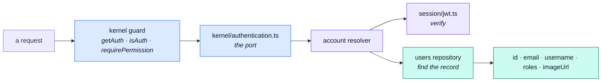
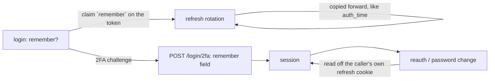
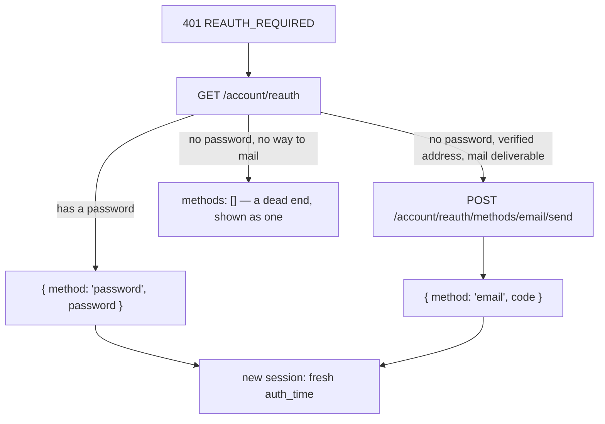
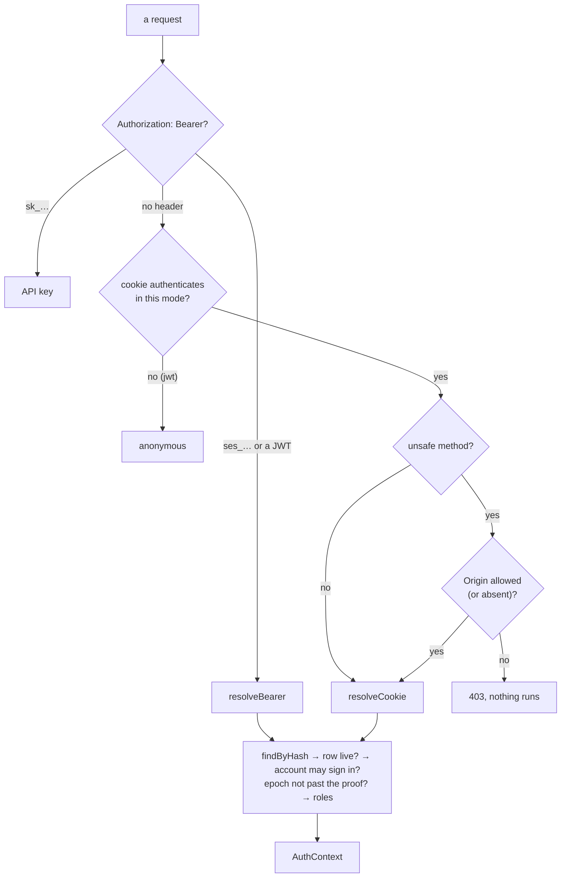
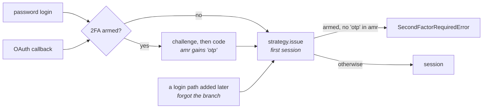
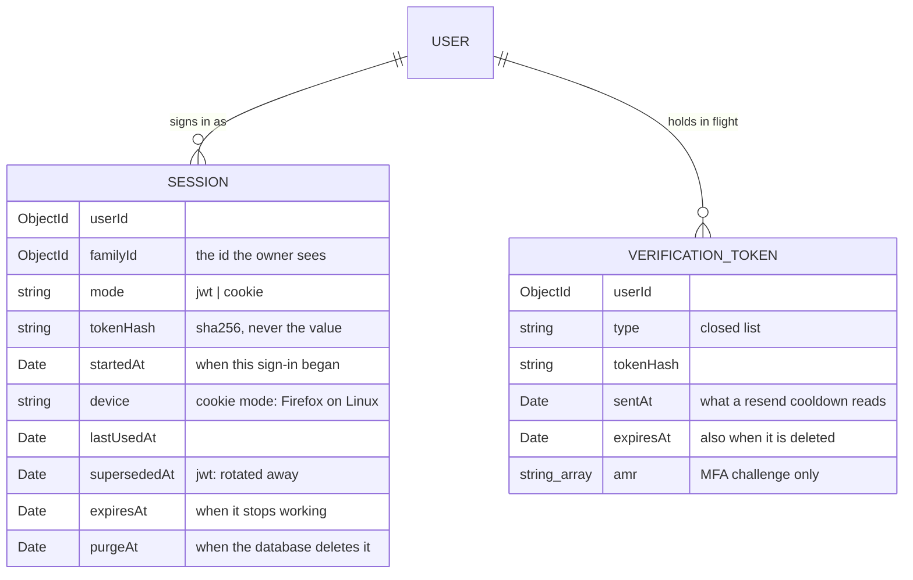
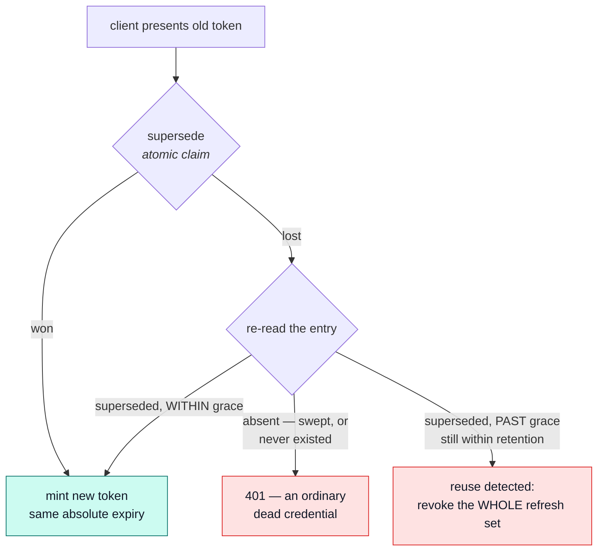

# Sessions

How this application decides who is making a request — and why none of it is published.

::: tip At a glance
**Two modes behind one port** — `strategy.ts` is the port (`issue` · `snapshot` · `reissue` · `remint` · `resolveBearer` · `resolveCookie` · `credentialOf` · `list`), `jwt-strategy.ts` and `cookie-strategy.ts` are its adapters, and `NODE_SESSION_MODE` picks one. The choice and what each defends against: [Two ways to stay signed in](../theory/sessions.md).
**The files** — `config.ts` reads the mode and the lifetimes, `session.ts` is what controllers call, `resolver.ts` answers the kernel's port, `auth-context.ts` turns a proof into an `AuthContext`, `listing.ts` shapes the session list, `mint-guard.ts` refuses a first session without its second factor or on a stale proof, `activity.ts` stamps `lastActiveAt`, `epoch.ts` holds the session-epoch rule, `cookies.ts` sets and clears. `jwt` mode adds `jwt.ts` (sign, verify, rotate) and `key-ring.ts` (a secret's `kid`); `cookie` mode adds `session-id.ts` (the `ses_…` id). `device-cookie.ts` is the familiar-device cookie, `login-observability.ts` records that a login happened.
**Published** — nothing. `session/` has no barrel and may not be imported from outside the module.
**Breaks if you change** — the cookie flags or the lifetimes. Every guard in the app resolves through here.
:::

## Choosing the session mode {#choosing-the-session-mode}

One variable, `NODE_SESSION_MODE`, read through `session/config.ts`. Documented in
`.env-example` § A4, as its first block.

|                           | `jwt` (default)                                              | `cookie`                              |
| ------------------------- | ------------------------------------------------------------ | ------------------------------------- |
| What a browser holds      | a 10-minute access token in memory, and the refresh cookie   | one HttpOnly cookie, `__Host-session` |
| Keys the deployment needs | `NODE_TOKEN_ACCESS` and `NODE_TOKEN_REFRESH`, each a ring    | none                                  |
| Lifetimes                 | `NODE_TOKEN_ACCESS_TIME`, `NODE_SESSION_TIME_*`              | `NODE_SESSION_TIME_*`                 |
| Rotation windows          | `NODE_TOKEN_ROTATION_GRACE_MS`, `NODE_TOKEN_REUSE_WINDOW_MS` | not used                              |
| Issuer and audiences      | optional, [derived from `NODE_URL`](#token-claims)           | not used                              |
| `POST /account/refresh`   | exists                                                       | answers 404                           |

- **Shared by both modes:** `NODE_SESSION_TIME_{SHORT,MEDIUM,LONG}` (the "remember me" tiers) and the
  step-up windows `NODE_REAUTH_TIME_CRITICAL` / `NODE_REAUTH_TIME_SENSITIVE`.
- **`jwt` only:** the rest of the `NODE_TOKEN_*` keys. In `cookie` mode they are ignored, and boot no
  longer refuses their placeholders (`skipWhen` on the presence rule), so a cookie deployment does
  not invent two secrets it never uses.
- **Switching signs everyone out.** A row belongs to the mode that issued it: a `jwt` refresh token
  is no `ses_…` id and the reverse, and `GET /account/sessions` lists only the active mode's rows.
  The old rows age out by their own date.
- **The frontend follows on its own.** It reads `GET /account/session-config` at boot and picks its
  transport: the access-token interceptor in `jwt` mode, `credentials: 'include'` and no interceptor
  in `cookie` mode.
- **The staff idle timeout and lifetime cap apply in both modes**, judged from the session row's clocks. See [sessions](../theory/sessions.md#the-staff-idle-timeout).

A client with no cookie jar logs in with `transport: "bearer"` in the body (`cookie` mode only;
`jwt` mode ignores it): no cookie is set, and the response carries the id as `sessionToken`.

## The resolver, installed by `onRegistered`

[`account`](./account.md) fills the kernel's authentication port from its own `onRegistered` hook,
called once when `app.ts` registers every enabled module — not in a boot step, and not merely by
being imported. Installing a function touches no connection, and every guard in the application
depends on it existing before the first request arrives.

The resolver hands back **only the fields the port declares**. The kernel must never learn the
document shape — that is what keeps `kernel` below `modules` in the tier order.

::: warning Two failures that are not the same failure
A **bad token** rejects. A **valid token whose user is gone** resolves `undefined`. The guard turns
that distinction into the same `401` for both (the miss reason is what is counted and audited), so
the answer never tells an attacker whether an account exists.
:::

## `jwt` mode: two tokens, two lifetimes, two homes

|                | Access token               | Refresh token               |
| -------------- | -------------------------- | --------------------------- |
| Travels in     | the `Authorization` header | the `__Host-session` cookie |
| Lifetime from  | `NODE_TOKEN_ACCESS_TIME`   | one of three tiers, below   |
| Readable by JS | yes — the client holds it  | no — `httpOnly`             |

The refresh tier is the "remember me" choice, and it is a tier rather than a boolean so the copy on
the login form and the lifetime in the environment stay one decision:

| Tier     | Environment variable       | Default |
| -------- | -------------------------- | ------- |
| `short`  | `NODE_SESSION_TIME_SHORT`  | 1 day   |
| `medium` | `NODE_SESSION_TIME_MEDIUM` | 7 days  |
| `long`   | `NODE_SESSION_TIME_LONG`   | 30 days |

Staff and admin sessions also idle out: see [the staff idle timeout](../theory/sessions.md#the-staff-idle-timeout).

The longest default is 30 days, which meets ASVS 4.0.3 V3.3.2 L1 as written. A shop session is
long-lived on purpose and risk-based (ASVS 5.0 V7.1.1): the sensitive actions behind it ask for the
password again (`NODE_REAUTH_TIME_*`), the model Amazon and Shopify customer accounts use.

`config.ts` is the single place a deployment's answer to _how long is a session_ is parsed —
`jwt.ts` signs against it, `cookie-strategy.ts` stores its row against it and `cookies.ts` sets
`maxAge` from it. Its name is deliberate: it holds no token and issues none. The three tiers are the
same in both modes: a refresh token's life in `jwt` mode, the session row's in `cookie` mode.

### The box left unticked {#remember-me-unticked}

No `remember` is a real choice, not a missing one. It is the conventional meaning of an unticked
"remember me" (ASP.NET Core Identity, Django, Rails Devise, Spring Security all do the same):

| Login                                 | Cookie                                      | Refresh token's server TTL |
| ------------------------------------- | ------------------------------------------- | -------------------------- |
| `remember: short` / `medium` / `long` | persistent, `Max-Age` = the tier            | the tier                   |
| no `remember` (also OAuth, signup)    | **browser-session**: no `Max-Age`/`Expires` | the `short` tier           |

The **server** TTL is the real limit, not the cookie: browsers restore session cookies ("continue
where you left off"), so a session cookie alone would not end anything. NIST 800-63B-4 says the same
— use a non-persistent cookie, and never let cookie expiry be the limit.

The access token is a separate clock. `getAccessExpiryTime()` reads `NODE_TOKEN_ACCESS_TIME` and
nothing else, so the refresh fallback above can never leak into it.

The choice has to survive every step that re-mints the session, or it silently reverts:

- **Claim.** The refresh token carries `remember` only when a tier was ticked; absent means a
  browser-session login. Rotation copies it (`carriedClaims` in `jwt.ts`) and hands the controller
  `refreshMaxAgeMs: undefined` for a session login, so the rotated cookie stays a session cookie.
- **2FA.** The password step answers a challenge and sets no cookie, so the box's value is asked
  again: `POST /account/login/2fa` takes the same optional `remember` (`LoginTwoFactorRequest`).
  ASP.NET Core Identity carries it the same way. An OAuth-originated challenge has no earlier
  password step, so the 2FA request is the only place it can be said.
- **Reauth and password change.** Both replace the session, so `reissueSession` keeps the tier: in
  `jwt` mode read off the request's own `__Host-session` cookie (signature only — a password change has
  already deleted the row), in `cookie` mode off a snapshot of the caller's row taken before the
  change. No cookie, a stranger's cookie or an expired one all read as "no tier": a session cookie,
  never a persistent one granted by accident.

## The signing key is a ring, not a single secret

`NODE_TOKEN_ACCESS`/`NODE_TOKEN_REFRESH` are each an ordered, comma-separated list of secrets,
newest first. `jwt.ts` signs with `ring[0]` and stamps a `kid` (`key-ring.ts#keyId`, a digest of
the secret itself); verifying looks the token's `kid` up in the ring rather than assuming
`ring[0]`, so a token signed moments before a rotation still verifies. Full rotation procedure:
[Security](../tools/security.md#signing-key-rotation).

## What a token says, and who it is for {#token-claims}

An access token carries RFC 9068's full set of registered claims, so its `at+jwt` header is true;
a refresh token carries the same minus `client_id`. `jwt.ts#signToken` stamps them and
`verifyAgainstRing` demands them.

| Claim       | Access token            | Refresh token    | From                                   |
| ----------- | ----------------------- | ---------------- | -------------------------------------- |
| `sub`       | the account             | the account      | the user id                            |
| `iss`       | checked                 | checked          | `NODE_TOKEN_ISSUER`, else `NODE_URL`   |
| `aud`       | checked, its own        | checked, its own | `NODE_TOKEN_{ACCESS,REFRESH}_AUDIENCE` |
| `iat` `exp` | required                | required         | the clock and the lifetime             |
| `jti`       | required, random        | required, random | `randomUUID()`                         |
| `client_id` | required, `first-party` | absent           | `FIRST_PARTY_CLIENT_ID`                |
| `sid`       | the session family      | absent           | the row it was minted against          |

- **Why `iss`/`aud`.** A secret shared with another service would otherwise let that service mint
  tokens accepted as sessions here (RFC 8725 §3.10). A wrong or missing one is a `401`.
- **Why two audiences.** Unset, the access audience is `NODE_URL` (the API) and the refresh one
  `NODE_URL/account/refresh` (where it is redeemed). A token of one kind is refused as the other
  even if both rings shared a secret — the second fence after `typ`.

## Freshness: how recently they proved it {#freshness-auth-time-and-amr}

A valid token and a recently-proved token are different things, and two OIDC claims are what makes
the difference expressible. Wire names are OIDC's on purpose: a future external identity provider's
tokens would satisfy the same guards unchanged.

| Claim       | Holds                                                             |
| ----------- | ----------------------------------------------------------------- |
| `auth_time` | epoch seconds at which the user last actually proved themselves   |
| `amr`       | **how** they proved it — RFC 8176 values, an array, not a boolean |

`auth_time` is a NumericDate (RFC 7519, seconds), the same unit in both modes: the claim in `jwt`
mode, the row's `authTime` in `cookie` mode. A login reads the clock **before** its check begins (the
password hash, the code, the OAuth exchange) and hands that `provedAt` to `issue`; OIDC defines
`auth_time` as when the user authenticated, not when the token was signed.

Both are **stamped once**, at login, then COPIED FORWARD on every access-token mint and every
rotation. Never re-stamped from the clock — a clock-derived `auth_time` would make every refresh
look like a fresh proof, which is precisely the thing the claim exists to deny.

`amr` is an array because proofs compose: a password login is `['pwd']`, a completed
[2FA](./account-two-factor.md) login is `['pwd', 'otp']`, an [OAuth](./account-oauth.md) callback is
`['google']`, and a future WebAuthn passkey is `['hwk']` without a schema change.

No mint defaults its `amr`: `issue` and `reissue` take it as a required option, and the JWT layer splits
into `startSession` (a first session, guarded) and `continueSession` (a re-mint, not). A re-mint claims
what the call proved: a verified code adds `otp` to what the caller held, a password change claims
`['pwd']` alone.

::: warning Both are optional, and absent means infinitely old
A token signed before these claims existed carries neither. Every reader treats a missing
`auth_time` as `0` rather than trusting it, so a pre-existing session is asked to re-authenticate at
its first sensitive action instead of reading as freshly authenticated. Fail-closed, in the only
direction that is safe.
:::

`POST /account/reauth` is how a caller refreshes `auth_time` without logging out — re-prove who you
are, get a new stamp. What consumes all of this is the `stepUp` tier declared on a permission
key, in [Authorization](../theory/authorization.md); the "remember me" tiers above set the cookie's
lifetime and **do not** exempt a sensitive action from the freshness check.

## Step-up for an account with no password

An account made through Google or GitHub has no password, so "re-prove the password" cannot be its
step-up. `GET /account/reauth` tells the client which methods apply; the body of `POST /account/reauth`
is tagged by `method`:

- **Why a mailed code is enough.** Forgot-password already works on an OAuth-only account, so the
  mailbox is the account's root key; a code to it adds no new trust. GitHub's sudo mode offers the
  same for social-login accounts. A provider round trip cannot replace it: Google honours neither
  `prompt=login` nor `max_age`, and GitHub returns no `auth_time`.
- **Only for accounts with no password.** A password account keeps the password, and the send route
  refuses it, so the route cannot mail unrequested codes to an account with a better proof.
- **Storage.** The code's HMAC sits on the user as `reauthCode`, separate from `twoFactorMethods`
  because it is not a factor: never armed, never challenges a login. Lifetime, cooldown and the
  five-guess ceiling are `two-factor/delivered-codes.ts`'s, shared; spending and counting are
  conditional writes ([concurrent writes](./account-two-factor.md#concurrent-writes)).
- **Budget.** The send spends the same per-account hourly budget as
  `POST /account/2fa/methods/{method}/send`, since both fill the same mailbox.
- **`amr`.** The re-minted session claims ONLY what that call proved: `pwd` or the new `email`, plus
  `otp` when the body carried a verified second-factor code (`otp` means a second factor here, and a
  mailed code is not one). Proofs from the login are not carried over, so a password-only re-auth
  does not pass a route that demands `otp`.

## Step-up for an account with a second factor

An account with a factor armed (`AuthContext.twoFactorArmed`, read fresh on every request) must have
proved a code in the fresh session before the identity routes: changing the email, changing the
password, and starting an account deletion. Checkout, payments, logout-everywhere, session
management and the data export stay password-only (ASVS 5.0 §7.5.1).

- **The challenge.** The same `401 REAUTH_REQUIRED`, with `details.methods: ['otp']` beside
  `details.maxAge` (RFC 9470's "which proof is missing"). No new error code.
- **The answer.** `POST /account/reauth` takes the password (or the mailed code) AND an optional
  `otp`. The code is checked only after the first proof passed, behind the per-account
  [wrong-code cap](./account-two-factor.md#changing-factors-needs-a-factor), and earns `otp`.
- **Unchanged without 2FA.** An account with no factor is asked nothing new; the password change
  still proves the current password and nothing more.
- **The undo.** An email change can be undone from the old address's link for 7 days, through
  a password change — see [Proving an address](./account.md#proving-an-address).
- **Boot.** An enabled OAuth provider with no deliverable mail (`smtp` with a host) refuses to boot
  outside `development` and `test`: those accounts would be locked out of checkout, payment and
  self-deletion. The demo registers its fake provider in code, not through these variables.

## `cookie` mode: one random id {#cookie-mode}

A login makes `ses_` plus 32 random bytes (base64url). Only its sha256 is stored, in a `sessions` row
with `mode: 'cookie'`: the account, a `familyId` (the id the owner sees), `authTime` and `amr` (the
step-up proof), the "remember me" tier, `startedAt` and the expiry. `lastUsedAt` is written at most once
a minute, so a busy tab does not write on every request.

- **Step-up.** `authTime` is stored at login and written again only by `POST /account/reauth`.
  Plain use never touches it, so a session kept alive for a month still asks for the password before
  money or deletion.
- **A re-proof replaces the id**, keeping the row's `familyId`, `startedAt` and expiry: the
  successor is stored first, the old row deleted second, so a failure between leaves two sessions,
  not none. A password change and a factor change delete every session first, so the controller
  reads the caller's session BEFORE the change (`sessionSnapshotOf`) and the re-mint continues it.
- **Logging out** deletes the digest's whole family (`removeFamilyByHash`); "log out that device"
  deletes by `familyId`, and clears the caller's own cookies when the family is its own;
  logout-everywhere moves the epoch and deletes every row. The epoch refuses what a failed delete
  would leave behind: a row whose `authTime` predates it never resolves.
- **A `ses_…` Bearer** is resolved exactly like the cookie, and is how every non-browser client logs
  in (`transport: "bearer"`). Because a header is not ambient, it is not origin-checked.
- **The origin check** is in `getAuth`, the one place a caller is resolved; see
  [Two ways to stay signed in](../theory/sessions.md#the-cookie-asks-for-a-check-on-every-write).
  `POST /account/refresh` answers 404 here.

## The cookie, flag by flag

The name is `__Host-session` in both modes: the prefix makes a browser refuse the cookie unless it is
`Secure`, `Path=/` and Domain-less. In `jwt` mode refresh is a `POST`, and refresh, logout and the SSE
streams answer 403 to a request naming an `Origin` that is not an allowed frontend origin (the same
list CORS uses), so a request from someone else's page cannot act on the cookie. In `cookie` mode the
same check covers every state-changing request the cookie authenticates.

| Flag       | Value           | Why                                                                                  |
| ---------- | --------------- | ------------------------------------------------------------------------------------ |
| `httpOnly` | `true`          | The credential (refresh token or session id) is long-lived; script must not read it. |
| `secure`   | `true`, always  | The `__Host-` name requires it; browsers accept `Secure` cookies from `localhost`.   |
| `sameSite` | `lax`           | Survives a top-level navigation back into the app; refuses cross-site form posts.    |
| `path`     | `/`             | The endpoints that read it are on different paths; `__Host-` needs it.               |
| `domain`   | none            | Host-locked: a sibling subdomain cannot set or overwrite the cookie.                 |
| `maxAge`   | the chosen tier | The cookie expires when the token does, rather than outliving it.                    |

There is a second, deliberately **non-secure** cookie carrying nothing but a logged-in hint, so the
client shell can render the right chrome before its first request answers. It holds no credential
and is safe to read from script — that is its entire job.

A third cookie is the **familiar-device** one (`session/device-cookie.ts`). It holds up to five
HMACs of account emails under `NODE_DEVICE_COOKIE_SECRET`, names no one and proves no password.
Holding one only skips the per-account failure budget, so an attacker spending that budget cannot
lock the owner out of their own browser. The per-address and per-block budgets still apply.

## Why none of this is published

::: tip The barrel is one line wide
`session/` is not exported: authorization does not need it.
`kernel/authentication.ts` is the port every request goes through, this module fills it from
`module.ts` using its own relative imports, and **no sibling has ever reached for a token**.

Issuing this application's tokens _is_ what `account` is, and none of it is anyone else's business.
That is also why `session/` is a folder rather than a published layer: nothing outside these four
walls may import it, so it needs no barrel of its own.
:::

`account`'s own barrel publishes nothing this page's flows produce either — `session/` stays
entirely internal. The address book, and what checkout reads from it, belongs to
[`addresses`](./addresses.md).

## The two shared tails

Three flows mint a session and two record one, so both halves are extracted rather than copied.
Neither is a layer — they are the repeated ends of controllers.

| File                     | Is                                                                                                             | Reused by                                                                   |
| ------------------------ | -------------------------------------------------------------------------------------------------------------- | --------------------------------------------------------------------------- |
| `session.ts`             | `issueSession`, `reissueSession`, `remintSession`: a session's credential, put on the response, whichever mode | login, signup, 2FA, the OAuth callback, reauth, password and factor changes |
| `login-observability.ts` | the metrics / audit / analytics emit meaning "a login happened"                                                | `post-login.ts`, `post-login-2fa.ts`                                        |

::: tip Why the observability tail is not in the service
`services/login.ts` checks credentials; it cannot know whether a session exists. The
SUCCESS emit must fire only **after** cookies and an access token are real, which is a
controller-layer fact — so `login()` and `verifyLoginChallenge()` are deliberately kept ignorant of
it.
:::

### The mint guard {#the-mint-guard}

"No session without the second factor" is enforced where a session is minted, not only where a
login branches. Both modes call `assertSecondFactor` (`mint-guard.ts`) from their `issue`, never from a re-mint. The rule itself is the pure `firstSessionRefused` in `domain/session-proof.ts`, which also owns the `AMR` values and `withProofs`. The guard refuses a **first** session for an account whose
`twoFactorEnabledAt` is set unless `amr` carries `otp`, with `SecondFactorRequiredError`:

The controllers still branch to the challenge first, so the guard is the backstop for the path that
forgot to: it fails loudly (a `500`, never a session) instead of handing out a session the factor
never guarded.

The same `issue` also calls `assertProofCurrent`: a first session is refused with `StaleProofError`
(also a `500`) when the account's epoch moved after `provedAt`, compared in milliseconds. That is a
login whose old password checked out while a password change, or a logout everywhere, committed
elsewhere: minted after the change, it would otherwise carry an `auth_time` the epoch does not
predate, and survive it.

A **re-mint** (`reissueSession`, `remintSession`) continues a session the caller already holds and
is not checked. It stamps `auth_time` at the mint: a password change re-mints after its own epoch
move, which a proof time read before that move would predate. That door, and `amr` becoming
required, are a separate decision.

## Where sessions live {#where-sessions-live}

Two collections, both `account`'s own. Neither is on the user document: an array that grows with
every refresh is the anti-pattern MongoDB names for unbounded arrays, and a credential-bearing one
would have to be loaded (and kept out of every serialization) with the account it hangs off.

| Collection           | One row is                         | Deleted by                                                      |
| -------------------- | ---------------------------------- | --------------------------------------------------------------- |
| `sessions`           | one refresh token, or one sign-in  | its own `purgeAt` (TTL index), a logout, a revoke, an erasure   |
| `verificationtokens` | one mailed link or login challenge | its own `expiresAt` (TTL index), being spent, a password change |

- **A date on the row, not a lifetime on the index.** Both TTL indexes are `expireAfterSeconds: 0`
  on a per-row date, so changing `NODE_SESSION_TIME_*` never rebuilds an index, and a
  rotated-away row can be given an earlier date than its original expiry. The database's monitor
  runs about once a minute, so every read also checks `expiresAt`: a row past it is dead whether or
  not it has been deleted yet.
- **One live link per kind, atomically.** A reset, verification, email-change and undo link each
  allow one live row per account, enforced by a partial unique index on `(userId, type)` for those
  kinds only. Issuing is one upsert, so two simultaneous requests cannot leave two working links. A
  deletion confirmation and an MFA challenge may be several at once, and are not in that index.
- **The kinds are a closed list** (`VERIFICATION_TOKEN_TYPES` in `token-types.ts`), the schema's
  enum: a misspelt kind is refused at the write, instead of being stored and never purged.
- **What stays on the user:** the password, the second factors, the linked providers and the session
  epoch. They are bounded, and the epoch has to commit with the credential write that moves it.
- **Deactivating or soft-deleting an account** moves the epoch in the same save, which refuses every
  session at once; the rows then age out by their own date. Nothing here reaches into `sessions`
  from `users`.

### What the session list shows

Each entry carries the time the sign-in began (`createdAt`, which a re-proof does not move) and
when it was last used. A `jwt` row per rotation would repeat one sign-in, so the list keeps only the
newest row of each family.

`cookie` mode adds a coarse `device` label such as "Firefox on Linux". `device-label.ts` parses
the `User-Agent` once, at login, with `bowser`, and keeps the browser and the system only (never a
version, an address or the raw header). The label lives on the row, so it is exported with the
session and erased with it. A client naming neither (curl, a script) gets no label, and `jwt` mode
keeps none.

## Logout everywhere

Every session an account holds is a row, which is what makes "log me out of every device" one
`deleteMany` rather than a token blocklist. The epoch (below) is the part that matters; the delete
is what keeps `GET /account/sessions` honest.

### The session epoch

Removing refresh tokens does not touch an access token already handed out (stateless, ten minutes)
except through its `sid` claim: every `jwt` access token names its session family, and the bearer
resolver checks that the family still has an unexpired row, so revoking one session (by id, or a
plain logout) stops its access tokens at once. Any unexpired row counts, rotated away or not: a
rotation supersedes the old row before it stores the successor. Ending a session deletes its whole
family, never only the presented row, so a predecessor inside the grace window dies with it. And
every "I may be compromised" event also moves `tokensValidAfter` on the user, and a token whose
`auth_time` (floored to the second) predates it is refused — by the resolver for an access token, by
`verifyRefreshToken` and the rotation for a refresh one. `auth_time`, not `iat`, because one
`/refresh` resets `iat` and would walk a stolen session out of the cut.

| Event                                 | Epoch moves                                                                      | The caller                                                                              |
| ------------------------------------- | -------------------------------------------------------------------------------- | --------------------------------------------------------------------------------------- |
| logout everywhere                     | yes                                                                              | signed out too                                                                          |
| password change or reset              | yes, and pending one-time tokens and MFA challenges are purged                   | survives: new session in the response                                                   |
| 2FA factor armed, removed or disabled | yes                                                                              | survives: refresh cookie re-minted, the client's next `/refresh` swaps the access token |
| email change confirmed                | yes                                                                              | the confirming request is usually the mailbox, not a session                            |
| email change undone ("not me")        | yes, FIRST, before the address is touched, and pending links purged              | n/a: the undo link is the credential                                                    |
| refresh reuse detected                | yes                                                                              | n/a                                                                                     |
| admin ban or soft delete              | yes, in the same save as `active` / `deletedAt`; a ban also purges pending links | n/a: an unban or a restore does not bring the old tokens back                           |
| plain logout                          | no, but its session family goes, so its access token stops at once               | n/a                                                                                     |

### One table, keyed by cause {#revocation}

`REVOCATION` (`domain/revocation.ts`) lists every cause once: where its epoch is written, whether
pending links are purged, whether it announces `account.sessions-revoked`, whether the caller is
re-minted, and which session modes it applies to. `revokeFor(cause, userId)` in
`services/revocation.ts` acts on a row; the reasons an event can carry (`SessionsRevokedReason`),
and so the cases `api-keys` mails about, are derived from the rows that announce. Adding a cause
means adding a row, and the compiler asks for its test trigger.

**Where the epoch is written.** In the credential's own write, so a second write failing cannot
leave an old session live: the password's transaction, the swap's `save`, the factor's `save`. Two
cases stand apart. Logout everywhere writes the epoch and its `account.sessions-revoked`
[outbox](../tools/outbox.md) row in one transaction. The email undo does the same **before**
restoring the address, because its link is already spent: if the old address was taken meanwhile
the restore answers 409, and the owner has no retry, so the thief must already be out. Deleting the
session rows afterwards is housekeeping; its failure is logged.

`POST /account/reauth` deletes the session it was given when it re-mints, leaving one live
session rather than two. A token stamped in the very second of a bump is kept, which is what lets
the caller's re-minted session survive its own bump.

## Refresh rotation

`POST /account/refresh` doesn't just re-sign an access token — it REPLACES the refresh token too,
every time. Without that, a stolen cookie would stay valid, silently, for as long as it had left to
live (up to 30 days, `remember: long`); rotation turns "a value that never changes" into "a value
that changes on every use", so a copy presented after the original has moved is detectable.

The new token's absolute expiry is COPIED from the old one's own claim, never reset to a fresh full
window — rotation changes the token's VALUE for theft detection, it does not extend how long the
session may live past what it was granted at login. The "remember me" choice is copied forward too
([above](#remember-me-unticked)): a rotation that dropped it would turn a session cookie persistent
on the first refresh.

**A session keeps one id across rotation.** Every rotation stores a new row with a new `_id`, so the
id `GET /account/sessions` publishes is the row's `familyId` instead: minted at login and copied to
every successor, together with `startedAt`. "Log out that device" deletes the whole family, the live
token and any rotated-away predecessor still kept for reuse detection. An id taken from `_id` would
name the dead predecessor after the first refresh, and the revoke would answer success while the
device stayed signed in (RFC 9700 §4.14.2: refresh-token families). Two refreshes of one token
inside the grace window each store a successor, so a family can briefly hold two live rows; the
list shows the newest, once.

The grace window (`NODE_TOKEN_ROTATION_GRACE_MS`, default 10s) exists for one reason: two requests
racing on the SAME cookie — two tabs waking together, an interceptor retrying — both present the
identical old token, and only one can win the atomic claim. Without the grace window the loser's
retry would look exactly like theft. Within it, the loser is reissued its own sibling token instead
of rejected — proven under real concurrent load in
`src/modules/account/tests/integration/auth-races.test.ts` (R5), not just asserted here.

### Two windows, and why they must not be one

A superseded row stays — never deleted immediately — so a later presentation of it can still be
told apart from noise. `GET /account/sessions` filters these out; they aren't a device the account
holder should see or be able to revoke on their own. Rotation shortens the row's `purgeAt` to the
reuse-detection window (never past its own expiry), and the database deletes it then. No job and no
per-request prune is involved.

How long a superseded row is kept is its own setting, and the separation is load-bearing:

| Window                         | Default | Answers                                                      |
| ------------------------------ | ------- | ------------------------------------------------------------ |
| `NODE_TOKEN_ROTATION_GRACE_MS` | 10s     | Is this replay a benign race, to be reissued?                |
| `NODE_TOKEN_REUSE_WINDOW_MS`   | 24h     | Do we still REMEMBER this token, so a replay reads as theft? |

A purge date equal to the grace window would be the exact complement of the detection predicate
(`supersededMsAgo > grace`): every token the check would have called theft would already be gone,
the lookup would fall through to "genuinely absent", answer an ordinary 401, and revoke nothing.
Nothing fails; the defence is simply unreachable. So a superseded row is kept for the RETENTION
window.

`account`'s manifest refuses to boot unless retention exceeds grace (the check on `sessionConfig` in `session/config.ts`) — the failure is silent by
nature, so it is made loud at the only moment it can be.

The retention default is a trade, stated plainly: an active client rotates about once per
`NODE_TOKEN_ACCESS_TIME` (600s), so 24h keeps roughly 144 rows per session alive at a time.
Retaining for a refresh token's full lifetime would reach ~4,300 rows on the 30-day tier. Past
the retention window a replay is an ordinary 401
with no revocation — a real limit, chosen rather than stumbled into, and asserted as such in
`src/modules/account/tests/integration/jwt.test.ts`.

## Libraries

`jose` and `bowser` are `account`'s alone — see [Package Dependencies](../tools/package-dependencies.md)
for where they sit among everything else this repo depends on.

| Library                  | Maintained    | What it costs you                                                                                |
| ------------------------ | ------------- | ------------------------------------------------------------------------------------------------ |
| `jose` (chosen)          | active, typed | ESM-only, which Jest has to be told to transform; no `oct` key set, so the `kid` ring stays ours |
| `jsonwebtoken`           | maintained    | callback API, hand-checked `typ`, and a header read before verify just to find the key           |
| `bowser` (device label)  | active, typed | one small dependency-free parser; `ua-parser-js` 2.x is AGPL, `detect-browser` is stale          |
| hand-rolled HMAC signing | —             | exactly the kind of crypto `CLAUDE.md` rules out writing by hand                                 |

### What `jose` replaced, and what is still ours

| Concern                                             | Who owns it                                                                      |
| --------------------------------------------------- | -------------------------------------------------------------------------------- |
| Compact encoding, HMAC, constant-time compare       | `jose`                                                                           |
| Algorithm allow-list (`HS256` only)                 | `jose`, through `algorithms`                                                     |
| `typ` header check, after the signature             | `jose`, through `typ` (was hand-written)                                         |
| Reading the `kid` before verifying                  | `jose`, which hands it to the key lookup (was a separate `decode`)               |
| Expiry, and refusing a token with none              | `jose`, through `requiredClaims: ['exp']`                                        |
| `iss`, `aud`, and every registered claim present    | `jose`, through `issuer`, `audience` and `requiredClaims`                        |
| Which ring member a `kid` names, and key rotation   | ours, `key-ring.ts`: a JWKS holds no shared secrets, so there is nothing to load |
| The shape of our own claims (`sub`, `auth_time`)    | ours, `carriesTokenClaims`: a signature proves the author, not the shape         |
| The session row, rotation, reuse and the grace      | ours: a JWT is stateless, and the revocation rules are the point                 |
| The epoch, the mint guard and the step-up freshness | ours: policy, not cryptography                                                   |

## Related pages

- [`account`](./account.md) — the module this belongs to
- [Two-factor authentication](./account-two-factor.md) — the second factor a login may have to pass
- [OAuth](./account-oauth.md) — the other way a session is minted
- [Authorization](../theory/authorization.md) — what consumes `auth_time` and `amr`
- [`users`](./users.md) — the account record, its epoch and its credentials
- [Security](../tools/security.md) — hashing, headers, and rate limits
- [Request Flow](../theory/request-flow.md) — where the guard sits
- [Strategic DDD](../theory/strategic-ddd.md#_2-context-map-—-how-a-module-reaches-its-siblings) — what `shared-kernel` costs
