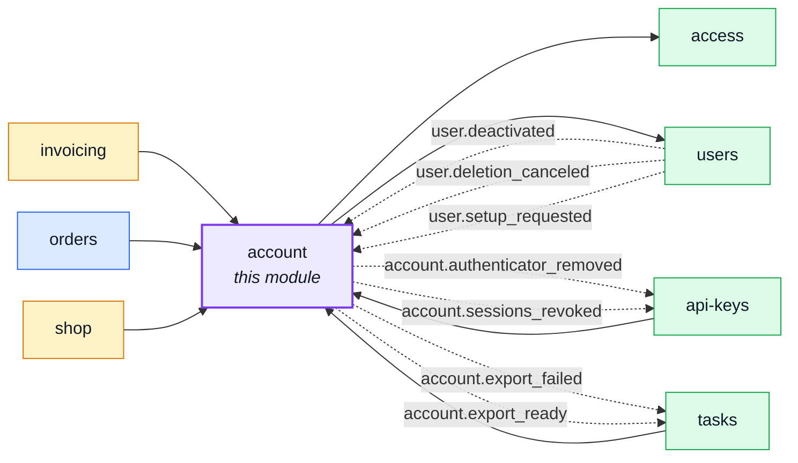
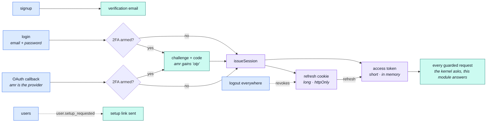
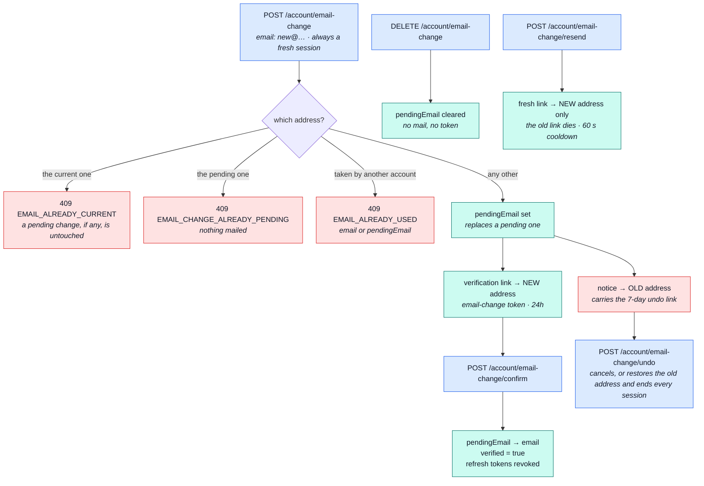
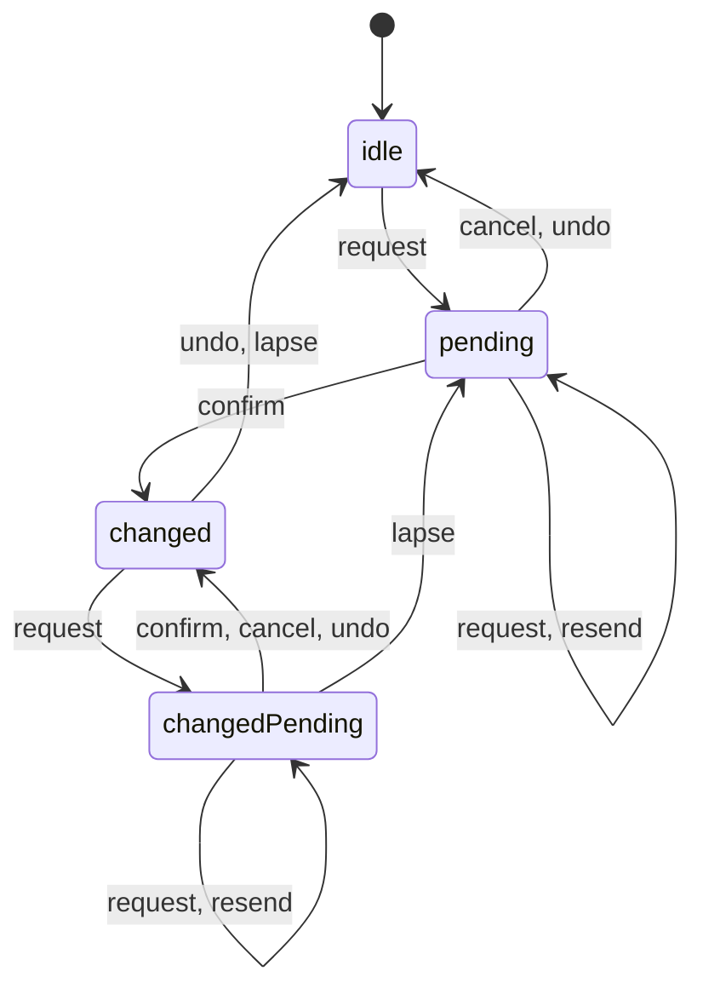
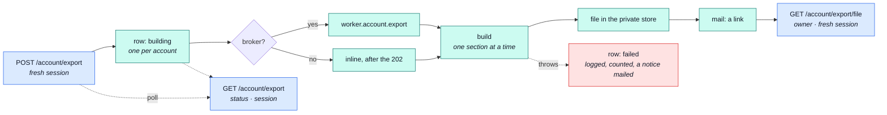

# account

::: tip At a glance
**Owns** — every way into an account: signup, login, [OAuth](./account-oauth.md), [two-factor auth](./account-two-factor.md), refresh, re-auth, password reset, session listing and revocation, logout-everywhere, [scheduled deletion](#scheduled-deletion), and the [data export](#data-export). Four collections of its own: `sessions`, `verificationtokens`, `accountexports` and `erasureledgers` (the [erasure ledger](../understand/data-retention.md#backups-and-erasure): who was erased and when, so a backup restore can erase them again); the address book is [`addresses`](./addresses.md).
**Depends on** — [`users`](./users.md), whose record it authenticates. The repo's only `shared-kernel` edge.
**Breaks if you change** — the token lifetimes or the cookie flags. Every guard in the app resolves through this module.
:::

## Its neighbourhood

<!-- module-graph:account:start -->

_Solid arrows are imports. Dotted arrows are domain events — the return path an import
graph cannot see._

<!-- module-graph:account:end -->

## The story

This module answers the kernel's one question: **who is making this request?** It registers an
auth resolver from its own `onRegistered` hook — run once every enabled module is known, not
merely on import — because installing a function touches no connection, and every guard in the
application depends on it existing before the first request arrives. Registering there rather than
at import time means importing this file for a type or a test does not install the resolver.

It owns three collections. `sessions` holds who is signed in and `verificationtokens` the
one-time links and challenges in flight ([Sessions](./account-sessions.md#where-sessions-live));
`accountexports` is a row per account that asked for its data ([below](#data-export)). The User
record belongs to [`users`](./users.md) and is reached through that module's barrel; the address
book lives in its own module, [`addresses`](./addresses.md) — see that page for why.

An account nobody has used in a long time — no login, no API-key use — is a live account with
less and less live purpose. `npm run job reap:inactive-accounts` (`docker/crontab`, nightly) handles it
in two independent steps:

- **Minimise**, on by default (`NODE_INACTIVE_MINIMISE_DAYS`, 1095): runs the `personalData.minimise`
  hooks — [`addresses`](./addresses.md) deletes the book, [`orders`](./orders.md) starts each order's
  PII clock. The login stays. Stamped `inactivityMinimisedAt`; an account that comes back and goes
  quiet again is minimised again.
- **Delete**, disabled by default (`NODE_INACTIVE_ACCOUNT_DAYS=0`): warns, then soft-, then
  hard-deletes, the hard delete running the same `personalData.erase` hooks every module declares.

Why minimise and not delete: [Data Retention](../understand/data-retention.md#inactive-accounts-minimise-don-t-delete).
See [Scheduled jobs](../reference/ops.md#scheduled-jobs) for the full mechanism.

::: tip The barrel is one line wide, and that is the story
`session/`, `two-factor/` and `oauth/` are three folders and not one exported symbol between them.
They might look like something authorization would need. It does not: `kernel/authentication.ts`
is the port every request goes through, and this module fills it using its own relative imports. No
sibling has ever reached for a token, a factor or a provider — and no staff route in
[`users`](./users.md) touches a credential at all. Proving who somebody is _is_ what `account` is,
and none of it is anyone else's business.
:::

## The pipeline

**Three ways in, one place they converge.** Password, password-plus-a-factor, and a provider's
redirect all end in the same `issueSession` — two tokens with two lifetimes, and then the one
question the kernel asks on every guarded request. [Sessions](./account-sessions.md) has the
mechanics.

**A signup writes the account and nothing else.** It grants no role: a self-service account has no
`verifiedAt`, so it is an `unverified` audience, and an OAuth signup sets `verifiedAt` (the provider
vouches for the address), so it is a `customer` from its first request. Verifying an address later
is one field written on the account, with no role to promote. An admin create is the one signup that
may also grant a staff role, see [`users`](./users.md#creating-with-a-role).

**The first password of a staff-created account is its holder's first screen, so it carries the
Terms.** The setup mail links the Terms and the privacy notice (the person's first contact from us,
GDPR Art. 14(3)(b)) and opens `account-setup`, the reset page in setup mode. `POST
/account/password/reset/confirm` takes an optional `termsAccepted: true`. An account with no Terms
record needs it: without it the answer is a 422 naming `termsAccepted`, only after the link is
found and before it is spent, so the same link still works. With it, the password write also
stamps `termsAcceptedAt` and `termsVersion`. The same rule covers "forgot password" on an account
that never accepted. An account that already has a record ignores the field.

::: tip Both entries owe the second factor
The OAuth callback checks `twoFactorEnabledAt` like the password login does and issues the same
challenge — see [OAuth](./account-oauth.md#two-consequences-worth-naming).
:::

## Proving an address {#proving-an-address}

Two **kinds** of email verification share one mechanism, and the distinction is the whole design.
One proves the address an account **already has** — signup, and the explicit re-send. The other
proves the address a `POST /account/email-change` request has **asked for**. They are stored under different
`verificationtokens.type` values (`verify` and `email-change`), and neither can do the other's work: a signup
token that could swap in a `pendingEmail` would be an account takeover with an extra step.

The old address gets a one-time **undo link** in its notice, valid for 7 days from the request and
kept through a password change (a password change purges every other pending one-time token, not
this one). Only the newest request's link lives. While the change is pending the undo cancels it;
once the new address was confirmed it restores `previousEmail`, a field written at the swap. Either
way every session ends, first and as its own write (so a 409 on the restore still leaves the thief
signed out), and `api-keys` revokes the keys the person minted: the owner is saying the change was
not theirs. The link is the credential, so the route is public like the confirm one. The spend of
a confirm or undo link and the address write commit in one transaction
([Spending a link](./account-sessions.md#spending-a-link)): a 409 on the restore or the swap
leaves the link live, so it can be followed again once the address is free. The undo reads the
account inside that transaction and decides cancel-or-restore from that fresh copy, so a
confirmation racing it is restored, not skipped.

A change never writes `user.email` directly. It parks the requested address in `pendingEmail`, so
the account keeps its current, proven address — and its `verified` flag, which describes that
proven address — until the new one is confirmed.

The flow has four states, read from `pendingEmail` and `previousEmail`, never stored. Which event
applies in which state is one table, `domain/email-change.ts`; an event that does not apply is a
no-op, not an error.

`lapse` is the end of the undo window: the nightly `reap:previous-emails` job clears `previousEmail`
on an account with no live undo link. See
[the retention page](../understand/data-retention.md#the-previous-email-after-a-change).

Three things in the flow above are decisions rather than mechanics:

- **The notice goes to the old address when the change is _requested_, not when it completes.** A
  warning that arrives before a takeover is a warning; one that arrives after is a receipt. It
  carries no token and no link that acts — "this wasn't me" is a password change and a
  logout-everywhere, both of which already exist.
- **The email has its own door, not a field of the profile.** `POST /account/email-change {email}`
  sits behind an unconditional step-up (`sensitive`, plus an `otp` proof when a second factor is
  armed), where the profile edit (`PUT`/`PATCH /account`) asks for nothing and carries no `email`.
  The change has mails, a guard and a pacing of its own, so it is an action
  ([write-methods](../understand/write-methods.md#action-or-field)), and no guard has to read a body to
  know whether to step in. It is a POST because it creates the pending change.
- **Cancelling is its own explicit action, not a side effect of re-typing the current address.**
  Asking for the current address is a `409 EMAIL_ALREADY_CURRENT`, so a retried request can never
  drop a pending change. `DELETE /account/email-change` is the only thing that cancels one.
- **Resending is its own action too, and it mails the new address only.** Asking for the pending
  address again is a `409 EMAIL_CHANGE_ALREADY_PENDING` (a double-submitted request must not mail
  twice), so `POST /account/email-change/resend` is the explicit way to ask for the link again. A
  different address while one is pending replaces it, revokes the earlier link and mails both again.
  The old address was told once, when the change was requested; telling it on every resend would
  read like a takeover alert. It uses `POST /account/email-verification/resend`'s cooldown and mailbox budget and
  answers `200 { resendAfter }` like it, so the button counts down from the server's number; when
  nothing is pending it mails nothing and answers `resendAfter` 0.
- **A new change request is paced, and so is a reset request.** A genuine change to a different
  address (one that is neither the current nor the already-pending address) is held to one a
  minute per account, answering `429 EMAIL_CHANGE_TOO_SOON` with `details.retryAfter`, like the
  resend button. The caller is signed in, so the answer can be honest. A password-reset request is
  paced the same way but SILENTLY: inside the minute it answers the same `204` and sends nothing,
  because a `429` would tell a stranger which addresses have an account. Both also spend the
  recipient's mailbox budget ([security](../understand/security.md#mail-to-one-mailbox-—-the-victim-s-budget)),
  which a refused request does not.
- **A display name is printed only to a mailbox that has proven itself.** `username` is free text
  (up to 50 characters, no charset rule: one would refuse real names). A mail to an address nobody
  has verified — a signup for a stranger's address, a pending new address — would put text of the
  caller's choosing in a stranger's inbox, from the shop's own domain. So the greeting carries the
  name only when the mail goes to the account's own VERIFIED address (`greetableName`), and a plain
  "Hello!" otherwise; every template that greets goes through the same `greetingFor`. The notice to
  the OLD address of an email change keeps the name, since that mailbox is the verified one.
- **Confirming revokes every refresh token.** An email change is the stronger takeover primitive
  of the two, and this is the same treatment a changed password already gets.
- **A signed-in password change mails a notice; a reset keeps its own confirmation.** Someone
  holding a stolen session and the current password can change it silently otherwise
  (`account.password-changed`; NIST SP 800-63B-4 §4.6, ASVS 5.0 6.3.7). It says what happened and
  to use "Forgot password" if it was not the owner: a reset signs every device out and revokes the
  API keys. No link, no timestamp. It is queued after the change and never fails it. The
  reset confirmation says the same ("reset it again and contact us").
- **Security notices name the support address.** The password, second-factor, sign-in-method and
  email-change notices end with a footer that names `NODE_SUPPORT_EMAIL` (required, read from the
  mail slice, which infrastructure owns, so the foundation can read it).

Collision is checked twice, because the two checks catch different things. At **request time**,
the requested address is compared against every account's `email` _and_ `pendingEmail`. At **swap
time**, the `users_email` and `users_pending_email` unique indexes catch whatever changed in the
up-to-24-hours between the two.

### How long each link and challenge lives

| What                                | Lives                                                                                                                      |
| ----------------------------------- | -------------------------------------------------------------------------------------------------------------------------- |
| the new address's confirmation link | 24 hours                                                                                                                   |
| the old address's undo link         | 7 days                                                                                                                     |
| the account restore link            | until `purgeAt` (`account-deletion.ts`)                                                                                    |
| a login's two-factor challenge      | 5 minutes, 10 when a delivered factor (email) is armed, since the code must cross a mail queue (`two-factor-challenge.ts`) |

## Scheduled deletion {#scheduled-deletion}

`DELETE /account` (a critically fresh session, and a second-factor proof when one is armed) locks the
account, ends its sessions (revocation cause `deletion-scheduled`), mails a restore link and answers
`202 {requestedAt, purgeAt}`. `purgeAt` is `min(requestedAt + NODE_ACCOUNT_DELETION_GRACE_DAYS,
one calendar month later)`: the reasoning, the GDPR clock and the table of what a locked account
loses are in [the retention page](../understand/data-retention.md#self-deletion-a-grace-under-one-month).

| Way back        | Route                                        | Proof                                                               |
| --------------- | -------------------------------------------- | ------------------------------------------------------------------- |
| the mailed link | `POST /account/restore {token}`              | the `account-restore` token; it does not sign anyone in             |
| signing in      | `POST /account/login`, then `/login/restore` | password (and second factor), then a `deletion-restore` claim check |
| staff           | `POST /users/{id}/restore`                   | `delete:User`; `account` hears `user.deletion_canceled`             |

The purge is `reap:scheduled-deletions` (hourly, leased). Per due account it copies the address and
name, runs `eraseScheduledDeletion` (the whole erase cascade), then mails the goodbye and records
`auth.account_delete.completed`. Audit: `.scheduled`, `.canceled` (`metadata.via` is `link`,
`sign-in` or `staff`), `.completed`. Metric `auth_account_delete_total{status}`; analytics
`account_deletion_scheduled` and `account_restored` (the purge fires nothing).

## Data export {#data-export}

"Give me my data" (GDPR Art. 15 and 20) is a job, not a request. Building the answer reads every
module's section of the account, and doing that inside the HTTP request held all of them in one
object, per call, for as long as the slowest took. So asking only records a row and queues a
build; a **link** is mailed when the file is ready, never the data. Google Takeout, GitHub and
Facebook all do the same.

A failed build announces `account.export_failed` in the same write that marks the row, and a ready one
`account.export_ready`; [tasks](./tasks.md#system-tasks) opens a task for the first (the person is
still owed the file within a month, GDPR Art. 12(3)) and closes it on the next ready export.

Why the export lives in `account` and not in a `privacy` module: GDPR export, erasure and
minimising are three jobs with three homes. Each module declares its own `personalData` section
(`collect`, `erase`, `minimise`), so who holds what is already one registry in the kernel. Erasure
and minimising stay in [`users`](./users.md), because they act on the User row inside one
transaction. The export stays beside the account it serves, as in Discourse, Mastodon and Spatie's
personal-data package, and it leans on this module's mailer, mail budget, audit actions and queue. A
separate module would need an import cycle with `users`, or a new URL, and would change no behaviour.

Decisions rather than mechanics:

- **One live export per account.** Asking while one is `building` returns that one (and starts no
  second build). Asking after one is `ready` or `failed` _replaces_ it: the old file and row are
  deleted first. The unique index on `userId` settles two simultaneous requests: one wins, the other
  gets the winner back. A `building` row older than 30 minutes counts as lost with its process and is
  replaced too.
- **A new export costs one mail.** Starting one is charged to the per-mailbox mail
  budget, because it ends in a mailed link. A spent budget answers `429` before the old export is deleted,
  so a ready file stays downloadable; asking while one is `building` is not charged.
- **The queue message names an account, not a mailbox.** The worker reads the account's address
  from the account itself, both for the mail and for the sections that match by address. A message
  that could carry its own address would let whoever can publish to the queue send one person's
  data to another's inbox. An account erased since the request fails the row and mails nobody.
- **Peak memory is one section.** The worker collects the sections one at a time and appends each to
  the file as it arrives, so the largest section is the ceiling, not the sum. The audit section reads
  by cursor on the `{ actorUserId, timestamp }` index: no count and no skip per page, which would make
  reading a long trail cost work quadratic in its length.
- **The job carries the subject the request saw**, including whether the address had been proven. A
  section that matches by address (`tasks`) answers only for a proven one, so the file says what
  the caller was entitled to when they asked, not what became true later.
- **A failed build is a state.** The worker logs the error, marks the row `failed`, counts it in
  `account_export_failed_total` and mails the requester a short notice (`account.export-failed`: no
  link, "ask again from your profile"), so nobody waits for a link that never comes. The notice is
  skipped when the account is gone, and a mail that cannot be queued is logged: the row stays `failed`.
  Asking again replaces it. Two runs of one job (a broker redelivery) are safe: only a row
  still `building` is built, and only the run that settles it mails the link.
- **The status is its own read.** `GET /account/export` answers `building`, `ready` or `failed`
  with `createdAt`, and `expiresAt` once `ready`, for a session that need not be fresh: it holds
  dates and a state, no personal data. `404` only when there is no export; one past its retention
  and not yet swept counts as none. A `building` row past 30 minutes reads as `failed`. The `202`
  of the request carries `Location: /account/export`, so a client can poll what it was told.
- **The download asks for a fresh session, like the request.** The mailed link opens a frontend page
  that reads the status, then calls `GET /account/export/file`; a forwarded mail hands nobody the
  file. A row that is not yours, not `ready`, past its retention, or `ready` with its file missing
  from the store are the same `404`: the file honestly does not exist.
- **Kept `NODE_ACCOUNT_EXPORT_TTL_DAYS` days (7), then gone.** The nightly `reap:account-exports`
  deletes file and row, and sweeps files no row points at by age. A hard account delete (and so
  `reap:inactive-accounts`) deletes the export with the rest of the account: the row inside the
  erasure's transaction, the file after its commit, because a file cannot roll back.
- **Plaintext on disk, on purpose.** The file sits unencrypted in `NODE_ACCOUNT_EXPORT_STORE_PATH`,
  like the Mongo data files: private (never under the public directory), regenerable (not backed up),
  at-rest protection is the host's. See
  [crypto and secrets](../understand/defences/crypto-and-secrets.md#secrets-at-rest).
- **Audited at both ends.** `auth.data_export.requested` when it is asked for, and
  `auth.data_export.downloaded` when the data actually leaves.

## Abilities {#abilities}

`GET /account` carries the caller's packed rules in both scopes as `abilities`, and the idle
clock as `activity`. A sign-in answer carries the whole `account` view (`AuthTokens.account`), and
a refresh answer carries `abilities`, so a client needs no follow-up read. A client renders from
the server's rules instead of a copy. An API key reads nothing of this: its own record lists the
permissions it was minted with. It also carries `grantableRoles`: the tenant roles the
caller may assign through the user writes. The list comes from `grantableRoles` in the
[`access`](./access.md) service, which asks the same rule as the `409` those writes answer, so a role
picker built from it offers exactly what the write accepts. Like the rules, it has no authority:
the write is re-checked.

## Terms version {#terms-version}

`NODE_TERMS_VERSION` and `termsVersion()` belong here, with the consent record signup writes: the
version is stored beside the date the Terms were accepted. `GET /config` prints it as `termsVersion`.
[`orders`](./orders.md#creating-an-order) also reads `termsVersion()`: an order placed at checkout
freezes the version in force at placement.

## Operator identity {#operator-identity}

Who runs the site: `NODE_LEGAL_NAME`, `_STREET`, `_CITY`, `_ZIP`, `_COUNTRY` (required at boot; an ISO 3166-1
alpha-2 code in any case, upper-cased, refused unless two letters),
`_EMAIL` (default `NODE_SUPPORT_EMAIL`), `_PHONE`, `_VAT_NUMBER`, `_TRADE_REGISTER`,
`_REGISTRATION_NUMBER` (optional). `operatorIdentity()` reads them live and `GET /config` serves
them as `operator`.

It is here, not in `shop`, because any online service owes its provider identity (e-Commerce
Directive Art. 5(1), GDPR Art. 13(1)(a)), so a project without the shop keeps its footer, Terms,
Legal notice and Privacy page. `shop` requires the phone on top of this (CRD Art. 6(1)(c)); `orders`
(withdrawal notice) and `invoicing` (seller block) read the rest.

## Why it stays one module {#one-module}

Identity is one generic subdomain. Keycloak, Auth0 and better-auth all keep it as one context.

- Split by flow inside the module: one file per flow under `services/*.ts`.
- Keep the `session/`, `oauth/` and `two-factor/` folders.
- No capability modules (a "login" module, a "tokens" module): they would share one collection.
- No external identity provider: the contract is the core of a two-backend boilerplate.

## Related pages

- [Sessions](./account-sessions.md) — the token mechanics, in detail
- [Two-factor authentication](./account-two-factor.md) — the registry, and the enrollment state machine
- [OAuth](./account-oauth.md) — the provider port and the three outcomes of a callback
- [`addresses`](./addresses.md) — shares the `/account` URL prefix and the frontend screen
- [`users`](./users.md) — the collection this module shares
- [Security](../understand/security.md) — hashing, cookies, the headers around them, and this module's own rate-limit budgets
- [Request Flow](../understand/request-flow.md) — where the guard sits in a request
- [Strategic DDD](../understand/strategic-ddd.md#_2-context-map-—-how-a-module-reaches-its-siblings) — what `shared-kernel` costs
