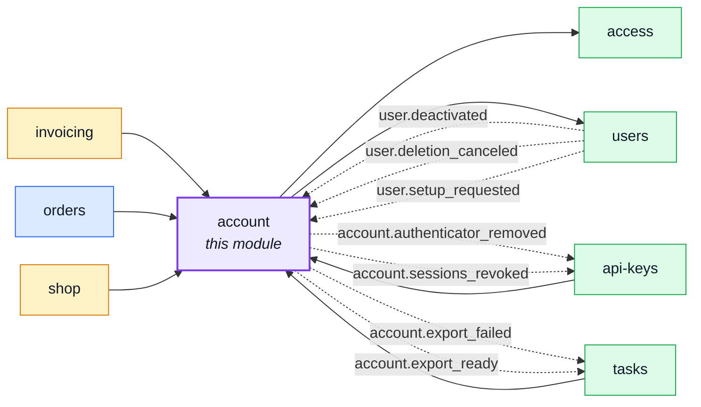
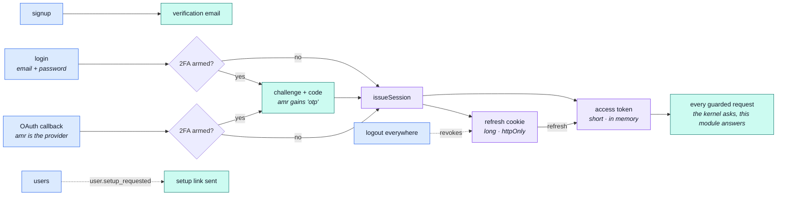

# account

Who is making this request: signup, login, sessions, two-factor, OAuth and the account lifecycle.

::: tip At a glance
**Owns** — every way into an account: signup, login, [OAuth](./account-oauth.md), [two-factor auth](./account-two-factor.md), refresh, re-auth, password reset, session listing and revocation, logout-everywhere, [scheduled deletion](#scheduled-deletion), and the [data export](#data-export). Four collections of its own: `sessions`, `verificationtokens`, `accountexports` and `erasureledgers` (the [erasure ledger](../understand/data-retention.md#backups-and-erasure): who was erased and when, so a backup restore can erase them again); the address book is [`addresses`](./addresses.md).
**Depends on** — [`users`](./users.md), whose record it authenticates. The repo's only `shared-kernel` edge.
**Breaks if you change** — the token lifetimes or the cookie flags. Every guard in the app resolves through this module.
:::

## Its neighbourhood

<!-- module-graph:account:start -->

_Solid arrows are imports. Dotted arrows are domain events — the return path an import
graph cannot see._

<!-- module-graph:account:end -->

## The story

This module answers the kernel's one question: **who is making this request?** It registers an
auth resolver from its own `onRegistered` hook — run once every enabled module is known, not
merely on import — because installing a function touches no connection, and every guard in the
application depends on it existing before the first request arrives. Registering there rather than
at import time means importing this file for a type or a test does not install the resolver.

It owns three collections. `sessions` holds who is signed in and `verificationtokens` the
one-time links and challenges in flight ([Sessions](./account-sessions.md#where-sessions-live));
`accountexports` is a row per account that asked for its data ([below](#data-export)). The User
record belongs to [`users`](./users.md) and is reached through that module's barrel; the address
book lives in its own module, [`addresses`](./addresses.md) — see that page for why.

An account nobody has used in a long time — no login, no API-key use — is a live account with
less and less live purpose. `npm run job reap:inactive-accounts` (`docker/crontab`, nightly) handles it
in two independent steps:

- **Minimise**, on by default (`NODE_INACTIVE_MINIMISE_DAYS`, 1095): runs the `personalData.minimise`
  hooks — [`addresses`](./addresses.md) deletes the book, [`orders`](./orders.md) starts each order's
  PII clock. The login stays. Stamped `inactivityMinimisedAt`; an account that comes back and goes
  quiet again is minimised again.
- **Delete**, disabled by default (`NODE_INACTIVE_ACCOUNT_DAYS=0`): warns, then soft-, then
  hard-deletes, the hard delete running the same `personalData.erase` hooks every module declares.

Why minimise and not delete: [Data Retention](../understand/data-retention.md#inactive-accounts-minimise-don-t-delete).
See [Scheduled jobs](../reference/ops.md#scheduled-jobs) for the full mechanism.

::: tip The barrel is one line wide, and that is the story
`session/`, `two-factor/` and `oauth/` are three folders and not one exported symbol between them.
They might look like something authorization would need. It does not: `kernel/authentication.ts`
is the port every request goes through, and this module fills it using its own relative imports. No
sibling has ever reached for a token, a factor or a provider — and no staff route in
[`users`](./users.md) touches a credential at all. Proving who somebody is _is_ what `account` is,
and none of it is anyone else's business.
:::

## The pipeline

**Three ways in, one place they converge.** Password, password-plus-a-factor, and a provider's
redirect all end in the same `issueSession` — two tokens with two lifetimes, and then the one
question the kernel asks on every guarded request. [Sessions](./account-sessions.md) has the
mechanics.

**A signup writes the account and nothing else.** It grants no role: a self-service account has no
`verifiedAt`, so it is an `unverified` audience, and an OAuth signup sets `verifiedAt` (the provider
vouches for the address), so it is a `customer` from its first request. Verifying an address later
is one field written on the account, with no role to promote. An admin create is the one signup that
may also grant a staff role, see [`users`](./users.md#creating-with-a-role).

**The first password of a staff-created account is its holder's first screen, so it carries the
Terms.** The setup mail links the Terms and the privacy notice (the person's first contact from us,
GDPR Art. 14(3)(b)) and opens `account-setup`, the reset page in setup mode. `POST
/account/password/reset/confirm` takes an optional `termsAccepted: true`. An account with no Terms
record needs it: without it the answer is a 422 naming `termsAccepted`, only after the link is
found and before it is spent, so the same link still works. With it, the password write also
stamps `termsAcceptedAt` and `termsVersion`. The same rule covers "forgot password" on an account
that never accepted. An account that already has a record ignores the field.

::: tip Both entries owe the second factor
The OAuth callback checks `twoFactorEnabledAt` like the password login does and issues the same
challenge — see [OAuth](./account-oauth.md#two-consequences-worth-naming).
:::

## Proving an address {#proving-an-address}

Two **kinds** of email verification share one mechanism, and the distinction is the whole design.
One proves the address an account **already has** — signup, and the explicit re-send. The other
proves the address a `POST /account/email-change` request has **asked for**. They are stored under different
`verificationtokens.type` values (`verify` and `email-change`), and neither can do the other's work: a signup
token that could swap in a `pendingEmail` would be an account takeover with an extra step.

Full detail: [Proving an address, deletion and data export](./account-proof-and-export.md#proving-an-address).

## Scheduled deletion {#scheduled-deletion}

`DELETE /account` (a critically fresh session, and a second-factor proof when one is armed) locks the
account, ends its sessions (revocation cause `deletion-scheduled`), mails a restore link and answers
`202 {requestedAt, purgeAt}`. `purgeAt` is `min(requestedAt + NODE_ACCOUNT_DELETION_GRACE_DAYS,
one calendar month later)`: the reasoning, the GDPR clock and the table of what a locked account
loses are in [the retention page](../understand/data-retention.md#self-deletion-a-grace-under-one-month).

Full detail: [Proving an address, deletion and data export](./account-proof-and-export.md#scheduled-deletion).

## Data export {#data-export}

"Give me my data" (GDPR Art. 15 and 20) is a job, not a request. Building the answer reads every
module's section of the account, and doing that inside the HTTP request held all of them in one
object, per call, for as long as the slowest took. So asking only records a row and queues a
build; a **link** is mailed when the file is ready, never the data. Google Takeout, GitHub and
Facebook all do the same.

Full detail: [Proving an address, deletion and data export](./account-proof-and-export.md#data-export).

## Abilities {#abilities}

`GET /account` carries the caller's packed rules in both scopes as `abilities`, and the idle
clock as `activity`. A sign-in answer carries the whole `account` view (`AuthTokens.account`), and
a refresh answer carries `abilities`, so a client needs no follow-up read. A client renders from
the server's rules instead of a copy. An API key reads nothing of this: its own record lists the
permissions it was minted with. It also carries `grantableRoles`: the tenant roles the
caller may assign through the user writes. The list comes from `grantableRoles` in the
[`access`](./access.md) service, which asks the same rule as the `409` those writes answer, so a role
picker built from it offers exactly what the write accepts. Like the rules, it has no authority:
the write is re-checked.

## Terms version {#terms-version}

`NODE_TERMS_VERSION` and `termsVersion()` belong here, with the consent record signup writes: the
version is stored beside the date the Terms were accepted. `GET /config` prints it as `termsVersion`.
[`orders`](./orders.md#creating-an-order) also reads `termsVersion()`: an order placed at checkout
freezes the version in force at placement.

## Operator identity {#operator-identity}

Who runs the site: `NODE_LEGAL_NAME`, `_STREET`, `_CITY`, `_ZIP`, `_COUNTRY` (required at boot; an ISO 3166-1
alpha-2 code in any case, upper-cased, refused unless two letters),
`_EMAIL` (default `NODE_SUPPORT_EMAIL`), `_PHONE`, `_VAT_NUMBER`, `_TRADE_REGISTER`,
`_REGISTRATION_NUMBER` (optional). `operatorIdentity()` reads them live and `GET /config` serves
them as `operator`.

It is here, not in `shop`, because any online service owes its provider identity (e-Commerce
Directive Art. 5(1), GDPR Art. 13(1)(a)), so a project without the shop keeps its footer, Terms,
Legal notice and Privacy page. `shop` requires the phone on top of this (CRD Art. 6(1)(c)); `orders`
(withdrawal notice) and `invoicing` (seller block) read the rest.

## Why it stays one module {#one-module}

Identity is one generic subdomain. Keycloak, Auth0 and better-auth all keep it as one context.

- Split by flow inside the module: one file per flow under `services/*.ts`.
- Keep the `session/`, `oauth/` and `two-factor/` folders.
- No capability modules (a "login" module, a "tokens" module): they would share one collection.
- No external identity provider: the contract is the core of a two-backend boilerplate.

## Read next

- [Sessions](./account-sessions.md) — the token mechanics, in detail
- [Two-factor authentication](./account-two-factor.md) — the registry, and the enrollment state machine
- [OAuth](./account-oauth.md) — the provider port and the three outcomes of a callback
- [`addresses`](./addresses.md) — shares the `/account` URL prefix and the frontend screen
- [`users`](./users.md) — the collection this module shares
- [Security](../understand/security.md) — hashing, cookies, the headers around them, and this module's own rate-limit budgets
- [Request Flow](../understand/request-flow.md) — where the guard sits in a request
- [Strategic DDD](../understand/strategic-ddd.md#_2-context-map-—-how-a-module-reaches-its-siblings) — what `shared-kernel` costs
