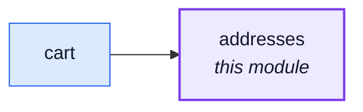
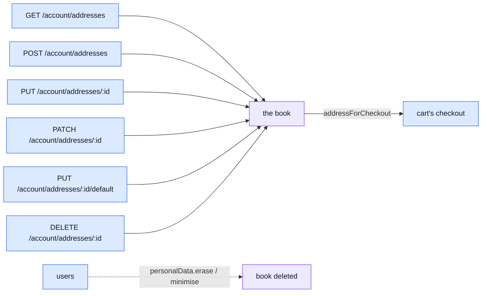

# addresses

::: tip At a glance
**Owns** — the address book: one document per user, entries keeping their own id (two addresses
can be identical in every field and still be different entries).
**Depends on** — nothing. [`users`](./users.md) reaches it only through the `personalData.erase`
hook its hard delete runs, never a service call.
**Breaks if you change** — [`cart`](./cart.md)'s checkout, the only sibling consumer of
`addressForCheckout`, for both the shipping and the billing address.
:::

## Its neighbourhood

<!-- module-graph:addresses:start -->

_Solid arrows are imports. Dotted arrows are domain events — the return path an import
graph cannot see._

<!-- module-graph:addresses:end -->

## The story

The address book is its own module, not part of [`account`](./account.md), so that it is a leaf.
`cart`'s checkout needs exactly one function from it, `addressForCheckout`. Had the book lived in
`account`, that arrow would close an `account ↔ cart` import cycle: `account`'s data export reads
`cart` for the shopping-basket section, and `cart` would read `account` back for the delivery
address.

`account` never needed `cart` to answer "who is this person". Keeping the data where the
dependency actually points — a leaf both can reach, that imports neither back — removes the
arrow instead of routing around it.

::: tip Shares a URL, not a folder
The routes sit at `/account/addresses`, the `account` prefix, though this module answers them. Two routers mounting `getAuth` under the same prefix would normally mean the JWT
verify, the user read and the membership read run twice for one request; `getAuth`
(`kernel/middlewares/authorizations.ts`) returns early once a caller is already resolved, so the
second router's mount costs nothing beyond the first.
:::

`users` is reached only the other way round: a hard-deleted account takes its address book with
it, through the `personalData.erase` hook this module declares and `users` runs inside the delete's
transaction — the same hook `cart`, `wishlist`, `payments` and `orders` each declare for their own
collection. An account inactive past `NODE_INACTIVE_MINIMISE_DAYS` loses its book too, through this
module's `personalData.minimise` hook: a saved address is re-entered on the next order, so it is the
first thing an idle account no longer needs ([why](../theory/data-retention.md#inactive-accounts-minimise-don-t-delete)).
Nothing here ever calls into `users`' service.

## The pipeline

One collection, six routes, one cross-cutting read.

The one invariant worth seeing after any write: whenever the book is non-empty, exactly one entry
carries `default`. The repository (`repository.ts`), not the schema, maintains it — a
read-modify-write on the whole array, because "exactly one default" is a property of the list, not
of any one entry, and no single `$set`/`$pull` can demote the old holder, promote the new one and
prune a removed entry atomically in one operation. The one exception is the **add**: it is a single
update-pipeline write (`$concatArrays` of the demoted entries and the new one), because it also
carries the size cap.

**A book holds at most `NODE_ADDRESS_BOOK_MAX` entries** (20). A book is one document and its
entries are PII-encrypted, so one that grows without bound walks toward the 16 MB document limit
and breaks its owner's own writes (about 160 posts of 100 kB would do it). The cap is a condition
in the add's filter (`items.19` must not exist), which mongod evaluates while holding the document,
so a burst of concurrent adds cannot all see room: exactly the cap is stored and the rest answer
`409 ADDRESS_BOOK_FULL`. The entry's text goes into the pipeline inside `$literal`, since a string
starting with `$` is a field path there.

`addressForCheckout(userId, addressId?)` answers three ways (an entry — the named one, or the
default — `undefined`, or `null`), and the distinction between the last two is deliberate: `undefined` means the caller keeps no addresses and named none (not required to
buy); `null` means they named an entry that is not theirs or does not exist. Checkout must refuse
the second case, not silently ship nowhere — collapsing the two would let a stale id downgrade to
"no address" instead of failing loudly.

`fullName`/`street`/`city`/`zip`/`country`/`phone` are stored AES-256-GCM under
`NODE_PII_ENCRYPTION_KEY` (`@infrastructure/security/pii-encryption`) — none of them is ever
queried on directly, so encrypting them costs no lookup capability. `repository.ts` is the one
place that encrypts (every write) and decrypts (every read) — `service.ts` and `cart`'s checkout
snapshot both see plaintext, never the stored ciphertext. See
[Secrets at rest](../theory/defences/crypto-and-secrets.md#secrets-at-rest).

## Related pages

- [`account`](./account.md) — shares the `/account` URL prefix and the frontend screen
- [`cart`](./cart.md) — the checkout that resolves a shipping address through this module
- [Adding & Removing a Module](../theory/module-lifecycle.md) — the deletability procedure
- [Strategic DDD](../theory/strategic-ddd.md#_2-context-map-—-how-a-module-reaches-its-siblings) — why the address book left `account`
