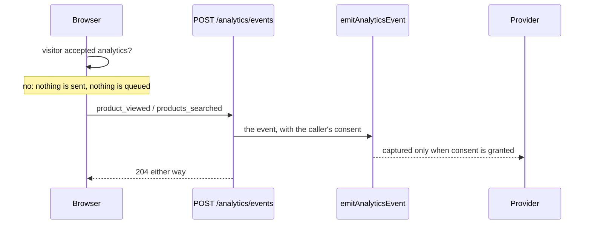

# analytics

::: tip At a glance
**Owns** — `POST /analytics/events`: the relay a browser uses to report the browsing events the
server cannot see (a product page opened, a search made).
**Depends on** — no module, and no module depends on it; only the paired frontend calls it. The events go through the analytics port in
`infrastructure/observability/analytics`, like every other module's.
**Breaks if you change** — the closed event list in the contract (`AnalyticsEventRequest`), which
the paired frontend's `trackBrowsing` sends from.
:::

## Its neighbourhood

<!-- module-graph:analytics:start -->

_Nothing reaches `analytics` and it reaches nothing — no imports either way, no events either way. Deleting it takes one folder and this page, and no other page changes._

<!-- module-graph:analytics:end -->

## The story

**Why a browser reports these at all.** The response cache (Redis, and the browser's own for a
search) answers most reads without reaching the application, so a `product_viewed` emitted by the
server under-counts browsing, and by an amount nobody can measure. The page knows when it was shown.
Business facts are the opposite case and stay on the server: see
[Who sends which event](../tools/analytics.md#who-sends-which-event).

**The answer never says whether it was recorded.** A `204` follows a recorded event and a dropped
one alike, so a page learns nothing about its own measurement. Consent is read the way every other
emit reads it: the account's stored choice, or the `X-Analytics-Consent` header for a guest.

**The set is closed.** The body is one of two events, each with bounded fields, and anything else
is a `422`. A cart, checkout, order, payment, signup or login event is never accepted: those are
facts the server decides, and a relay for them would let a console forge them.

**Rate limits.** Only the global burst brake (`app/security.ts`): the route writes nothing, and
without consent it does no work beyond parsing the body.

## Related pages

- [Modules overview](./index.md) — the whole context map
- [Product analytics](../tools/analytics.md) — the port, consent, and who sends which event
- [products](./products.md) — declares the two event names this relay carries
