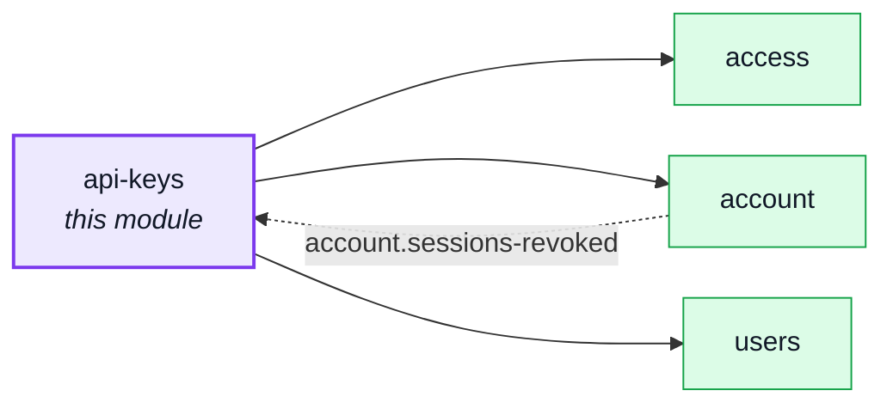
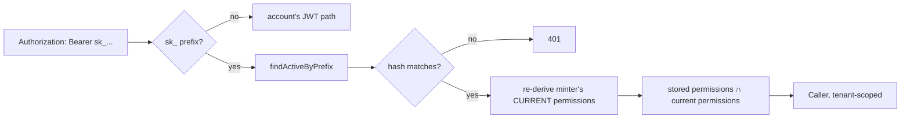
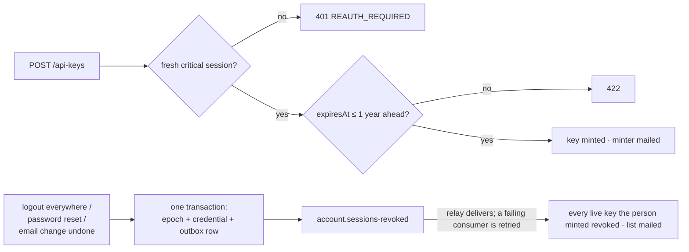

# api-keys

::: tip At a glance
**Owns** — machine-to-machine credentials: mint, list, revoke, and the `CredentialResolver` that
lets an `sk_...` bearer token authenticate a request the way a JWT does.
**Depends on** — [`users`](./users.md) for the minting user's account, [`access`](./access.md)
for their current role, and [`account`](./account.md) for the `account.sessions-revoked` event.
**Breaks if you change** — the `sk_` token prefix (`kernel/authentication.ts`'s dispatch between
this module's credential path and `account`'s JWT path assumes it), or the mint-time/check-time
permission-floor pair in `services/api-keys.ts` and `module.ts`.
:::

## Its neighbourhood

<!-- module-graph:api-keys:start -->

_Solid arrows are imports. Dotted arrows are domain events — the return path an import
graph cannot see._

<!-- module-graph:api-keys:end -->

## The story

A partner integration, or a webhook consumer calling back into this shop's own API, has nothing to
present short of a person's password — which then appears in the audit trail as that person,
and carries their whole reach rather than the two endpoints the partner needs. This module is the
answer: a revocable credential, scoped to a caller-chosen subset of whoever minted it.

**The credential is verified, never decrypted.** `sk_<8-char prefix>_<32 bytes>`, both halves
`base64url`. Only a sha256 digest is ever stored — `credentials.ts` reuses `hashToken` (`src/infrastructure/security/hash-token.ts`)
(`@modules/users`), the same one-way primitive refresh/reset tokens use: a high-entropy, one-time
secret has no search space for bcrypt/argon2 to make expensive, so the ~100ms they would cost on
every authenticated request buys nothing. The prefix is the only part ever stored in the clear —
it is what turns verification into one indexed lookup instead of a collection scan, and it is not
secret.

**A key holds a subset of the minter's permissions, floored TWICE.** Once at mint time
(`services/api-keys.ts#isMintable`, against what the requesting caller holds right now), and again
on every single use (`module.ts`'s `CredentialResolver`, re-deriving the minter's CURRENT
permissions and intersecting them against the key's stored snapshot). The second floor is the one
that matters after the fact: demote or delete the person who minted a key, and every key they ever
minted shrinks or dies with them — without the credential document itself ever being touched.

**A key use counts as activity.** Each use stamps the key's own `lastUsedAt` and, at most once a
day, the minter's `lastApiKeyUseAt` through the `users` service. The inactivity job reads that, so
an account driven only through its keys is never minimised or reaped as idle
([inactive accounts](../theory/data-retention.md#inactive-accounts-minimise-don-t-delete)).

**A key outlives its session, so three rules bound it.**

The event is not fired on the bus and forgotten: it is a row in the [transactional
outbox](../tools/outbox.md), committed with the credential write and the session epoch. If
revoking the keys fails, the row stays pending and the relay retries it, so a reset can no longer
report success while the keys stay live. Revoking is idempotent (only active keys are touched, and
a person with none live gets neither audit row nor mail), so a redelivery does nothing twice.

- **Minting needs a fresh session** (`stepUp: critical` on `create:ApiKey`): a stolen access
  token must not turn ten minutes into a long-lived key. GitHub's sudo mode asks the same.
- **A key holds only what a key can use.** A rule with a step-up tier is refused at mint (a key cannot
  re-authenticate), and so is one marked `credential: false` in the shared keys file — a rule whose
  routes are session-only, such as `read:Stats` or the key list itself, which would hold nothing
  while looking like it holds something.
- **Every key expires**, at most one year out. A key that never expires never gets rotated.
- **The minter is mailed** when a key is created, and again — with the list — when logout-everywhere,
  a password reset or an email-change undo ("this wasn't me") revoked them. These are the causes whose row in `REVOCATION` (`account/domain/revocation.ts`) announces; the list is derived there, not restated. `account` only announces the event; this module owns what it
  means for keys. An ordinary password change, where the owner typed the current password, leaves
  keys alone.
- **A replayed refresh token leaves keys alone.** It signs every device out (see
  [Refresh rotation](./account-sessions.md#refresh-rotation)) but does not announce
  `account.sessions-revoked`: it shows one browser's token leaked, not that the owner's account
  was taken over. In `cookie` mode there is no rotation, so nothing to replay: a stolen cookie ends
  with "log out that device", logout everywhere or a password reset.

**Tenant-scoped only, by design.** This repo's own deployment model is a silo — one organisation
per stack, never pooled multi-tenancy — so every real use case for a machine credential (a partner,
a webhook consumer calling back) is shop-level. A platform-scoped credential would exist for
automating this ONE installation's own ops surface, and that need is already served by the static
`NODE_METRICS_TOKEN` bearer credential — building a second, per-key mechanism for a need nobody has
stated would be scope nobody asked for.

::: tip What deleting this module actually costs
Every ingredient it is built from — `kernel/authentication.ts`'s `CredentialResolver` port,
`hashToken` (`@infrastructure/security`), the permission model — is still there and still used by whatever remains. Deleting
`api-keys` simply means no build serves `sk_...` tokens: `resolveCredential` resolves `undefined`
for one instead of throwing, exactly like a build with no `account` has no JWTs to verify.
:::

## Managing it

**Revoking is not protected.** Any holder of `delete:ApiKey` revokes any key in the tenant, a
fellow administrator's included: revoking only takes access away, so the
[protection of staff accounts](../theory/authorization.md#protecting-people) has nothing to guard.

Minting, listing and revoking a credential have an admin screen in the paired
`boilerplate-vue-frontend` — `api-keys` there, its own two routes over this module's three
endpoints. Nothing here requires the UI: any HTTP client works. See that repo's `docs/modules/api-keys.md` for the client side, including why the
permissions field is free text rather than a picker.

See: [Security](../tools/security.md#machine-to-machine-credentials),
[Authorization theory](../theory/authorization.md).

## Who can do what

Every rule this module declares and who holds it, role by role. The rule is what a route guard asks for; the set is what a role lists.

<!-- permissions:start -->

| Rule            | Set                | `guest` | `unverified` | `customer` | `manager` | `warehouse` | `support` | `editor` | `moderator` | `admin` | `operator` | Credential | What it lets them do                                                                                                    |
| --------------- | ------------------ | ------- | ------------ | ---------- | --------- | ----------- | --------- | -------- | ----------- | ------- | ---------- | ---------- | ----------------------------------------------------------------------------------------------------------------------- |
| `read:ApiKey`   | `ApiKeyDisplay`    | —       | —            | —          | —         | —           | —         | —        | —           | ✅      | —          | —          | List this shop's machine-to-machine credentials. Never returns a key's secret.                                          |
| `create:ApiKey` | `ApiKeyManagement` | —       | —            | —          | —         | —           | —         | —        | —           | ✅ ⚡c  | —          | —          | Mint a credential. Carries its own floor on top of this key: a credential can never hold a permission the minter lacks. |
| `delete:ApiKey` | `ApiKeyManagement` | —       | —            | —          | —         | —           | —         | —        | —           | ✅      | —          | —          | Revoke a credential. Soft and immediate; the row stays readable.                                                        |

✅ held · `own` only the caller’s own rows · ⚡c / ⚡s needs a freshly proved session (critical / sensitive) ·
Credential: ✅ when an API key can be minted with the rule. Generated from the rules and sets in
`src/modules/*/authorization.yaml` and the roles in `shared/authorization-roles.yaml`, asked of the
evaluator — [Authorization](../theory/authorization.md) explains the model.

<!-- permissions:end -->
