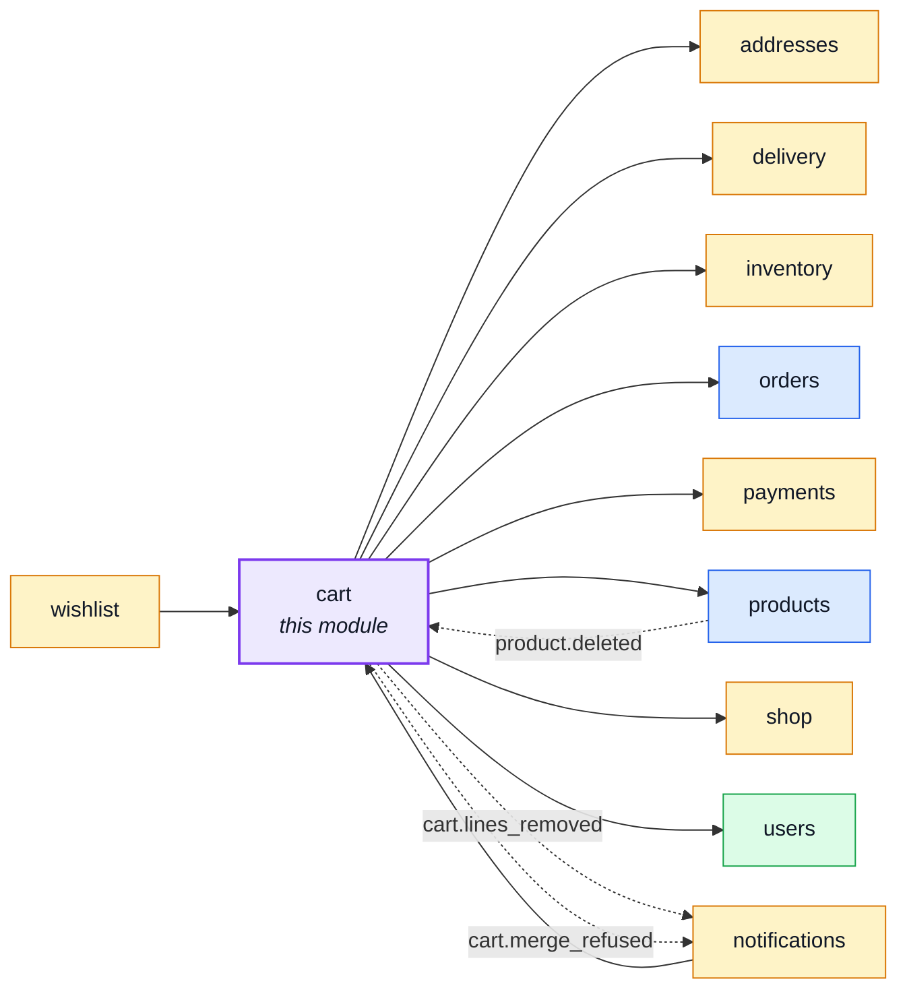
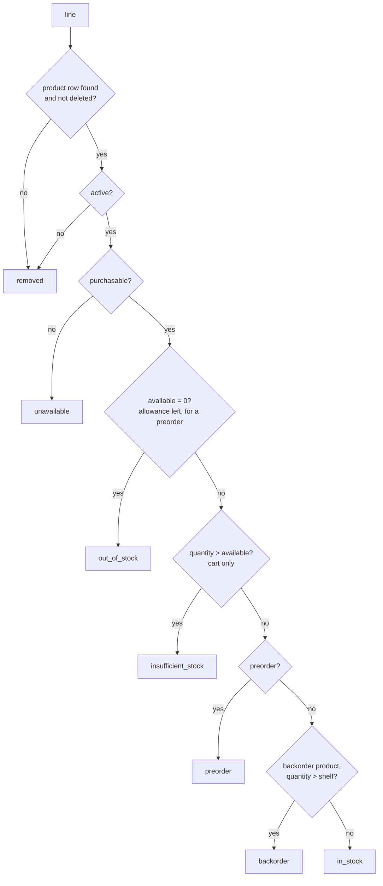
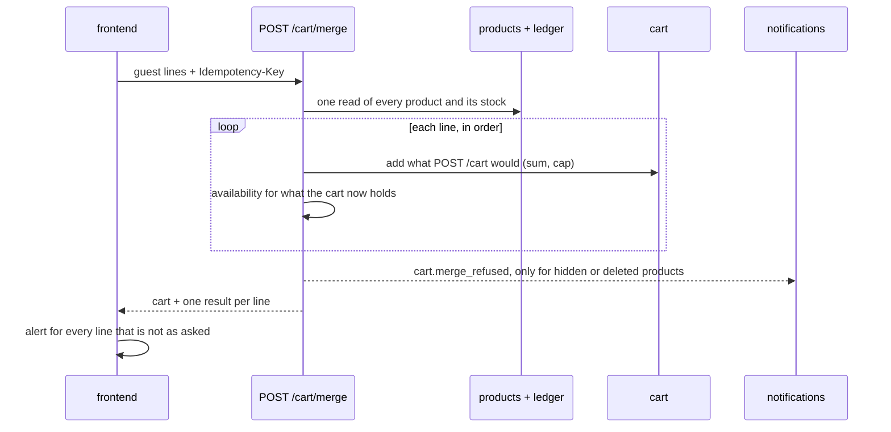
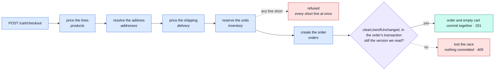

# cart

::: tip At a glance
**Owns** — one cart document per user, priced against the live catalogue, and the checkout that ends it.
**Depends on** — seven modules. Checkout is where every rule in the shop has to agree at once.
**Breaks if you change** — `clearLinesIfUnchanged`. It is what stops two parallel checkouts becoming two orders.
:::

## Its neighbourhood

<!-- module-graph:cart:start -->

_Solid arrows are imports. Dotted arrows are domain events — the return path an import
graph cannot see._

<!-- module-graph:cart:end -->

## The story

Checkout is the one place price, stock, address, shipping and order creation must all agree at
the same instant, and that is why this module carries more edges than any other. **The seven arrows
are not a smell to be refactored away — they are what a checkout is.** This module is a customer of
those contexts rather than an orchestration layer sitting above them.

A cart is its own collection keyed by `userId`, not a subdocument of the user. Two things follow,
and both are the point: a user response cannot leak a cart it does not carry, and touching a cart
reads and writes one small document instead of the whole account.

::: warning The concurrency rule
`unique: true` on `userId` makes "one cart per user" a database fact rather than something every
write path has to remember — which is what lets every mutation be a single upsert. Checkout then
empties the cart _conditionally on the version it read the lines at_. Remove that condition and two
parallel checkouts turn one cart into two orders.
:::

The second index, `items.productId: 1`, exists for exactly one query: a deleted product has to find
every cart holding it. Without the index that read scans the collection. A third, TTL index on
`updatedAt` (`NODE_CART_RETENTION_DAYS`) drops an abandoned cart; any touch restarts its clock.
Changing the window needs `npm run db:sync`.

Field names match the contract's `CartItem` — `{ productId, quantity }` — so a stored line and a
wire line are the same shape, and there is no mapper between them to keep in sync.

**A line holds at most `NODE_CART_LINE_MAX` units** (default 10, the contract's hard ceiling is 999):
a `PUT` past it and an add that would push a line past it answer 422
`CART_QUANTITY_LIMIT`, a reorder clamps to what room is left instead, and checkout re-checks every line, so a basket
filled before the ceiling was lowered is refused with the lines named rather than quietly trimmed.
It is one of three caps on denial of inventory, with `NODE_MAX_OPEN_UNPAID_ORDERS_PER_ACCOUNT` and
`NODE_RESERVATION_TTL_MINUTES` — see [checkout](./cart-checkout.md).

Mongo and not Redis, deliberately: Redis here is cache-only, with no persistence and `allkeys-lru`
eviction. A cart in Redis would make concurrent writes race-free for nothing, paid for in
durability — and would turn one indexed query into a hand-maintained secondary index.

## Stock checked in three places

One rule answers "what can this line do right now", in the cart's domain layer
(`src/modules/cart/domain/availability.ts`), and three callers share it. All three read the **stock ledger**
(`inventoryService.availableFor`, one batched read per request), never the catalogue's cached copy,
so a line cannot read as fitting and then be refused at checkout.

| Where        | When                               | What happens on a line that cannot be bought as it stands                   |
| ------------ | ---------------------------------- | --------------------------------------------------------------------------- |
| **Checkout** | `POST /cart/checkout`              | Refused, naming the line, the quantity asked for and its `availability`     |
| **Merge**    | `POST /cart/merge`                 | The line keeps its quantity and comes back with its `availability`          |
| **View**     | every answer that carries the cart | The line carries its `availability`; a client polling `GET /cart` learns it |

**No number is ever disclosed.** The value says short, not how many are left: exact stock is for
callers holding `read:StockLevel` ([Reading the shelf](../theory/defences/authorization.md)).
That is also why the merge never lowers a short line: lowering it to what is for sale would let
anyone read the stock by merging 999.

`POST /cart` and `PUT` do not refuse a line for stock or for being off sale, so the gate that
refuses is checkout.

## Line availability

One derived value on every cart line, wishlist line and merge result. The names are Google's feed
vocabulary.

| `availability`       | Means                                                                                            | Shopper copy (frontend)               | Checkout |
| -------------------- | ------------------------------------------------------------------------------------------------ | ------------------------------------- | -------- |
| `in_stock`           | buyable, enough stock                                                                            | none                                  | ok       |
| `preorder`           | buyable before its release date, the allowance covers it                                         | "Preorder, ships from {date}"         | ok       |
| `backorder`          | released, out of stock, kept on sale: the shelf covers less than the line asks, the rest is owed | "Backorder", always with its promise  | ok       |
| `insufficient_stock` | some left, fewer than the line wants (cart lines only)                                           | "Only fewer left, lower the quantity" | refused  |
| `out_of_stock`       | none left                                                                                        | "Sold out"                            | refused  |
| `unavailable`        | taken off sale (`purchasable: false`)                                                            | "Not available right now"             | refused  |
| `removed`            | hidden (`active: false`), or deleted and not yet pulled                                          | "No longer available", no title       | refused  |

First match wins, in this order: removed, unavailable, out_of_stock, insufficient_stock, preorder,
backorder, in_stock. The wishlist asks the same function without a quantity, so it never yields
`insufficient_stock`.

A preorder product (`active && purchasable && releaseDate > now`, see
[products](./products.md#preorder)) is judged against its **allowance**, not the shelf: the cart
tells `inventory` which products are preorders (`availableFor(ids, preorderIds)`) and gets back what
is left of `backorderLimit`. So `out_of_stock` on a preorder line means the allowance is full, however
much sits on the shelf, and `insufficient_stock` means it has fewer left than the line wants. Nothing
else changes: a basket may mix a preorder with goods in stock, since the order splits into fulfillment
orders by release date (see [delivery](./delivery.md)).

A released product the shop keeps selling while it is out of stock (`allowBackorder`, see
[products](./products.md#backorder)) is judged against the shelf **and** the room under the cap
together. `availableFor` answers two numbers per product, what can be sold and what is on the shelf,
and the rule needs both:

| Shelf | Room on the cap | The line asks | Reads                | Why                                |
| ----- | --------------- | ------------- | -------------------- | ---------------------------------- |
| 5     | any             | 3             | `in_stock`           | the shelf covers it                |
| 2     | 10              | 3             | `backorder`          | two now, one owed                  |
| 0     | 10              | 3             | `backorder`          | all owed                           |
| 0     | 2               | 3             | `insufficient_stock` | shelf and room together fall short |
| 0     | 0               | 1             | `out_of_stock`       | nothing to sell                    |
| any   | 5               | wishlist      | `backorder` at 0     | a wishlist line has no quantity    |

The cart shows the bare label, never "2 now, 1 later": buyers are not told a stock number, and "2
now" is one. After ordering, the order page's fulfillment orders show what ships when.

Adding a hidden product stays a 404 (`POST /cart`, a wishlist add, `PUT /cart/{id}`): a new add
must not reveal that a hidden product exists. An off-sale product is accepted, as a sold-out one
is. The states themselves are in [products](./products.md#product-states).

## Merging a guest cart

A cart built while signed out lives in the browser. At sign-in the client sends it in one call,
`POST /cart/merge`, and the cart folds it in by `POST /cart`'s own rule: a product held in both
carts ends at the sum, capped at `NODE_CART_LINE_MAX`. The answer is the cart as it now stands plus
**one result per submitted line, in request order**: what the guest asked for (`requested`), what the
cart holds now (`resulting`), a `reason` when the two differ, and the line's `availability`.

| Line                                           | Result                                                             |
| ---------------------------------------------- | ------------------------------------------------------------------ |
| a new product                                  | added; no `reason`                                                 |
| already in the cart                            | added to the line, `reason: summed`                                |
| the sum passes the ceiling                     | the line stops at the ceiling, `reason: capped`                    |
| sold out, or short                             | added anyway, `availability: out_of_stock` or `insufficient_stock` |
| taken off sale                                 | added anyway, `availability: unavailable`                          |
| not shown by the catalogue (deleted or hidden) | nothing added, `reason: removed`, one notification                 |

One bad line is a result, never a failure: the call answers 200 and the rest still land. The
request carries an `Idempotency-Key`, so a lost answer replays instead of adding twice (the server
keeps keys 24 hours). Lines are merged one at a time because each add rewrites the same cart
document; a product listed twice sees its first line's result.

## The pipeline

The arrows, in the order checkout walks them. [Checkout](./cart-checkout.md) draws the same
flow at step-by-step resolution, including the lost race.

## Configuration

| Variable                                  | Default | What it does                                                                                                                                                                                           |
| ----------------------------------------- | ------- | ------------------------------------------------------------------------------------------------------------------------------------------------------------------------------------------------------ |
| `NODE_CART_RETENTION_DAYS`                | `365`   | Days an untouched cart survives before the TTL index drops it                                                                                                                                          |
| `NODE_CART_LINE_MAX`                      | `10`    | Most units one line may hold, 1 to 999. See [the story](#the-story)                                                                                                                                    |
| `NODE_MAX_OPEN_UNPAID_ORDERS_PER_ACCOUNT` | `2`     | How many unpaid (`pending`) orders one account may hold, whatever the payment method; each holds stock. Checkout refuses the next with 409 `CART_OPEN_ORDER_LIMIT`. Admin `POST /orders` is not capped |

The open-order cap is a checkout rule, not an order rule: the error code, the message and the
checkout-only scope are all `cart`'s. Checkout asks `orders` for `openUnpaidOrderIds` and compares
the count itself. Parallel checkouts cannot slip past it, because only the one that clears the
cart's lines wins ([the race](./cart-checkout.md#the-race-and-why-it-is-a-409)).

## Who can do what

Every rule this module declares and who holds it, role by role. The rule is what a route guard asks for; the set is what a role lists.

<!-- permissions:start -->

| Rule            | Set            | `guest` | `unverified` | `customer` | `manager` | `warehouse` | `support` | `editor` | `moderator` | `admin` | `operator` | Credential | What it lets them do                                                                          |
| --------------- | -------------- | ------- | ------------ | ---------- | --------- | ----------- | --------- | -------- | ----------- | ------- | ---------- | ---------- | --------------------------------------------------------------------------------------------- |
| `update:Cart`   | `CartShopping` | —       | ✅           | ✅         | ✅        | ✅          | ✅        | ✅       | ✅          | ✅      | —          | ✅         | Use a basket at all — add to it, change it, reorder into it. Held by every signed-in account. |
| `checkout:Cart` | `CartCheckout` | —       | —            | ✅         | ✅        | ✅          | ✅        | ✅       | ✅          | ✅      | —          | ✅         | Spend the caller's own basket — place an order and start paying for it.                       |

✅ held · `own` only the caller’s own rows · ⚡c / ⚡s needs a freshly proved session (critical / sensitive) ·
Credential: ✅ when an API key can be minted with the rule. Generated from the rules and sets in
`src/modules/*/authorization.yaml` and the roles in `shared/authorization-roles.yaml`, asked of the
evaluator — [Authorization](../theory/authorization.md) explains the model.

<!-- permissions:end -->

## Related pages

- [Checkout](./cart-checkout.md) — the flow, step by step
- [`orders`](./orders.md) — what a checkout produces
- [`inventory`](./inventory.md) — who holds the units while a checkout runs
- [Redis Cache](../tools/redis-cache.md) — why the cart is not in it
- [Strategic DDD](../theory/strategic-ddd.md) — reading a seven-edge context map
