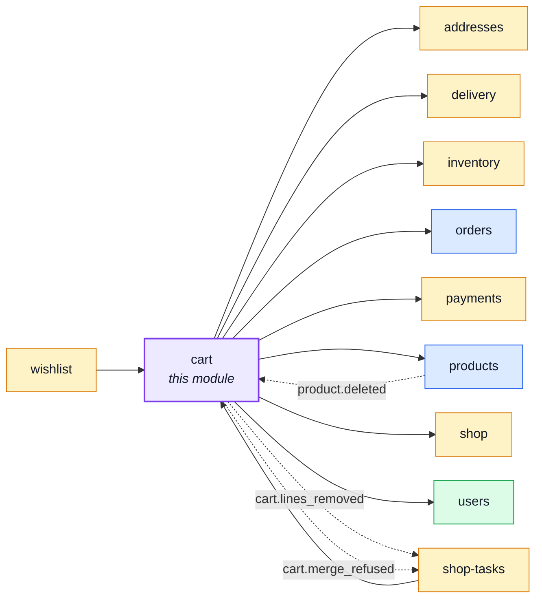
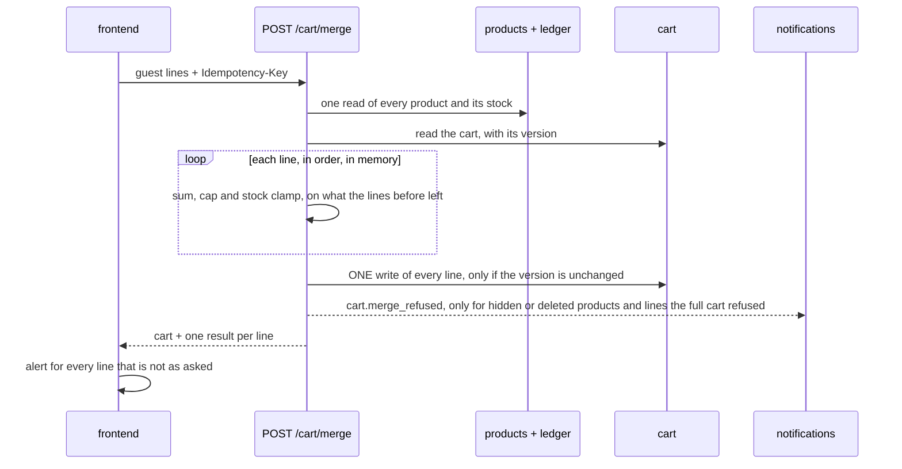
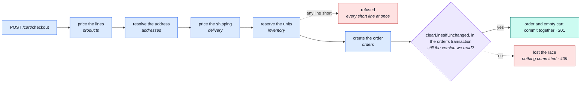

# cart

One document per user, and checkout, the transaction the whole shop turns on.

::: tip At a glance
**Owns** — one cart document per user, priced against the live catalogue, and the checkout that ends it.
**Depends on** — more modules than any other. Checkout is where every rule in the shop has to agree at once.
**Breaks if you change** — `clearLinesIfUnchanged`. It is what stops two parallel checkouts becoming two orders.
:::

## Its neighbourhood

<!-- module-graph:cart:start -->

_Solid arrows are imports. Dotted arrows are domain events — the return path an import
graph cannot see._



<!-- module-graph:cart:end -->

## Who can do what

Every rule this module declares and who holds it, role by role. The rule is what a route guard asks for; the set is what a role lists.

<!-- permissions:start -->

| Rule            | Set            | `guest` | `unverified` | `customer` | `manager` | `warehouse` | `support` | `editor` | `moderator` | `admin` | `operator` | Credential | What it lets them do                                                    |
| --------------- | -------------- | ------- | ------------ | ---------- | --------- | ----------- | --------- | -------- | ----------- | ------- | ---------- | ---------- | ----------------------------------------------------------------------- |
| `checkout:Cart` | `CartCheckout` | —       | —            | ✅         | ✅        | ✅          | ✅        | ✅       | ✅          | ✅      | —          | ✅         | Spend the caller's own basket — place an order and start paying for it. |

✅ held · `own` only the caller’s own rows · ⚡c / ⚡s needs a freshly proved session (critical / sensitive) ·
Credential: ✅ when an API key can be minted with the rule. Generated from the rules and sets in
`src/modules/*/authorization.yaml` and the roles in `shared/rules/authorization-roles.yaml`, asked of the
evaluator — [Authorization](../understand/authorization.md) explains the model.

<!-- permissions:end -->

## The story

Checkout is the one place price, stock, address, shipping and order creation must all agree at
the same instant, and that is why this module carries more edges than any other. **The arrows
are not a smell to be refactored away — they are what a checkout is.** This module is a customer of
those contexts rather than an orchestration layer sitting above them.

A cart is its own collection keyed by `userId`, not a subdocument of the user. Two things follow,
and both are the point: a user response cannot leak a cart it does not carry, and touching a cart
reads and writes one small document instead of the whole account.

::: warning The concurrency rule
`unique: true` on `userId` makes "one cart per user" a database fact rather than something every
write path has to remember — which is what lets every mutation be a single upsert. Checkout then
empties the cart _conditionally on the version it read the lines at_. Remove that condition and two
parallel checkouts turn one cart into two orders.
:::

The second index, `items.productId: 1`, exists for exactly one query: a deleted product has to find
every cart holding it. Without the index that read scans the collection. A third, TTL index on
`updatedAt` (`NODE_CART_RETENTION_DAYS`) drops an abandoned cart; any touch restarts its clock.
Changing the window needs `npm run db:sync`.

Field names match the contract's `CartItem` — `{ productId, quantity }` — so a stored line and a
wire line are the same shape, and there is no mapper between them to keep in sync.

**A line holds at most `NODE_CART_LINE_MAX_QUANTITY` units** (default 10, the contract's hard ceiling is 999):
a `PUT` past it and an add that would push a line past it answer 422
`CART_QUANTITY_LIMIT`, a reorder clamps to what room is left instead and reports it per line (`capped`), and checkout re-checks every line, so a basket
filled before the ceiling was lowered is refused with the lines named rather than quietly trimmed.
It is one of three caps on denial of inventory, with `NODE_MAX_OPEN_UNPAID_ORDERS_PER_ACCOUNT` and
`NODE_RESERVATION_TTL_MINUTES` — see [checkout](./cart-checkout.md).

**A cart holds at most `NODE_CART_MAX_LINES` lines** (default 100, at most 500). `GET /cart` is never
paginated, so the number of lines is bounded where one is written: 100 is the guest cart's own cap
(`MAX_GUEST_LINES` in the frontend), so a guest cart always merges, and Stripe Checkout's; 500 is
Shopify's ceiling. A NEW product in a full cart answers `409 CART_LINE_LIMIT_REACHED`; raising a line
already there is never refused. The cap is a condition in the push's filter (`items.99` must not
exist), which mongod evaluates while holding the document, so a burst of adds cannot all see room. A
filter that misses on an existing cart collides with the unique `userId` index; one more read tells a
full cart from a lost race, which the write's own retry converges. A merge or reorder does not fail on
it: the line is reported `cart_full` (see [merging](#merging-a-guest-cart)), and a reorder where
no line fits answers the same 409. Lowering the cap leaves
a bigger cart as it is: only a new line is refused.

Mongo and not Redis, deliberately: Redis here is cache-only, with no persistence and `allkeys-lru`
eviction. A cart in Redis would make concurrent writes race-free for nothing, paid for in
durability — and would turn one indexed query into a hand-maintained secondary index.

## Why a line has no id

One product is one line, so the product id names the line (`/cart/items/{productId}`,
`updateCartItemByProductId`, `deleteCartItemByProductId`). With variants or options two lines could
hold the same product, so each line would get its own id: the address becomes
`/cart/items/{itemId}` and the operations become `updateCartItemById` / `deleteCartItemById`. What
that costs then: the model, the contract, the frontend cart store, the guest merge, reorder and the
wishlist's "move to cart".

## Stock checked in three places

Stock is read from the **stock ledger**, never the catalogue's cached copy
(`inventoryService.liveAvailabilityOf` for the view and the writes, `availableFor` for checkout; one
batched read per request), so a line cannot read as fitting and then be refused at checkout. A cart
reserves nothing: a sale can land between any read and any write, so checkout stays the real gate.

| Where                | When                                                              | What happens on a line that cannot be bought as it stands                                |
| -------------------- | ----------------------------------------------------------------- | ---------------------------------------------------------------------------------------- |
| **Checkout**         | `POST /cart/checkout`                                             | Refused (409), naming the line, the quantity asked for and `quantityAvailable`           |
| **Writes and merge** | `POST`/`PATCH /cart/items`, wishlist move-to-cart, merge, reorder | **Clamped**: the write succeeds at the most that can be bought, and `warnings[]` says so |
| **View**             | every answer that carries the cart                                | The line carries the product's own stock answer; a client polling `GET /cart` learns it  |

**The number is public.** `quantityAvailable` is the shopper's number (Shopify's
`ProductVariant.quantityAvailable`): the shelf, plus the room under the backorder cap for a product
open to backorder, or only the room for a preorder. Absent means no limit (an uncapped backorder),
`0` means it cannot be bought. What stays behind `read:StockLevel` is the raw `onHand`, `reserved`
and the movements ([Reading the shelf](../understand/defences/authorization.md)).

### The clamp

A write that asks for more than `quantityAvailable` still answers 200, with the line at the most
that can be bought (and never above `NODE_CART_LINE_MAX_QUANTITY`), plus a `warnings[]` entry, the
shape of Shopify's `CartWarning`: `{code, productId, requested, resulting}`.

| Code                           | Means                                                      |
| ------------------------------ | ---------------------------------------------------------- |
| `MERCHANDISE_NOT_ENOUGH_STOCK` | some can be bought, fewer than asked: the line holds that  |
| `MERCHANDISE_OUT_OF_STOCK`     | none can be bought (sold out, off sale): nothing was added |

The codes are spelled as Shopify spells them, a value another standard defines
([enum values](../build/openapi-workflow.md#generated-output-api-generated)). Every clamp is also logged at info.

- A line **above** the number (a sale lowered it) is never lowered by a write that did not ask for
  it: raising it stops at what it holds, lowering is always allowed.
- A new line that clamps to nothing is not created.
- The write reads stock first and then writes, so a sale can slip between the two. That is the
  accepted race; checkout is the gate.

`PATCH /cart/items/{productId}` of a line the cart does not hold stays a 404, not a stock matter.

## Line availability

Every signed-in cart line carries the product's **own** stock answer, the same words and numbers as
`GET /products/{id}/availability` ([inventory](./inventory.md#the-availability-reads)):

```json
{
    "productId": "…",
    "quantity": 3,
    "availability": "in_stock",
    "quantityAvailable": 12,
    "quantityBackordered": 1,
    "canIncrease": true
}
```

| Field                 | Means                                                                                                                             |
| --------------------- | --------------------------------------------------------------------------------------------------------------------------------- |
| `availability`        | Google's four: `in_stock`, `out_of_stock`, `preorder`, `backorder`                                                                |
| `availabilityDate`    | the release date of a preorder, the restock date of a backorder                                                                   |
| `quantityAvailable`   | how many can be bought now; `0` exactly when `out_of_stock`; absent is no limit                                                   |
| `quantityBackordered` | units of THIS line that ship later (Magento's `qty_backordered`): a preorder's all, a backorder's past the shelf; absent for none |
| `canIncrease`         | `quantity` is below both the shop's line ceiling and `quantityAvailable`                                                          |

One meaning per word, so `out_of_stock` ⇔ `quantityAvailable: 0`, and that covers a product that is
hidden, deleted or off sale. A client tells those apart from the product details it already holds
(`purchasable: false`, a missing or `active: false` product, else sold out). "Too many in the line"
is `quantity > quantityAvailable`, worked out by the client the way Shopify does.

The judge is the server for the signed-in cart and the frontend, from the cached availability read,
for the guest cart. A guest cart cannot know `quantityBackordered` (no shelf is served), so "ships
later" appears after sign-in.

A line has no `removed`, `unavailable` or `insufficient_stock` any more. Checkout still names each
case for itself through its refusal ([checkout](./cart-checkout.md#which-lines-are-refused-and-as-what)).

A preorder product (`active && purchasable && releaseDate > now`, see
[products](./products.md#preorder)) is judged against its **allowance**, not the shelf, and a
released product kept on sale while out of stock (`allowBackorder`, see
[products](./products.md#backorder)) against the shelf **and** the room under the cap together;
inventory's availability read does both, so the cart does not repeat it.

| Shelf | Room on the cap | Reads          | `quantityAvailable` | A line of 3 holds `quantityBackordered` |
| ----- | --------------- | -------------- | ------------------- | --------------------------------------- |
| 5     | any             | `in_stock`     | 5 + room            | none                                    |
| 2     | 10              | `in_stock`     | 12                  | 1                                       |
| 0     | 10              | `backorder`    | 10                  | 3                                       |
| 0     | 0               | `out_of_stock` | 0                   | the line cannot be added                |

The judging order itself is pinned for both backends by `shared/cases/availability.cases.yaml`.

Adding a hidden product stays a 404 (`POST /cart/items`, a wishlist add, `PATCH /cart/items/{id}`): a new add
must not reveal that a hidden product exists. An off-sale product cannot be added either: its
`quantityAvailable` is 0, so the add succeeds with nothing added and a `MERCHANDISE_OUT_OF_STOCK`
warning. The states themselves are in [products](./products.md#product-states).

The cart answers two flags so a client holds no copy of the rule: each line's `canIncrease` and the
cart's `checkoutable` (not empty, and every line on sale, shown and no larger than its
`quantityAvailable`: the same verdict checkout's refusal reaches). A shipping method and an address
are separate steps and not part of it.

## Merging a guest cart

A cart built while signed out lives in the browser. At sign-in the client sends it in one call,
`POST /cart/merge`, and the cart folds it in by `POST /cart/items`' own rule: a product held in both
carts ends at the sum, capped at `NODE_CART_LINE_MAX_QUANTITY`. The answer is the cart as it now stands plus
**one result per submitted line, in request order**: what the guest asked for (`requested`), what the
cart holds now (`resulting`) and a `reason` when the two differ. A line stock held back is also named in
`warnings[]`, as for [`POST /cart/items`](#the-clamp).



| Line                                             | Result                                                                    |
| ------------------------------------------------ | ------------------------------------------------------------------------- |
| a new product                                    | added; no `reason`                                                        |
| already in the cart                              | added to the line, `reason: summed`                                       |
| the sum passes the ceiling                       | the line stops at the ceiling, `reason: capped`                           |
| short                                            | added up to `quantityAvailable`, a `MERCHANDISE_NOT_ENOUGH_STOCK` warning |
| sold out, or taken off sale                      | nothing added, a `MERCHANDISE_OUT_OF_STOCK` warning                       |
| already held above what can be bought            | nothing added, no `reason`, a `MERCHANDISE_NOT_ENOUGH_STOCK` warning      |
| not shown by the catalogue (deleted or hidden)   | nothing added, `reason: removed`, one notification                        |
| a new product, and the cart holds the most lines | nothing added, `reason: cart_full`, one notification                      |

One bad line is a result, never a failure: the call answers 200 and the rest still land. The
request carries an `Idempotency-Key`, so a lost answer replays instead of adding twice (the server
keeps keys 24 hours).

**All lines land together or none do.** Every line is planned in memory, in request order (a product
listed twice sees its first line's result), then written in ONE `findOneAndUpdate` on the cart
document, filtered on the `__v` the plan was read at: the same optimistic guard checkout uses to
empty the cart. A cart that changed meanwhile fails the filter, so the cart is read and planned again
(three attempts, then an error). A failure therefore leaves the cart as it was, and a client that
resends after a 5xx under a new key cannot add a line twice. No transaction is needed, and the answer
is the document the write returned. Analytics events are sent after the write, one per line that
grew. `POST /cart/reorder` goes through the same write.

The `cart.merge_refused` notice is a courtesy to the shopper, not part of the merge: the names it
carries come from the products the plan already read, and a name lookup that fails is logged and
sends that line with no names, never a 500 for a cart that was already written.

## The pipeline

The arrows, in the order checkout walks them. [Checkout](./cart-checkout.md) draws the same
flow at step-by-step resolution, including the lost race.



## Configuration

| Variable                                  | Default | What it does                                                                                                                                                                                                   |
| ----------------------------------------- | ------- | -------------------------------------------------------------------------------------------------------------------------------------------------------------------------------------------------------------- |
| `NODE_CART_RETENTION_DAYS`                | `365`   | Days an untouched cart survives before the TTL index drops it                                                                                                                                                  |
| `NODE_CART_LINE_MAX_QUANTITY`             | `10`    | Most units one line may hold, 1 to 999. See [the story](#the-story)                                                                                                                                            |
| `NODE_CART_MAX_LINES`                     | `100`   | Most lines one cart may hold, 1 to 500. See [the story](#the-story)                                                                                                                                            |
| `NODE_MAX_OPEN_UNPAID_ORDERS_PER_ACCOUNT` | `2`     | How many unpaid (`pending`) orders one account may hold, whatever the payment method; each holds stock. Checkout refuses the next with 409 `CART_OPEN_ORDER_LIMIT_REACHED`. Admin `POST /orders` is not capped |

The open-order cap is a checkout rule, not an order rule: the error code, the message and the
checkout-only scope are all `cart`'s. Checkout asks `orders` for `openUnpaidOrderIds` and compares
the count itself. Parallel checkouts cannot slip past it, because only the one that clears the
cart's lines wins ([the race](./cart-checkout.md#the-race-and-why-it-is-a-409)).

## Read next

- [Checkout](./cart-checkout.md) — the flow, step by step
- [`orders`](./orders.md) — what a checkout produces
- [`inventory`](./inventory.md) — who holds the units while a checkout runs
- [Redis Cache](../understand/redis-cache.md) — why the cart is not in it
- [Strategic DDD](../understand/strategic-ddd.md) — reading a busy context map
