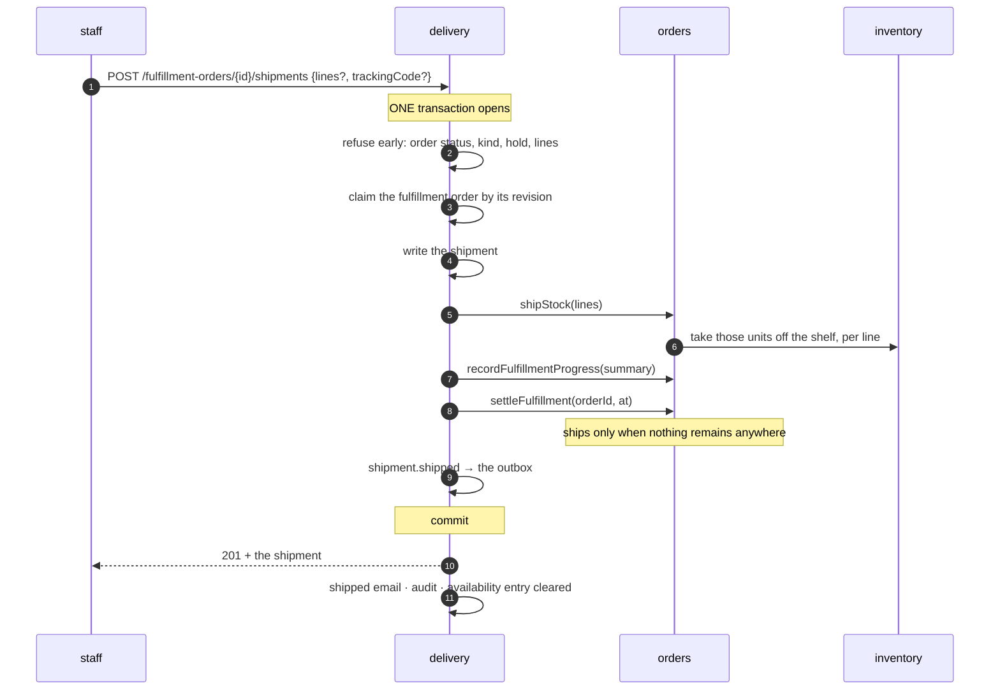

# Cutting, shipping and delivering

The three staff acts that move a shipment: one transaction per act, shipping, and delivering.

## One transaction per act {#one-transaction-per-act}

A ship, deliver, fulfil, hold, release or remainder cancel writes, together or not at all:
**the record**, **the order's summary**, **the order's status move when one is due**, **the outbox
events** — and, for a shipment, **the units leaving the shelf**. Refusals are decided before the first
write, inside the same snapshot the writes land in.

`orders` cannot import `delivery`, so the order carries a small **summary** (`fulfillment.shipped`,
`remaining`, `onHold`, `awaitingStock`, `undelivered`, `lastDeliveredAt`) that only `delivery` writes,
only through `orderService.recordFulfillmentProgress`, recomputed from the records themselves inside
the act's transaction. A stale read can never overwrite a newer one. The order's `fulfillmentStatus`
and its `cancel` and `withdraw` flags read that summary.

Two acts racing the same remainder cannot both land: each claims the fulfillment order by its
`revision`, in the filter of the write, and the loser gets a 409. A ship racing a cancel cannot both
win either: the summary write is conditional on the order still being fulfillable, and a whole-order
cancel is conditional on `fulfillment.shipped` not being set.

## Shipping {#shipping}

`POST /delivery/fulfillment-orders/{id}/shipments {lines?, trackingCode?}` → `201`.
`lines` omitted ships everything that remains. The order moves `processing → shipped` only when the
shipment leaves **nothing** remaining anywhere; until then it stays `processing`, and its
`fulfillmentStatus` reads `partially_fulfilled`. Refused:

| Case                                                                                          | Answer                                          |
| --------------------------------------------------------------------------------------------- | ----------------------------------------------- |
| more than remains, a product that is not there, the same twice                                | `422 DELIVERY_LINES_INVALID`                    |
| a fulfillment order on hold, closed or cancelled; a cancelled or never-paid (`pending`) order | `409 DELIVERY_NOT_SHIPPABLE`                    |
| a first shipment from `paid` that finds the order no longer `paid` (it moved meanwhile)       | `409 ORDER_NOT_PAID`                            |
| a `paid` order, for a caller without `start:Shipment` (the act makes the start move itself)   | `403` and a `security.forbidden` audit row      |
| a digital one                                                                                 | `409 DELIVERY_NOT_PHYSICAL` — fulfil it instead |
| an order that is neither `processing` nor `paid`                                              | `409 ORDER_NOT_PROCESSING`                      |

### Where a parcel went

The order holds one address: where the units still to send go. Each shipment stores its own copy as
`destination`, taken when it is cut (`services/cut.ts`, so ship, fulfil and the override's shipments
all get it), encrypted under the shipment's `_id` (`pii.ts`, same key ring as the order's). Staff can
therefore redirect the rest of a partly shipped order without rewriting where the first parcel
went. The copy is personal data of its own: it shows in the account export, follows the key rotation
(`reencrypt`), and is unset when the order's address is scrubbed (`order.redacted` →
`scrubDestinations`). A pickup or a digital fulfilment has none.

### Shipping from `paid`

Shipping from `paid` is an ordinary act, not an override: the act makes the `paid → processing` move
itself, in its own transaction, so the caller holds `update:Shipment` **and** `start:Shipment`.
`POST /orders/{id}/process` stays as an optional "mark in progress". The digital fulfil door works the
same way. `processing` has one effect for the buyer: self-cancel closes (it works from `pending` and
`paid` only); the legal right of withdrawal is not affected.

### Audit rows

`Shipment.forced` marks a shipment cut by an admin status override; arrival has no forced variant,
so recording one is a single act with a single door. A hold's and a release's
audit rows carry the hold's reason **code** (a release, the code of the hold it ended), never the
`holdNote`: free commentary that has no business in the operator log.

## Delivering {#delivering}

`POST /delivery/shipments/{id}/deliver` stamps the shipment. The order moves to `delivered` when this
was the last undelivered shipment **and** nothing remains to ship, and its withdrawal clock starts from
**that** arrival — CRD Art. 9(2)(b)(i): the 14 days run from physical possession of the last good
(Commission Notice 2021/C 525/01 §5.1.2: "a single withdrawal period should apply from the day after
delivery of the last item"). One window per order, from the last good; per-shipment windows would be
shorter than the law allows.

A `lost` shipment that turns up is recorded here too, when every unit on it is still open
([Lost in transit](./delivery.md#the-lost-parcel-turns-up)).

A remainder **cancelled after** every shipment was delivered makes the order `shipped` and `delivered`
in one transaction, the clock counted from the cancellation: the order only became complete then.

## Read next

- [delivery](./delivery.md) — the module's own page
