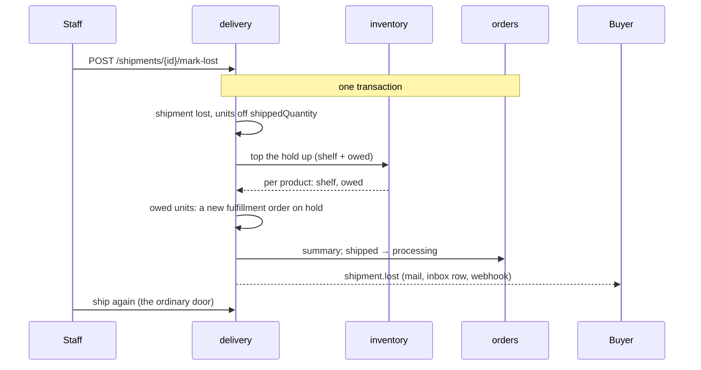

# Lost shipments and replacements

What happens when a shipment is lost in transit, and how a replacement follows a return.

## Lost in transit {#lost-in-transit}

`POST /delivery/shipments/{id}/mark-lost` (`update:Shipment`, no step-up) is for a parcel that left and
will not arrive: `{ reason: lost | damaged, note?, message? }`. **`damaged` means damaged in
transit and reported before its arrival was recorded.** Damage found after the buyer has the goods is
a [return](./returns.md), not this door. Only a `shipped` physical shipment on a `processing` or
`shipped` order can be reported (`DELIVERY_NOT_LOSABLE`).

The replacement lives on **the same order**: no new order, invoice, revenue or `order_created`, and the
shipping is not charged again. (A €0 order would need a price override, a fake `paid` and a €0 invoice,
and the original order would stay `shipped` for ever. Shopify's native model, like Solidus', also keeps
the lines on the same order.) The EU rules agree: risk passes only when the buyer has the goods (CRD
Art. 20), the reship is the original delivery duty (Art. 18), and the withdrawal clock and the
guarantee start at the replacement's arrival, which `markDelivered` already counts.

| Step              | What it does                                                                                                                                                                                                                                              |
| ----------------- | --------------------------------------------------------------------------------------------------------------------------------------------------------------------------------------------------------------------------------------------------------- |
| Shipment          | `shipped → lost`, with `lostAt`, `lostReason`, `lostMessage` (kept) and `lostNote` (reaped with the hold notes). One conditional write, so two reports of one parcel cannot both land                                                                     |
| Fulfillment order | every lost unit comes off the line's `shippedQuantity`, so the units are open again; staff ship them with the ordinary ship door. The net `shippedQuantity` is what `returns` gates on, so a buyer can never return twice what they bought                |
| Stock             | the hold is topped up with the shelf units that are free, never units held for another order. What the shelf cannot cover is **owed**: see below                                                                                                          |
| Order             | a `shipped` order steps back to `processing` (the system-only `reopen` edge, one of the two backward moves); a `processing` one stays                                                                                                                     |
| Records           | timeline `shipment_lost` (buyer-visible), audit `admin.shipment.lost` (the reason code only), event and webhook `shipment.lost` (the reason code, never the free text)                                                                                    |
| Buyer             | a mail with a fixed text per reason, what the parcel carried, what is owed and when, and staff's `message` in a quote; the same in the inbox (`shop-tasks.shipment-lost`). Always sent, there is no switch. The `note` is for colleagues and never leaves |
| Untouched         | no invoice, no credit note, no revenue                                                                                                                                                                                                                    |

A lost shipment still counts as shipped in the order's summary (`shipped: true`), which keeps the
whole-order cancel closed; it counts as neither out nor arrived (`undelivered` leaves it out).

### Cancelled and refunded after a loss

The buyer may take the money instead of a second parcel: cancelling the open units refunds them
(shipping included), and `returns` puts their stock back. The order's own `lost` cancel, below,
restocks nothing. What the order then ends as depends on whether anything ever arrived:

| What arrived                                  | The order ends | Why                                                                                       |
| --------------------------------------------- | -------------- | ----------------------------------------------------------------------------------------- |
| something (another parcel, or a digital line) | `delivered`    | part of the contract was performed; the clocks start at the cancel, as for any completion |
| nothing at all                                | `canceled`     | nothing was delivered, so `delivered` would be untrue                                     |

The second row is our choice, not Shopify's: Shopify leaves such an order open and refunded unless the
merchant cancels it. We settle it for them, with `settleOrder` asking `orders`' `settleFulfillment`, which picks the lost-parcel cancel
(cause `lost`, the system's, `refund: false` because the remainder cancel already refunded). Nothing
else runs: no withdrawal or guarantee clock, no `delivered` row, no second refund, no second stock
release, and no mail (the loss and the refund were already mailed). The `canceled` row is the
system's. The `order.canceled` listeners treat `lost` as no purchase-hold count and no refund, and
`returns`, which owns the transaction, writes the `order.canceled` audit row (system actor) and
sends the `order_canceled` analytics event once the transaction commits, through the callback
`settleOrder` hands back, exactly like any other cancel.

The move is its own lifecycle constant (`UNDELIVERABLE_EVENT`), not an actor on `cancelInFulfillment`:
a `system` actor on `processing → canceled` would let the three existing system cancels match orders
in fulfilment. The order is retained as "paid, cancelled without delivery" by the PII sweep, not on a
guarantee clock it never had. A parcel found afterwards answers `DELIVERY_NOT_DELIVERABLE`, and
`actions.deliver` is false.

### Owed after a loss, when the shelf is short

The lost units were already taken off the shelf when the parcel shipped, so only what the shelf has
free can be set aside again. The rest becomes a claim on the restock that **ignores the backorder
cap** (the cap limits new sales, not a promise the shop already made), first in the queue by the
original payment ([inventory](./inventory-reservations.md#owed-after-a-loss)). Those units go to a
**new fulfillment order**, `on_hold` for `awaiting_stock`, `cause: backorder`, dated by the products'
restock dates or the 30-day default, and linked to the loss (`sourceShipmentId`). The original
fulfillment order is not held: the units the shelf covered ship at once.

On the original line, `shippedQuantity` drops by **all** the lost units and `quantity` drops by the
owed part, which the new order carries, so what the order holds never exceeds what was bought. Stock
arriving releases the owed order through the same allocation as any backorder; the buyer can still
cancel it, and a product deleted since has no stock row, so the loss is recorded with no claim.

### The lost parcel turns up

`POST /delivery/shipments/{id}/deliver` accepts a `lost` shipment **if and only if every unit on it is
still open**: the shelf part still unshipped and uncancelled on the original fulfillment order, and
every owed unit still unshipped and uncancelled on the orders linked to the loss. All or nothing, in
the arrival's transaction:

- the shipment becomes `delivered` (`lostAt` and `lostReason` stay as history);
- the units go back onto the original order as shipped, and the owed orders close with
  `cancelReason: found` and no refund;
- the top-up is given back and the hold ends `shipped`, not `released`;
- the order settles as for any arrival, the clock starting at this one.

Otherwise it answers `409 DELIVERY_LOST_SUPERSEDED`, which protects the counts, not a policy: taking
them back would count the goods twice. `ShipmentActions.deliver` is true for a lost shipment exactly
when the condition holds.

**What the shop does about the second parcel** is a guide matter: ask for one back or let the buyer
keep it ([The lost parcel arrived](../use-the-shop/when-something-goes-wrong-orders-and-delivery.md#lost-parcel-arrived)).
A parcel returned to sender needs no door of its own: receive the units
([It came back to us](../use-the-shop/when-something-goes-wrong-orders-and-delivery.md#parcel-came-back)), then ship them again.

For the accountant, the shipment with its tracking code and note is the loss documentation: Italy
presumes goods that went missing were sold unless the loss is documented (DPR 441/1997).

## Replacement after a return {#replacement-after-a-return}

A return received with `remedy: replace` ([returns](./returns.md#the-remedy-ladder)) sends the same
product again on the **same order**: no new order, invoice or revenue. It reuses a lost parcel's
machinery, in the receipt's own transaction:

- the returned units come off `shippedQuantity` of the fulfillment orders they shipped from (the
  latest first), so they are open again; the order steps back `delivered → processing`;
- the stock hold is topped up from the free shelf (`reserveMoreForOrder`); what the shelf cannot
  cover is owed on a new fulfillment order on hold (`cause: backorder`), outside the backorder cap;
- staff ship it through the ordinary shipping door. The arrival keeps the order's first
  `withdrawUntil` (a replacement does not restart the withdrawal clock) and only ever pushes
  `conformityUntil` out.

If the order never shipped that many physical units the receipt answers `409 DELIVERY_NOT_REOPENABLE`
and writes nothing.

## Read next

- [delivery](./delivery.md) — the module's own page
