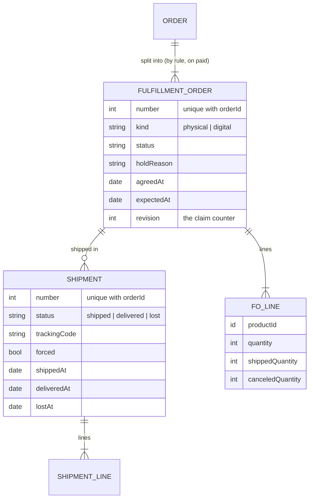
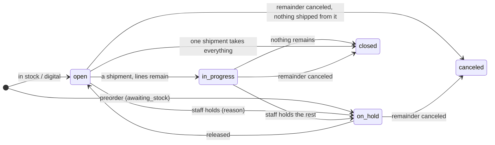
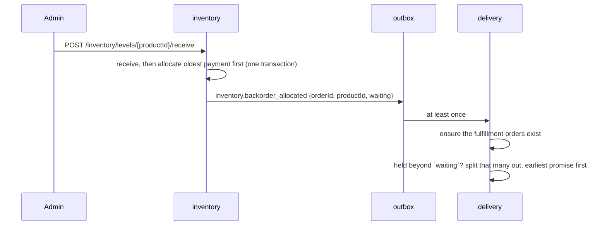
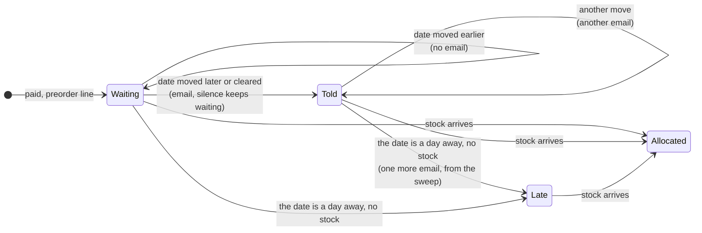
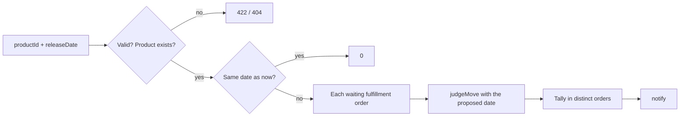

# Fulfillment orders and shipments

The fulfillment order and the shipment: what each holds, who writes it, and how they move together.

## The two records {#the-two-records}

One order, one payment, one invoice, as many shipments as it takes. The model is Shopify's, both
layers: the **plan** (what should leave together, and when) and the **act** (what left).

| Word                  | Means                                                                       | Shopify            |
| --------------------- | --------------------------------------------------------------------------- | ------------------ |
| **Fulfillment order** | lines that should leave together, made by the system when the order is paid | `FulfillmentOrder` |
| **Shipment**          | what actually left, at one time, with one tracking code                     | `Fulfillment`      |
| Box                   | the physical carton — not modelled                                          | —                  |

`remaining = quantity − shippedQuantity − canceledQuantity`, per line, and the server serves it so no
client counts. Lines are keyed by product id, as a return's lines are. A fulfillment order's status
is never decided by a caller: it is derived from its lines and its hold on every write
(`statusOfLines`).

- `closed` — nothing remains, and something shipped from it. `canceled` — nothing ever shipped from it.
- A shipment is born `shipped` and becomes `delivered`, or `lost` when staff report it will not arrive
  ([Lost in transit](./delivery-lost-and-replaced.md#lost-in-transit)); a **digital** fulfilment is born delivered, in the same write
  (Shopify fulfils digital goods without shipping them too).
- The moves are one table, `domain/lifecycle.ts`: `deliver` and `lose` from `shipped`, `find` from
  `lost`. The repository writes and the `actions` flags both ask it. A digital shipment's birth as
  `delivered` is not a move, so the table does not list it.

### The grouping rule

Pure, in `domain/fulfillment.ts`, over the order's **frozen** line snapshot:

| Lines                                                          | Fulfillment order                                                                                                                                       |
| -------------------------------------------------------------- | ------------------------------------------------------------------------------------------------------------------------------------------------------- |
| everything that is neither a preorder nor `noWithdrawal`       | #1, `open`. `physical` if any line ships, `digital` otherwise. Digital lines of a mixed order ship with the physical ones                               |
| `noWithdrawal` lines (made to order, perishable) that ship now | the next one, `open`, on their own — the shop's work on them is not cancelled with the rest                                                             |
| preorder lines, release day D                                  | one per distinct day and per `noWithdrawal` value, `on_hold` for `awaiting_stock`, `agreedAt = expectedAt =` the latest release date of its lines       |
| the owed part of a line the shelf half covered, promised day D | the shelf part ships in #1; the owed part is its own group per day, cause and `noWithdrawal` value, `on_hold`, dated by the promise frozen on the order |

The preorder flag and the date are read from the snapshot frozen at checkout, never from the product
at payment time: a bank transfer can be paid a week after it was ordered. `agreedAt` is the day the
buyer was shown, and it never moves; `expectedAt` starts equal to it and is rewritten if the date
slips. Both (and the board's `firstAgreedAt`) go out as plain shop days (`YYYY-MM-DD`) and are
stored as the UTC instant of that day's shop midnight; the 30-day backorder default is the one
promise that is an arbitrary instant, and is also answered as the day it falls on. "Moved later"
compares days, so a move inside the same shop day sends no delayed notice. A group of one day leaves together, so it is promised for the latest release instant among
its lines. "One day" is the shop's calendar day (`NODE_SHOP_TIMEZONE`): staff type a date on the shop's
wall clock, so two instants UTC splits can still be the same day. The emails print those dates in the
same zone, so the day staff typed is the day the buyer reads. A product line that carries neither flag simply lands in #1.

The split is decided at payment; the cart shows each line's date and a notice on any basket with a later line.

### Holds

| Reason                                               | Set by            | Released by                                                                                                                        |
| ---------------------------------------------------- | ----------------- | ---------------------------------------------------------------------------------------------------------------------------------- |
| `awaiting_stock`                                     | the grouping rule | **only** the allocation of stock. A hand release would ship goods the ledger never counted out — a consistency guard, not a policy |
| `incorrect_address`, `high_risk`, `other` (+ a note) | staff, `…/hold`   | staff, `…/release`                                                                                                                 |

A fulfillment order is **never** shipped from `on_hold`.

**What the buyer sees is not the reason.** Staff's reason can be an internal call (a risk check), and
naming it tips off the people a check exists for, so the buyer gets one of three notices, mapped
once in `domain/hold-notice.ts`:

| Staff's reason       | The buyer reads                          | Mailed (and an inbox row)?                      |
| -------------------- | ---------------------------------------- | ----------------------------------------------- |
| `awaiting_stock`     | `holdNotice: awaiting_stock`             | never                                           |
| `incorrect_address`  | `check_address`: the buyer can act       | always                                          |
| `high_risk`, `other` | `delayed`: the same plain delay for both | only when staff wrote a `message` for the buyer |

A staff hold also records `heldAt` (removed on release; never set for `awaiting_stock`). The
daily staff digest counts holds older than `NODE_STAFF_HOLD_OPEN_DAYS` from it
([`shop-tasks`](./shop-tasks.md#the-staff-digest)).

Hiding the hold instead would put a false "being prepared" on a held order (UCPD Art. 6(1)(b)) and leave
a wrong address unfixable. `holdReason` and `holdNote` are staff's (and the buyer's own GDPR export);
`holdMessage`, the optional sentence staff write **for** the buyer (`message` on `…/hold`, at most 500
characters), is read by everyone and is dropped with the hold on release. It is not scrubbed with
the note: it is something the shop told a customer. A mail and an inbox row come from one fact,
`fulfillment_order.hold_noticed`, written in the hold's transaction. When the address is wrong, staff
correct it with [`PUT /orders/{id}/shipping-address`](./orders.md#correcting-the-shipping-address).

### A short stock delivery

A preorder line asked for 3 units and the stock that arrived covers 2. The allocation calls
`splitForAllocation`: the 2 allocated units move to a **new `open`** fulfillment order (the next
number, the dates copied) and can ship; the third stays `on_hold` for `awaiting_stock`. When the
arrival covers everything the hold simply ends. This is the system split (Shopify's
`fulfillmentOrderSplit`, CRD Art. 9(2)(b)(i) and the FTC Mail Order Rule all expect partial
shipment): waiting for all three would hold back goods already on the shelf, and a hand release is
refused. Staff have no button for it — they can still hold the new `open` order to ship everything
together. No route reaches it: `inventory` allocates, and this module listens.

**A refused split is not dropped.** If the split loses a race (the hold changed under it) the
listener throws, so the outbox retries the event; each retry recounts what is still held, so it only
releases what is left. A split that never succeeds ends as a dead event: the `OutboxEventsDead`
alert fires and the admin `outbox-dead` bell rings. Staff cannot release an `awaiting_stock` hold by
hand (the ledger never counted those goods out): the instrument is to [revive the dead event](../understand/outbox.md#poison-events), or to
cancel what has not shipped.

The event carries `waiting`, what the order still claims of that product, rather than how many were
allocated. A state survives redelivery: the listener releases whatever it holds beyond `waiting`, and
the second time there is nothing beyond it. If one order holds the same product for two release
dates, the earliest `agreedAt` is served first.

### Preorders and a moved date

The same flow serves a **backorder**: the owed part of a line waits on hold, dated by the promise
frozen on the order. A group carries its `cause` (`preorder` or `backorder`) and, when the promise was
the 30-day default, `defaulted`: a later change to the catalogue's date leaves such a group alone,
because the buyer was never promised a date. `product.restock_date_changed` is the backorder's twin of
the release-date event, and `GET /delivery/fulfillment-orders/restock-date-impact` its staff preview.
A delay is worded without the word preorder (`delivery.fulfillment-delayed`,
`shop-tasks.fulfillment-delayed`): late is late whatever the cause, and a preorder still waiting
after release is a backorder in all but name.

The buyer of a preorder was promised a date, and that promise is law: the date shown when ordering
is the agreed one (CRD Art. 18). `agreedAt` is frozen; `expectedAt` is the date the fulfillment
order is expected now. **This module owns the whole flow**, because both dates live on its
fulfillment order and `orders → delivery` is forbidden.

**The computer tells; a person decides.** The shop never asks the buyer a question and never
cancels on its own. When the date moves later, or is taken away, the buyer gets one email: the new
date (or "no date yet"), and that they can cancel from their order page for a full refund. If they
are happy to wait they do nothing: **silence always means keep waiting**. Staff see every late
order on the board's Late view and decide whom to call (see
[the staff routine](#what-staff-do-about-a-late-order)).

When an admin moves a product's `releaseDate`, `products` announces `product.release_date_changed`,
and every fulfillment order still waiting for that product is judged by a pure table
(`domain/preorder.ts`):

| The new date is...               | The buyer gets                                                  |
| -------------------------------- | --------------------------------------------------------------- |
| later than the date expected     | an email with the new date and the way to cancel                |
| none: the date was cleared       | an email saying there is no new date yet, and the way to cancel |
| not later than the date expected | nothing; the order page shows the new date                      |
| a date after a cleared one       | nothing; the order page shows it (good news needs no email)     |

Which date is expected is read from the catalogue, the latest release date among the products still
waiting, so a group of several stays right when one of them moves; the event only says that
something moved, and a redelivery finds the date already expected. A product that still waits with
no release date makes the whole group undated (it cannot leave before that product), and an undated
group has no `expectedAt` at all: a cleared date removes it, so a redelivered event finds nothing to
move and tells nobody twice. The fulfillment order carries the state: `agreedAt`, `expectedAt`,
`lastNoticeAt`, `dueNoticeFor` and `cancelReason`.

### Previewing a move before it is saved

`GET /delivery/fulfillment-orders/release-date-impact?productId=&releaseDate=` tells staff, before
they save, how many **orders** the move would email (`notify`). It runs the listener's own rule
(`expectedDateOf` and `judgeMove` in `domain/preorder.ts`) against the date that would be, and
writes nothing, so the two cannot drift.

- `releaseDate` absent or blank previews a **cleared** date.
- The same format and "at most one year ahead" rule as the product save.
- An order with several groups to tell counts once.
- Guarded by `update:Product` **and** `display:Order`: an editor moves dates but sees no order volume.
- A snapshot: a payment or a shipment between the preview and the save can shift the count.

Every notice is one transaction with the state it leaves on the fulfillment order and one outbox
event, `fulfillment_order.delayed`; the email follows the commit and links to the buyer's order
page, where the cancel button already is. [`shop-tasks`](./shop-tasks.md#the-notices) turns the event into
an inbox row, `shop-tasks.fulfillment-delayed`.

#### The daily sweep

`npm run job sweep:preorders` (02:20 UTC, under a lease; [scheduled jobs](../reference/ops.md#scheduled-jobs))
does one thing, and only to fulfillment orders still `on_hold` for stock: a fulfillment order whose
**current** `expectedAt` is a day away or already gone (`expectedAt <= now + 1 day`), with no stock
and no notice for that date, tells its buyer once that it will miss the date: "the stock has not
reached us, there is no new date yet, you can cancel any time". The sweep is daily, so looking a day
ahead is what lets the email land before the date, not after it. It is keyed on `expectedAt`, not
`agreedAt`: after a moved date the agreed one is long gone and only the expected one can still be
missed. `dueNoticeFor` is what stops a daily repeat: it stores the `expectedAt` the notice was sent
for, so a date that moves is a new date and is told about again (timestamps cannot say that, since
a moved-date notice also stamps `lastNoticeAt`). A backorder promised the 30-day default is told like
any other, on day 29 of 30.

The sweep cancels nothing and expires nothing. Units already allocated but not shipped (`open`) are
left alone: goods on the shelf are a short, definite delay, and the buyer can already cancel any
time before dispatch. The admin's Late view is where they show.

#### What staff do about a late order

Check the Late list about once a week. For an order that is **very late** (30 days past the agreed date, `agreedAt`, the assumption this shop starts from; see [FTC 16 CFR 435.2(b)](https://www.ecfr.gov/current/title-16/section-435.2)), contact the buyer: ask whether they still want it. If
they do not, or the goods will not come, cancel and refund with the existing staff cancel. The
buyer who does nothing keeps waiting.

Selling to the **EU** needs no warning or clause for this, because the shop never cancels on its
own. Selling to **US** buyers adds the FTC's mail-order rule (16 CFR 435.2): for a long delay the
buyer's express OK is needed. Staff ask for it by email by hand, and cancel with a refund if there is
no OK within 30 days. See [before you sell](../use-the-shop/before-you-sell.md).

The reminder is a task: a delay that the FTC rule covers (a shop in the United States or one of its
territories, or a buyer shipped to one) opens a `consent_due` task for the staff who hold `OrderEditing`, due 30 days after the agreed date (or on
the date the buyer last held), and shipping or cancelling closes it. The human rule above is
unchanged. `promisedAt` on the fulfillment order is the date the buyer holds now; the rule is in
[shop-tasks](shop-tasks.md#the-shop-s-to-dos).

### The preorder board

The admin's preorder board (ADMIN_SALES 3) reads two things from here. The grain is the fulfillment
order, not the order line: the agreed and expected date, the hold and the cancel
reason all live on it, and `orders → delivery` is forbidden, so `orders` could not serve those columns.

| Route                                                  | Answers                                                                                              |
| ------------------------------------------------------ | ---------------------------------------------------------------------------------------------------- |
| `GET /delivery/fulfillment-orders`                     | one row per fulfillment order, with its buyer, `paidAt`, `state`, `late`, `delivered`, `slippedDays` |
| `GET /delivery/fulfillment-orders/summary`             | per product, in units: paid, waiting, allocated, shipped, canceled, late                             |
| `GET /delivery/fulfillment-orders/release-date-impact` | orders a release-date move would email, before it is saved (`update:Product` + `display:Order`)      |

Filters on the list: `cause` (`preorder`, `backorder`, or `any` wait that carries an agreed date),
`state`, `productId`, `late` and `dueWithin`.

The board carries no `holdReason`: it is staff-only on the hold itself, and in the buyer's own export
(see [Holds](#holds)).

| `state`     | The fulfillment order is...                                                                    |
| ----------- | ---------------------------------------------------------------------------------------------- |
| `waiting`   | paid and held for stock                                                                        |
| `allocated` | stock is set aside for it and not all shipped; a staff hold on such goods is still `allocated` |
| `shipped`   | nothing remains and something shipped; `delivered` says whether every shipment also arrived    |
| `canceled`  | nothing remains and nothing shipped; `cancelReason` says who: `buyer`, `staff`, `order`        |

`late` is the Late view: the expected date has passed and units remain, whether still waiting, allocated
and not shipped, or part shipped. It is where goods on the shelf show, which the daily sweep deliberately
does not write to the buyer about. `dueWithin=N` is its early warning, for fulfillment orders still waiting
and expected within N days. The queue key stock is allocated by is the hold's `committedAt`, stamped in the payment's own
transaction, so `paidAt` here orders the buyers the way `inventory` does.

**Who reads it** is the audience of the orders themselves: the key is `display:Order` (decided A5.2,
because there is one audience and one permission for it). A route guard cannot tell that key from a
buyer's own `read:Order`, which collapses onto it, so the scope is in the query: staff who read
every order see every row; anyone else sees only their own orders' fulfillment orders. The buyer and
`paidAt` come from `orders`, one batched read a page (`orderBriefsByIds`).

### When they are made

| Path       | What                                                                                                                                                                                                                         |
| ---------- | ---------------------------------------------------------------------------------------------------------------------------------------------------------------------------------------------------------------------------- |
| Normal     | this module listens to `order.status_changed {to: paid}` through the outbox, as `invoicing` does. Idempotent on `{ orderId, number }`                                                                                        |
| Safety net | `ensureFulfillmentOrders` runs the same idempotent create on every `process` of a paid order, and an operator reviving a dead `paid` event makes them too. A read never does: a just-paid order may answer `[]` for a moment |
| Not paid   | `GET /orders/{id}/fulfillment-orders` and `/shipments` answer `200` with `items: []`                                                                                                                                         |

## Read next

- [delivery](./delivery.md) — the module's own page
