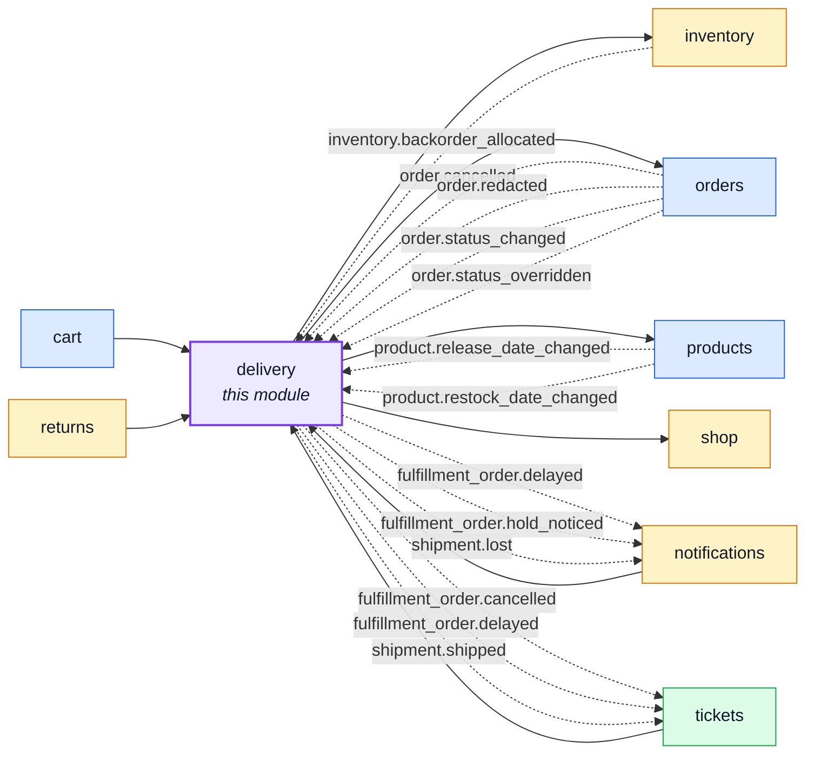
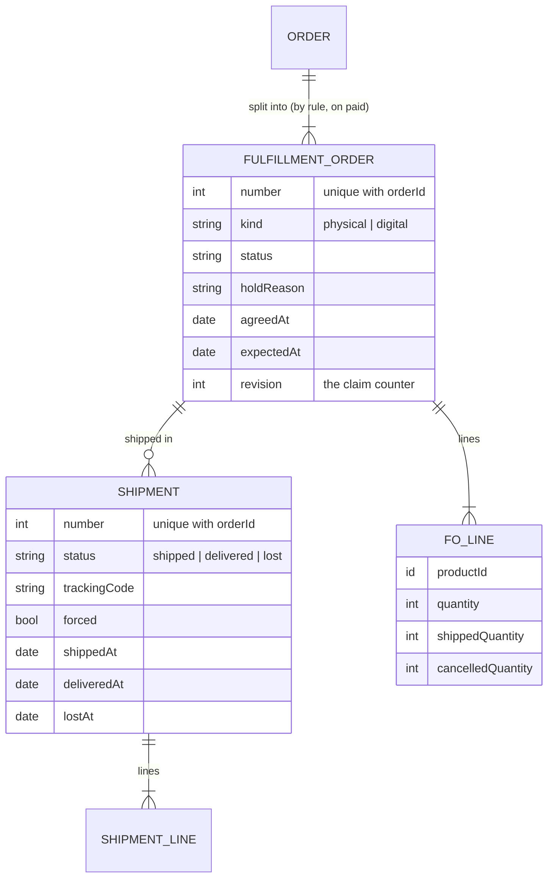
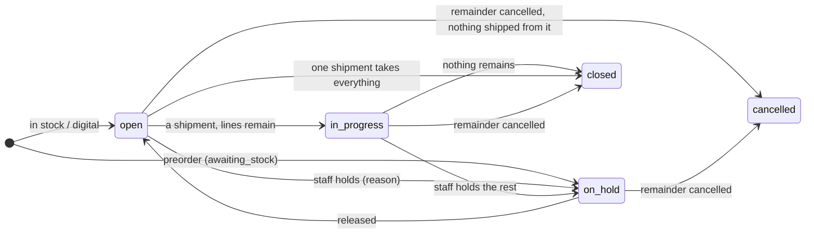
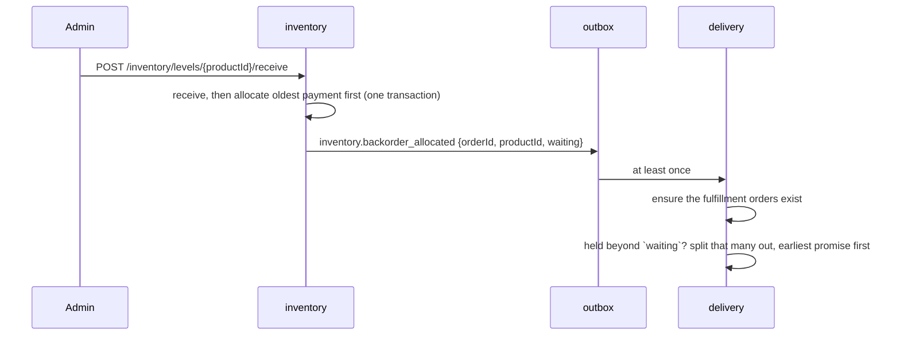
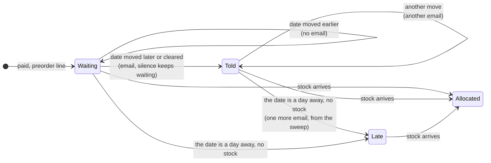
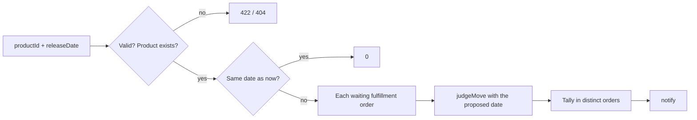
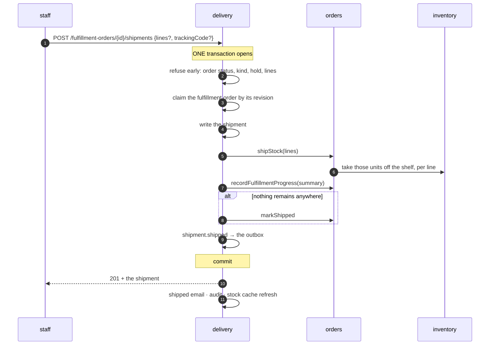

# delivery

::: tip At a glance
**Owns** — shipping rates, fulfillment orders (the groups of an order's lines that leave together) and shipments (what actually left, with its tracking code).
**Depends on** — [`orders`](./orders.md) for the order a fulfillment order is about, and for the stock, mail and status doors it writes through; [`inventory`](./inventory.md) for the allocation event that releases a held fulfillment order; [`products`](./products.md) for the moved-release-date event and the dates staff preview; [`shop`](./shop.md) for the currency a rate is quoted in.
**Breaks if you change** — `findShippingMethod` or `priceShipping`. The cart prices a checkout through both. `cancelRemainder` and `shippedQuantities`: [`returns`](./returns.md) reads what has shipped and cancels what has not through them.
:::

## Its neighbourhood

<!-- module-graph:delivery:start -->

_Solid arrows are imports. Dotted arrows are domain events — the return path an import
graph cannot see._



<!-- module-graph:delivery:end -->

## The story

A fulfillment order and a shipment are _about_ an order. The shipped email's language comes through
`orders`' `mailBuyerOfOrder`, so this module never reads the account itself. It is sent from the
`shipment.shipped` listener, like every customer mail ([Customer mail](../tools/outbox.md#customer-mail)).

**The rates are pure functions in `domain/`, and that is what makes the cart's edge cheap to
hold.** [`cart`](./cart.md) imports `findShippingMethod` and `priceShipping` directly — a real,
solid import — but never touches this module's HTTP surface or learns that a shipment record
exists: it receives vocabulary, not state, the narrowest an import can be.

::: tip What deleting this module actually costs
The shipping selector, the fulfilment records and the costs go with it. Orders simply stop carrying a
`shippingCost`. That is a clean removal, not a broken build.
:::

There is no courier simulation: goods move only when staff record it, through this module's own
doors.

Each shipping method (`domain/rates.ts`) says whether it is `tracked` — standard is untracked,
express is tracked, pickup is untracked. `tracked` means the carrier gives a code the buyer can follow. The ship door never
requires it: a parcel may leave first and get its code later, with `PATCH /delivery/shipments/{id}`.
`Shipment.awaitingTracking` is the server's answer to "tracked, still waiting for its code" (a
physical, `shipped` parcel on a tracked method with none), so a client draws one chip and staff's
digest counts the same rows.

A method may also declare `minWeight`/`maxWeight`, grams — express caps at 5000g, standard at
30000g, pickup at neither. Unlike `tracked`, this one IS enforced against the basket: `PUT /cart/shipping-method`
refuses a method whose range the real basket doesn't fit (`CART_SHIPPING_METHOD_WEIGHT`, 409). At
checkout a stored choice the basket has outgrown counts as none, and a physical basket with none is
refused (`CART_SHIPPING_METHOD_REQUIRED`, 422) — see [Checkout](./cart-checkout.md). A product with no `weight` set counts as 0g, never as a
refusal on its own account.

`requiresAddress` says whether the method needs somewhere to ship to — standard and express do,
pickup does not. `cart`'s checkout is what enforces it — see [Checkout](./cart-checkout.md).

## The two records

One order, one payment, one invoice, as many shipments as it takes. The model is Shopify's, both
layers: the **plan** (what should leave together, and when) and the **act** (what left).

| Word                  | Means                                                                       | Shopify            |
| --------------------- | --------------------------------------------------------------------------- | ------------------ |
| **Fulfillment order** | lines that should leave together, made by the system when the order is paid | `FulfillmentOrder` |
| **Shipment**          | what actually left, at one time, with one tracking code                     | `Fulfillment`      |
| Box                   | the physical carton — not modelled                                          | —                  |



`remaining = quantity − shippedQuantity − cancelledQuantity`, per line, and the server serves it so no
client counts. Lines are keyed by product id, as a return's lines are. A fulfillment order's status
is never decided by a caller: it is derived from its lines and its hold on every write
(`statusOfLines`).



- `closed` — nothing remains, and something shipped from it. `cancelled` — nothing ever shipped from it.
- A shipment is born `shipped` and becomes `delivered`, or `lost` when staff report it will not arrive
  ([Lost in transit](#lost-in-transit)); a **digital** fulfilment is born delivered, in the same write
  (Shopify fulfils digital goods without shipping them too).

### The grouping rule

Pure, in `domain/fulfillment.ts`, over the order's **frozen** line snapshot:

| Lines                                                          | Fulfillment order                                                                                                                                       |
| -------------------------------------------------------------- | ------------------------------------------------------------------------------------------------------------------------------------------------------- |
| everything that is neither a preorder nor `noWithdrawal`       | #1, `open`. `physical` if any line ships, `digital` otherwise. Digital lines of a mixed order ship with the physical ones                               |
| `noWithdrawal` lines (made to order, perishable) that ship now | the next one, `open`, on their own — the shop's work on them is not cancelled with the rest                                                             |
| preorder lines, release day D                                  | one per distinct day and per `noWithdrawal` value, `on_hold` for `awaiting_stock`, `agreedAt = expectedAt =` the latest release date of its lines       |
| the owed part of a line the shelf half covered, promised day D | the shelf part ships in #1; the owed part is its own group per day, cause and `noWithdrawal` value, `on_hold`, dated by the promise frozen on the order |

The preorder flag and the date are read from the snapshot frozen at checkout, never from the product
at payment time: a bank transfer can be paid a week after it was ordered. `agreedAt` is the date the
buyer was shown, and it never moves; `expectedAt` starts equal to it and is rewritten if the date
slips. A group of one day leaves together, so it is promised for the latest release instant among
its lines. "One day" is the shop's calendar day (`NODE_SHOP_TIMEZONE`): staff type a date on the shop's
wall clock, so two instants UTC splits can still be the same day. The emails print those dates in the
same zone, so the day staff typed is the day the buyer reads. A product line that carries neither flag simply lands in #1.

### Holds

| Reason                                               | Set by            | Released by                                                                                                                        |
| ---------------------------------------------------- | ----------------- | ---------------------------------------------------------------------------------------------------------------------------------- |
| `awaiting_stock`                                     | the grouping rule | **only** the allocation of stock. A hand release would ship goods the ledger never counted out — a consistency guard, not a policy |
| `incorrect_address`, `high_risk`, `other` (+ a note) | staff, `…/hold`   | staff, `…/release`                                                                                                                 |

A fulfillment order is **never** shipped from `on_hold`.

**What the buyer sees is not the reason.** Staff's reason can be an internal call (a risk check), and
naming it tips off the people a check exists for, so the buyer gets one of three notices, mapped
once in `domain/hold-notice.ts`:

| Staff's reason       | The buyer reads                          | Mailed (and an inbox row)?                      |
| -------------------- | ---------------------------------------- | ----------------------------------------------- |
| `awaiting_stock`     | `holdNotice: awaiting_stock`             | never                                           |
| `incorrect_address`  | `check_address`: the buyer can act       | always                                          |
| `high_risk`, `other` | `delayed`: the same plain delay for both | only when staff wrote a `message` for the buyer |

A staff hold also records `heldAt` (removed on release; never set for `awaiting_stock`). The
daily staff digest counts holds older than `NODE_STAFF_HOLD_OPEN_DAYS` from it
([`notifications`](./notifications.md#the-daily-digest)).

Hiding the hold instead would put a false "being prepared" on a held order (UCPD Art. 6(1)(b)) and leave
a wrong address unfixable. `holdReason` and `holdNote` are staff's (and the buyer's own GDPR export);
`holdMessage`, the optional sentence staff write **for** the buyer (`message` on `…/hold`, at most 500
characters), is read by everyone and is dropped with the hold on release. It is not scrubbed with
the note: it is something the shop told a customer. A mail and an inbox row come from one fact,
`fulfillment_order.hold_noticed`, written in the hold's transaction. When the address is wrong, staff
correct it with [`PUT /orders/{id}/shipping-address`](./orders.md#correcting-the-shipping-address).

### A short stock delivery

A preorder line asked for 3 units and the stock that arrived covers 2. The allocation calls
`splitForAllocation`: the 2 allocated units move to a **new `open`** fulfillment order (the next
number, the dates copied) and can ship; the third stays `on_hold` for `awaiting_stock`. When the
arrival covers everything the hold simply ends. This is the system split (Shopify's
`fulfillmentOrderSplit`, CRD Art. 9(2)(b)(i) and the FTC Mail Order Rule all expect partial
shipment): waiting for all three would hold back goods already on the shelf, and a hand release is
refused. Staff have no button for it — they can still hold the new `open` order to ship everything
together. No route reaches it: `inventory` allocates, and this module listens.



The event carries `waiting`, what the order still claims of that product, rather than how many were
allocated. A state survives redelivery: the listener releases whatever it holds beyond `waiting`, and
the second time there is nothing beyond it. If one order holds the same product for two release
dates, the earliest `agreedAt` is served first.

### Preorders and a moved date

The same flow serves a **backorder**: the owed part of a line waits on hold, dated by the promise
frozen on the order. A group carries its `cause` (`preorder` or `backorder`) and, when the promise was
the 30-day default, `defaulted`: a later change to the catalogue's date leaves such a group alone,
because the buyer was never promised a date. `product.restock_date_changed` is the backorder's twin of
the release-date event, and `GET /delivery/fulfillment-orders/restock-date-impact` its staff preview.
A delay is worded without the word preorder (`delivery.fulfillment-delayed`,
`notifications.fulfillment-delayed`): late is late whatever the cause, and a preorder still waiting
after release is a backorder in all but name.

The buyer of a preorder was promised a date, and that promise is law: the date shown when ordering
is the agreed one (CRD Art. 18). `agreedAt` is frozen; `expectedAt` is the date the fulfillment
order is expected now. **This module owns the whole flow**, because both dates live on its
fulfillment order and `orders → delivery` is forbidden.

**The computer tells; a person decides.** The shop never asks the buyer a question and never
cancels on its own. When the date moves later, or is taken away, the buyer gets one email: the new
date (or "no date yet"), and that they can cancel from their order page for a full refund. If they
are happy to wait they do nothing: **silence always means keep waiting**. Staff see every late
order on the board's Late view and decide whom to call (see
[the staff routine](#what-staff-do-about-a-late-order)).

When an admin moves a product's `releaseDate`, `products` announces `product.release_date_changed`,
and every fulfillment order still waiting for that product is judged by a pure table
(`domain/preorder.ts`):

| The new date is...               | The buyer gets                                                  |
| -------------------------------- | --------------------------------------------------------------- |
| later than the date expected     | an email with the new date and the way to cancel                |
| none: the date was cleared       | an email saying there is no new date yet, and the way to cancel |
| not later than the date expected | nothing; the order page shows the new date                      |
| a date after a cleared one       | nothing; the order page shows it (good news needs no email)     |

Which date is expected is read from the catalogue, the latest release date among the products still
waiting, so a group of several stays right when one of them moves; the event only says that
something moved, and a redelivery finds the date already expected. A product that still waits with
no release date makes the whole group undated (it cannot leave before that product), and an undated
group has no `expectedAt` at all: a cleared date removes it, so a redelivered event finds nothing to
move and tells nobody twice. The fulfillment order carries the state: `agreedAt`, `expectedAt`,
`lastNoticeAt`, `dueNoticeFor` and `cancelReason`.



### Previewing a move before it is saved

`GET /delivery/fulfillment-orders/release-date-impact?productId=&releaseDate=` tells staff, before
they save, how many **orders** the move would email (`notify`). It runs the listener's own rule
(`expectedDateOf` and `judgeMove` in `domain/preorder.ts`) against the date that would be, and
writes nothing, so the two cannot drift.



- `releaseDate` absent or blank previews a **cleared** date.
- The same format and "at most one year ahead" rule as the product save.
- An order with several groups to tell counts once.
- Guarded by `update:Product` **and** `display:Order`: an editor moves dates but sees no order volume.
- A snapshot: a payment or a shipment between the preview and the save can shift the count.

Every notice is one transaction with the state it leaves on the fulfillment order and one outbox
event, `fulfillment_order.delayed`; the email follows the commit and links to the buyer's order
page, where the cancel button already is. [`notifications`](./notifications.md) turns the event into
an inbox row, `notifications.fulfillment-delayed`.

#### The daily sweep

`npm run job sweep:preorders` (02:20 UTC, under a lease; [scheduled jobs](../reference/ops.md#scheduled-jobs))
does one thing, and only to fulfillment orders still `on_hold` for stock: a fulfillment order whose
**current** `expectedAt` is a day away or already gone (`expectedAt <= now + 1 day`), with no stock
and no notice for that date, tells its buyer once that it will miss the date: "the stock has not
reached us, there is no new date yet, you can cancel any time". The sweep is daily, so looking a day
ahead is what lets the email land before the date, not after it. It is keyed on `expectedAt`, not
`agreedAt`: after a moved date the agreed one is long gone and only the expected one can still be
missed. `dueNoticeFor` is what stops a daily repeat: it stores the `expectedAt` the notice was sent
for, so a date that moves is a new date and is told about again (timestamps cannot say that, since
a moved-date notice also stamps `lastNoticeAt`). A backorder promised the 30-day default is told like
any other, on day 29 of 30.

The sweep cancels nothing and expires nothing. Units already allocated but not shipped (`open`) are
left alone: goods on the shelf are a short, definite delay, and the buyer can already cancel any
time before dispatch. The admin's Late view is where they show.

#### What staff do about a late order

Check the Late list about once a week. For an order that is **very late** (30 days past the agreed date, `agreedAt`, the assumption this shop starts from; see [FTC 16 CFR 435.2(b)](https://www.ecfr.gov/current/title-16/section-435.2)), contact the buyer: ask whether they still want it. If
they do not, or the goods will not come, cancel and refund with the existing staff cancel. The
buyer who does nothing keeps waiting.

Selling to the **EU** needs no warning or clause for this, because the shop never cancels on its
own. Selling to **US** buyers adds the FTC's mail-order rule (16 CFR 435.2): for a long delay the
buyer's express OK is needed. Staff ask for it by email by hand, and cancel with a refund if there is
no OK within 30 days. See [before you sell](../demo-ecommerce/before-you-sell.md).

The reminder is a ticket: a delay to a ship-to country in `NODE_TICKETS_FTC_COUNTRIES` opens a
`consent_due` ticket for the staff who hold `OrderEditing`, due 30 days after the agreed date (or on
the date the buyer last held), and shipping or cancelling closes it. The human rule above is
unchanged. `promisedAt` on the fulfillment order is the date the buyer holds now; the rule is in
[tickets](tickets.md#system-tickets).

### The preorder board

The admin's preorder board (ADMIN_SALES 3) reads two things from here. The grain is the fulfillment
order, not the order line: the agreed and expected date, the hold and the cancel
reason all live on it, and `orders → delivery` is forbidden, so `orders` could not serve those columns.

| Route                                                  | Answers                                                                                              |
| ------------------------------------------------------ | ---------------------------------------------------------------------------------------------------- |
| `GET /delivery/fulfillment-orders`                     | one row per fulfillment order, with its buyer, `paidAt`, `state`, `late`, `delivered`, `slippedDays` |
| `GET /delivery/fulfillment-orders/summary`             | per product, in units: paid, waiting, allocated, shipped, cancelled, late                            |
| `GET /delivery/fulfillment-orders/release-date-impact` | orders a release-date move would email, before it is saved (`update:Product` + `display:Order`)      |

Filters on the list: `cause` (`preorder`, `backorder`, or `any` wait that carries an agreed date),
`state`, `productId`, `late` and `dueWithin`.

| `state`     | The fulfillment order is...                                                                    |
| ----------- | ---------------------------------------------------------------------------------------------- |
| `waiting`   | paid and held for stock                                                                        |
| `allocated` | stock is set aside for it and not all shipped; a staff hold on such goods is still `allocated` |
| `shipped`   | nothing remains and something shipped; `delivered` says whether every shipment also arrived    |
| `cancelled` | nothing remains and nothing shipped; `cancelReason` says who: `buyer`, `staff`, `order`        |

`late` is the Late view: the expected date has passed and units remain, whether still waiting, allocated
and not shipped, or part shipped. It is where goods on the shelf show, which the daily sweep deliberately
does not write to the buyer about. `dueWithin=N` is its early warning, for fulfillment orders still waiting
and expected within N days. The queue key stock is allocated by is the hold's `committedAt`, stamped in the payment's own
transaction, so `paidAt` here orders the buyers the way `inventory` does.

**Who reads it** is the audience of the orders themselves: the key is `display:Order` (decided A5.2,
because there is one audience and one permission for it). A route guard cannot tell that key from a
buyer's own `read:Order`, which collapses onto it, so the scope is in the query: staff who read
every order see every row; anyone else sees only their own orders' fulfillment orders. The buyer and
`paidAt` come from `orders`, one batched read a page (`orderBriefsByIds`).

### When they are made

| Path       | What                                                                                                                                                                                                                                    |
| ---------- | --------------------------------------------------------------------------------------------------------------------------------------------------------------------------------------------------------------------------------------- |
| Normal     | this module listens to `order.status_changed {to: paid}` through the outbox, as `invoicing` does. Idempotent on `{ orderId, number }`                                                                                                   |
| Safety net | `ensureFulfillmentOrders` runs the same idempotent create on every fulfillment-orders list read and every `process` of a paid order: the outbox gives up after its last retry, and a missing fulfillment order would leave no ship door |
| Not paid   | `GET /orders/{id}/fulfillment-orders` and `/shipments` answer `200` with `items: []`                                                                                                                                                    |

## One transaction per act

A ship, deliver, fulfil, hold, release or remainder cancel writes, together or not at all:
**the record**, **the order's summary**, **the order's status move when one is due**, **the outbox
events** — and, for a shipment, **the units leaving the shelf**. Refusals are decided before the first
write, inside the same snapshot the writes land in.



`orders` cannot import `delivery`, so the order carries a small **summary** (`fulfillment.shipped`,
`remaining`, `onHold`, `awaitingStock`, `undelivered`, `lastDeliveredAt`) that only `delivery` writes,
only through `orderService.recordFulfillmentProgress`, recomputed from the records themselves inside
the act's transaction. A stale read can never overwrite a newer one. The order's `fulfillmentStatus`
and its `cancel` and `withdraw` flags read that summary.

Two acts racing the same remainder cannot both land: each claims the fulfillment order by its
`revision`, in the filter of the write, and the loser gets a 409. A ship racing a cancel cannot both
win either: the summary write is conditional on the order still being fulfillable, and a whole-order
cancel is conditional on `fulfillment.shipped` not being set.

## Shipping

`POST /delivery/fulfillment-orders/{id}/shipments {lines?, trackingCode?}` → `201`.
`lines` omitted ships everything that remains. The order moves `processing → shipped` only when the
shipment leaves **nothing** remaining anywhere; until then it stays `processing`, and its
`fulfillmentStatus` reads `partially_fulfilled`. Refused:

| Case                                                                                          | Answer                                          |
| --------------------------------------------------------------------------------------------- | ----------------------------------------------- |
| more than remains, a product that is not there, the same twice                                | `422 DELIVERY_LINES_INVALID`                    |
| a fulfillment order on hold, closed or cancelled; a cancelled or never-paid (`pending`) order | `409 DELIVERY_NOT_SHIPPABLE`                    |
| a first shipment from `paid` that finds the order no longer `paid` (it moved meanwhile)       | `409 ORDER_NOT_PAID`                            |
| a `paid` order, for a caller without `start:Shipment` (the act makes the start move itself)   | `403` and a `security.forbidden` audit row      |
| a digital one                                                                                 | `409 DELIVERY_NOT_PHYSICAL` — fulfil it instead |
| an order that is neither `processing` nor `paid`                                              | `409 ORDER_NOT_PROCESSING`                      |

### Where a parcel went

The order holds one address: where the units still to send go. Each shipment stores its own copy as
`destination`, taken when it is cut (`services/cut.ts`, so ship, fulfil and the override's shipments
all get it), encrypted under the shipment's `_id` (`pii.ts`, same key ring as the order's). Staff can
therefore redirect the rest of a partly shipped order without rewriting where the first parcel
went. The copy is personal data of its own: it shows in the account export, follows the key rotation
(`reencrypt`), and is unset when the order's address is scrubbed (`order.redacted` →
`scrubDestinations`). A pickup or a digital fulfilment has none.

### Shipping from `paid`

Shipping from `paid` is an ordinary act, not an override: the act makes the `paid → processing` move
itself, in its own transaction, so the caller holds `update:Shipment` **and** `start:Shipment`.
`POST /orders/{id}/process` stays as an optional "mark in progress". The digital fulfil door works the
same way. `processing` has one effect for the buyer: self-cancel closes (it works from `pending` and
`paid` only); the legal right of withdrawal is not affected.

### Audit rows

`Shipment.forced` marks a shipment cut by an admin status override; arrival has no forced variant,
so recording one is a single act with a single door. A hold's and a release's
audit rows carry the hold's reason **code** (a release, the code of the hold it ended), never the
`holdNote`: free commentary that has no business in the operator log.

## Delivering

`POST /delivery/shipments/{id}/deliver` stamps the shipment. The order moves to `delivered` when this
was the last undelivered shipment **and** nothing remains to ship, and its withdrawal clock starts from
**that** arrival — CRD Art. 9(2)(b)(i): the 14 days run from physical possession of the last good
(Commission Notice 2021/C 525/01 §5.1.2: "a single withdrawal period should apply from the day after
delivery of the last item"). One window per order, from the last good; per-shipment windows would be
shorter than the law allows.

A `lost` shipment that turns up is recorded here too, when every unit on it is still open
([Lost in transit](#the-lost-parcel-turns-up)).

A remainder **cancelled after** every shipment was delivered makes the order `shipped` and `delivered`
in one transaction, the clock counted from the cancellation: the order only became complete then.

## Lost in transit

`POST /delivery/shipments/{id}/lost` (`update:Shipment`, no step-up) is for a parcel that left and
will not arrive: `{ reason: lost | damaged, note?, message? }`. **`damaged` means damaged in
transit and reported before its arrival was recorded.** Damage found after the buyer has the goods is
a [return](./returns.md), not this door. Only a `shipped` physical shipment on a `processing` or
`shipped` order can be reported (`DELIVERY_NOT_LOSABLE`).

The replacement lives on **the same order**: no new order, invoice, revenue or `order_created`, and the
shipping is not charged again. (A €0 order would need a price override, a fake `paid` and a €0 invoice,
and the original order would stay `shipped` for ever. Shopify's native model, like Solidus', also keeps
the lines on the same order.) The EU rules agree: risk passes only when the buyer has the goods (CRD
Art. 20), the reship is the original delivery duty (Art. 18), and the withdrawal clock and the
guarantee start at the replacement's arrival, which `markDelivered` already counts.

```mermaid
sequenceDiagram
    participant S as Staff
    participant D as delivery
    participant I as inventory
    participant O as orders
    participant B as Buyer
    S->>D: POST /shipments/{id}/lost
    Note over D,O: one transaction
    D->>D: shipment lost, units off shippedQuantity
    D->>I: top the hold up (shelf + owed)
    I-->>D: per product: shelf, owed
    D->>D: owed units: a new fulfillment order on hold
    D->>O: summary; shipped → processing
    D-->>B: shipment.lost (mail, inbox row, webhook)
    S->>D: ship again (the ordinary door)
```

| Step              | What it does                                                                                                                                                                                                                                                 |
| ----------------- | ------------------------------------------------------------------------------------------------------------------------------------------------------------------------------------------------------------------------------------------------------------ |
| Shipment          | `shipped → lost`, with `lostAt`, `lostReason`, `lostMessage` (kept) and `lostNote` (reaped with the hold notes). One conditional write, so two reports of one parcel cannot both land                                                                        |
| Fulfillment order | every lost unit comes off the line's `shippedQuantity`, so the units are open again; staff ship them with the ordinary ship door. The net `shippedQuantity` is what `returns` gates on, so a buyer can never return twice what they bought                   |
| Stock             | the hold is topped up with the shelf units that are free, never units held for another order. What the shelf cannot cover is **owed**: see below                                                                                                             |
| Order             | a `shipped` order steps back to `processing` (the system-only `reopen` edge, the one backward move); a `processing` one stays                                                                                                                                |
| Records           | timeline `shipment_lost` (buyer-visible), audit `admin.shipment.lost` (the reason code only), event and webhook `shipment.lost` (the reason code, never the free text)                                                                                       |
| Buyer             | a mail with a fixed text per reason, what the parcel carried, what is owed and when, and staff's `message` in a quote; the same in the inbox (`notifications.shipment-lost`). Always sent, there is no switch. The `note` is for colleagues and never leaves |
| Untouched         | no invoice, no credit note, no revenue                                                                                                                                                                                                                       |

A lost shipment still counts as shipped in the order's summary (`shipped: true`), which keeps the
whole-order cancel closed; it counts as neither out nor arrived (`undelivered` leaves it out).

### Cancelled and refunded after a loss

The buyer may take the money instead of a second parcel: cancelling the open units refunds them
(shipping included) and gives the stock back. What the order then ends as depends on whether anything
ever arrived:

| What arrived                                  | The order ends | Why                                                                                       |
| --------------------------------------------- | -------------- | ----------------------------------------------------------------------------------------- |
| something (another parcel, or a digital line) | `delivered`    | part of the contract was performed; the clocks start at the cancel, as for any completion |
| nothing at all                                | `cancelled`    | nothing was delivered, so `delivered` would be untrue                                     |

The second row is our choice, not Shopify's: Shopify leaves such an order open and refunded unless the
merchant cancels it. We settle it for them, with `settleOrder` asking `orders`' `markUndeliverable`
(cause `lost`, the system's, `refund: false` because the remainder cancel already refunded). Nothing
else runs: no withdrawal or guarantee clock, no `delivered` row, no second refund, no second stock
release, and no mail (the loss and the refund were already mailed). The `cancelled` row is the
system's. The `order.cancelled` listeners treat `lost` as no purchase-hold count and no refund.

The move is its own lifecycle constant (`UNDELIVERABLE_EVENT`), not an actor on `cancelInFulfilment`:
a `system` actor on `processing → cancelled` would let the three existing system cancels match orders
in fulfilment. The order is retained as "paid, cancelled without delivery" by the PII sweep, not on a
guarantee clock it never had. A parcel found afterwards answers `DELIVERY_NOT_DELIVERABLE`, and
`actions.deliver` is false.

### Owed after a loss, when the shelf is short

The lost units were already taken off the shelf when the parcel shipped, so only what the shelf has
free can be set aside again. The rest becomes a claim on the restock that **ignores the backorder
cap** (the cap limits new sales, not a promise the shop already made), first in the queue by the
original payment ([inventory](./inventory-reservations.md#owed-after-a-loss)). Those units go to a
**new fulfillment order**, `on_hold` for `awaiting_stock`, `cause: backorder`, dated by the products'
restock dates or the 30-day default, and linked to the loss (`sourceShipmentId`). The original
fulfillment order is not held: the units the shelf covered ship at once.

On the original line, `shippedQuantity` drops by **all** the lost units and `quantity` drops by the
owed part, which the new order carries, so what the order holds never exceeds what was bought. Stock
arriving releases the owed order through the same allocation as any backorder; the buyer can still
cancel it, and a product deleted since has no stock row, so the loss is recorded with no claim.

### The lost parcel turns up

`POST /delivery/shipments/{id}/deliver` accepts a `lost` shipment **if and only if every unit on it is
still open**: the shelf part still unshipped and uncancelled on the original fulfillment order, and
every owed unit still unshipped and uncancelled on the orders linked to the loss. All or nothing, in
the arrival's transaction:

- the shipment becomes `delivered` (`lostAt` and `lostReason` stay as history);
- the units go back onto the original order as shipped, and the owed orders close with
  `cancelReason: found` and no refund;
- the top-up is given back and the hold ends `shipped`, not `released`;
- the order settles as for any arrival, the clock starting at this one.

Otherwise it answers `409 DELIVERY_LOST_SUPERSEDED`, which protects the counts, not a policy: taking
them back would count the goods twice. `ShipmentActions.deliver` is true for a lost shipment exactly
when the condition holds.

**What the shop does about the second parcel** is a guide matter: ask for one back or let the buyer
keep it ([The lost parcel arrived](../demo-ecommerce/when-something-goes-wrong.md#lost-parcel-arrived)).
A parcel returned to sender needs no door of its own: receive the units
([It came back to us](../demo-ecommerce/when-something-goes-wrong.md#parcel-came-back)), then ship them again.

For the accountant, the shipment with its tracking code and note is the loss documentation: Italy
presumes goods that went missing were sold unless the loss is documented (DPR 441/1997).

## Replacement after a return {#replacement-after-a-return}

A return received with `remedy: replace` ([returns](./returns.md#the-remedy-ladder)) sends the same
product again on the **same order**: no new order, invoice or revenue. It reuses a lost parcel's
machinery, in the receipt's own transaction:

- the returned units come off `shippedQuantity` of the fulfillment orders they shipped from (the
  latest first), so they are open again; the order steps back `delivered → processing`;
- the stock hold is topped up from the free shelf (`reserveMoreForOrder`); what the shelf cannot
  cover is owed on a new fulfillment order on hold (`cause: backorder`), outside the backorder cap;
- staff ship it through the ordinary shipping door. The arrival keeps the order's first
  `withdrawUntil` (a replacement does not restart the withdrawal clock) and only ever pushes
  `conformityUntil` out.

If the order never shipped that many physical units the receipt answers `409 DELIVERY_NOT_REOPENABLE`
and writes nothing.

## Digital fulfilment

`POST /delivery/fulfillment-orders/{id}/fulfill` is the digital door: a shipment with no tracking, born
and delivered in the same write. Refused for a physical fulfillment order (`DELIVERY_NOT_DIGITAL`);
`ship` refuses a digital one the other way (`DELIVERY_NOT_PHYSICAL`), so the two never overlap. A
digital-only order's window counts from payment (Art. 9(2)(c)).

## The status override

The admin override (`POST /orders/{id}/status-override`) stays an order-level repair, and it must not
leave the two records disagreeing. `orders` announces `order.status_overridden {orderId, from, to, at}`
through the outbox, in the override's own transaction; this module listens:

| The order was overridden to | This module                                                                                                             |
| --------------------------- | ----------------------------------------------------------------------------------------------------------------------- |
| `shipped`                   | cuts a **forced** shipment of every remainder, at `at`                                                                  |
| `delivered`                 | the same, and delivers every shipment still out, with `deliveredAt = at` — the instant `withdrawUntil` was counted from |

The shipments it cuts take no stock (the override already shipped what was left of the hold) and send
no email and no webhook: nothing left that anyone recorded, which keeps the override's "no parcel, no
email". The override is **refused while any unit awaits stock** (`ORDER_OVERRIDE_AWAITING_STOCK`): it would
ship goods the ledger never counted out.

## Cancelling what has not shipped

A cancel of the whole order is only possible while nothing has shipped; this module hears
`order.cancelled` and cancels every fulfillment order. Once anything has shipped — or before, while
another fulfillment order still has units to send — what remains is cancelled **one fulfillment order
at a time**, by [`returns`](./returns.md#cancelling-what-has-not-shipped)
(a Return of `kind: cancellation`) — it moves the money, the stock and the shipping rule, and is the
only module that already reaches all of them. This module only marks the lines:
`cancelRemainder(fulfillmentOrderId, orderId, session, reason)`, called inside `returns`' own
transaction, and stores who cancelled (`cancelReason`: `buyer`, `staff`, `order`, or `found` for the owed units of a lost parcel that turned up). The
result says whether the fulfillment order was held for stock (`waitingForStock`), because then what
is given back is the preorder allowance and not shelf units.

## The order timeline

Each act writes its rows to the order's [timeline](./orders.md#the-timeline) in its own transaction
(`services/announce.ts`), beside the outbox event it already wrote.

| Row                    | Written when                                                   | Carries                                                              |
| ---------------------- | -------------------------------------------------------------- | -------------------------------------------------------------------- |
| `shipment_shipped`     | a shipment is cut (also a digital fulfilment)                  | shipment and fulfillment order ids, `number`, `trackingCode`         |
| `shipment_delivered`   | a shipment arrives                                             | the same ids                                                         |
| `shipment_lost`        | staff report a shipment lost or damaged                        | the same ids, `reason` code; never the note or the message           |
| `fulfillment_held`     | staff hold one, or a preorder group is born on hold            | `reason` code; never the note (staff only)                           |
| `fulfillment_released` | staff, or an allocation of stock, release it (staff only)      | fulfillment order id                                                 |
| `remainder_cancelled`  | `returns` cancels what had not shipped                         | fulfillment order id                                                 |
| `release_date_moved`   | a product's date moved and this order's expected date followed | fulfillment order id, `from` and `to` (ISO; an unset side is absent) |
| `delay_notice_sent`    | the buyer was told: the date moved, or it will be missed       | fulfillment order id, `reason`, `expectedAt`                         |

A whole-order cancel writes no `remainder_cancelled`: the order's own `cancelled` row says it. The
shipment row comes first, then the order's own move that it caused (`shipped`, `delivered`). A
`remainder_cancelled` row, and the `shipped` or `delivered` move the cancel completes, name the
account that made the cancel: the buyer, or the staff member acting for them.

`release_date_moved` is written by `delivery`, not `orders`: `products` announces the move and
`orders` cannot import it, while `delivery` already judges every waiting fulfillment order. A
redelivered event finds the date already followed and writes no second row. The row's `from` is the
date this order was expecting, not the product's previous date.

## Routes and events

| Route                                                      | Key                                                | Answers                                                                                           |
| ---------------------------------------------------------- | -------------------------------------------------- | ------------------------------------------------------------------------------------------------- |
| `GET /delivery/methods`                                    | public                                             | the shipping methods and what each costs                                                          |
| `GET /delivery/fulfillment-orders` · `/summary`            | `display:Order`                                    | [the preorder board](#the-preorder-board)'s two reads                                             |
| `GET /delivery/fulfillment-orders/restock-date-impact`     | `update:Product` + `display:Order`                 | orders a restock-date move would email, before it is saved                                        |
| `GET /orders/{id}/fulfillment-orders` · `/shipments`       | the owner, or staff                                | `{ items[] }` each, every item with its own `actions`; unpaged                                    |
| `POST /orders/{id}/process`                                | `start:Shipment`                                   | the order, `processing`                                                                           |
| `POST /delivery/fulfillment-orders/{id}/shipments`         | `update:Shipment`                                  | `201` + `Location` + the shipment; optional `Idempotency-Key` (a retry would cut a second parcel) |
| `POST /delivery/fulfillment-orders/{id}/fulfill`           | `update:Shipment` (+ `start:Shipment` from `paid`) | `201` + `Location` like ship, the shipment delivered; same optional `Idempotency-Key`             |
| `POST /delivery/fulfillment-orders/{id}/hold` · `/release` | `update:Shipment`                                  | the fulfillment order                                                                             |
| `PATCH /delivery/shipments/{id}`                           | `update:Shipment`                                  | the shipment, tracking added or corrected, at any time (shipped, delivered or lost)               |
| `POST /delivery/shipments/{id}/deliver`                    | `update:Shipment`                                  | the shipment                                                                                      |
| `POST /delivery/shipments/{id}/lost`                       | `update:Shipment`                                  | the shipment, `lost`                                                                              |

Every button a client draws comes from the record's own `actions` (or `GET /returns/options`): the
frontend never re-derives a rule. Every staff door asks the key and nothing else: [no rank](../theory/authorization.md#protecting-people).

`FulfillmentOrderActions.ship` and `fulfill` are true on a `paid` order only for a caller who also holds
`start:Shipment`. `ShipmentActions.update` is the tracking-code edit
and `markLost` the lost-parcel report.

| Event                                                 | Payload                                                                                               | Public webhook                 |
| ----------------------------------------------------- | ----------------------------------------------------------------------------------------------------- | ------------------------------ |
| `shipment.shipped`                                    | `{orderId, shipmentId, fulfillmentOrderId, lines}`                                                    | yes — replaces `order.shipped` |
| `shipment.delivered`                                  | the same                                                                                              | yes                            |
| `shipment.lost`                                       | the same, `reason`, and what the buyer is told                                                        | yes — the reason code only     |
| `fulfillment_order.held` · `.released` · `.cancelled` | `{orderId, fulfillmentOrderId, reason?}`                                                              | no                             |
| `fulfillment_order.hold_noticed`                      | `{orderId, fulfillmentOrderId, userId?, notice, message?}`                                            | no                             |
| `fulfillment_order.delayed`                           | the dates (`agreedAt`, the held `promisedAt`), the titles, `shipCountry`, `reason` (`moved` or `due`) | no                             |

All are written through the outbox **in the act's transaction**. An order shipped in two goes fires
`shipment.shipped` twice, and the order reaching `shipped` is the last of them.

**Emails**, one per shipment: _shipped_ (its lines, the tracking line when the method carries one, and
"N more items to follow" while anything remains) when it leaves, and _delivered_ (its lines, and on
the delivery that completes the order, the date until which the buyer may withdraw) when it arrives.
Setting a tracking code (`PATCH /delivery/shipments/{id}`) mails the buyer the same shipped mail with its
own subject, only when the code actually changed; best effort, after the save. The first code of a parcel
that left without one says "your tracking code is ready"; a replacement says it changed, with an apology
for the earlier code. The audit row records the code before and after.

The code can be set at any time, delivered and lost shipments included: it is most useful later, as dispute
evidence. A digital shipment never had a carrier and refuses it with `DELIVERY_NOT_PHYSICAL`; the
shipment stores the fulfillment order's `kind` for that reason.

## Your data

A shipment and a fulfillment order are the buyer's data by way of their order: `POST /account/export`
carries a `shipments` section (lines, number, tracking, dates, and for a loss its reason, message and **staff's note**) and a `fulfillmentOrders` section
(lines, dates, hold reason, **staff's hold note**): a note a person typed about a person is that
person's data, and the record holds no staff id, so none is exported. The note is also **reaped** — `npm run job reap:delivery` unsets it once the fulfillment order has not
changed for `NODE_HOLD_NOTE_RETENTION_DAYS` (default 365), and a lost parcel's `lostNote` with it (`lostMessage` stays: it was sent to the buyer), exactly as `reap:returns` does for a return's
text ([why](../theory/data-retention.md#free-text-on-holds)). Lines, status and dates stay: they are the
trail.

## Configuration

| Variable                        | Default | Meaning                                                                              |
| ------------------------------- | ------- | ------------------------------------------------------------------------------------ |
| `NODE_HOLD_NOTE_RETENTION_DAYS` | `365`   | Days without a change before `reap:delivery` unsets a fulfillment order's `holdNote` |

## The return address

The return address is [`shop`'s](./shop.md), not this module's: the placed-order email must name
where goods go. `GET /shop` serves it as `returnAddress` (beside `shipToCountries`), and
[`returns`](./returns.md) names it in the approval notice.

The same module answers "what would standard delivery have cost?" (`cheapestStandardShipping`,
`domain/rates.ts`): a withdrawal refunds delivery only up to that, and `pickup` — collection, not
delivery — never counts, which `requiresAddress: false` already says.

## Who can do what

Every rule this module declares and who holds it, role by role. The rule is what a route guard asks for; the set is what a role lists.

<!-- permissions:start -->

| Rule              | Set                  | `guest` | `unverified` | `customer` | `manager` | `warehouse` | `support` | `editor` | `moderator` | `admin` | `operator` | Credential | What it lets them do                                                                                                                                              |
| ----------------- | -------------------- | ------- | ------------ | ---------- | --------- | ----------- | --------- | -------- | ----------- | ------- | ---------- | ---------- | ----------------------------------------------------------------------------------------------------------------------------------------------------------------- |
| `update:Shipment` | `DeliveryManagement` | —       | —            | —          | —         | ✅          | —         | —        | —           | ✅      | —          | ✅         | Cut a shipment from a fulfillment order, record its arrival, correct its tracking code, report a parcel lost or damaged, and hold or release a fulfillment order. |
| `start:Shipment`  | `DeliveryStart`      | —       | —            | —          | ✅        | ✅          | —         | —        | —           | ✅      | —          | ✅         | Begin fulfilling a paid order — the move into `processing`, before any parcel exists to record.                                                                   |

✅ held · `own` only the caller’s own rows · ⚡c / ⚡s needs a freshly proved session (critical / sensitive) ·
Credential: ✅ when an API key can be minted with the rule. Generated from the rules and sets in
`src/modules/*/authorization.yaml` and the roles in `shared/authorization-roles.yaml`, asked of the
evaluator — [Authorization](../theory/authorization.md) explains the model.

<!-- permissions:end -->

## Related pages

- [`orders`](./orders.md) — what a fulfillment order is about, and the summary it reads
- [`returns`](./returns.md) — what comes back, and what is cancelled before it leaves
- [Data Retention](../theory/data-retention.md#free-text-on-holds) — why a hold note is wiped
- [`cart`](./cart.md) — the checkout that prices a method
- [Domain Layer](../theory/domain-layer.md) — why the rates are pure functions
- [Email & PDF Rendering](../tools/email-and-rendering.md) — the shipped notification
- [Strategic DDD](../theory/strategic-ddd.md#_5-published-language-—-the-barrel) — what `published-language` buys
