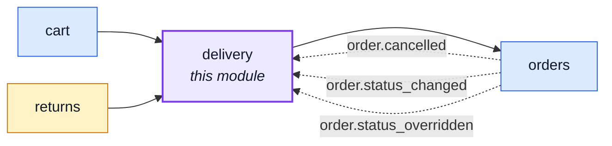
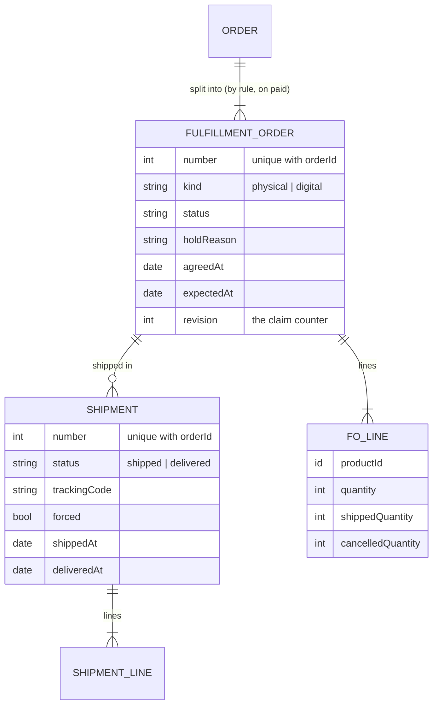
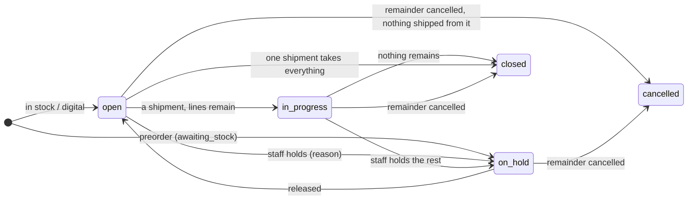
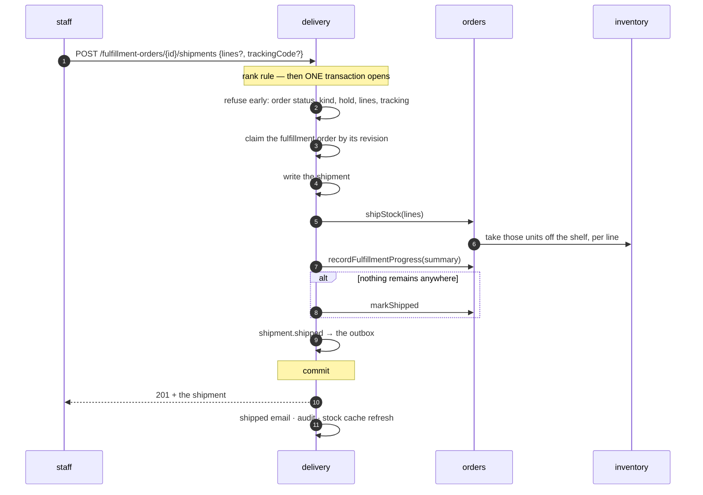

# delivery

::: tip At a glance
**Owns** — shipping rates, fulfillment orders (the groups of an order's lines that leave together) and shipments (what actually left, with its tracking code).
**Depends on** — [`orders`](./orders.md) for the order a fulfillment order is about, and for the stock, mail and status doors it writes through.
**Breaks if you change** — `findShippingMethod` or `priceShipping`. The cart prices a checkout through both. `cancelRemainder` and `shippedQuantities`: [`returns`](./returns.md) reads what has shipped and cancels what has not through them.
:::

## Its neighbourhood

<!-- module-graph:delivery:start -->

_Solid arrows are imports. Dotted arrows are domain events — the return path an import
graph cannot see._

<!-- module-graph:delivery:end -->

## The story

A fulfillment order and a shipment are _about_ an order. The shipped email's language comes through
`orders`' `mailBuyer`, so this module never reads the account itself.

**The rates are pure functions in `domain/`, and that is what makes the cart's edge cheap to
hold.** [`cart`](./cart.md) imports `findShippingMethod` and `priceShipping` directly — a real,
solid import — but never touches this module's HTTP surface or learns that a shipment record
exists: it receives vocabulary, not state, the narrowest an import can be.

::: tip What deleting this module actually costs
The shipping selector, the fulfilment records and the costs go with it. Orders simply stop carrying a
`shippingCost`. That is a clean removal, not a broken build.
:::

There is no courier simulation: goods move only when staff record it, through this module's own
doors.

Each shipping method (`domain/rates.ts`) says whether it is `tracked` — standard is untracked,
express is tracked, pickup is untracked. `tracked` is what `POST /delivery/fulfillment-orders/{id}/shipments`
enforces: a tracking code is required for a tracked method, on every shipment, refused with a named
422 otherwise.

A method may also declare `minWeight`/`maxWeight`, grams — express caps at 5000g, standard at
30000g, pickup at neither. Unlike `tracked`, this one IS enforced against the basket: `cart`'s
checkout refuses a chosen method whose range the real basket doesn't fit
(`CART_SHIPPING_METHOD_WEIGHT`, 409). A product with no `weight` set counts as 0g, never as a
refusal on its own account.

`requiresAddress` says whether the method needs somewhere to ship to — standard and express do,
pickup does not. `cart`'s checkout is what enforces it — see [Checkout](./cart-checkout.md).

## The two records

One order, one payment, one invoice, as many shipments as it takes. The model is Shopify's, both
layers: the **plan** (what should leave together, and when) and the **act** (what left).

| Word                  | Means                                                                       | Shopify            |
| --------------------- | --------------------------------------------------------------------------- | ------------------ |
| **Fulfillment order** | lines that should leave together, made by the system when the order is paid | `FulfillmentOrder` |
| **Shipment**          | what actually left, at one time, with one tracking code                     | `Fulfillment`      |
| Box                   | the physical carton — not modelled                                          | —                  |

`remaining = quantity − shippedQuantity − cancelledQuantity`, per line, and the server serves it so no
client counts. Lines are keyed by product id, as a return's lines are. A fulfillment order's status
is never decided by a caller: it is derived from its lines and its hold on every write
(`statusOfLines`).

- `closed` — nothing remains, and something shipped from it. `cancelled` — nothing ever shipped from it.
- A shipment is born `shipped` and becomes `delivered`; a **digital** fulfilment is born delivered, in
  the same write (Shopify fulfils digital goods without shipping them too).

### The grouping rule

Pure, in `domain/fulfillment.ts`, over the order's **frozen** line snapshot:

| Lines                             | Fulfillment order                                                                                                         |
| --------------------------------- | ------------------------------------------------------------------------------------------------------------------------- |
| everything that is not a preorder | #1, `open`. `physical` if any line ships, `digital` otherwise. Digital lines of a mixed order ship with the physical ones |
| preorder lines, release date D    | one per distinct D, `on_hold` for `awaiting_stock`, `agreedAt = expectedAt = D`                                           |

The preorder flag and the date are read from the snapshot frozen at checkout, never from the product
at payment time: a bank transfer can be paid a week after it was ordered. Preorder as a product state
is not built yet; the rule and the hold it makes are, and a product line that carries neither flag
simply lands in #1.

### Holds

| Reason                                               | Set by            | Released by                                                                                                                        |
| ---------------------------------------------------- | ----------------- | ---------------------------------------------------------------------------------------------------------------------------------- |
| `awaiting_stock`                                     | the grouping rule | **only** the allocation of stock. A hand release would ship goods the ledger never counted out — a consistency guard, not a policy |
| `incorrect_address`, `high_risk`, `other` (+ a note) | staff, `…/hold`   | staff, `…/release`                                                                                                                 |

A fulfillment order is **never** shipped from `on_hold`, forced or not.

### A short stock delivery

A preorder line asked for 3 units and the stock that arrived covers 2. The allocation calls
`splitForAllocation`: the 2 allocated units move to a **new `open`** fulfillment order (the next
number, the dates copied) and can ship; the third stays `on_hold` for `awaiting_stock`. When the
arrival covers everything the hold simply ends. This is the system split (Shopify's
`fulfillmentOrderSplit`, CRD Art. 9(2)(b)(i) and the FTC Mail Order Rule all expect partial
shipment): waiting for all three would hold back goods already on the shelf, and a hand release is
refused. Staff have no button for it — they can still hold the new `open` order to ship everything
together. No route reaches it, and nothing calls it until preorders exist: the allocation is the
stock lane's.

### When they are made

| Path       | What                                                                                                                                                                                                          |
| ---------- | ------------------------------------------------------------------------------------------------------------------------------------------------------------------------------------------------------------- |
| Normal     | this module listens to `order.status_changed {to: paid}` through the outbox, as `invoicing` does. Idempotent on `{ orderId, number }`                                                                         |
| Safety net | `ensureFulfillmentOrders` runs the same idempotent create on every read and every `start` of a paid order: the outbox gives up after its last retry, and a missing fulfillment order would leave no ship door |
| Not paid   | `GET /delivery/order/{orderId}` answers `200` with both lists empty                                                                                                                                           |

## One transaction per act

A ship, deliver, fulfil, hold, release or remainder cancel writes, together or not at all:
**the record**, **the order's summary**, **the order's status move when one is due**, **the outbox
events** — and, for a shipment, **the units leaving the shelf**. Refusals are decided before the first
write, inside the same snapshot the writes land in.

`orders` cannot import `delivery`, so the order carries a small **summary** (`fulfillment.shipped`,
`remaining`, `onHold`, `awaitingStock`, `undelivered`, `lastDeliveredAt`) that only `delivery` writes,
only through `orderService.recordFulfillmentProgress`, recomputed from the records themselves inside
the act's transaction. A stale read can never overwrite a newer one. The order's `fulfillmentStatus`
and its `cancel` and `withdraw` flags read that summary.

Two acts racing the same remainder cannot both land: each claims the fulfillment order by its
`revision`, in the filter of the write, and the loser gets a 409. A ship racing a cancel cannot both
win either: the summary write is conditional on the order still being fulfillable, and a whole-order
cancel is conditional on `fulfillment.shipped` not being set.

## Shipping

`POST /delivery/fulfillment-orders/{id}/shipments {lines?, trackingCode?, forced?, reason?}` → `201`.
`lines` omitted ships everything that remains. The order moves `processing → shipped` only when the
shipment leaves **nothing** remaining anywhere; until then it stays `processing`, and its
`fulfillmentStatus` reads `partially_fulfilled`. Refused:

| Case                                                                | Answer                                          |
| ------------------------------------------------------------------- | ----------------------------------------------- |
| more than remains, a product that is not there, the same twice      | `422 DELIVERY_LINES_INVALID`                    |
| a tracked method with no code                                       | `422 DELIVERY_TRACKING_CODE_REQUIRED`           |
| a fulfillment order on hold, closed or cancelled; a cancelled order | `409 DELIVERY_NOT_SHIPPABLE`                    |
| a digital one                                                       | `409 DELIVERY_NOT_PHYSICAL` — fulfil it instead |
| an order that is not `processing`                                   | `409 ORDER_NOT_PROCESSING`                      |

### `forced`

`forced` lets staff skip a step, never a rule: ship from `paid` without `start` (the order then moves
`paid → processing → …` by itself), or record a delivery without a carrier confirmation. It needs
`orders.any.override` (itself step-up gated, and the route asks for the fresh session before the
controller runs) and a `reason`. It leaves a history row on the order — `orderService.recordForcedFulfilment`
appends to `statusOverrides` without a move of its own — and the shipment is stored with `forced: true`.

## Delivering

`POST /delivery/shipments/{id}/deliver` stamps the shipment. The order moves to `delivered` when this
was the last undelivered shipment **and** nothing remains to ship, and its withdrawal clock starts from
**that** arrival — CRD Art. 9(2)(b)(i): the 14 days run from physical possession of the last good
(Commission Notice 2021/C 525/01 §5.1.2: "a single withdrawal period should apply from the day after
delivery of the last item"). One window per order, from the last good; per-shipment windows would be
shorter than the law allows.

A remainder **cancelled after** every shipment was delivered makes the order `shipped` and `delivered`
in one transaction, the clock counted from the cancellation: the order only became complete then.

## Digital fulfilment

`POST /delivery/fulfillment-orders/{id}/fulfill` is the digital door: a shipment with no tracking, born
and delivered in the same write. Refused for a physical fulfillment order (`DELIVERY_NOT_DIGITAL`);
`ship` refuses a digital one the other way (`DELIVERY_NOT_PHYSICAL`), so the two never overlap. A
digital-only order's window counts from payment (Art. 9(2)(c)).

## The status override

The admin override (`POST /orders/{id}/status-override`) stays an order-level repair, and it must not
leave the two records disagreeing. `orders` announces `order.status_overridden {orderId, from, to, at}`
through the outbox, in the override's own transaction; this module listens:

| The order was overridden to | This module                                                                                                             |
| --------------------------- | ----------------------------------------------------------------------------------------------------------------------- |
| `shipped`                   | cuts a **forced** shipment of every remainder, at `at`                                                                  |
| `delivered`                 | the same, and delivers every shipment still out, with `deliveredAt = at` — the instant `withdrawUntil` was counted from |

The shipments it cuts take no stock (the override already shipped what was left of the hold) and send
no email and no webhook: nothing left that anyone recorded, which keeps the override's "no parcel, no
email". The override is **refused while any unit awaits stock** (`ORDER_OVERRIDE_AWAITING_STOCK`): it would
ship goods the ledger never counted out.

## Cancelling what has not shipped

A cancel of the whole order is only possible while nothing has shipped; this module hears
`order.cancelled` and cancels every fulfillment order. Once anything has shipped, what remains is
cancelled **one fulfillment order at a time**, by [`returns`](./returns.md#cancelling-what-has-not-shipped)
(a Return of `kind: cancellation`) — it moves the money, the stock and the shipping rule, and is the
only module that already reaches all of them. This module only marks the lines:
`cancelRemainder(fulfillmentOrderId, orderId, session)`, called inside `returns`' own transaction.

## Routes and events

| Route                                                      | Key                   | Answers                                                             |
| ---------------------------------------------------------- | --------------------- | ------------------------------------------------------------------- |
| `GET /delivery/order/{orderId}`                            | the owner, or staff   | `{ fulfillmentOrders[], shipments[] }`, each with its own `actions` |
| `POST /delivery/order/{orderId}/start`                     | `delivery.any.start`  | the order, `processing`                                             |
| `POST /delivery/fulfillment-orders/{id}/shipments`         | `delivery.any.update` | `201` + the shipment                                                |
| `POST /delivery/fulfillment-orders/{id}/fulfill`           | `delivery.any.update` | the shipment, delivered                                             |
| `POST /delivery/fulfillment-orders/{id}/hold` · `/release` | `delivery.any.update` | the fulfillment order                                               |
| `PATCH /delivery/shipments/{id}`                           | `delivery.any.update` | the shipment, tracking corrected while it is out                    |
| `POST /delivery/shipments/{id}/deliver`                    | `delivery.any.update` | the shipment                                                        |

Every button a client draws comes from the record's own `actions` (or `GET /returns/options`): the
frontend never re-derives a rule. All the staff doors apply [the rank rule](../theory/authorization.md).

| Event                                                 | Payload                                            | Public webhook                 |
| ----------------------------------------------------- | -------------------------------------------------- | ------------------------------ |
| `shipment.shipped`                                    | `{orderId, shipmentId, fulfillmentOrderId, lines}` | yes — replaces `order.shipped` |
| `shipment.delivered`                                  | the same                                           | yes                            |
| `fulfillment_order.held` · `.released` · `.cancelled` | `{orderId, fulfillmentOrderId, reason?}`           | no                             |

All are written through the outbox **in the act's transaction**. An order shipped in two goes fires
`shipment.shipped` twice, and the order reaching `shipped` is the last of them.

**Emails**, one per shipment: _shipped_ (its lines, the tracking line when the method carries one, and
"N more items to follow" while anything remains) when it leaves, and _delivered_ (its lines, and on
the delivery that completes the order, the date until which the buyer may withdraw) when it arrives.

## Your data

A shipment and a fulfillment order are the buyer's data by way of their order: `POST /account/export`
carries a `shipments` section (lines, number, tracking, dates) and a `fulfillmentOrders` section
(lines, dates, hold reason). **Staff's hold note is not in it**: it is free text a person typed about a
person, so it is also **reaped** — `npm run reap:delivery` unsets it once the fulfillment order has not
changed for `NODE_HOLD_NOTE_RETENTION_DAYS` (default 365), exactly as `reap:returns` does for a return's
text ([why](../theory/data-retention.md#free-text-on-holds)). Lines, status and dates stay: they are the
trail.

## Configuration

| Variable                        | Default | Meaning                                                                              |
| ------------------------------- | ------- | ------------------------------------------------------------------------------------ |
| `NODE_HOLD_NOTE_RETENTION_DAYS` | `365`   | Days without a change before `reap:delivery` unsets a fulfillment order's `holdNote` |

## The return address

The return address is [`orders`'s](./orders.md#shop-identity), not this module's: the placed-order
email must name where goods go, and `orders` cannot import `delivery`. `returnAddress()` is the
configured `NODE_RETURN_ADDRESS_*`, or the shop's legal address when none is fully set, so it is
never absent. `GET /delivery/methods` serves it as `returnAddress` (beside `shipToCountries`), and [`returns`](./returns.md)
names it in the approval notice.

The same module answers "what would standard delivery have cost?" (`cheapestStandardShipping`,
`domain/rates.ts`): a withdrawal refunds delivery only up to that, and `pickup` — collection, not
delivery — never counts, which `requiresAddress: false` already says.

## Related pages

- [`orders`](./orders.md) — what a fulfillment order is about, and the summary it reads
- [`returns`](./returns.md) — what comes back, and what is cancelled before it leaves
- [Data Retention](../theory/data-retention.md#free-text-on-holds) — why a hold note is wiped
- [`cart`](./cart.md) — the checkout that prices a method
- [Domain Layer](../theory/domain-layer.md) — why the rates are pure functions
- [Email & PDF Rendering](../tools/email-and-rendering.md) — the shipped notification
- [Strategic DDD](../theory/strategic-ddd.md#_5-published-language-—-the-barrel) — what `published-language` buys
