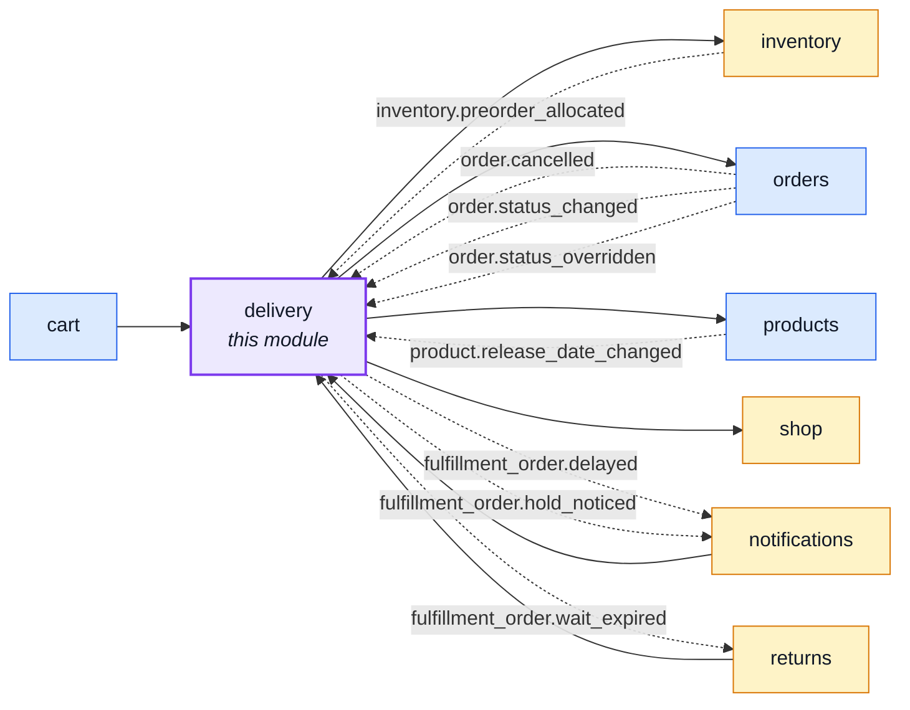
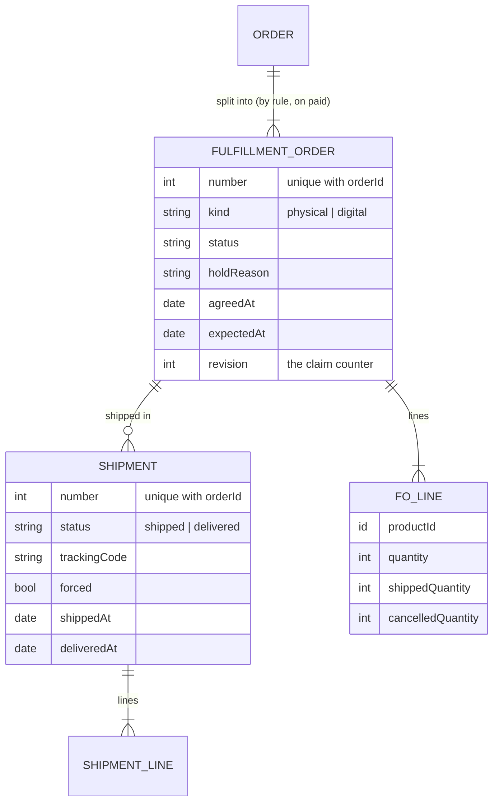
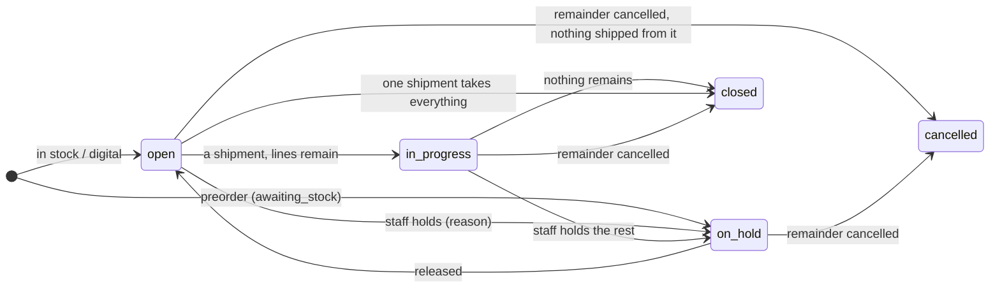
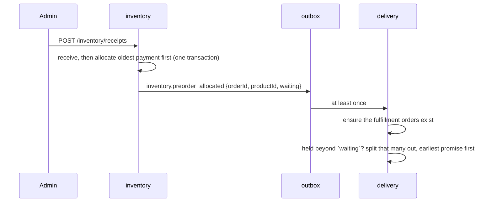
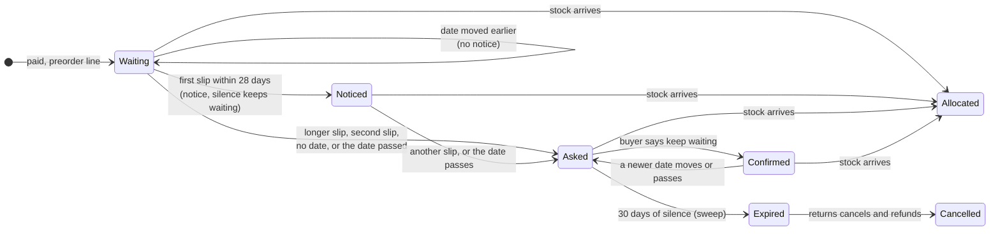
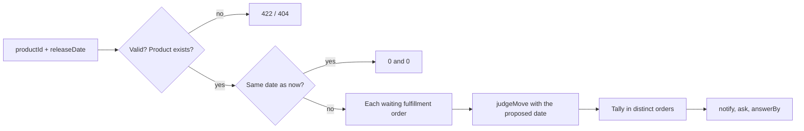
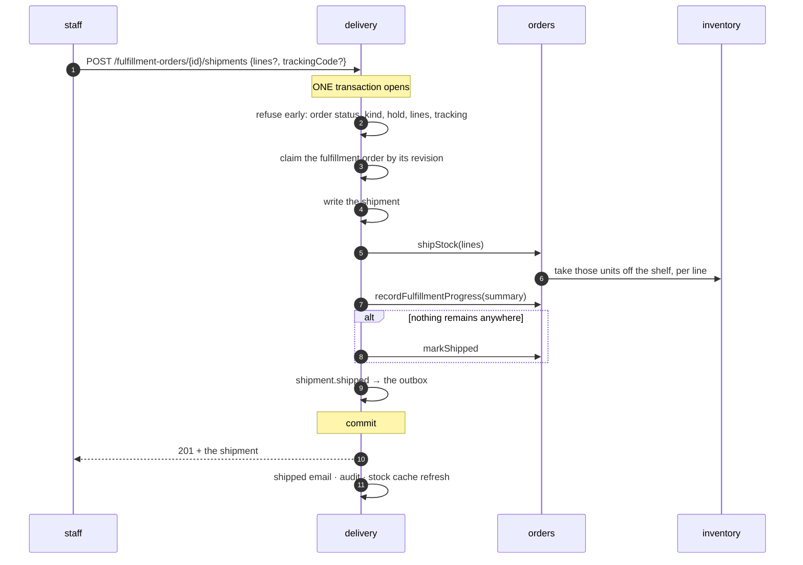

# delivery

::: tip At a glance
**Owns** — shipping rates, fulfillment orders (the groups of an order's lines that leave together) and shipments (what actually left, with its tracking code).
**Depends on** — [`orders`](./orders.md) for the order a fulfillment order is about, and for the stock, mail and status doors it writes through.
**Breaks if you change** — `findShippingMethod` or `priceShipping`. The cart prices a checkout through both. `cancelRemainder` and `shippedQuantities`: [`returns`](./returns.md) reads what has shipped and cancels what has not through them.
:::

## Its neighbourhood

<!-- module-graph:delivery:start -->

_Solid arrows are imports. Dotted arrows are domain events — the return path an import
graph cannot see._

<!-- module-graph:delivery:end -->

## The story

A fulfillment order and a shipment are _about_ an order. The shipped email's language comes through
`orders`' `mailBuyerOfOrder`, so this module never reads the account itself. It is sent from the
`shipment.shipped` listener, like every customer mail ([Customer mail](../tools/outbox.md#customer-mail)).

**The rates are pure functions in `domain/`, and that is what makes the cart's edge cheap to
hold.** [`cart`](./cart.md) imports `findShippingMethod` and `priceShipping` directly — a real,
solid import — but never touches this module's HTTP surface or learns that a shipment record
exists: it receives vocabulary, not state, the narrowest an import can be.

::: tip What deleting this module actually costs
The shipping selector, the fulfilment records and the costs go with it. Orders simply stop carrying a
`shippingCost`. That is a clean removal, not a broken build.
:::

There is no courier simulation: goods move only when staff record it, through this module's own
doors.

Each shipping method (`domain/rates.ts`) says whether it is `tracked` — standard is untracked,
express is tracked, pickup is untracked. `tracked` is what `POST /delivery/fulfillment-orders/{id}/shipments`
enforces: a tracking code is required for a tracked method, on every shipment, refused with a named
422 otherwise.

A method may also declare `minWeight`/`maxWeight`, grams — express caps at 5000g, standard at
30000g, pickup at neither. Unlike `tracked`, this one IS enforced against the basket: `cart`'s
checkout refuses a chosen method whose range the real basket doesn't fit
(`CART_SHIPPING_METHOD_WEIGHT`, 409). A product with no `weight` set counts as 0g, never as a
refusal on its own account.

`requiresAddress` says whether the method needs somewhere to ship to — standard and express do,
pickup does not. `cart`'s checkout is what enforces it — see [Checkout](./cart-checkout.md).

## The two records

One order, one payment, one invoice, as many shipments as it takes. The model is Shopify's, both
layers: the **plan** (what should leave together, and when) and the **act** (what left).

| Word                  | Means                                                                       | Shopify            |
| --------------------- | --------------------------------------------------------------------------- | ------------------ |
| **Fulfillment order** | lines that should leave together, made by the system when the order is paid | `FulfillmentOrder` |
| **Shipment**          | what actually left, at one time, with one tracking code                     | `Fulfillment`      |
| Box                   | the physical carton — not modelled                                          | —                  |

`remaining = quantity − shippedQuantity − cancelledQuantity`, per line, and the server serves it so no
client counts. Lines are keyed by product id, as a return's lines are. A fulfillment order's status
is never decided by a caller: it is derived from its lines and its hold on every write
(`statusOfLines`).

- `closed` — nothing remains, and something shipped from it. `cancelled` — nothing ever shipped from it.
- A shipment is born `shipped` and becomes `delivered`; a **digital** fulfilment is born delivered, in
  the same write (Shopify fulfils digital goods without shipping them too).

### The grouping rule

Pure, in `domain/fulfillment.ts`, over the order's **frozen** line snapshot:

| Lines                             | Fulfillment order                                                                                                         |
| --------------------------------- | ------------------------------------------------------------------------------------------------------------------------- |
| everything that is not a preorder | #1, `open`. `physical` if any line ships, `digital` otherwise. Digital lines of a mixed order ship with the physical ones |
| preorder lines, release day D     | one per distinct day, `on_hold` for `awaiting_stock`, `agreedAt = expectedAt =` the latest release date of its lines      |

The preorder flag and the date are read from the snapshot frozen at checkout, never from the product
at payment time: a bank transfer can be paid a week after it was ordered. `agreedAt` is the date the
buyer was shown, and it never moves; `expectedAt` starts equal to it and is rewritten if the date
slips. A group of one day leaves together, so it is promised for the latest release instant among
its lines. A product line that carries neither flag simply lands in #1.

### Holds

| Reason                                               | Set by            | Released by                                                                                                                        |
| ---------------------------------------------------- | ----------------- | ---------------------------------------------------------------------------------------------------------------------------------- |
| `awaiting_stock`                                     | the grouping rule | **only** the allocation of stock. A hand release would ship goods the ledger never counted out — a consistency guard, not a policy |
| `incorrect_address`, `high_risk`, `other` (+ a note) | staff, `…/hold`   | staff, `…/release`                                                                                                                 |

A fulfillment order is **never** shipped from `on_hold`, forced or not.

**What the buyer sees is not the reason.** Staff's reason can be an internal call (a risk check), and
naming it tips off the people a check exists for, so the buyer gets one of three notices, mapped
once in `domain/hold-notice.ts`:

| Staff's reason       | The buyer reads                          | Mailed (and an inbox row)?                      |
| -------------------- | ---------------------------------------- | ----------------------------------------------- |
| `awaiting_stock`     | `holdNotice: awaiting_stock`             | never                                           |
| `incorrect_address`  | `check_address`: the buyer can act       | always                                          |
| `high_risk`, `other` | `delayed`: the same plain delay for both | only when staff wrote a `message` for the buyer |

Hiding the hold instead would put a false "being prepared" on a held order (UCPD Art. 6(1)(b)) and leave
a wrong address unfixable. `holdReason` and `holdNote` are staff's (and the buyer's own GDPR export);
`holdMessage`, the optional sentence staff write **for** the buyer (`message` on `…/hold`, at most 500
characters), is read by everyone and is dropped with the hold on release. It is not scrubbed with
the note: it is something the shop told a customer. A mail and an inbox row come from one fact,
`fulfillment_order.hold_noticed`, written in the hold's transaction. When the address is wrong, staff
correct it with [`PUT /orders/{id}/shipping-address`](./orders.md#correcting-the-shipping-address).

### A short stock delivery

A preorder line asked for 3 units and the stock that arrived covers 2. The allocation calls
`splitForAllocation`: the 2 allocated units move to a **new `open`** fulfillment order (the next
number, the dates copied) and can ship; the third stays `on_hold` for `awaiting_stock`. When the
arrival covers everything the hold simply ends. This is the system split (Shopify's
`fulfillmentOrderSplit`, CRD Art. 9(2)(b)(i) and the FTC Mail Order Rule all expect partial
shipment): waiting for all three would hold back goods already on the shelf, and a hand release is
refused. Staff have no button for it — they can still hold the new `open` order to ship everything
together. No route reaches it: `inventory` allocates, and this module listens.

The event carries `waiting`, what the order still claims of that product, rather than how many were
allocated. A state survives redelivery: the listener releases whatever it holds beyond `waiting`, and
the second time there is nothing beyond it. If one order holds the same product for two release
dates, the earliest `agreedAt` is served first.

### Preorders and a moved date

The buyer of a preorder was promised a date, and that promise is law: the date shown when ordering
is the agreed one (CRD Art. 18), and a seller who cannot keep a mail-order date must tell the buyer
before it and offer a cancel (FTC 16 CFR 435.2). `agreedAt` is frozen; `expectedAt` is the date the
fulfillment order is expected now. **This module owns the whole flow**, because both dates live on
its fulfillment order and `orders → delivery` is forbidden.

When an admin moves a product's `releaseDate`, `products` announces `product.release_date_changed`,
and every fulfillment order still waiting for that product is judged by a pure table
(`domain/preorder.ts`). The notice goes out the moment the admin saves, so it is always before the
old date, unless the admin moves it after the date has passed; the daily sweep catches that case.

| The new date is...                                    | The buyer gets                                         | Law, and our margin                               |
| ----------------------------------------------------- | ------------------------------------------------------ | ------------------------------------------------- |
| not later than the date expected                      | nothing; the order page shows the new date             | none owed                                         |
| a **first** slip, at most **28** days past the agreed | a notice with the cancel option; silence keeps waiting | FTC (b)(1)(ii) allows 30; two days for time zones |
| a longer slip, **or** any second one                  | a question: keep waiting, or cancel                    | FTC (b)(1)(iii), (b)(2)(ii): silence is a cancel  |
| none: the date was cleared                            | the same question, with no new date to offer, once     | an indefinite delay                               |

A question opens a 30-day window (`consent: awaiting`, `consentDeadline`). The buyer answers
`POST /delivery/fulfillment-orders/{id}/confirm-wait` (`consent: confirmed`), cancels (the existing
cancel or remainder cancel), or says nothing. The fulfillment order carries the whole state: `slips`
(later dates already told), `consent`, `consentDeadline`, `lastNoticeAt` and `cancelReason`. Moving a
date earlier writes only `expectedAt`. Which date is expected is read from the catalogue, the latest
release date among the products still waiting, so a group of several stays right when one of them
moves; the event only says that something moved, and a redelivery finds the date already expected.
A product that still waits with no release date makes the whole group undated (it cannot leave
before that product), and an undated group has no `expectedAt` at all: a cleared date removes it, so
a redelivered event finds nothing to move and asks nobody twice.

### Previewing a move before it is saved

`GET /delivery/fulfillment-orders/release-date-impact?productId=&releaseDate=` tells staff, before
they save, how many **orders** the move would notify (`notify`) or ask (`ask`), and the `answerBy`
a question would carry. It runs the listener's own rule (`expectedDateOf` and `judgeMove` in
`domain/preorder.ts`) against the date that would be, and writes nothing, so the two cannot drift.

- `releaseDate` absent or blank previews a **cleared** date.
- The same format and "at most one year ahead" rule as the product save.
- An order with groups in both buckets counts once, under `ask`.
- Guarded by `update:Product` **and** `display:Order`: an editor moves dates but sees no order volume.
- A snapshot: a payment or a shipment between the preview and the save can shift a count.

Every notice is one transaction with the state it leaves on the fulfillment order and one outbox
event, `fulfillment_order.delayed`; the email follows the commit and links to the buyer's order
page, where the cancel button already is. [`notifications`](./notifications.md) turns the event into an
inbox row, `notifications.preorder-delayed` when it only informs and `notifications.preorder-confirm-wait`
when the buyer must answer.

#### The daily sweep

`npm run sweep:preorders` (02:20 UTC, under a lease; [scheduled jobs](../reference/ops.md#scheduled-jobs))
does two things, and only to fulfillment orders still `on_hold` for stock:

- a fulfillment order whose **current** `expectedAt` has passed with no stock, and no notice since, asks
  the same question. It is keyed on `expectedAt`, not `agreedAt`: after an accepted slip the agreed date
  is long gone and only the expected one can still be missed. `lastNoticeAt` is what stops a daily
  repeat;
- one asked and not answered for 30 days is marked `consent: expired` and announced as
  `fulfillment_order.wait_expired`. [`returns`](./returns.md#a-wait-nobody-answered) cancels and refunds
  it. It is announced again each day until the cancel lands, so a failed cancel retries by itself.

Units already allocated but not shipped (`open`) are left alone: goods on the shelf are a short, definite
delay (FTC (b)(1)(ii)), not an indefinite one, and the buyer can already cancel any time before dispatch.
The admin's Late view is where they show.

### The preorder board

The admin's preorder board (ADMIN_SALES 3) reads two things from here. The grain is the fulfillment
order, not the order line: the agreed and expected date, the hold, the consent state and the cancel
reason all live on it, and `orders → delivery` is forbidden, so `orders` could not serve those columns.

| Route                                                  | Answers                                                                                                 |
| ------------------------------------------------------ | ------------------------------------------------------------------------------------------------------- |
| `GET /delivery/fulfillment-orders`                     | one row per fulfillment order, with its buyer, `paidAt`, `state`, `late`, `delivered`, `slippedDays`    |
| `GET /delivery/fulfillment-orders/summary`             | per product, in units: paid, waiting, awaiting a yes, allocated, shipped, cancelled, late               |
| `GET /delivery/fulfillment-orders/release-date-impact` | orders a release-date move would notify or ask, before it is saved (`update:Product` + `display:Order`) |

Filters on the list: `preorder` (made from a preorder line, the ones that carry an agreed date),
`state`, `productId`, `late` and `dueWithin`.

| `state`        | The fulfillment order is...                                                                          |
| -------------- | ---------------------------------------------------------------------------------------------------- |
| `waiting`      | paid and held for stock, the buyer not being asked anything                                          |
| `awaiting_yes` | held for stock, and the buyer was asked to keep waiting (or the window closed, the cancel pending)   |
| `allocated`    | stock is set aside for it and not all shipped; a staff hold on such goods is still `allocated`       |
| `shipped`      | nothing remains and something shipped; `delivered` says whether every shipment also arrived          |
| `cancelled`    | nothing remains and nothing shipped; `cancelReason` says who: `buyer`, `staff`, `no_answer`, `order` |

`late` is the Late view: the expected date has passed and units remain, whether still waiting, allocated
and not shipped, or part shipped. It is where goods on the shelf show, which the daily sweep deliberately
does not ask the buyer about. `dueWithin=N` is its early warning, for fulfillment orders still waiting
and expected within N days: a slip moved before the date passes is a notice, and one moved after is a
question. The queue key stock is allocated by is the hold's `committedAt`, stamped in the payment's own
transaction, so `paidAt` here orders the buyers the way `inventory` does.

**Who reads it** is the audience of the orders themselves: the key is `display:Order` (decided A5.2,
because there is one audience and one permission for it). A route guard cannot tell that key from a
buyer's own `read:Order`, which collapses onto it, so the scope is in the query: staff who read
every order see every row; anyone else sees only their own orders' fulfillment orders. The buyer and
`paidAt` come from `orders`, one batched read a page (`orderBriefsByIds`).

### When they are made

| Path       | What                                                                                                                                                                                                          |
| ---------- | ------------------------------------------------------------------------------------------------------------------------------------------------------------------------------------------------------------- |
| Normal     | this module listens to `order.status_changed {to: paid}` through the outbox, as `invoicing` does. Idempotent on `{ orderId, number }`                                                                         |
| Safety net | `ensureFulfillmentOrders` runs the same idempotent create on every read and every `start` of a paid order: the outbox gives up after its last retry, and a missing fulfillment order would leave no ship door |
| Not paid   | `GET /delivery/order/{orderId}` answers `200` with both lists empty                                                                                                                                           |

## One transaction per act

A ship, deliver, fulfil, hold, release or remainder cancel writes, together or not at all:
**the record**, **the order's summary**, **the order's status move when one is due**, **the outbox
events** — and, for a shipment, **the units leaving the shelf**. Refusals are decided before the first
write, inside the same snapshot the writes land in.

`orders` cannot import `delivery`, so the order carries a small **summary** (`fulfillment.shipped`,
`remaining`, `onHold`, `awaitingStock`, `undelivered`, `lastDeliveredAt`) that only `delivery` writes,
only through `orderService.recordFulfillmentProgress`, recomputed from the records themselves inside
the act's transaction. A stale read can never overwrite a newer one. The order's `fulfillmentStatus`
and its `cancel` and `withdraw` flags read that summary.

Two acts racing the same remainder cannot both land: each claims the fulfillment order by its
`revision`, in the filter of the write, and the loser gets a 409. A ship racing a cancel cannot both
win either: the summary write is conditional on the order still being fulfillable, and a whole-order
cancel is conditional on `fulfillment.shipped` not being set.

## Shipping

`POST /delivery/fulfillment-orders/{id}/shipments {lines?, trackingCode?, forced?, reason?}` → `201`.
`lines` omitted ships everything that remains. The order moves `processing → shipped` only when the
shipment leaves **nothing** remaining anywhere; until then it stays `processing`, and its
`fulfillmentStatus` reads `partially_fulfilled`. Refused:

| Case                                                                                          | Answer                                          |
| --------------------------------------------------------------------------------------------- | ----------------------------------------------- |
| more than remains, a product that is not there, the same twice                                | `422 DELIVERY_LINES_INVALID`                    |
| a tracked method with no code                                                                 | `422 DELIVERY_TRACKING_CODE_REQUIRED`           |
| a fulfillment order on hold, closed or cancelled; a cancelled or never-paid (`pending`) order | `409 DELIVERY_NOT_SHIPPABLE`                    |
| a forced first shipment that finds the order no longer `paid` (it moved meanwhile)            | `409 ORDER_NOT_PAID`                            |
| a digital one                                                                                 | `409 DELIVERY_NOT_PHYSICAL` — fulfil it instead |
| an order that is not `processing`                                                             | `409 ORDER_NOT_PROCESSING`                      |

### `forced`

`forced` lets staff skip a step, never a rule: ship from `paid` without `start` (the order then moves
`paid → processing → …` by itself), or record a delivery without a carrier confirmation. It needs
`override:Order` (itself step-up gated, and the route asks for the fresh session before the
controller runs) and a `reason`. It leaves a `status_overridden` row on the order's [timeline](./orders.md#the-timeline) —
`orderService.recordForcedFulfilment` appends it without a move of its own — and the shipment is stored with `forced: true`.

## Delivering

`POST /delivery/shipments/{id}/deliver` stamps the shipment. The order moves to `delivered` when this
was the last undelivered shipment **and** nothing remains to ship, and its withdrawal clock starts from
**that** arrival — CRD Art. 9(2)(b)(i): the 14 days run from physical possession of the last good
(Commission Notice 2021/C 525/01 §5.1.2: "a single withdrawal period should apply from the day after
delivery of the last item"). One window per order, from the last good; per-shipment windows would be
shorter than the law allows.

A remainder **cancelled after** every shipment was delivered makes the order `shipped` and `delivered`
in one transaction, the clock counted from the cancellation: the order only became complete then.

## Digital fulfilment

`POST /delivery/fulfillment-orders/{id}/fulfill` is the digital door: a shipment with no tracking, born
and delivered in the same write. Refused for a physical fulfillment order (`DELIVERY_NOT_DIGITAL`);
`ship` refuses a digital one the other way (`DELIVERY_NOT_PHYSICAL`), so the two never overlap. A
digital-only order's window counts from payment (Art. 9(2)(c)).

## The status override

The admin override (`POST /orders/{id}/status-override`) stays an order-level repair, and it must not
leave the two records disagreeing. `orders` announces `order.status_overridden {orderId, from, to, at}`
through the outbox, in the override's own transaction; this module listens:

| The order was overridden to | This module                                                                                                             |
| --------------------------- | ----------------------------------------------------------------------------------------------------------------------- |
| `shipped`                   | cuts a **forced** shipment of every remainder, at `at`                                                                  |
| `delivered`                 | the same, and delivers every shipment still out, with `deliveredAt = at` — the instant `withdrawUntil` was counted from |

The shipments it cuts take no stock (the override already shipped what was left of the hold) and send
no email and no webhook: nothing left that anyone recorded, which keeps the override's "no parcel, no
email". The override is **refused while any unit awaits stock** (`ORDER_OVERRIDE_AWAITING_STOCK`): it would
ship goods the ledger never counted out.

## Cancelling what has not shipped

A cancel of the whole order is only possible while nothing has shipped; this module hears
`order.cancelled` and cancels every fulfillment order. Once anything has shipped, what remains is
cancelled **one fulfillment order at a time**, by [`returns`](./returns.md#cancelling-what-has-not-shipped)
(a Return of `kind: cancellation`) — it moves the money, the stock and the shipping rule, and is the
only module that already reaches all of them. This module only marks the lines:
`cancelRemainder(fulfillmentOrderId, orderId, session, reason)`, called inside `returns`' own
transaction, and stores who cancelled (`cancelReason`: `buyer`, `staff`, `no_answer` or `order`). The
result says whether the fulfillment order was held for stock (`waitingForStock`), because then what
is given back is the preorder allowance and not shelf units.

## The order timeline

Each act writes its rows to the order's [timeline](./orders.md#the-timeline) in its own transaction
(`services/announce.ts`), beside the outbox event it already wrote.

| Row                    | Written when                                                   | Carries                                                      |
| ---------------------- | -------------------------------------------------------------- | ------------------------------------------------------------ |
| `shipment_shipped`     | a shipment is cut (also a digital fulfilment)                  | shipment and fulfillment order ids, `number`, `trackingCode` |
| `shipment_delivered`   | a shipment arrives                                             | the same ids                                                 |
| `fulfillment_held`     | staff hold one, or a preorder group is born on hold            | `reason` code; never the note (staff only)                   |
| `fulfillment_released` | staff, or an allocation of stock, release it (staff only)      | fulfillment order id                                         |
| `remainder_cancelled`  | `returns` cancels what had not shipped                         | fulfillment order id                                         |
| `release_date_moved`   | a product's date moved and this order's expected date followed | fulfillment order id, `from` and `to` (ISO, or `null`)       |
| `delay_notice_sent`    | the buyer was told: the date moved, or it passed               | fulfillment order id, `reason`, `needsAnswer`, dates         |
| `wait_confirmed`       | the buyer said "keep waiting" (their own `actor`)              | fulfillment order id                                         |
| `wait_expired`         | the sweep announced a wait that ran 30 days in silence         | fulfillment order id                                         |

A whole-order cancel writes no `remainder_cancelled`: the order's own `cancelled` row says it. The
shipment row comes first, then the order's own move that it caused (`shipped`, `delivered`).

`release_date_moved` is written by `delivery`, not `orders`: `products` announces the move and
`orders` cannot import it, while `delivery` already judges every waiting fulfillment order. A
redelivered event finds the date already followed and writes no second row. The row's `from` is the
date this order was expecting, not the product's previous date.

## Routes and events

| Route                                                      | Key                 | Answers                                                             |
| ---------------------------------------------------------- | ------------------- | ------------------------------------------------------------------- |
| `POST /delivery/fulfillment-orders/{id}/confirm-wait`      | the order's buyer   | the fulfillment order, `consent: confirmed`                         |
| `GET /delivery/fulfillment-orders` · `/summary`            | `display:Order`     | [the preorder board](#the-preorder-board)'s two reads               |
| `GET /delivery/order/{orderId}`                            | the owner, or staff | `{ fulfillmentOrders[], shipments[] }`, each with its own `actions` |
| `POST /delivery/order/{orderId}/start`                     | `start:Shipment`    | the order, `processing`                                             |
| `POST /delivery/fulfillment-orders/{id}/shipments`         | `update:Shipment`   | `201` + the shipment                                                |
| `POST /delivery/fulfillment-orders/{id}/fulfill`           | `update:Shipment`   | the shipment, delivered                                             |
| `POST /delivery/fulfillment-orders/{id}/hold` · `/release` | `update:Shipment`   | the fulfillment order                                               |
| `PATCH /delivery/shipments/{id}`                           | `update:Shipment`   | the shipment, tracking corrected while it is out                    |
| `POST /delivery/shipments/{id}/deliver`                    | `update:Shipment`   | the shipment                                                        |

Every button a client draws comes from the record's own `actions` (or `GET /returns/options`): the
frontend never re-derives a rule. Every staff door asks the key and nothing else: [no rank](../theory/authorization.md#protecting-people).

| Event                                                 | Payload                                                    | Public webhook                 |
| ----------------------------------------------------- | ---------------------------------------------------------- | ------------------------------ |
| `shipment.shipped`                                    | `{orderId, shipmentId, fulfillmentOrderId, lines}`         | yes — replaces `order.shipped` |
| `shipment.delivered`                                  | the same                                                   | yes                            |
| `fulfillment_order.held` · `.released` · `.cancelled` | `{orderId, fulfillmentOrderId, reason?}`                   | no                             |
| `fulfillment_order.hold_noticed`                      | `{orderId, fulfillmentOrderId, userId?, notice, message?}` | no                             |
| `fulfillment_order.delayed`                           | the dates, the titles, `needsAnswer`, `answerBy`           | no                             |
| `fulfillment_order.wait_expired`                      | `{orderId, fulfillmentOrderId}`                            | no                             |

All are written through the outbox **in the act's transaction**. An order shipped in two goes fires
`shipment.shipped` twice, and the order reaching `shipped` is the last of them.

**Emails**, one per shipment: _shipped_ (its lines, the tracking line when the method carries one, and
"N more items to follow" while anything remains) when it leaves, and _delivered_ (its lines, and on
the delivery that completes the order, the date until which the buyer may withdraw) when it arrives.
Correcting a tracking code (`PATCH /delivery/shipments/{id}`) mails the buyer the same shipped mail with its own
subject and an apology for the earlier code, only when the code actually changed; best effort, after the fix is saved.

## Your data

A shipment and a fulfillment order are the buyer's data by way of their order: `POST /account/export`
carries a `shipments` section (lines, number, tracking, dates) and a `fulfillmentOrders` section
(lines, dates, hold reason, **staff's hold note**): a note a person typed about a person is that
person's data, and the record holds no staff id, so none is exported. The note is also **reaped** — `npm run reap:delivery` unsets it once the fulfillment order has not
changed for `NODE_HOLD_NOTE_RETENTION_DAYS` (default 365), exactly as `reap:returns` does for a return's
text ([why](../theory/data-retention.md#free-text-on-holds)). Lines, status and dates stay: they are the
trail.

## Configuration

| Variable                        | Default | Meaning                                                                              |
| ------------------------------- | ------- | ------------------------------------------------------------------------------------ |
| `NODE_HOLD_NOTE_RETENTION_DAYS` | `365`   | Days without a change before `reap:delivery` unsets a fulfillment order's `holdNote` |

## The return address

The return address is [`shop`'s](./shop.md), not this module's: the placed-order email must name
where goods go. `GET /shop` serves it as `returnAddress` (beside `shipToCountries`), and
[`returns`](./returns.md) names it in the approval notice.

The same module answers "what would standard delivery have cost?" (`cheapestStandardShipping`,
`domain/rates.ts`): a withdrawal refunds delivery only up to that, and `pickup` — collection, not
delivery — never counts, which `requiresAddress: false` already says.

## Who can do what

Every rule this module declares and who holds it, role by role. The rule is what a route guard asks for; the set is what a role lists.

<!-- permissions:start -->

| Rule              | Set                  | `guest` | `unverified` | `customer` | `manager` | `warehouse` | `support` | `editor` | `moderator` | `admin` | `operator` | Credential | What it lets them do                                                                                                             |
| ----------------- | -------------------- | ------- | ------------ | ---------- | --------- | ----------- | --------- | -------- | ----------- | ------- | ---------- | ---------- | -------------------------------------------------------------------------------------------------------------------------------- |
| `update:Shipment` | `DeliveryManagement` | —       | —            | —          | —         | ✅          | —         | —        | —           | ✅      | —          | ✅         | Cut a shipment from a fulfillment order, record its arrival, correct its tracking code, and hold or release a fulfillment order. |
| `start:Shipment`  | `DeliveryStart`      | —       | —            | —          | ✅        | ✅          | —         | —        | —           | ✅      | —          | ✅         | Begin fulfilling a paid order — the move into `processing`, before any parcel exists to record.                                  |

✅ held · `own` only the caller’s own rows · ⚡c / ⚡s needs a freshly proved session (critical / sensitive) ·
Credential: ✅ when an API key can be minted with the rule. Generated from the rules and sets in
`src/modules/*/authorization.yaml` and the roles in `shared/authorization-roles.yaml`, asked of the
evaluator — [Authorization](../theory/authorization.md) explains the model.

<!-- permissions:end -->

## Related pages

- [`orders`](./orders.md) — what a fulfillment order is about, and the summary it reads
- [`returns`](./returns.md) — what comes back, and what is cancelled before it leaves
- [Data Retention](../theory/data-retention.md#free-text-on-holds) — why a hold note is wiped
- [`cart`](./cart.md) — the checkout that prices a method
- [Domain Layer](../theory/domain-layer.md) — why the rates are pure functions
- [Email & PDF Rendering](../tools/email-and-rendering.md) — the shipped notification
- [Strategic DDD](../theory/strategic-ddd.md#_5-published-language-—-the-barrel) — what `published-language` buys
