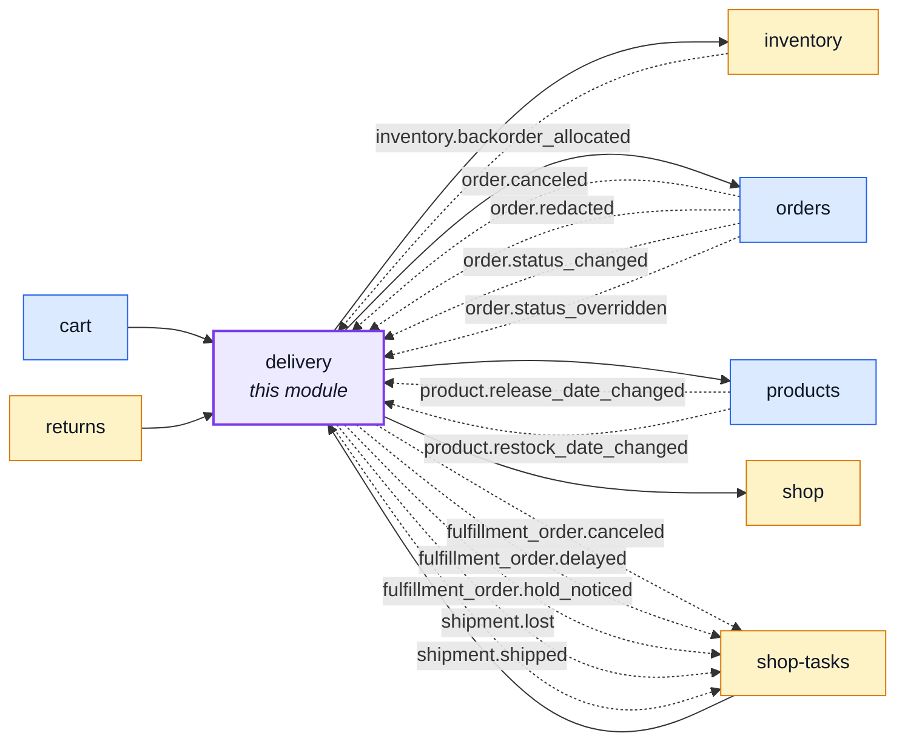

# delivery

Shipping rates as pure rules, fulfillment orders, the staff doors that cut a shipment, record its arrival, report it lost and hold or release a fulfillment order, and what a late preorder owes its buyer.

::: tip At a glance
**Owns** — shipping rates, fulfillment orders (the groups of an order's lines that leave together) and shipments (what actually left, with its tracking code).
**Depends on** — [`orders`](./orders.md) for the order a fulfillment order is about, and for the stock, mail and status doors it writes through; [`inventory`](./inventory.md) for the allocation event that releases a held fulfillment order; [`products`](./products.md) for the moved-release-date event and the dates staff preview; [`shop`](./shop.md) for the currency a rate is quoted in.
**Breaks if you change** — `findShippingMethod` or `priceShipping`. The cart prices a checkout through both. `cancelRemainder` and `shippedQuantities`: [`returns`](./returns.md) reads what has shipped and cancels what has not through them.
:::

## Its neighbourhood

<!-- module-graph:delivery:start -->

_Solid arrows are imports. Dotted arrows are domain events — the return path an import
graph cannot see._

<!-- module-graph:delivery:end -->

## Who can do what

Every rule this module declares and who holds it, role by role. The rule is what a route guard asks for; the set is what a role lists.

<!-- permissions:start -->

| Rule              | Set                  | `guest` | `unverified` | `customer` | `manager` | `warehouse` | `support` | `editor` | `moderator` | `admin` | `operator` | Credential | What it lets them do                                                                                                                                              |
| ----------------- | -------------------- | ------- | ------------ | ---------- | --------- | ----------- | --------- | -------- | ----------- | ------- | ---------- | ---------- | ----------------------------------------------------------------------------------------------------------------------------------------------------------------- |
| `update:Shipment` | `DeliveryManagement` | —       | —            | —          | —         | ✅          | —         | —        | —           | ✅      | —          | ✅         | Cut a shipment from a fulfillment order, record its arrival, correct its tracking code, report a parcel lost or damaged, and hold or release a fulfillment order. |
| `start:Shipment`  | `DeliveryStart`      | —       | —            | —          | ✅        | ✅          | —         | —        | —           | ✅      | —          | ✅         | Begin fulfilling a paid order — the move into `processing`, before any parcel exists to record.                                                                   |

✅ held · `own` only the caller’s own rows · ⚡c / ⚡s needs a freshly proved session (critical / sensitive) ·
Credential: ✅ when an API key can be minted with the rule. Generated from the rules and sets in
`src/modules/*/authorization.yaml` and the roles in `shared/rules/authorization-roles.yaml`, asked of the
evaluator — [Authorization](../understand/authorization.md) explains the model.

<!-- permissions:end -->

## The story

A fulfillment order and a shipment are _about_ an order. The shipped email's language comes through
`orders`' `mailBuyerOfOrder`, so this module never reads the account itself. It is sent from the
`shipment.shipped` listener, like every customer mail ([Customer mail](../understand/outbox.md#customer-mail)).

**The rates are pure functions in `domain/`, and that is what makes the cart's edge cheap to
hold.** [`cart`](./cart.md) imports `findShippingMethod` and `priceShipping` directly — a real,
solid import — but never touches this module's HTTP surface or learns that a shipment record
exists: it receives vocabulary, not state, the narrowest an import can be.

::: tip What deleting this module actually costs
The shipping selector, the fulfilment records and the costs go with it. Orders simply stop carrying a
`shippingCost`. That is a clean removal, not a broken build.
:::

There is no courier simulation: goods move only when staff record it, through this module's own
doors.

Each shipping method (`domain/rates.ts`) says whether it is `tracked` — standard is untracked,
express is tracked, pickup is untracked. `tracked` means the carrier gives a code the buyer can follow. The ship door never
requires it: a parcel may leave first and get its code later, with `PATCH /delivery/shipments/{id}`.
`Shipment.awaitingTracking` is the server's answer to "tracked, still waiting for its code" (a
physical, `shipped` parcel on a tracked method with none), so a client draws one chip and staff's
digest counts the same rows.

A method may also declare `minWeight`/`maxWeight`, grams — express caps at 5000g, standard at
30000g, pickup at neither. Unlike `tracked`, this one IS enforced against the basket: `PUT /cart/shipping-method`
refuses a method whose range the real basket doesn't fit (`CART_SHIPPING_METHOD_WEIGHT`, 409). At
checkout a stored choice the basket has outgrown counts as none, and a physical basket with none is
refused (`CART_SHIPPING_METHOD_REQUIRED`, 422) — see [Checkout](./cart-checkout.md). A product with no `weight` set counts as 0g, never as a
refusal on its own account.

`requiresAddress` says whether the method needs somewhere to ship to — standard and express do,
pickup does not. `cart`'s checkout is what enforces it — see [Checkout](./cart-checkout.md).

## The two records {#the-two-records}

One order, one payment, one invoice, as many shipments as it takes. The model is Shopify's, both
layers: the **plan** (what should leave together, and when) and the **act** (what left).

Full detail: [Fulfillment orders and shipments](./delivery-records.md#the-two-records).

### The daily sweep {#the-daily-sweep}

See [Fulfillment orders and shipments](./delivery-records.md#the-daily-sweep).

### What staff do about a late order {#what-staff-do-about-a-late-order}

See [Fulfillment orders and shipments](./delivery-records.md#what-staff-do-about-a-late-order).

### The grouping rule {#the-grouping-rule}

See [Fulfillment orders and shipments](./delivery-records.md#the-grouping-rule).

### Holds {#holds}

See [Fulfillment orders and shipments](./delivery-records.md#holds).

### A short stock delivery {#a-short-stock-delivery}

See [Fulfillment orders and shipments](./delivery-records.md#a-short-stock-delivery).

### Preorders and a moved date {#preorders-and-a-moved-date}

See [Fulfillment orders and shipments](./delivery-records.md#preorders-and-a-moved-date).

### Previewing a move before it is saved {#previewing-a-move-before-it-is-saved}

See [Fulfillment orders and shipments](./delivery-records.md#previewing-a-move-before-it-is-saved).

### The preorder board {#the-preorder-board}

See [Fulfillment orders and shipments](./delivery-records.md#the-preorder-board).

### When they are made {#when-they-are-made}

See [Fulfillment orders and shipments](./delivery-records.md#when-they-are-made).

## One transaction per act {#one-transaction-per-act}

A ship, deliver, fulfil, hold, release or remainder cancel writes, together or not at all:
**the record**, **the order's summary**, **the order's status move when one is due**, **the outbox
events** — and, for a shipment, **the units leaving the shelf**. Refusals are decided before the first
write, inside the same snapshot the writes land in.

Full detail: [Cutting, shipping and delivering](./delivery-acts.md#one-transaction-per-act).

## Shipping {#shipping}

`POST /delivery/fulfillment-orders/{id}/shipments {lines?, trackingCode?}` → `201`.
`lines` omitted ships everything that remains. The order moves `processing → shipped` only when the
shipment leaves **nothing** remaining anywhere; until then it stays `processing`, and its
`fulfillmentStatus` reads `partially_fulfilled`. Refused:

Full detail: [Cutting, shipping and delivering](./delivery-acts.md#shipping).

## Delivering {#delivering}

`POST /delivery/shipments/{id}/deliver` stamps the shipment. The order moves to `delivered` when this
was the last undelivered shipment **and** nothing remains to ship, and its withdrawal clock starts from
**that** arrival — CRD Art. 9(2)(b)(i): the 14 days run from physical possession of the last good
(Commission Notice 2021/C 525/01 §5.1.2: "a single withdrawal period should apply from the day after
delivery of the last item"). One window per order, from the last good; per-shipment windows would be
shorter than the law allows.

Full detail: [Cutting, shipping and delivering](./delivery-acts.md#delivering).

## Lost in transit {#lost-in-transit}

`POST /delivery/shipments/{id}/mark-lost` (`update:Shipment`, no step-up) is for a parcel that left and
will not arrive: `{ reason: lost | damaged, note?, message? }`. **`damaged` means damaged in
transit and reported before its arrival was recorded.** Damage found after the buyer has the goods is
a [return](./returns.md), not this door. Only a `shipped` physical shipment on a `processing` or
`shipped` order can be reported (`DELIVERY_NOT_LOSABLE`).

Full detail: [Lost shipments and replacements](./delivery-lost-and-replaced.md#lost-in-transit).

### The lost parcel turns up {#the-lost-parcel-turns-up}

See [Lost shipments and replacements](./delivery-lost-and-replaced.md#the-lost-parcel-turns-up).

## Replacement after a return {#replacement-after-a-return}

A return received with `remedy: replace` ([returns](./returns.md#the-remedy-ladder)) sends the same
product again on the **same order**: no new order, invoice or revenue. It reuses a lost parcel's
machinery, in the receipt's own transaction:

Full detail: [Lost shipments and replacements](./delivery-lost-and-replaced.md#replacement-after-a-return).

## Digital fulfilment

`POST /delivery/fulfillment-orders/{id}/fulfill` is the digital door: a shipment with no tracking, born
and delivered in the same write. Refused for a physical fulfillment order (`DELIVERY_NOT_DIGITAL`);
`ship` refuses a digital one the other way (`DELIVERY_NOT_PHYSICAL`), so the two never overlap. A
digital-only order's window counts from payment (Art. 9(2)(c)).

## The status override

The admin override (`POST /orders/{id}/override-status`) stays an order-level repair, and it must not
leave the two records disagreeing. `orders` announces `order.status_overridden {orderId, from, to, at}`
through the outbox, in the override's own transaction; this module listens:

| The order was overridden to | This module                                                                                                             |
| --------------------------- | ----------------------------------------------------------------------------------------------------------------------- |
| `shipped`                   | cuts a **forced** shipment of every remainder, at `at`                                                                  |
| `delivered`                 | the same, and delivers every shipment still out, with `deliveredAt = at` — the instant `withdrawUntil` was counted from |

The shipments it cuts take no stock (the override already shipped what was left of the hold) and send
no email and no webhook: nothing left that anyone recorded, which keeps the override's "no parcel, no
email". A forward override to `shipped` or `delivered` is **refused while any unit awaits stock**
(`ORDER_OVERRIDE_AWAITING_STOCK`): it would ship goods the ledger never counted out. A move to
`processing` ships nothing and is allowed.

If the fulfillment records cannot follow the override (a unit changed state in between), the listener
throws instead of dropping the refusal: the outbox retries, and a persistent failure is a dead event
(`OutboxEventsDead`, the admin `outbox-dead` bell). Until then the order reads `shipped` while a
fulfillment order is still open, so staff watch for that bell after an override.

## Cancelling what has not shipped

A cancel of the whole order is only possible while nothing has shipped; this module hears
`order.canceled` and cancels every fulfillment order. Once anything has shipped — or before, while
another fulfillment order still has units to send — what remains is cancelled **one fulfillment order
at a time**, by [`returns`](./returns.md#cancelling-what-has-not-shipped)
(a Return of `kind: cancellation`) — it moves the money, the stock and the shipping rule, and is the
only module that already reaches all of them. This module only marks the lines:
`cancelRemainder(fulfillmentOrderId, orderId, session, reason)`, called inside `returns`' own
transaction, and stores who cancelled (`cancelReason`: `buyer`, `staff`, `order`, or `found` for the owed units of a lost parcel that turned up). The
result says whether the fulfillment order was held for stock (`waitingForStock`), because then what
is given back is the preorder allowance and not shelf units.

## The order timeline

Each act writes its rows to the order's [timeline](./orders.md#the-timeline) in its own transaction
(`services/announce.ts`), beside the outbox event it already wrote.

| Row                    | Written when                                                   |
| ---------------------- | -------------------------------------------------------------- |
| `shipment_shipped`     | a shipment is cut (also a digital fulfilment)                  |
| `shipment_delivered`   | a shipment arrives                                             |
| `shipment_lost`        | staff report a shipment lost or damaged                        |
| `fulfillment_held`     | staff hold one, or a preorder group is born on hold            |
| `fulfillment_released` | staff, or an allocation of stock, release it (staff only)      |
| `remainder_canceled`   | `returns` cancels what had not shipped                         |
| `release_date_moved`   | a product's date moved and this order's expected date followed |
| `delay_notice_sent`    | the buyer was told: the date moved, or it will be missed       |

What each row carries is its variant in `OrderTimeline*` of `src/modules/orders/openapi.yaml`; never the staff note or the buyer's message.

A whole-order cancel writes no `remainder_canceled`: the order's own `canceled` row says it. The
shipment row comes first, then the order's own move that it caused (`shipped`, `delivered`). A
`remainder_canceled` row, and the `shipped` or `delivered` move the cancel completes, name the
account that made the cancel: the buyer, or the staff member acting for them.

`release_date_moved` is written by `delivery`, not `orders`: `products` announces the move and
`orders` cannot import it, while `delivery` already judges every waiting fulfillment order. A
redelivered event finds the date already followed and writes no second row. The row's `from` is the
date this order was expecting, not the product's previous date.

## Routes and events

| Route                                                      | Answers                                                                                                                                                                                |
| ---------------------------------------------------------- | -------------------------------------------------------------------------------------------------------------------------------------------------------------------------------------- |
| `GET /delivery/methods`                                    | the shipping methods and what each costs                                                                                                                                               |
| `GET /delivery/fulfillment-orders` · `/summary`            | [the preorder board](#the-preorder-board)'s two reads                                                                                                                                  |
| `GET /delivery/fulfillment-orders/restock-date-impact`     | orders a restock-date move would email, before it is saved                                                                                                                             |
| `GET /orders/{id}/fulfillment-orders` · `/shipments`       | `{ items[] }` each, every item with its own `actions`; unpaged                                                                                                                         |
| `POST /orders/{id}/process`                                | the order, `processing`                                                                                                                                                                |
| `POST /delivery/fulfillment-orders/{id}/shipments`         | `201` + `Location` + the shipment; REQUIRED `Idempotency-Key` (a retry would cut a second parcel), see [do-not-retry operations](../understand/idempotency.md#do-not-retry-operations) |
| `POST /delivery/fulfillment-orders/{id}/fulfill`           | `201` + `Location` like ship, the shipment delivered; optional `Idempotency-Key` (it takes the whole remainder, so a re-run is refused by the order's state)                           |
| `POST /delivery/fulfillment-orders/{id}/hold` · `/release` | the fulfillment order                                                                                                                                                                  |
| `PATCH /delivery/shipments/{id}`                           | the shipment, tracking added or corrected, at any time (shipped, delivered or lost)                                                                                                    |
| `POST /delivery/shipments/{id}/deliver`                    | the shipment                                                                                                                                                                           |
| `POST /delivery/shipments/{id}/mark-lost`                  | the shipment, `lost`                                                                                                                                                                   |

The key each route asks is in `src/modules/delivery/routes.ts`: the shipment doors take `update:Shipment` (`fulfill` also `start:Shipment` from `paid`), `process` takes `start:Shipment`, the reads are `display:Order`, the order's owner, or public for the methods.

Every button a client draws comes from the record's own `actions` (or `GET /returns/options`): the
frontend never re-derives a rule. Every staff door asks the key and nothing else: [no rank](../understand/authorization.md#protecting-people).

`FulfillmentOrderActions.ship` and `fulfill` are true on a `paid` order only for a caller who also holds
`start:Shipment`. `ShipmentActions.update` is the tracking-code edit
and `markLost` the lost-parcel report.

| Event                                                | Public webhook                 |
| ---------------------------------------------------- | ------------------------------ |
| `shipment.shipped`                                   | yes — replaces `order.shipped` |
| `shipment.delivered`                                 | yes                            |
| `shipment.lost`                                      | yes — the reason code only     |
| `fulfillment_order.held` · `.released` · `.canceled` | no                             |
| `fulfillment_order.hold_noticed`                     | no                             |
| `fulfillment_order.delayed`                          | no                             |

The payloads are the events of the contract (`asyncapi.yaml`).

All are written through the outbox **in the act's transaction**. An order shipped in two goes fires
`shipment.shipped` twice, and the order reaching `shipped` is the last of them.

**Emails**, one per shipment: _shipped_ (its lines, the tracking line when the method carries one, and
"N more items to follow" while anything remains) when it leaves, and _delivered_ (its lines, and on
the delivery that completes the order, the date until which the buyer may withdraw) when it arrives.
Setting a tracking code (`PATCH /delivery/shipments/{id}`) mails the buyer the same shipped mail with its
own subject, only when the code actually changed; best effort, after the save. The first code of a parcel
that left without one says "your tracking code is ready"; a replacement says it changed, with an apology
for the earlier code. The audit row records the code before and after.

The code can be set at any time, delivered and lost shipments included: it is most useful later, as dispute
evidence. A digital shipment never had a carrier and refuses it with `DELIVERY_NOT_PHYSICAL`; the
shipment stores the fulfillment order's `kind` for that reason.

## Your data

A shipment and a fulfillment order are the buyer's data by way of their order: `POST /account/export`
carries a `shipments` section (lines, number, tracking, dates, and for a loss its reason, message and **staff's note**) and a `fulfillmentOrders` section
(lines, dates, hold reason, **staff's hold note**): a note a person typed about a person is that
person's data, and the record holds no staff id, so none is exported. The note is also **reaped** — `npm run job reap:delivery` unsets it once the fulfillment order has not
changed for `NODE_HOLD_NOTE_RETENTION_DAYS` (default 365), and a lost parcel's `lostNote` with it (`lostMessage` stays: it was sent to the buyer), exactly as `reap:returns` does for a return's
text ([why](../understand/data-retention.md#free-text-on-holds)). Lines, status and dates stay: they are the
trail.

## Configuration

| Variable                                  | Default | Meaning                                                                                                                                                       |
| ----------------------------------------- | ------- | ------------------------------------------------------------------------------------------------------------------------------------------------------------- |
| `NODE_HOLD_NOTE_RETENTION_DAYS`           | `365`   | Days without a change before `reap:delivery` unsets a fulfillment order's `holdNote`                                                                          |
| `NODE_DELIVERY_UNDELIVERED_REMINDER_DAYS` | —       | Owned by [`shop-tasks`](./shop-tasks.md#configuration), which counts the undelivered parcels for the staff digest; `deliveryDigest` only receives the number. |

The undelivered count takes physical shipments still `shipped` past that age. A lost parcel, a delivered
one and a digital fulfillment are all left out.

## The return address

The return address is [`shop`'s](./shop.md), not this module's: the placed-order email must name
where goods go. `GET /shop` serves it as `returnAddress` (beside `shipToCountries`), and
[`returns`](./returns.md) names it in the approval notice.

The same module answers "what would standard delivery have cost?" (`cheapestStandardShipping`,
`domain/rates.ts`): a withdrawal refunds delivery only up to that, and `pickup` — collection, not
delivery — never counts, which `requiresAddress: false` already says.

## Read next

- [Cutting, shipping and delivering](./delivery-acts.md) — a deeper page of this module
- [Lost shipments and replacements](./delivery-lost-and-replaced.md) — a deeper page of this module
- [Fulfillment orders and shipments](./delivery-records.md) — a deeper page of this module
- [`orders`](./orders.md) — what a fulfillment order is about, and the summary it reads
- [`returns`](./returns.md) — what comes back, and what is cancelled before it leaves
- [Data Retention](../understand/data-retention.md#free-text-on-holds) — why a hold note is wiped
- [`cart`](./cart.md) — the checkout that prices a method
- [Domain Layer](../understand/domain-layer.md) — why the rates are pure functions
- [Email & PDF Rendering](../understand/email-and-rendering.md) — the shipped notification
- [Strategic DDD](../understand/strategic-ddd.md#_5-published-language-—-the-barrel) — what `published-language` buys
