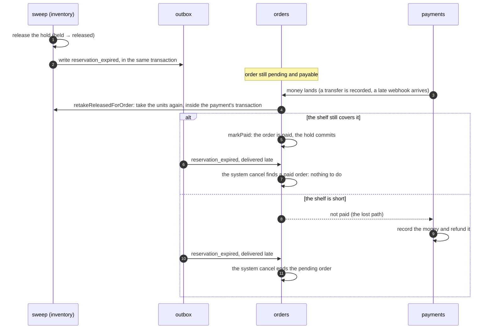

# Orphaned holds and the ledger

What it means when a paid order has no stock hold, and why the ledger is half of every stock transition.

## A paid order with no hold at all is an incident, not a no-op {#orphaned-hold}

A paid order always commits its hold, and a shipped one always ships it. When `commitForOrder`'s or
`shipForOrder`'s claim misses, that is one of three very different facts, and it tells them apart
before deciding what to do:

- the hold is already `committed` or `shipped` — a redelivered settlement, or a repeated dispatch
  report; the sale already stands. Silent, correctly: replaying it is not new information.
- the hold is `released` at **ship**. Silent too: a remainder cancel emptied it after a partial
  shipment, so nothing is left to take. (At **commit** a `released` hold is not an incident either:
  the units are taken again, see the next section.)
- the hold **never existed**. No checkout door can produce that: it means seeded or hand-edited
  data. Alarmed: an `admin.commit.orphaned` audit row, `outcome: 'failure'`, naming the order and the
  `stage` (`commit` or `ship`). The only other alarm is a `released` hold at commit whose units were
  sold in the meantime and cannot be taken back, a safety net for any caller that did not use
  `markPaid`.

The alarm **records** the fact and **pages**: the counter `inventory_commit_orphaned_total{stage}` rises
with it, which fires the `PaidOrderWithoutHold` alert (severity `critical`, see
[Prometheus](../operate/prometheus.md)). A human checks the stock and decides ship or refund. The payment's
own step also announces `inventory.hold_orphaned` in its transaction, which opens a `paid_without_hold`
task for the warehouse ([tasks](./tasks.md#system-tasks)); it closes when the order is cancelled or
ships. The shipping step alarms but opens no task: the goods already left.

::: info Where the page goes
`critical` means email **and** every other channel that is set (the webhook, ntfy, Telegram, Pushover). Until one
of those is set, only the email reaches anyone, so read the alert mailbox. The phone push is set up in
[Prometheus](../operate/prometheus.md#phone-push), not in this module.
:::

### When the alert fires

1. Read the `admin.commit.orphaned` audit row: it names the order, the `stage` and the
   `reservationStatus`. `none` means no hold ever existed; `released` at `commit` means the units
   were sold in the meantime and could not be taken again.
2. `none` means the database was edited or restored, not that a payment arrived late: no checkout
   door produces an order without a hold.
3. **Stage `commit`:** no route restores a hold: if the units are on the shelf, that is a technician's database
   edit, or cancel the order through the `paid_without_hold` to-do, which refunds it. If they are
   not on the shelf, cancel the order.
4. **Stage `ship`:** the units left the shelf without a hold behind them. Lower `onHand` with an
   `adjust` so the count is true again.
5. Find out who changed the database or what restore put the order out of step with the stock.

### Money can land on a released hold: take the units again

An expiry is two transactions, not one: the sweep releases the hold and writes
`inventory.reservation_expired` (`expireOne`), and `orders` cancels the order later, when the
outbox delivers that event (`expireReservationById`). They cannot be one transaction because
`inventory` may not import `orders`. In between, the order still says `pending` and is payable
while its hold is `released`, and the units it gave up may already belong to someone else.

| Situation                                 | How long the order is payable with no hold                  |
| ----------------------------------------- | ----------------------------------------------------------- |
| normal (`nudgeOutbox()` after the commit) | milliseconds                                                |
| the nudge fails                           | up to a minute (the `sweep:outbox` cron is the backstop)    |
| the cancel throws                         | backoff retries, up to `NODE_OUTBOX_MAX_ATTEMPTS`           |
| retries exhausted, the row goes `dead`    | unbounded: the order stays `pending`, payable, with no hold |

**The rule: money that lands on a released hold takes the units again, inside the payment's own
transaction, before the order is written `paid`.** `markPaid` (`orders`) first reads the order in
that transaction: one that can no longer be paid (the sweep already cancelled it) takes nothing back,
so the ledger gets no reserve-then-release pair for it. A payable order asks
`inventoryService.retakeReleasedForOrder`:

- the hold is not released: nothing to do, the normal commit follows.
- the shelf still covers it: the hold goes `released → held` and every line's counters move again
  (one conditional write each, so two late payments racing for the last unit meet in the database
  and exactly one wins). The order is written `paid` and the hold commits as usual; the late
  `reservation_expired` cancel then finds a paid order and does nothing.
- the shelf is short (a line sold meanwhile): the lines already taken are given back, the hold goes
  back to `released`, and `markPaid` answers `null` without writing `paid`. The payment then takes
  the existing `lost` path: it is recorded as received and refunded (a card or provider refund is
  sent; a hand-recorded payment leaves the refund open for the operator to return by hand), and the
  late cancel ends the order. Nothing is oversold.

It never throws: a throw would abort the very transaction that records the refund.

**Which doors ask first.** Only the card confirm checks the hold before money moves
(`orderService.isPayableNow`: awaiting payment AND hold not released). It is interactive, so the
buyer can still be refused before the card is charged. Every other door records money that already
moved: an operator recording cash or a transfer, a provider reference or webhook, the
`PaymentActions.pay` view, `orders`' `canRecordPayment` and `markPaid` itself check the status only.
Refusing there would not un-pay anything, so they take the units again or refund, as above.

When the retries are exhausted the row is `dead`, which the `OutboxEventsDead` alert already
raises (see [Alert rules](../operate/prometheus.md#alert-rules) and [the outbox](../understand/outbox.md)).

## The ledger is half of the transition, not a reaction to it {#the-ledger-is-half-of-the-transition-not-a-reaction-to-it}

`stockmovements` rows are written **by the same call that moves the counter**. There is deliberately
no `product.stock_moved` event:

> As an event, the ledger row would be a _reaction_ to a counter change rather than half of one, so
> every mover would have to remember to announce on every path, rollback paths included.
> **A counter change nobody recorded is a corrupt audit trail, not a smaller feature.**

The row records the deltas rather than the resulting totals, so replaying the ledger reconstructs
either counter at any point in time.

## Read next

- [inventory-reservations](./inventory-reservations.md) — the module's own page
