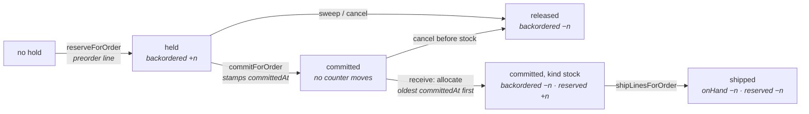

# Preorders and backorders

How stock is promised before it exists: the preorder and backorder holds and what releases them.

## Preorders {#preorders}

Owed units live in one counter, whatever phase of the product claimed them: a preorder, or a released product out of stock ([below](#backorders)). The names say so: `backorderLimit`, `backordered`, kind and reason `backorder`. The product state keeps "preorder".

A preorder is sold before its units exist, so it claims an **allowance** instead of a shelf unit. The
stock level gains two counters, a third ledger column and two `reason` values; the hold's lines gain
a `kind` (`stock` or `backorder`).

| Counter / column   | Meaning                                                                                                                                                               |
| ------------------ | --------------------------------------------------------------------------------------------------------------------------------------------------------------------- |
| `backorderLimit`   | how many units may be owed at once; set by staff holding `update:StockLevel` (admin, warehouse), `0` closes it, stored `null` is no cap (the wire leaves the key out) |
| `backordered`      | units claimed against it and not yet allocated stock, paid or not                                                                                                     |
| `backorderedDelta` | the ledger column that makes `backordered` replayable, like `onHandDelta` and `reservedDelta`                                                                         |

A claim is a `backorder` movement (`backordered` +n, nothing else), guarded in the write's own filter by
`backordered + n <= backorderLimit`. The shelf is never read: 50 units on hand do not widen the
allowance, and an allowance of 5 does not need one unit to exist. The cap counts from the moment the
order is placed (decided 2026-10-11): a buyer who then pays a week later by bank transfer is never
refused for a cap that filled in between.

| Moment                  | What happens to a preorder line                                                                                             |
| ----------------------- | --------------------------------------------------------------------------------------------------------------------------- |
| before payment          | today's windows: 15 minutes by card, a week by bank transfer, then the sweep gives the allowance back                       |
| payment                 | `held → committed`, no expiry; `committedAt` is stamped by the same claim, so it is the payment's instant                   |
| stock arrives           | `POST /inventory/levels/{productId}/receive` receives and **allocates in the same transaction**, oldest `committedAt` first |
| a short delivery        | the order gets what exists; the rest stays a claim and keeps waiting                                                        |
| cancelled while waiting | the allowance comes back (`backordered` −n); `restock` is never used, it would add stock that never existed                 |

Allocation turns the claim into an ordinary hold on a real unit: `backordered` falls and `reserved`
rises by the same number, so `available` drops by what was allocated and the units never look
sellable to a stranger in between. From then on those units ship, release and restock like any
others; the hold keeps the same product under both kinds while part of it still waits, and every
caller that takes lines out of a hold (`shipLinesForOrder`, `releaseLinesForOrder`) names the kind.
A claim cannot ship: `ship` of a `backorder` line throws and rolls its transaction back.

Oldest payment first, not oldest order: the key is the moment the buyer's money was in, so a bank
transfer is still served, after the cards that paid earlier. It is the hold's own `committedAt`
because this module does not depend on `orders` and cannot read `paidAt`. Unpaid holds are never
allocated. Stock that arrived while an order was still unpaid is served by the payment itself:
`commitForOrder` runs the same allocation once it has claimed the hold.

Each allocation writes `inventory.backorder_allocated { orderId, productId, waiting }` to the outbox in
that transaction. `waiting` is what the order still claims of that product, a state and not a delta, so
a redelivery is harmless: [`delivery`](./delivery.md) releases whatever it holds beyond `waiting`, and
the second time there is nothing beyond it.

A product that is a preorder never counts as "running low": the `products_low_stock_total` gauge
leaves it out (`countPublic` with `excludePreorders`). The stock
board's `lowOnly` view is unchanged, since a restocker wants to see it.

`GET /inventory/preorders` is the preorder board's read: per product the cap, `backordered`, its split
between `held` (unpaid, frees itself) and `paid`, `left`, and `ordered`, the lifetime count read off the
ledger's `backorder` rows. `PATCH /inventory/levels/{productId}` sets the allowance under
`update:StockLevel`; it is not a stock movement and leaves no ledger row, only an audit entry.

## Backorders {#backorders}

A released product the shop keeps selling while the shelf is empty owes units the same way a preorder
does, from the same counter. `allowBackorder` on the product ([`products`](./products.md#backorder))
switches it on and the catalogue tells this module which lines may spill; the cap stays here.

**A line the shelf covers half.** `reserveForOrder` takes a line with `spill` whole from the shelf when
it fits. Otherwise, in one transaction, it takes the shelf units there are, claims the rest against the
cap and adds each part to the hold. A crash anywhere inside leaves nothing taken; a claim
the cap refuses gives the shelf part back; two checkouts racing the last unit resolve inside the
database. The outcome returns the owed count per line for [`orders`](./orders.md) to freeze.

**No cap.** `backorderLimit: null` is no cap; `0` is closed and is the default. A level row without the
field reads as closed, never as unlimited. The room left is `Infinity`, never `null`: callers do
arithmetic on it, and a `null` would read as sold out. The shopper-facing `available` of an uncapped product reads `999999` instead: the contract wants an integer, and no buyer is ever told the count.

**Every arrival serves the queue.** The claims of buyers who paid are served oldest `committedAt`
first by every write that raises `available`, in that write's own transaction, not only by a receipt:

| Raises `available`                    | Allocates                               |
| ------------------------------------- | --------------------------------------- |
| receipt, positive stocktake `adjust`  | yes                                     |
| return restock                        | yes                                     |
| unpaid hold expiring (the sweep)      | yes                                     |
| order cancel, paid or not             | yes                                     |
| remainder cancel                      | yes                                     |
| a claim given back (`backorder` kind) | no: it frees allowance, not shelf units |

Without this, a hold that expires would hand its units to the next stranger while a buyer who paid
last week keeps waiting. An allocation is not undone: a typo (+50 for +5) allocates, and the correcting
−45 is refused as `INVENTORY_BELOW_RESERVED`.

### Owed after a loss {#owed-after-a-loss}

A parcel [reported lost](./delivery.md#lost-in-transit) leaves the order owed its units, and they left
the shelf when the parcel shipped. `reserveMoreForOrder` tops the order's hold up, per line:

| Part                        | What it does                                                                                                                                                            |
| --------------------------- | ----------------------------------------------------------------------------------------------------------------------------------------------------------------------- |
| the shelf part              | reserves the free units, `available` drops. Never units held for another order: `available` already excludes them                                                       |
| the owed part               | an `owed` movement **outside the cap** (a ledger note says so): the cap limits new sales, not a promise already made                                                    |
| a product with no stock row | claims nothing and does not fail: the loss is recorded elsewhere. A deleted product is this case: `shelf` 0, `owed` 0, no alert, since staff marked the loss themselves |
| the hold                    | an open hold grows; a hold that ended (`shipped`, `released`) is reopened `committed` with only the added units, keeping the original `committedAt`                     |

The owed claim is in the paid queue at the place of the original payment, so a stranger's checkout
cannot take the next arriving unit. When the lost parcel turns up, `releaseTopUpForOrder` gives both
parts back and the hold ends `shipped`, not `released`: the goods it named left for good.

## Read next

- [inventory-reservations](./inventory-reservations.md) — the module's own page
