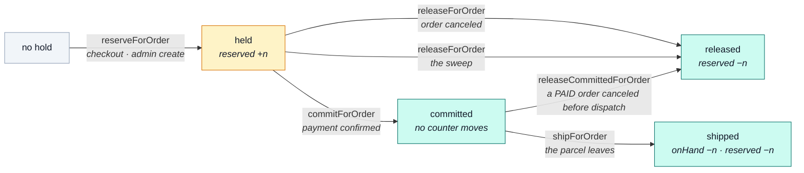

# Reservations

A reservation is a **promise that units exist**, made before money changes hands and kept for a
fixed window.

::: tip At a glance
**Window** — `NODE_RESERVATION_TTL_MINUTES`, 15 by default, stamped onto each hold at reserve time.
**Guarantee** — every transition is exactly-once, by conditional claim rather than by lock.
**Breaks if you change** — the conditional status claim. It is the entire correctness of this module.
:::

## Counters and ledger reasons

Every stock level carries `onHand`, `reserved` and `backordered` (units owed, for [preorders](#preorders)).
[`products`](./products.md) never writes any of them, and neither does anything else — the
transitions below are the only writers in the application. Their ledger reasons are `reserve`, `ship`,
`release`, `expire`, `receive`, `adjust`, `restock`, `backorder`, `owed` and `allocate`.

`held` is the only state with a deadline: `expiresAt` is what makes it non-permanent. `committed` is
a paid order waiting for its parcel; it ends at `shipped` (the units leave) or, if the order is
cancelled first, `released`. Shelf count (`onHand`) drops at dispatch, not at payment — the model
Shopify, Magento MSI, Saleor and Medusa share — so a stocktake counts the same number `onHand`
says, and `available` is identical in both models at every moment.

| Transition                 | Called by                                                                                                                  | Counters                        | Ledger `reason`   |
| -------------------------- | -------------------------------------------------------------------------------------------------------------------------- | ------------------------------- | ----------------- |
| `reserveForOrder`          | [checkout](./cart-checkout.md), admin order create                                                                         | `reserved` +n                   | `reserve`         |
| `commitForOrder`           | [`orders`](./orders.md), in the transaction of `markPaid` (a card, a transfer or a cash payment)                           | none                            | none              |
| `shipLinesForOrder`        | [`delivery`](./delivery.md) (through `orders`), in the transaction of each shipment — only ITS units                       | `onHand` −n, `reserved` −n      | `ship`            |
| `shipForOrder`             | [`orders`](./orders.md), in the transaction of an admin override past dispatch — whatever is left                          | `onHand` −n, `reserved` −n      | `ship`            |
| `releaseLinesForOrder`     | [`orders`](./orders.md) for [`returns`](./returns.md), in the transaction of a remainder cancel — only the cancelled units | `reserved` −n                   | `release`         |
| `releaseForOrder`          | [`orders`](./orders.md) on cancel                                                                                          | `reserved` −n                   | `release`         |
| `releaseForOrder`          | the sweep                                                                                                                  | `reserved` −n                   | `expire`          |
| `releaseCommittedForOrder` | [`orders`](./orders.md) on cancel, once the release above claims nothing (a paid, unshipped order)                         | `reserved` −n                   | `release`         |
| `reserveForOrder`          | checkout, for a [preorder](#preorders) line, or the owed part of a [backorder](#backorders) line                           | `backordered` +n                | `backorder`       |
| `receive`                  | `POST /inventory/levels/{productId}/receive`, for the paid claims waiting (every write that raises `available` does this)  | `backordered` −n, `reserved` +n | `allocate`        |
| `reserveMoreForOrder`      | [`delivery`](./delivery.md) (through `orders`), when a parcel is [reported lost](#owed-after-a-loss)                       | `reserved` +n, `backordered` +n | `reserve`, `owed` |
| `releaseTopUpForOrder`     | [`delivery`](./delivery.md) (through `orders`), when the lost parcel turns up                                              | `reserved` −n, `backordered` −n | `release`         |

**`releaseCommittedForOrder` is never merged into `releaseForOrder`**, on purpose: the sweep only
ever releases a stale HOLD, and folding the paid case into that same function would let it put a
just-paid order's units back on sale the moment its unrelated reservation record aged past the
sweep's cutoff — a sale undone by a timer, not by anyone cancelling anything. A cancel calls it
explicitly, only after `releaseForOrder`'s own claim on `held → released` has already missed —
exactly what a PAID order's `committed` hold does, every time.

An order ships in parts, so the shelf follows the shipments, not the status. `shipLinesForOrder` takes
ONE shipment's lines off the shelf in that shipment's own transaction: `onHand` and `reserved` both
drop by what left, `available` does not change, and the hold keeps the units that have not left yet —
it ends `shipped` with the last one. The arithmetic is a pure rule (`takeFromHold`): a line asking for
more than the hold holds of that product takes what there is, so the counters move by exactly what was
set aside. `releaseLinesForOrder` is its twin for a cancelled remainder, and ends the hold `released`.
Because the shelf count follows what really left, a later return's `restock` puts back units that
were taken out.

`shipForOrder` is what remains of the whole-hold dispatch, and the admin override into
`shipped`/`delivered` is its one caller: it ships whatever the hold still sets aside, in the status
write's own transaction. It claims `committed → shipped`, and also `held → shipped` for a payment whose
own commit crashed and has not been retried yet: the goods left either way, and the retry then finds
a shipped hold and stays silent. Goods a customer sends back are a separate door: `restockReturnedLines` writes `restock`
rows and claims nothing, because the hold is `shipped` for good.

Both take an optional Mongo `session`. `orders`' cancel passes one so the status move, the release
commits together or not at all; given a session, the catalogue's stock cache is
not synced inside the transaction (that write cannot roll back), and the caller runs
`refreshStockCacheForOrder` after the commit (which never rejects: a failed read there only leaves the catalogue copy stale until the next stock change).

Two more `reason` values exist and belong to no reservation at all: `receive`
(`POST /inventory/levels/{productId}/receive`) and `adjust` (`POST /inventory/levels/{productId}/adjust`), which move `onHand`
directly.

## Preorders {#preorders}

Owed units live in one counter, whatever phase of the product claimed them: a preorder, or a released product out of stock ([below](#backorders)). The names say so: `backorderLimit`, `backordered`, kind and reason `backorder`. The product state keeps "preorder".

Full detail: [Preorders and backorders](./inventory-reservations-preorders-and-backorders.md#preorders).

## Backorders {#backorders}

A released product the shop keeps selling while the shelf is empty owes units the same way a preorder
does, from the same counter. `allowBackorder` on the product ([`products`](./products.md#backorder))
switches it on and the catalogue tells this module which lines may spill; the cap stays here.

Full detail: [Preorders and backorders](./inventory-reservations-preorders-and-backorders.md#backorders).

### Owed after a loss {#owed-after-a-loss}

See [Preorders and backorders](./inventory-reservations-preorders-and-backorders.md#owed-after-a-loss).

## Exactly-once, without a lock

::: warning The claim is the guarantee
Each transition claims the reservation's status **conditionally** — `held → committed` only
succeeds if the row is still `held`. So a cancel racing the sweep, or a provider webhook delivered
twice, resolves to exactly one winner and the loser is a no-op rather than a second counter move.

There is no distributed lock holding this up. A single conditional update decides the winner, which
is why it survives a restart and a second worker. The claim and every line's counter move then land
in **one transaction** (the caller's, or one `commitForOrder` / `releaseForOrder` /
`releaseCommittedForOrder` opens itself): a write that throws partway undoes the claim too, so the retry
finds the hold still open and finishes the job instead of reporting "already done".

Taking a multi-line hold's lines is ordered by product id, so two checkouts listing the same
products oppositely meet on the same product first, and one goes on rather than both refusing.

**The hold starts empty and names only what was taken.** `reserveForOrder` writes the hold with no
lines, then takes each line in one transaction that also adds it to the hold (`pushItems`, guarded on
the hold still being `held`). A checkout killed between two lines therefore leaves a hold that lists
only lines whose counters moved, so the sweep never gives back units another order holds. A refused or
failing line unwinds through the same claim-guarded `releaseForOrder` the sweep uses, and the hold ends
`released`, never deleted; a hold the sweep claimed first makes the next line's push miss and abort, so nothing is taken twice.
:::

## A paid order with no hold at all is an incident, not a no-op {#orphaned-hold}

A paid order always commits its hold, and a shipped one always ships it. When `commitForOrder`'s or
`shipForOrder`'s claim misses, that is one of three very different facts, and it tells them apart
before deciding what to do:

Full detail: [Orphaned holds and the ledger](./inventory-reservations-orphaned-holds.md#orphaned-hold).

### Money can land on a released hold: take the units again {#money-can-land-on-a-released-hold-take-the-units-again}

See [Orphaned holds and the ledger](./inventory-reservations-orphaned-holds.md#money-can-land-on-a-released-hold-take-the-units-again).

## The ledger is half of the transition, not a reaction to it {#the-ledger-is-half-of-the-transition-not-a-reaction-to-it}

`stockmovements` rows are written **by the same call that moves the counter**. There is deliberately
no `product.stock_moved` event:

Full detail: [Orphaned holds and the ledger](./inventory-reservations-orphaned-holds.md#the-ledger-is-half-of-the-transition-not-a-reaction-to-it).

## The sweep

`POST /inventory/reservations/sweep` releases every hold past its `expiresAt`; `npm run
sweep:reservations` is the same work, driven every 5 minutes rather than on demand — see
[Scheduled jobs](../reference/ops.md#scheduled-jobs). The admin route stays, deliberately: the
operation is idempotent and cheap, and occasionally something an operator wants to force between
ticks.

The sweep DRAINS: it reads batches of 200 stale holds until one comes back short (at most 50
batches, 10,000 holds, per run), so a backlog is gone in one tick instead of leaking out at 40 a
minute. The scheduled run holds a lease (`sweep:reservations`), since a drain can outlast the
five-minute tick and two drains would only fight over the same claims.

The `status: 1, expiresAt: 1` index exists for exactly that query, and for nothing else.

Only an operator's on-demand run through the route is audited (`admin.reservations.swept`); the scheduled
run writes no audit row, since it has no caller.

When a hold is swept, `inventory.reservation_expired` is published through the transactional
outbox, in the same transaction as the release, so the units come back and the announcement exists
together or not at all; the relay retries until [`orders`](./orders.md) has heard it, and `orders`
cancels the order. Until it does, a card confirm on that order is refused: its hold is released, so
taking money would sell stock that may be gone. That is the one arrow pointing back
from this module, and it is an event rather than an import precisely so the two mutually-aware
domains stay acyclic.

**The hold length is per-checkout, not a single constant.** `reserveForOrder` takes an optional
window and falls back to `NODE_RESERVATION_TTL_MINUTES` only when the caller gives none — `cart`'s
checkout hands it a longer one for a `bank_transfer` order (`NODE_BANK_TRANSFER_HOLD_HOURS`, a
week by default). The sweep itself needed no change to honour this: it only ever reads each hold's
own stored `expiresAt`, never a constant. See [Payments — Bank transfer](./payments.md#bank-transfer).

**A card payment gone `processing` gets the same week, after the fact.** `extendHoldForOrder`
pushes a still-`held` hold's `expiresAt` out to `NODE_BANK_TRANSFER_HOLD_HOURS` from now, asked for by
`settlePayment` (through `orders`' `extendHold`) the moment the provider reports `processing` — a SEPA debit, some bank redirects,
can take days to settle, and the ordinary 15-minute window would let the sweep cancel an order
whose money is still genuinely on its way. `requires_action` gets no such grace: that state means
the BROWSER has a challenge to answer, not the provider a payment to finish, so the ordinary window
already fits it. No setting of its own — reusing the bank-transfer window is the whole point: both
are "this payment method settles over days", the same fact under two names. Guarded on
`status: 'held'`, the same as every other lifecycle write here, so a hold already claimed has
nothing left on it to extend.

## The threshold, and its two readers

`NODE_LOW_STOCK_THRESHOLD` (5 by default, declared once as the infrastructure's `stockConfig` slice) has two readers that deliberately count **different
populations**:

| Reader                             | Population                     | Why                                                          |
| ---------------------------------- | ------------------------------ | ------------------------------------------------------------ |
| The stock board's `lowOnly` filter | the whole catalogue            | an admin restocking needs to see an inactive product's units |
| `products_low_stock_total`         | publicly visible products only | an alert about stock a customer cannot buy is noise          |

The two numbers will not match, and should not. Sharing the threshold while differing on the
population is the intended arrangement.

Both settings are read through their slice on every call rather than captured at import, and the
slice parses the environment once per process: a changed variable takes effect on restart.

## Read next

- [`inventory`](./inventory.md) — the module this belongs to
- [Checkout](./cart-checkout.md) — where a hold is taken
- [`payments`](./payments.md) — where a hold becomes a sale
- [`orders`](./orders.md) — the listener for `inventory.reservation_expired`
- [Prometheus](../operate/prometheus.md) — the two gauges this module exports, and its orphaned-commit counter
