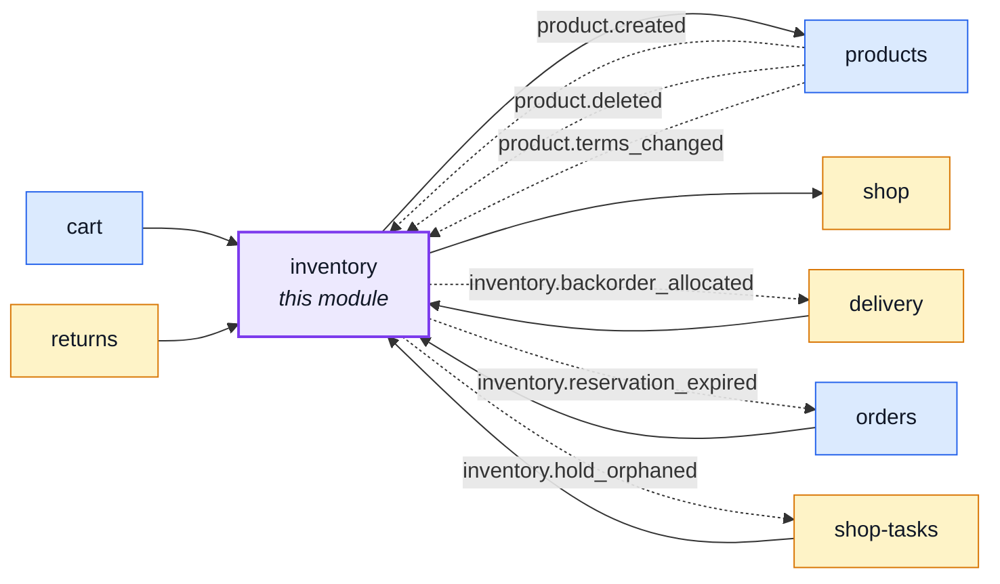
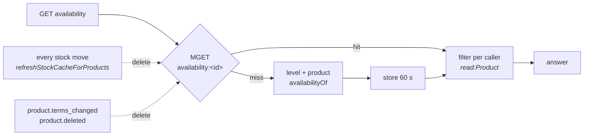
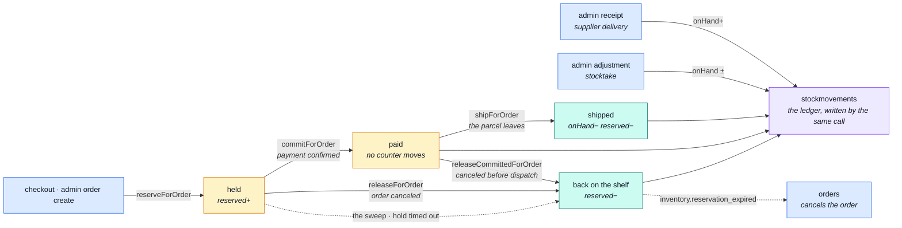

# inventory

The only writer of stock in the application.

::: tip At a glance
**Owns** — the stock counters (its own `stocklevels` collection), the reservation lifecycle,
and the ledger that explains both.
**Depends on** — [`products`](./products.md), whose document keeps a read-only mirror of the
counters this module writes, and whose settings (sale flags, backorder switch, dates) decide the
availability this module tells shoppers.
**Breaks if you change** — any transition's conditional claim. It is what makes each one exactly-once.
:::

## Its neighbourhood

<!-- module-graph:inventory:start -->

_Solid arrows are imports. Dotted arrows are domain events — the return path an import
graph cannot see._

<!-- module-graph:inventory:end -->

## Who can do what

Every rule this module declares and who holds it, role by role. The rule is what a route guard asks for; the set is what a role lists.

<!-- permissions:start -->

| Rule                   | Set                   | `guest` | `unverified` | `customer` | `manager` | `warehouse` | `support` | `editor` | `moderator` | `admin` | `operator` | Credential | What it lets them do                                                                                       |
| ---------------------- | --------------------- | ------- | ------------ | ---------- | --------- | ----------- | --------- | -------- | ----------- | ------- | ---------- | ---------- | ---------------------------------------------------------------------------------------------------------- |
| `read:StockLevel`      | `InventoryDisplay`    | —       | —            | —          | ✅        | ✅          | —         | —        | —           | ✅      | —          | ✅         | Read stock levels and the movements behind them.                                                           |
| `create:StockMovement` | `InventoryManagement` | —       | —            | —          | —         | ✅          | —         | —        | —           | ✅      | —          | ✅         | Record a receipt or an adjustment. Stock never moves without one.                                          |
| `update:StockLevel`    | `InventoryManagement` | —       | —            | —          | —         | ✅          | —         | —        | —           | ✅      | —          | ✅         | Edit a product's stock level, i.e. set its preorder limit. The counters move only through stock movements. |
| `sweep:StockLevel`     | `InventorySweep`      | —       | —            | —          | —         | —           | —         | —        | —           | ✅      | —          | ✅         | Clear expired reservation holds. The expiry tick, not a role's own tool.                                   |

✅ held · `own` only the caller’s own rows · ⚡c / ⚡s needs a freshly proved session (critical / sensitive) ·
Credential: ✅ when an API key can be minted with the rule. Generated from the rules and sets in
`src/modules/*/authorization.yaml` and the roles in `shared/rules/authorization-roles.yaml`, asked of the
evaluator — [Authorization](../understand/authorization.md) explains the model.

<!-- permissions:end -->

## The story

The counters live in this module's own `stocklevels` collection — one row per product, written
only by `applyTransition`, beside the ledger row that explains every move. `products` keeps a
synced copy of `onHand`/`reserved` on its own document purely so a catalogue read still needs no
join; that copy is never the source of truth and this module never reads it back. **Every change
to a stock count is a transition here.**

A new product's stock level arrives as `product.created` through the outbox, which delivers at
least once. `openLevel` inserts the row at zero and books nothing, so a redelivery finds it and
changes nothing. A product has no stock until a receipt gives it some: `POST /inventory/levels/{productId}/receive` is
the only transition that creates units, so every unit has a ledger row and a caller holding
`create:StockMovement`.

Every transition, who calls it, which counters it moves and which ledger `reason` it writes is one
table, in [Reservations](./inventory-reservations.md#counters-and-ledger-reasons). The stocktake `adjust` and
`restockReturnedLines` (goods a customer sent back are received: the returned lines go back on `onHand`,
one `restock` movement each) are this module's.

::: warning Exactly-once, by construction
Each transition claims the reservation's status **conditionally**, so a cancel racing the sweep — or
a provider webhook delivered twice — resolves to exactly one winner. That conditional claim is the
correctness of this module; there is no lock anywhere else holding it up.
:::

A paid order always commits its hold. `commitForOrder` or `shipForOrder` finding no hold to claim is
either a benign replay (already `committed` or `shipped`) or an incident — see
[Reservations](./inventory-reservations.md#orphaned-hold) for
which is which, and what gets recorded.

The ledger is not a reaction to a counter change, it is half of one. `stockmovements` rows are
written by the same call that moves the counter, which is why there is no `product.stock_moved`
event: with one, every mover would have to remember to announce on every path, rollback paths
included. A counter change nobody recorded is a corrupt audit trail, not a smaller feature.

Reads go through `availableFor`: one batched ledger read that [`cart`](./cart.md) uses for its
stock flags and its checkout, so a line never reads as fitting and then fails at the hold. For a
product that is a preorder the caller says so, and the read answers with what is left of its
allowance instead of the shelf.

Deleting this module leaves a shop that cannot sell. That is the honest consequence of owning
something.

## Why `products` still carries a copy

A catalogue read is the shop's most common query and must not need a join. Three shapes were weighed for how a product
read keeps showing `available` once the counters move here:

1. **A separate `inventory` endpoint the storefront calls.** Chosen for what a shopper is told
   (`availability`, [below](#the-availability-reads)): the product answer carries details, which
   change on an edit, and the stock signal is its own read with its own short cache, so a busy
   product stops having its details re-read on every sale. It was first rejected as two round
   trips; the second request on a product page or a catalogue list is now accepted. The copy below
   stays only until the product answer stops carrying stock.
2. **`products` imports this module and reads live.** Rejected for the same reason: a live
   cross-collection read at catalogue-read time is a join in every way that matters, just not
   spelled `$lookup`.
3. **`products` keeps a maintained projection.** Chosen. `onHand`/`reserved` stay columns on the
   product document, but this module is still their only writer — `productService.syncStockCache`
   sets them, and nothing else may.
   The copy is written only if newer: each level write bumps a `version`, the copy remembers the
   version it was taken at, and an older snapshot that arrives late matches nothing.

The sync on a stock write is a **plain awaited function call inside `applyTransition`**, never a
domain event. This module deliberately has no stock event (see "The story" above): an event a
listener can miss is fine for a fact nothing depends on, and wrong for one a catalogue page reads.

A caller that moves several products at once (a multi-line checkout, a hold's release) refreshes
them in one batch: one read of all their levels, one sync per product, one clear of the `products`
cache tag. It is still a plain awaited call that never rejects.

One exception, and it is not a stock write: a payment that serves a preorder moves counters inside
the payer's transaction, where the catalogue copy cannot be written (it would not roll back). That
reaction is a listener on this module's own `inventory.backorder_allocated`, which refreshes the
served product's copy once the commit has landed. A payment that lands on a released hold and takes
its units again does the same through `inventory.stock_retaken`
([why](./inventory-reservations.md#money-can-land-on-a-released-hold-take-the-units-again)). A plain
payment moves no counter, so it announces nothing and refreshes nothing. Eventual is fine there: the copy may already be stale (a failed
sync is left for the next transition to correct), and no confirm response shows stock.
Write order matters and is deliberate: the counter and its ledger row commit first, as
`applyTransition` does it — the transition IS the source of truth the moment it commits,
regardless of whether the cache sync afterward succeeds. A failed sync is logged and left for the
next transition on that product to correct — never a reason to fail the transition that already committed.

The same call deletes each product's `availability:<id>` entry, the one cache a stock move makes
stale: every stock write (receipt, adjustment, hold, release, both sweeps, a return's restock) ends
in `refreshStockCache`, so one call covers routes, jobs and webhooks alike. It clears nothing in the
`products` response cache, because the product answer carries no stock. `GET /products/:id` is
`browserRevalidate`, so a browser checks first instead of keeping the page for an hour — see
[Redis cache](../understand/redis-cache.md).

One consequence worth naming: this module imports `products` (for a shortfall's title, and
for the cache sync). Only `products → inventory` would be a cycle, and nothing creates it.

## The availability reads {#the-availability-reads}

What a shopper is told about a product's stock, in Google Merchant's words: `availability`
(`in_stock`, `out_of_stock`, `preorder`, `backorder`) and, with the last two, `availabilityDate`.
This module answers it under the catalogue's URL, through its own router mounted at `/products`
(the pattern of `payments` serving `/orders/{id}/payments`):

| Request                                | Answer                                                                         |
| -------------------------------------- | ------------------------------------------------------------------------------ |
| `GET /products/{id}/availability`      | one product; an unknown or hidden one is a `404`, as for `/{id}`               |
| `GET /products/availability?id=a&id=b` | many, at most 100 ids (a 101st is a `422`); unknown or hidden ids are left out |

The rule that turns settings and counts into a value is `availabilityOf` in the `products` domain
(`out_of_stock` covers every "cannot be ordered": sold out, not on sale, a preorder whose allowance
is full). `availabilityDate` is the release day of a preorder, or the restock day of a backorder,
or `BACKORDER_PROMISE_DAYS` from today when it names none.

**One Redis entry per product, `availability:<id>`, 60 seconds, no tags.** A batch reads every entry
at once, computes only the missing ones and stores each under its own key, so id order and
duplicates do not matter and the language is not part of the key. This module owns the whole cache:

- **Stock moves** delete the key in the funnel every stock write ends in, for every id it is given.
- **Edits to the product** reach it through `product.terms_changed` (a change to `purchasable`,
  `allowBackorder`, `active`, `releaseDate` or `restockDate`, and a restore) and `product.deleted`,
  both outbox events, so the delete lands when the relay delivers them, not at commit.
- **The 60 seconds** covers what nothing announces: a release or restock date passing, and the
  shop's calendar day turning over. A read in flight can still store an old answer after a delete,
  for at most those 60 seconds.

The entry holds the product's `active` and `deletedAt`, because the cache has no caller in its key:
after the read, each caller is judged with `read:Product`, so a guest never gets a hidden product
from a hit and staff (`display:Product`) do. The browser always re-checks: `public, no-cache` and an
ETag, so an unchanged answer is a `304`.

Mount order matters here and nowhere else in the app. `products` mounts `/:id`, which would read
the word `availability` as an id and answer `404`, so `inventory` must be mounted first. The
registry lists modules alphabetically, which gives that order, and
`tests/integration/availability-route-order.test.ts` fails if it ever flips.

## The pipeline

Checkout, an admin with a clipboard, and a received return move stock. Every one of them writes
the ledger in the same call that moves the counter.

## Reading the stock board

The admin low-stock gauge and the stock board both read `stocklevels` directly — paged, sorted
`{available: 1, _id: 1}` so the lowest-stock products come first with a stable tie-break — then
call `productService.findManyByIds`/`countPublic` for the titles and visibility to show alongside
each row. That is API composition, not a join: this module never asks `products` for a `$lookup`,
and `products` never asks this module to look inside `stocklevels`. Each side stays the only door
onto its own collection, at the cost of two calls instead of one aggregation.

## Read next

- [Reservations](./inventory-reservations.md) — the lifecycle and the sweep, in detail
- [`orders`](./orders.md) — what a reservation is attached to
- [`products`](./products.md) — where the counters physically live
- [Domain Layer](../understand/domain-layer.md) — the pure rules behind the transitions
- [Prometheus](../operate/prometheus.md) — the counters this module exports about itself
