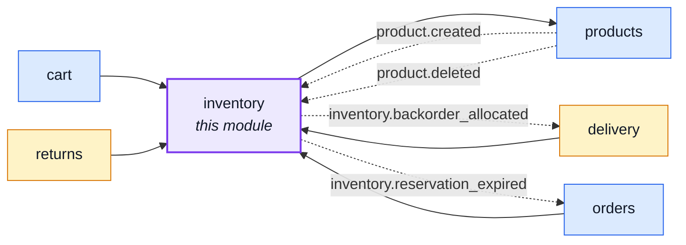
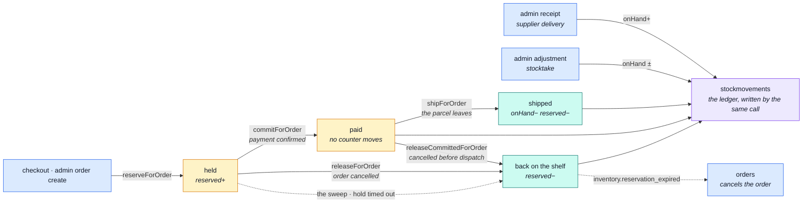

# inventory

::: tip At a glance
**Owns** — the two stock counters (its own `stocklevels` collection), the reservation lifecycle,
and the ledger that explains both.
**Depends on** — [`products`](./products.md), whose document keeps a read-only mirror of the
counters this module writes, so a catalogue read needs no join.
**Breaks if you change** — any transition's conditional claim. It is what makes each one exactly-once.
:::

## Its neighbourhood

<!-- module-graph:inventory:start -->

_Solid arrows are imports. Dotted arrows are domain events — the return path an import
graph cannot see._

<!-- module-graph:inventory:end -->

## The story

The counters live in this module's own `stocklevels` collection — one row per product, written
only by `applyTransition`, beside the ledger row that explains every move. `products` keeps a
synced copy of `onHand`/`reserved` on its own document purely so a catalogue read still needs no
join; that copy is never the source of truth and this module never reads it back. **Every change
to a stock count is a transition here.**

A new product's stock level arrives as `product.created` through the outbox, which delivers at
least once. `openLevel` inserts the row at zero and books nothing, so a redelivery finds it and
changes nothing. A product has no stock until a receipt gives it some: `POST /inventory/receipts` is
the only transition that creates units, so every unit has a ledger row and a caller holding
`create:StockMovement`.

| Transition                  | Fired by                                                                     | What it does                                                                                                                               |
| --------------------------- | ---------------------------------------------------------------------------- | ------------------------------------------------------------------------------------------------------------------------------------------ |
| `reserveForOrder`           | checkout, admin order create                                                 | units held, not sold                                                                                                                       |
| `commitForOrder`            | payment confirmed                                                            | the claim is settled; nothing moves, so no ledger row — the units stay on the shelf, and the date is the hold's `committedAt`              |
| `shipForOrder`              | the parcel leaves, or a digital order is fulfilled ([`orders`](./orders.md)) | units leave the shelf: `onHand` and `reserved` fall together, `available` stays                                                            |
| `releaseForOrder`           | order cancelled, or the sweep (a stale hold timed out)                       | units come back                                                                                                                            |
| `releaseCommittedForOrder`  | a PAID order cancelled before dispatch                                       | the claim is given up; the units never left the shelf                                                                                      |
| `receive` (with allocation) | a delivery lands, `POST /inventory/receipts`                                 | the units arrive, then go to the paid [preorders](./inventory-reservations.md#preorders) waiting, oldest payment first, in one transaction |
| `restockReturnedLines`      | goods a customer sent back are received ([`returns`](./returns.md))          | the returned lines go back on `onHand`, one `restock` movement each — no reservation claimed; the return's own once-only move is the guard |

::: warning Exactly-once, by construction
Each transition claims the reservation's status **conditionally**, so a cancel racing the sweep — or
a provider webhook delivered twice — resolves to exactly one winner. That conditional claim is the
correctness of this module; there is no lock anywhere else holding it up.
:::

A paid order always commits its hold. `commitForOrder` or `shipForOrder` finding no hold to claim is
either a benign replay (already `committed` or `shipped`) or an incident — see
[Reservations](./inventory-reservations.md#a-commit-with-no-hold-is-an-incident-not-a-no-op) for
which is which, and what gets recorded.

The ledger is not a reaction to a counter change, it is half of one. `stockmovements` rows are
written by the same call that moves the counter, which is why there is no `product.stock_moved`
event: with one, every mover would have to remember to announce on every path, rollback paths
included. A counter change nobody recorded is a corrupt audit trail, not a smaller feature.

Reads go through `availableFor`: one batched ledger read that [`cart`](./cart.md) uses for its
stock flags and its checkout, so a line never reads as fitting and then fails at the hold. For a
product that is a preorder the caller says so, and the read answers with what is left of its
allowance instead of the shelf.

Deleting this module leaves a shop that cannot sell. That is the honest consequence of owning
something.

## Why `products` still carries a copy

A catalogue read is the shop's most common query and must not need a join. Three shapes were weighed for how a product
read keeps showing `available` once the counters move here:

1. **A separate `inventory` endpoint the storefront calls.** Rejected: it turns one catalogue read
   into two round trips, which costs the same as the join the constraint exists to avoid — worse,
   from the client's own timing.
2. **`products` imports this module and reads live.** Rejected for the same reason: a live
   cross-collection read at catalogue-read time is a join in every way that matters, just not
   spelled `$lookup`.
3. **`products` keeps a maintained projection.** Chosen. `onHand`/`reserved` stay columns on the
   product document, but this module is still their only writer — `productService.syncStockCache`
   sets them, and nothing else may.

The sync on a stock write is a **plain awaited function call inside `applyTransition`**, never a
domain event. This module deliberately has no stock event (see "The story" above): an event a
listener can miss is fine for a fact nothing depends on, and wrong for one a catalogue page reads.

One exception, and it is not a stock write: a payment that serves a preorder moves counters inside
the payer's transaction, where the catalogue copy cannot be written (it would not roll back). That
reaction is a listener on this module's own `inventory.backorder_allocated`, which refreshes the
served product's copy once the commit has landed. A plain payment moves no counter, so it announces
nothing and refreshes nothing. Eventual is fine there: the copy may already be stale (a failed
sync is left for the next transition to correct), and no confirm response shows stock.
Write order matters and is deliberate: the counter and its ledger row commit first, as
`applyTransition` does it — the transition IS the source of truth the moment it commits,
regardless of whether the cache sync afterward succeeds. A failed sync is logged and left for the
next transition on that product to correct — never a reason to fail the transition that already committed.

The same sync also clears the `products` response-cache tag, because the product page and the
lists carry `available`: every stock write (receipt, adjustment, hold, release, both sweeps, a
return's restock) ends in `refreshStockCache`, so one call covers routes, jobs and webhooks alike.
`GET /products/:id` is also `browserRevalidate`, so a browser checks first instead of keeping the
page for an hour — see [Redis cache](../tools/redis-cache.md).

One consequence worth naming: this module imports `products` (for a shortfall's title, and
for the cache sync). Only `products → inventory` would be a cycle, and nothing creates it.

## The pipeline

Checkout, an admin with a clipboard, and a received return move stock. Every one of them writes
the ledger in the same call that moves the counter.

## Reading the stock board

The admin low-stock gauge and the stock board both read `stocklevels` directly — paged, sorted
`{available: 1, _id: 1}` so the lowest-stock products come first with a stable tie-break — then
call `productService.findManyByIds`/`countPublic` for the titles and visibility to show alongside
each row. That is API composition, not a join: this module never asks `products` for a `$lookup`,
and `products` never asks this module to look inside `stocklevels`. Each side stays the only door
onto its own collection, at the cost of two calls instead of one aggregation.

## Who can do what

Every rule this module declares and who holds it, role by role. The rule is what a route guard asks for; the set is what a role lists.

<!-- permissions:start -->

| Rule                   | Set                   | `guest` | `unverified` | `customer` | `manager` | `warehouse` | `support` | `editor` | `moderator` | `admin` | `operator` | Credential | What it lets them do                                                                                 |
| ---------------------- | --------------------- | ------- | ------------ | ---------- | --------- | ----------- | --------- | -------- | ----------- | ------- | ---------- | ---------- | ---------------------------------------------------------------------------------------------------- |
| `read:StockLevel`      | `InventoryDisplay`    | —       | —            | —          | ✅        | ✅          | —         | —        | —           | ✅      | —          | ✅         | Read stock levels and the movements behind them.                                                     |
| `create:StockMovement` | `InventoryManagement` | —       | —            | —          | —         | ✅          | —         | —        | —           | ✅      | —          | ✅         | Record a receipt or an adjustment, or set a product's preorder limit. Stock never moves without one. |
| `sweep:StockLevel`     | `InventorySweep`      | —       | —            | —          | —         | —           | —         | —        | —           | ✅      | —          | ✅         | Clear expired reservation holds. The expiry tick, not a role's own tool.                             |

✅ held · `own` only the caller’s own rows · ⚡c / ⚡s needs a freshly proved session (critical / sensitive) ·
Credential: ✅ when an API key can be minted with the rule. Generated from the rules and sets in
`src/modules/*/authorization.yaml` and the roles in `shared/authorization-roles.yaml`, asked of the
evaluator — [Authorization](../theory/authorization.md) explains the model.

<!-- permissions:end -->

## Related pages

- [Reservations](./inventory-reservations.md) — the lifecycle and the sweep, in detail
- [`orders`](./orders.md) — what a reservation is attached to
- [`products`](./products.md) — where the counters physically live
- [Domain Layer](../theory/domain-layer.md) — the pure rules behind the transitions
- [Prometheus](../tools/prometheus.md) — the counters this module exports about itself
