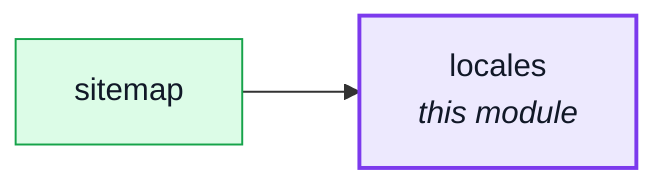
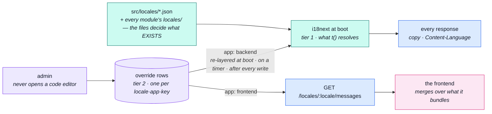

# locales

::: tip At a glance
**Owns** — which languages this deployment speaks, and the runtime overrides layered over the bundled copy.
**Depends on** — nothing. It carries the convenience barrel every module does, but nothing imports it: no sibling needs a translated dictionary directly.
**Breaks if you change** — the `app` field. It decides which of two dictionaries a row patches.
:::

## Its neighbourhood

<!-- module-graph:locales:start -->

_Solid arrows are imports. Dotted arrows are domain events — the return path an import
graph cannot see._

<!-- module-graph:locales:end -->

## The story

This is the subtlest module in the repo, and almost all of the subtlety is one distinction.

**There are two tiers, and they never merge.**

_Tier 1 is the API's own copy_ — `src/locales/*.json` plus every module's `locales/` folder, loaded
into i18next at boot. It is what `t()` resolves, what decides `Content-Language`, and it stays on
the filesystem permanently. It exists so a client can render copy _when no response arrives_, and
putting it behind a database would make it unavailable in exactly the outage it was created for.

_Tier 2 is the overrides_ — the two collections this module owns, edited at runtime by people who do
not open a code editor. One row per `(locale, app, key)`, and `app` says which dictionary it
patches — a keyspace, not a customer: `NODE_LOCALE_APP_BACKEND`/`_FRONTEND` name the two this
deployment starts with, and `NODE_LOCALE_APPS_EXTRA` may add more frontend ones (a mobile app, a
kiosk) that share the same rows and never collide with each other's keys:

| App kind   | Served by                           | Merged where                                                         |
| ---------- | ----------------------------------- | -------------------------------------------------------------------- |
| `frontend` | `GET /locales/:locale/messages`     | the frontend, over what it bundles, key by key                       |
| `backend`  | nothing — never leaves this service | layered over tier 1 at boot, on a timer, and after every admin write |

::: warning Both halves are overrides, never dictionaries
Neither side may introduce a key its files do not already define and expect it to render. **The
files decide what exists; the rows decide what it says.**
:::

::: warning A language in the database does not mean the API can answer in it
`GET /locales` reports `apps` per language rather than a bare list of tags, so "may I send
`Accept-Language: es`" and "may I download a Spanish dictionary" stay two questions. The seeded
scenario (`scenarios/locales.ts`) registers `es` with no `src/locales/es.json` behind it precisely so the answers really are <!-- doc-paths:ignore -->
_no_ and _yes_.
:::

Nothing here is awaited on the request path. Mongo down, a language half-translated, a malformed
key — the worst outcome is one endpoint failing and the overlay going stale, while every other
response still resolves its copy from the files.

## The pipeline

The two tiers, and the two sinks they never share. Follow `app` and the whole module falls out.

Nothing on that diagram is awaited on the request path. Mongo down and the overlay goes stale while
every response still resolves its copy from the files.

## The translations collection

A third axis, unrelated to the two tiers above: not the shop's own UI copy, but content an editor
or anyone holding `update:Translation` writes — a product's `title`, its `description`. This
module owns that collection
too, though nothing about it is a tier — see
[Internationalisation](../tools/i18n.md#tier-3-user-authored-content) for how it composes with tier
1's fallback locale and tier 2's `locales` collection.

One row per `(entityType, entityId, locale)`, unique on that triple
(`translations_entity_locale` in `src/modules/locales/model.ts`), including the fallback-language
row — there is no separate "source" flag, only the row whose `locale` equals the deployment's
fallback locale.

| field          | what it is                                                                                                                                                                                                                              |
| -------------- | --------------------------------------------------------------------------------------------------------------------------------------------------------------------------------------------------------------------------------------- |
| `entityType`   | A `translatables` registry key — `product` in V1, generic beyond it.                                                                                                                                                                    |
| `entityId`     | The translated document's id.                                                                                                                                                                                                           |
| `fields`       | `Record<string, string>` — `{ title, description }` for a product.                                                                                                                                                                      |
| `sourceDigest` | Hash of the fallback row's `fields` at the moment THIS row was translated. Absent on the fallback row itself — it can't be stale relative to its own content. A mismatch means the source changed since; nothing recomputes it on read. |
| `origin`       | `machine` or `human` — what a reviewer would prioritise. No workflow gate behind either: a write is live immediately.                                                                                                                   |
| `translatedBy` | Whoever last wrote the row, for the audit trail.                                                                                                                                                                                        |

`src/modules/locales/services/translations.ts` owns the write path: `planTranslationWrites`
validates a whole PATCH-shaped batch — the locale exists and is `active`, every field name is one
the registry declares for that `entityType` — before anything is written; `writePlannedTranslations`
applies it, and is also the one place that updates an entity's derived index column (its own
`title`/`description`, kept for sort and search only — see [`products`](./products.md)), so that
write can never vary by caller.

### The generic translations door, and why it's not the only one

`GET`/`PUT`/`PATCH /locales/translations/{entityType}/{id}` is generic across whatever
`translatables` declares — words only, any registered entity, and it has no way to touch anything
else about that entity. PUT replaces the whole set (a stored locale the body doesn't name is
deleted, and the fallback locale is required), PATCH merges — the same replace/merge split
`/locales/{locale}/apps/{app}/entries` already uses for its own bulk import. A product also has its own write
surface, [`POST /products` / `PUT`/`PATCH /products/{id}`](./products.md#writing-translated-content),
which writes the SAME rows but alongside price, stock flags and the image, in one request.

Both doors stay, on purpose:

| door                                      | who                                                 | may change a price | generic across entities |
| ----------------------------------------- | --------------------------------------------------- | ------------------ | ----------------------- |
| `/products/{id}`                          | holds `update:Product` **and** `update:Translation` | **yes**            | no — products only      |
| `/locales/translations/{entityType}/{id}` | any holder of `update:Translation`                  | **no**             | yes                     |

Collapsing them would mean handing anyone who may write a word `update:Product` just so a form can
save a title alongside a price — the coupling `Translation` was carved out as its own CASL subject
specifically to avoid. The shipped `editor` role happens to hold both keys, so it reaches both
doors; that is a fact about that role, not about the doors, and a deployment that cuts a words-only
role gets the separation back untouched. The generic door also has to
outlive `product`: the next `translatables` entry — a category description, a CMS page, an email
template — gets no product-shaped write surface of its own.

::: warning A locale slot's three states, on either door
Absent leaves that language's row untouched; a `{ fields, … }` object upserts it; `null` deletes
it. An empty `fields` object is a 422, never treated as a delete, and `null` on the fallback locale
is a 422 too — deleting it would leave the entity with nothing to fall back to.
:::

### What happens when the translated thing goes away

| event                          | what happens to its translation rows                                                                                                                                                                                                                  |
| ------------------------------ | ----------------------------------------------------------------------------------------------------------------------------------------------------------------------------------------------------------------------------------------------------- |
| A product is **soft**-deleted  | Rows survive — a restore must not come back with no name in any language.                                                                                                                                                                             |
| A product is **hard**-deleted  | Rows are removed in the SAME transaction as the product row and its outbox event, through `@kernel/translation`'s port — never via the `product.deleted` event, which fires on both delete paths with an identical payload and can't tell them apart. |
| A language is deleted          | Its rows cascade with it, the way `localeEntrySchema` rows already do (`src/modules/locales/repository.ts`'s `deleteLocaleCascade`), reported back as a count.                                                                                        |
| A language is only deactivated | Nothing — deactivating hides a language, it doesn't retire it.                                                                                                                                                                                        |
| The FALLBACK locale itself     | Cannot be deleted or deactivated (`src/modules/locales/services/languages.ts`'s `rejectFallbackLocale`) — every entity's source row lives in it.                                                                                                      |

## Removing it

Deleting this module does not break the shop — it becomes monolingual. `@kernel/translation`
ships its own fallback: a write naming only `NODE_FALLBACK_LOCALE`'s locale plans a single
upsert straight through, and one naming any other locale, or leaving the fallback slot empty or
deleted, is a 422. Admin overrides, other
languages and `/locales*` are simply absent. A product's own row still carries its `title`/
`description`, since the read path treats no provider as "nothing to overlay," not an error.

## Who can do what

Every rule this module declares and who holds it, role by role. The rule is what a route guard asks for; the set is what a role lists.

<!-- permissions:start -->

| Rule                 | Set                     | `guest` | `unverified` | `customer` | `manager` | `warehouse` | `support` | `editor` | `moderator` | `admin` | `operator` | Credential | What it lets them do                                                                                                                                                                                                           |
| -------------------- | ----------------------- | ------- | ------------ | ---------- | --------- | ----------- | --------- | -------- | ----------- | ------- | ---------- | ---------- | ------------------------------------------------------------------------------------------------------------------------------------------------------------------------------------------------------------------------------ |
| `read:Locale`        | `LocaleStorefront`      | ✅      | ✅           | ✅         | ✅        | ✅          | ✅        | ✅       | ✅          | ✅      | —          | ✅         | Read active locales and their dictionaries — the storefront's own view.                                                                                                                                                        |
| `display:Locale`     | `LocaleDisplay`         | —       | —            | —          | ✅        | —           | —         | ✅       | —           | ✅      | —          | ✅         | Read every locale regardless of publish state — what staff need to see a draft language.                                                                                                                                       |
| `create:Locale`      | `LocaleManagement`      | —       | —            | —          | ✅        | —           | —         | ✅       | —           | ✅      | —          | ✅         | Add a locale.                                                                                                                                                                                                                  |
| `update:Locale`      | `LocaleManagement`      | —       | —            | —          | ✅        | —           | —         | ✅       | —           | ✅      | —          | ✅         | Change a locale or one of its entries.                                                                                                                                                                                         |
| `delete:Locale`      | `LocaleManagement`      | —       | —            | —          | ✅        | —           | —         | ✅       | —           | ✅      | —          | ✅         | Remove a locale or one of its entries.                                                                                                                                                                                         |
| `read:Translation`   | `TranslationDisplay`    | —       | —            | —          | ✅        | —           | —         | ✅       | —           | ✅      | —          | ✅         | Read an entity's translated fields, in the admin shape (every locale at once).                                                                                                                                                 |
| `update:Translation` | `TranslationManagement` | —       | —            | —          | ✅        | —           | —         | ✅       | —           | ✅      | —          | ✅         | Write an entity's translated fields. Never grants a write on the entity itself — that is `update:Product`, and the two are stacked on the product write route precisely so one alone cannot turn a rewording into a repricing. |

✅ held · `own` only the caller’s own rows · ⚡c / ⚡s needs a freshly proved session (critical / sensitive) ·
Credential: ✅ when an API key can be minted with the rule. Generated from the rules and sets in
`src/modules/*/authorization.yaml` and the roles in `shared/authorization-roles.yaml`, asked of the
evaluator — [Authorization](../theory/authorization.md) explains the model.

<!-- permissions:end -->

## Related pages

- [Internationalisation](../tools/i18n.md) — the mechanism both tiers, and the translations collection, run on
- [`products`](./products.md) — the one entity translatable today, and its own write surface
- [Modules overview](./index.md) — the whole context map
- [The Flow Runner](../tools/flow-runner.md) — the seeded languages and which square of the grid each covers
- [Request Input](../theory/request-input.md) — how a locale is negotiated
